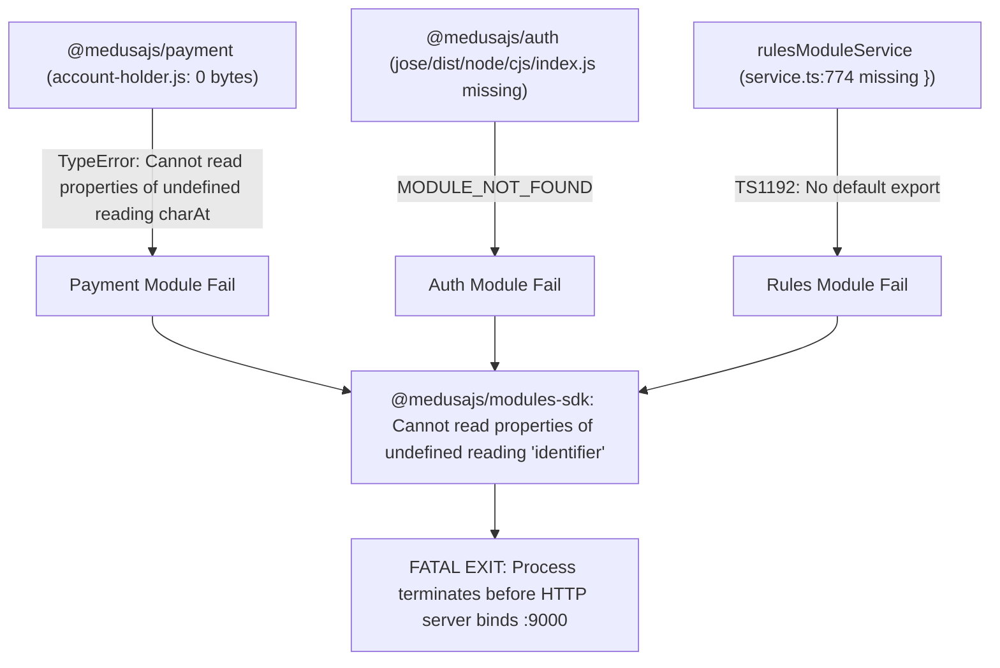

# CAKETOHOME — BACKEND STARTUP BASELINE (PRE-REPAIR)

## Startup Diagnostic Summary

- **Command**: `npm run dev:backend` (`node node_modules/@medusajs/cli/cli.js develop`)
- **Port 9000 Status**: Closed (Connection Refused)
- **Time to Crash**: ~1,200ms
- **Watcher Behavior**: Infinite crash-restart cycle (restarts upon crash, crashes again).

### Failure Cascade Analysis

1. **Root Failure #1**: `@medusajs/payment` model `account-holder.js` is 0 bytes $\rightarrow$ `upperCaseFirst(model.name)` throws `TypeError: Cannot read properties of undefined (reading 'charAt')`.
2. **Root Failure #2**: `@medusajs/auth` requires `jose` $\rightarrow$ `dist/node/cjs/index.js` missing in `jose@4.15.9`.
3. **Root Failure #3**: `backend/src/modules/rules/service.ts:774` missing closing `}` in `logOfferAction`.
4. **Cascading Failure**: `@medusajs/modules-sdk` receives `undefined` module definition and throws `Cannot read properties of undefined (reading 'identifier')`.
