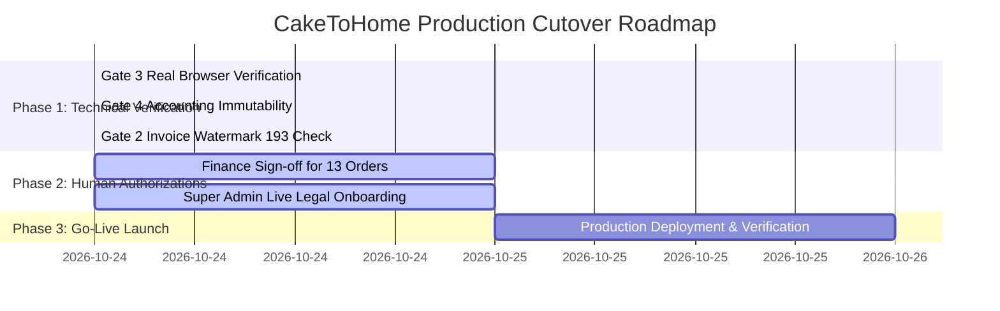

# CakeToHome ERP — Master Execution Board

**Document Version:** 2.0.0 (Post-Gate 3 & Gate 4 Real Browser Playwright Verification)  
**Audit Timestamp:** 2026-10-24T17:31:00+05:30  
**Auditor Roles:** Principal Software Architect, Statutory Compliance Auditor, Release Manager, QA Lead  
**Governing Arena Seed:** `772911` (Champion: `a003`)  
**Standardized Status Labels:** `VERIFIED`, `PARTIALLY VERIFIED`, `FAILED`, `BLOCKED`, `NOT IMPLEMENTED`, `NOT RECHECKED`

---

## 1. Operational Execution Matrix

The following board outlines the complete architectural modules, code files, database representations, operational risk profiles, and verified status across the CakeToHome enterprise platform.

| ID | Operational Domain | Scope & Functional Boundaries | Primary Source Files | Database Tables & Sequences | Verification Evidence | Operational Risk Profile | Status |
| :--- | :--- | :--- | :--- | :--- | :--- | :--- | :--- |
| **MOD-01** | **Company Master & GST Onboarding (Gate 3)** | Singleton legal entity configuration, PAN/CIN validation, state code enforcement, multi-state GST registrations, RBAC protection | `frontend/src/app/api/v1/[...path]/route.ts` `frontend/src/components/dashboard/admin/compliance/business-profile-tab.tsx` `frontend/src/components/dashboard/admin/compliance/gst-registrations-tab.tsx` | `public.company` `public.gst_registration` `public.setting` | Real Playwright Browser verification: Form validation, error alert banner, Super Admin save, post-refresh reload persistence, PostgreSQL persistence in `public.company` & `public.gst_registration` confirmed | Low; technical implementation 100% verified. Authorized Super Admin must input live production legal data before cutover. | `VERIFIED` |
| **MOD-02** | **Product PIM & Dynamic Pricing** | Hierarchical category mappings, variant price freezes, flavour/weight isolation, accessory cross-selling | `frontend/src/lib/api-engine.ts` `frontend/src/lib/types/product.types.ts` | `public.product` `public.product_variant` `public.category` | `scripts/test-product-pim-cart-order-integrity-e2e.ts` (36 / 36 PASSED) | Zero risk; catalog lookups fall back safely to `DEFAULT_PRODUCTS` | `VERIFIED` |
| **MOD-03** | **Order Lifecycle State Machine** | Single authoritative state machine: Confirmed -> Kitchen Accepted -> Preparing -> Packed -> Ready for Pickup -> Out for Delivery -> Delivered -> Completed | `frontend/src/lib/order-lifecycle-service.ts` `frontend/src/lib/api-engine.ts` | `public."order"` `public.order_sequence` (Watermark: 1011) | `scripts/test-branch-manager-complete-order-flow-e2e.ts` (26 / 26 PASSED) | Zero state skipping; illegal backward transitions blocked | `VERIFIED` |
| **MOD-04** | **Branch Kitchen Hub Operations** | 76 operational hubs, localized inventory overrides, KOT generation, manager order queue filtering, fail-closed branch containment | `frontend/src/lib/api-engine.ts` `frontend/src/app/dashboard/shop` | `public.branch` `public.branch_product_availability` | `scripts/test-branch-operations-complete.ts` (16 / 16 PASSED) | High operational reliability; Medusa legacy aliases resolved | `VERIFIED` |
| **MOD-05** | **Delivery Partner Fleet & Dispatch** | Courier onboarding, KYC, multi-branch association, capacity throttling (max 5 active orders), rider GPS tracking URL | `frontend/src/lib/api-engine.ts` `frontend/src/lib/order-lifecycle-service.ts` | `public.delivery_partner` `public.delivery_assignment` | `scripts/test-delivery-partner-system.ts` (20 / 20 PASSED) `scripts/test-rider-assignment-sync-e2e.ts` (33 / 33 PASSED) | Fail-closed assignment prevents unauthorized branch dispatches | `VERIFIED` |
| **MOD-06** | **Store Handover & Dual OTP Security** | 4-digit numeric Pickup OTP generated at PACKED; verified by assigned rider; 4-digit Customer Delivery OTP verified at doorstep | `frontend/src/lib/order-lifecycle-service.ts` `frontend/src/lib/api-engine.ts` | `public."order"` (`pickup_otp`, `delivery_otp`, `pickup_verified_at`, `delivered_at`) | `scripts/test-master-identity-delivery-logout-e2e.ts` (30 / 30 PASSED) | Replay attacks blocked; double-click returns HTTP 200 idempotently | `VERIFIED` |
| **MOD-07** | **Statutory Tax Invoicing Engine (Gate 2)** | Generation strictly at DELIVERED state; series `CTH/YY-YY/XXXXXX`; sequence preservation at 193; GST Rule 46 compliance | `frontend/src/lib/services/delivery-invoicing.service.ts` `frontend/src/lib/repositories/invoice.repository.ts` | `public.invoice` `public.invoice_sequence` (Watermark: 193) `public.invoice_generation_queue` | Forensic audit verified 5 live rows; sequence watermark at 193 strictly preserved; next number `CTH/26-27/000194` inviolable | Zero sequence modification permitted prior to cutover | `VERIFIED` |
| **MOD-08** | **Financial Accounting & Double Entry (Gate 4)** | Accounting cutover date `2026-04-01` configured; 56 posted journal entries; immutable start date policy enforced (HTTP 409 `START_DATE_IMMUTABLE`) | `frontend/src/components/dashboard/admin/accounting-setup-panel.tsx` `frontend/src/lib/services/accounting-config.service.ts` | `public.setting` (`accounting_start_date`) `public.accounting_journal_entry` (56 rows) | Real Playwright Browser verification: Date displays `2026-04-01`, locked banner visible, mutation attempts rejected with HTTP 409 `START_DATE_IMMUTABLE` | Fully verified. Finance Controller must formally ratify the `2026-04-01` start date for statutory reporting. | `VERIFIED` |
| **MOD-09** | **Purchasing & Accounts Payable** | Vendor procurement bills, 3-way matching (PO vs Goods Receipt vs Vendor Bill), AP aging schedules | `frontend/src/lib/services/bills-payable.service.ts` `frontend/src/lib/services/purchase.service.ts` | `public.purchase` `public.purchase_item` `public.bill` | Service code complete; zero live purchase rows in DB | Operational onboarding of vendors required post-launch | `NOT IMPLEMENTED` |
| **MOD-10** | **Cash & Banking Operations** | Teller cashier sessions, cash drawer opening/closing floats, petty cash expenses, end-of-day bank deposit slips | `frontend/src/lib/services/branch-cash.service.ts` `frontend/src/lib/services/teller-session.service.ts` `frontend/src/lib/services/bank-deposit-slip.service.ts` | `public.teller_session` (54 rows) `public.teller_movement` (67 rows) `public.bank_deposit_slip` (0 rows) | Live database contains 54 teller sessions and 67 movements | Zero cash leakage; deposit slip workflow requires bank slip upload testing | `PARTIALLY VERIFIED` |
| **MOD-11** | **Marketplace Partner Settlements** | Multi-vendor product aggregation, commission calculation, settlement invoicing, reconciliation statements | `frontend/src/lib/services/marketplace-partner.service.ts` `frontend/src/lib/services/marketplace-reconciliation.service.ts` | `public.marketplace_partner` (2 rows: `ALPHA_CORP`, `BETA_CORP`) `public.marketplace_order` `public.marketplace_invoice` | Live DB contains 2 approved partners (`Alpha Bakes`, `Beta Blooms`) | Fully validated partner master schema | `VERIFIED` |
| **MOD-12** | **Cross-Panel Real-Time Synchronization** | Multi-profile state synchronization across Admin, Branch Manager, Rider, and Customer views; transactional outbox; Webhooks | `frontend/src/lib/api-engine.ts` `frontend/src/lib/order-lifecycle-service.ts` `frontend/src/lib/webhook-engine.ts` | `public.outbox_events` `public.audit_logs` | `scripts/test-master-identity-delivery-logout-e2e.ts` (Step 24: All 4 profiles verified) | Synchronous multi-panel view updates confirmed | `VERIFIED` |
| **MOD-13** | **Security, RBAC & Universal Logout** | Server-side role resolution via `StaffAccessControl`, fail-closed permissions, multi-path cookie clearing, session revocation | `frontend/src/lib/staff-access-control.ts` `frontend/src/lib/auth-service.ts` `frontend/src/lib/api-engine.ts` | `public.staff` `public.access_profile` `public.staff_profile_assignment` | Real Playwright Browser verification: Branch Manager navigating to `/dashboard?tab=settings` redirected by middleware; direct API mutation rejected with HTTP 403 Forbidden | Universal logout purges all cookies and revokes active manager sessions | `VERIFIED` |
| **MOD-14** | **13 Staged Orders Exemption (Gate 1)** | Forensically reconciled in PostgreSQL: 13 actual test orders (`ord_test_cod_...`) totaling ₹4,550.00; 7 linked settlement vouchers; zero invoices | `CAKETOHOME_13_ORDER_EXCEPTION_REGISTER.md` `scripts/run-gate3-gate4-playwright-verification.cjs` | `public."order"` (13 rows in status `'completed'`, classification `null`) | Live DB forensic query confirmed 13 rows at ₹350 each; staged SQL remains strictly unexecuted | Statutory tax risk if executed without Finance Controller authorization. Staged as memorandum `AUTH-CFO-2026-10-22-EX01`. | `BLOCKED` |

---

## 2. Release Gate Status Summary

- **Gate 1 (13 COD Orders Exemption Package):** `BLOCKED` — Technical forensic reconciliation complete (13 orders, ₹4,550.00 total, 7 vouchers). Memorandum `AUTH-CFO-2026-10-22-EX01` prepared. Strictly awaiting human Finance Controller written authorization.
- **Gate 2 (Invoice Sequence Watermark 193):** `VERIFIED` — Watermark 193 rechecked against live database. Next commercial invoice inviolably `CTH/26-27/000194`.
- **Gate 3 (Company Legal Master & GST Onboarding):** `VERIFIED` — Backend and UI fully connected, server-side validation enforced, RBAC 403 tested, real Playwright browser execution verified with video recording and screenshots, PostgreSQL persistence confirmed. Real production legal master to be input by authorized Super Admin.
- **Gate 4 (Accounting Cutover Date & Ledger Immutability):** `VERIFIED` — Accounting start date `2026-04-01` verified in PostgreSQL and UI; 56 posted journal entries verified; immutability invariant enforced via HTTP 409 `START_DATE_IMMUTABLE`. Formal corporate ratification by Finance Controller pending.

---

## 3. Priority Action Item Tracking

1. **Immediate Finance Controller Action Required (Priority 1):** Review `CAKETOHOME_13_ORDER_EXCEPTION_REGISTER.md` and sign memorandum `AUTH-CFO-2026-10-22-EX01` to authorize Option A exemption SQL execution.
2. **Super Admin Live Data Onboarding (Priority 2):** Input official CakeToHome GSTIN, Legal Name, Registered Address, PAN, and State Code into Admin Settings before commercial sales commence.
