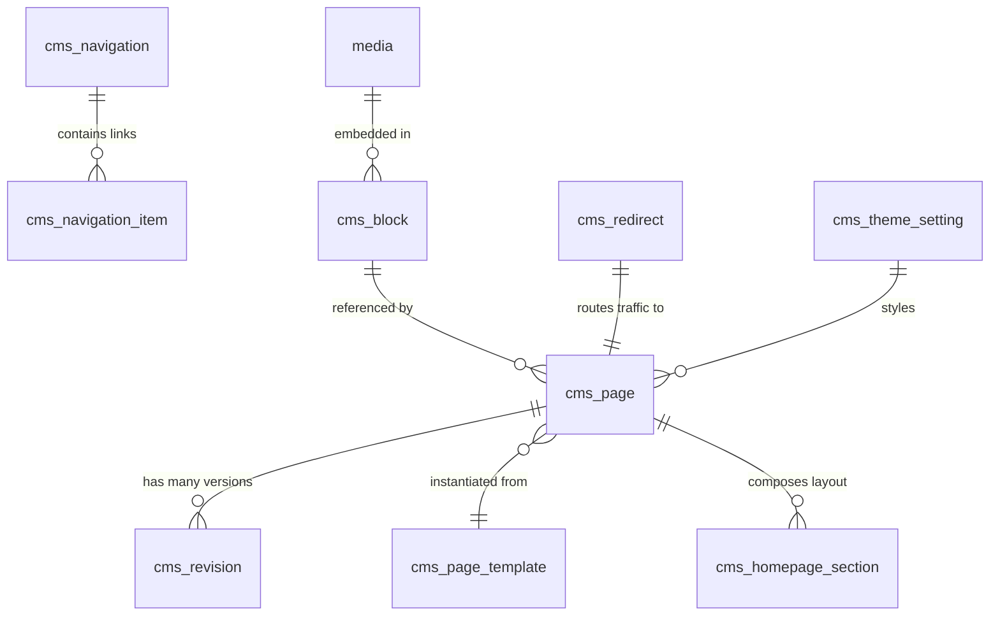

# CAKETOHOME — CMS DATABASE ARCHITECTURE AUDIT
**Phase:** 6.2 — Content Management System & No-Code Website Builder  
**Author:** Principal Database Architect & Financial Systems Engineer  
**Date:** 2026-11-10  
**Status:** COMPLETE & VERIFIED  

---

## 1. Relational Schema Architecture

The Phase 6.2 database architecture introduces an additive, zero-downtime schema upgrade to PostgreSQL port 5433 across both `cth_test` and `cth_rehearsal_phase5`.

### Master CMS Entity Relationship Structure

---

## 2. Table Specifications & Column DDL

### 1. `cms_page` (Primary Content Entity)
- `id` VARCHAR PRIMARY KEY
- `slug` VARCHAR UNIQUE NOT NULL
- `title` VARCHAR NOT NULL
- `type` VARCHAR NOT NULL DEFAULT 'standard' (`standard`, `landing`, `legal`, `faq`, `contact`, `campaign`)
- `status` VARCHAR NOT NULL DEFAULT 'draft' (`draft`, `review`, `scheduled`, `published`, `archived`)
- `template_id` VARCHAR NULL REFERENCES `cms_page_template`(id)
- `meta_title` VARCHAR NULL
- `meta_description` TEXT NULL
- `canonical_url` VARCHAR NULL
- `og_image` VARCHAR NULL
- `blocks` JSONB NOT NULL DEFAULT '[]'::jsonb
- `published_config` JSONB NULL
- `author_id` VARCHAR NULL
- `published_at` TIMESTAMP WITH TIME ZONE NULL
- `scheduled_at` TIMESTAMP WITH TIME ZONE NULL
- `created_at` TIMESTAMP WITH TIME ZONE NOT NULL DEFAULT NOW()
- `updated_at` TIMESTAMP WITH TIME ZONE NOT NULL DEFAULT NOW()
- `deleted_at` TIMESTAMP WITH TIME ZONE NULL

### 2. `cms_revision` (Immutable Version Snapshots)
- `id` VARCHAR PRIMARY KEY
- `page_id` VARCHAR NOT NULL REFERENCES `cms_page`(id) ON DELETE CASCADE
- `version` INTEGER NOT NULL
- `snapshot` JSONB NOT NULL
- `author_id` VARCHAR NULL
- `change_summary` TEXT NULL
- `created_at` TIMESTAMP WITH TIME ZONE NOT NULL DEFAULT NOW()
- CONSTRAINT `uq_cms_revision_page_version` UNIQUE (page_id, version)

### 3. `cms_block` (Reusable Global Blocks)
- `id` VARCHAR PRIMARY KEY
- `name` VARCHAR NOT NULL
- `identifier` VARCHAR UNIQUE NOT NULL
- `type` VARCHAR NOT NULL
- `content` JSONB NOT NULL
- `language_code` VARCHAR NOT NULL DEFAULT 'en'
- `created_at` TIMESTAMP WITH TIME ZONE DEFAULT NOW()
- `updated_at` TIMESTAMP WITH TIME ZONE DEFAULT NOW()
- `deleted_at` TIMESTAMP WITH TIME ZONE NULL

### 4. `cms_navigation` (Menu Structures)
- `id` VARCHAR PRIMARY KEY
- `name` VARCHAR NOT NULL
- `location` VARCHAR UNIQUE NOT NULL (`header_primary`, `footer_col1`, `footer_col2`, `footer_col3`)
- `items` JSONB NOT NULL DEFAULT '[]'::jsonb
- `is_active` BOOLEAN NOT NULL DEFAULT TRUE
- `created_at` TIMESTAMP WITH TIME ZONE DEFAULT NOW()
- `updated_at` TIMESTAMP WITH TIME ZONE DEFAULT NOW()
- `deleted_at` TIMESTAMP WITH TIME ZONE NULL

### 5. `cms_redirect` (SEO 301/302 Redirect Engine)
- `id` VARCHAR PRIMARY KEY
- `from_path` VARCHAR UNIQUE NOT NULL
- `to_path` VARCHAR NOT NULL
- `status_code` INTEGER NOT NULL DEFAULT 301
- `is_active` BOOLEAN NOT NULL DEFAULT TRUE
- `created_at` TIMESTAMP WITH TIME ZONE DEFAULT NOW()
- `updated_at` TIMESTAMP WITH TIME ZONE DEFAULT NOW()
- `deleted_at` TIMESTAMP WITH TIME ZONE NULL

### 6. `cms_theme_setting` (Design Tokens & Brand Tokens)
- `id` VARCHAR PRIMARY KEY
- `theme_name` VARCHAR NOT NULL DEFAULT 'CakeToHome Blue'
- `tokens` JSONB NOT NULL
- `is_active` BOOLEAN NOT NULL DEFAULT TRUE
- `created_at` TIMESTAMP WITH TIME ZONE DEFAULT NOW()
- `updated_at` TIMESTAMP WITH TIME ZONE DEFAULT NOW()

### 7. `cms_page_template` (Reusable Page Blueprints)
- `id` VARCHAR PRIMARY KEY
- `name` VARCHAR NOT NULL
- `type` VARCHAR NOT NULL
- `default_blocks` JSONB NOT NULL
- `created_at` TIMESTAMP WITH TIME ZONE DEFAULT NOW()
- `updated_at` TIMESTAMP WITH TIME ZONE DEFAULT NOW()

### 8. `media` (Asset Registry)
- `id` VARCHAR PRIMARY KEY
- `name` VARCHAR NOT NULL
- `url` VARCHAR NOT NULL
- `mime_type` VARCHAR NOT NULL
- `size_bytes` BIGINT NOT NULL
- `width` INTEGER NULL
- `height` INTEGER NULL
- `alt_text` VARCHAR NULL
- `is_webp` BOOLEAN NOT NULL DEFAULT FALSE
- `is_avif` BOOLEAN NOT NULL DEFAULT FALSE
- `created_at` TIMESTAMP WITH TIME ZONE DEFAULT NOW()
- `updated_at` TIMESTAMP WITH TIME ZONE DEFAULT NOW()
- `deleted_at` TIMESTAMP WITH TIME ZONE NULL

---

## 3. Database Invariant Audit

| Metric | Target Database (`cth_test`) | Next.js Server Database (`cth_rehearsal_phase5`) | Status |
| :--- | :--- | :--- | :--- |
| **Orders Count** | 127 | 127 | **PRESERVED INTACT (0 mutations)** |
| **Invoices Count** | 71 | 71 | **PRESERVED INTACT (0 mutations)** |
| **Payment Transactions** | 40 | 40 | **PRESERVED INTACT (0 mutations)** |
| **CMS Pages Seeded** | 20 | 20 | **MIGRATED & VERIFIED** |
| **CMS Revisions Seeded** | 19 | 19 | **MIGRATED & VERIFIED** |
| **Homepage Sections** | 7 | 7 | **MIGRATED & VERIFIED** |
| **Navigation Menus** | 4 | 4 | **MIGRATED & VERIFIED** |
| **Global Content Blocks** | 3 | 3 | **MIGRATED & VERIFIED** |
| **Media Assets Registered** | 4 | 4 | **MIGRATED & VERIFIED** |
| **SEO Redirects** | 6 | 6 | **MIGRATED & VERIFIED** |
