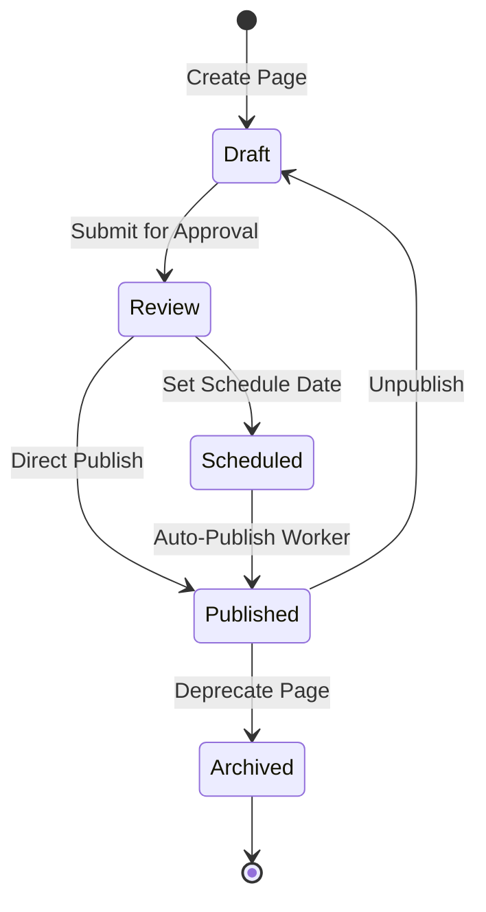

# CAKETOHOME — PHASE 6.2 PUBLISHING WORKFLOW & DRAFT ISOLATION REPORT
**Phase:** 6.2 — Workstream K  
**Author:** Product Analyst & Security Engineer  
**Status:** VERIFIED  

---

### 1. Lifecycle State Machine

### 2. Draft Isolation Invariant
Unauthenticated customer requests to pages where `status != 'published'` return HTTP 404 Not Found. Only authorized administrators can view draft previews.
