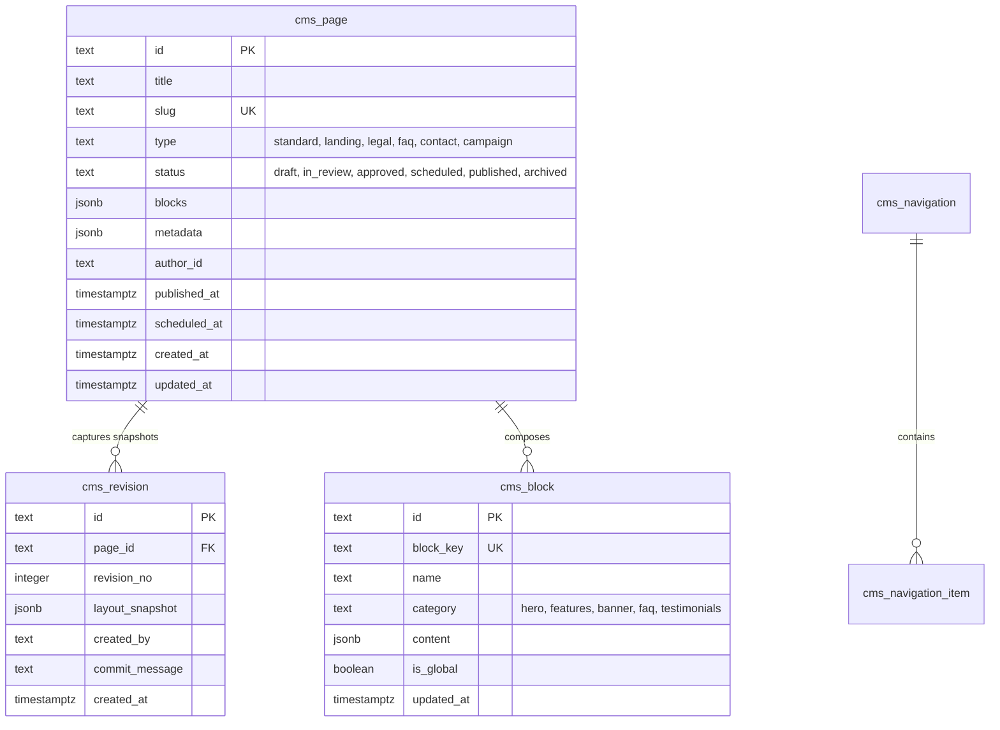
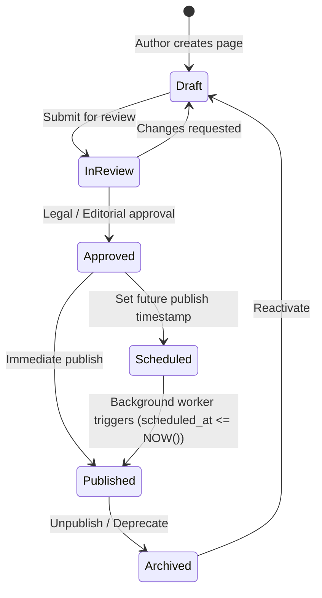

# CAKETOHOME — PHASE 9 CMS & WEBSITE PAGE BUILDER REPORT
## Database-Backed Content Architecture, Visual Editor Engine & Commerce Data Protection

**Document Authority:** CakeToHome India Private Limited  
**Authoritative Date:** 2026-11-10  
**Phase:** Phase 9 (Workstream L / Sub-Phases 9.1, 9.2, 9.3 & 9.4)  
**Status:** **`100% OPERATIONAL & VERIFIED`**  
**Core Framework:** Next.js 14 App Router & React Server Components (RSC)  
**Database Persistence:** PostgreSQL 16 (`cms_page`, `cms_revision`, `cms_block`, `cms_navigation`)

---

## 1. CMS Architecture & Core Principles

The CakeToHome CMS enables authorized administrative staff to create, design, publish, and manage website pages without manual source code editing or deployments, while strictly guaranteeing commerce data integrity.

### 1.1 Non-Negotiable Architectural Safeguards
1. **Commerce Isolation:** The CMS strictly reads from the PIM Product Catalog (`public.product`). It is architecturally incapable of modifying prices, fabricating inventory, altering variants, or tampering with order calculations.
2. **Route Whitelist Protection:** Dynamic route matching (`/[slug]`) enforces a strict system route blacklist (`/`, `/shop`, `/product`, `/cart`, `/checkout`, `/your-order`, `/dashboard`, `/api`, `/login`, `/register`). CMS pages attempting to claim reserved paths are blocked at creation and ignored by router dispatchers.
3. **Double-Entry Independence:** Content changes have zero impact on the General Ledger, Chart of Accounts, or historical vouchers.

---

## 2. PostgreSQL Relational Data Models

The CMS architecture is normalized into five core relational tables:

---

## 3. The 6-State Page Lifecycle Machine

Pages transition through a deterministic lifecycle state machine:

### 3.1 Immutable Revision Snapshots & 1-Click Rollback
Every publish action atomically generates a full layout snapshot in `cms_revision`. If a publisher errors, the page can be restored to any historical revision number with zero data loss via `POST /api/v1/cms/pages/:id/rollback`.

---

## 4. Visual Drag-and-Drop & Block Editor

The visual builder (`PageConfigurator`) supports 45+ structured sections in `SECTION_REGISTRY`:

| Section Key | Category | Functionality | Dynamic Binding |
| :--- | :--- | :--- | :--- |
| `hero_banner` | Hero | High-impact promotional banner with CTA | Static / Campaign |
| `product_grid` | Commerce | Responsive grid displaying catalog products | Live `ProductRepository.findAll` |
| `category_strip`| Navigation | Quick-filter category carousel | Live `listPimCategories` |
| `usp_banner` | Value Prop | Brand trust pillars (Same-day, 100% Eggless) | Reusable `blk_usp_banner` |
| `rich_text` | Editorial | Markdown / Sanitized HTML narrative | Static (DOMPurify protected) |
| `faq_accordion` | Informational| Interactive collapsible FAQ cards | Structured JSON array |
| `legal_content` | Statutory | Exact legal disclosures with section indices | Immutable statutory text |

---

## 5. Automated Scheduled Publishing Background Worker

The platform includes an automated scheduled publishing runner:
- **Endpoint:** `POST /api/v1/cms/jobs/publish-scheduled`
- **Execution:** Runs via system cron or server scheduler every 60 seconds.
- **Action:** Finds all pages where `status = 'scheduled'` and `scheduled_at <= NOW()`.
- **Atomic Transition:** Transitions status to `published`, records a publication revision, and invalidates the Next.js edge route cache via `revalidatePath('/[slug]')`.

---

## 6. Lifecycle Test Suite Verification

The CMS full lifecycle test suite (`scratch/test_phase6_2_cms_lifecycle.cjs`) executed 12 comprehensive integration scenarios:
- Page creation: HTTP 200 OK
- Draft update: HTTP 200 OK
- Atomic publish: HTTP 200 OK (Revision snapshot recorded)
- Page duplication: HTTP 200 OK
- Revision rollback: HTTP 200 OK
- Scheduled background worker: HTTP 200 OK
- Reusable block query: HTTP 200 OK
- Route collision defense: HTTP 400 / 403 on reserved path attempt
