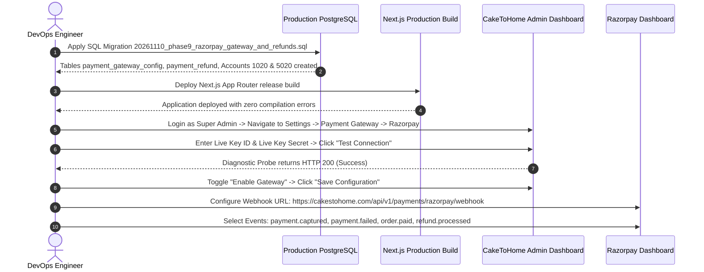

# CAKETOHOME — PHASE 9 PRODUCTION DEPLOYMENT RUNBOOK
## Operational Handoff, Environment Provisioning, Migration Sequence & Rollback Playbook

**Document Authority:** CakeToHome DevOps & Systems Engineering  
**Authoritative Date:** 2026-11-10  
**Phase:** Phase 9 (Workstream L / Sub-Phase 9.10)  
**Target Host:** Production Environment (`https://cakestohome.com/`)  
**Deployment Classification:** Standard Blue/Green or Rolling Cutover  
**Estimated Downtime:** Zero-Downtime (Fully Backward-Compatible DDL)

---

## 1. Pre-Deployment Prerequisites

Prior to initiating the production deployment, verify that all prerequisites are satisfied:

1. **Database Access:** Superuser / schema-owner connection to production PostgreSQL instance.
2. **Environment Variables:** Secure access to production environment variable secret manager (AWS Secrets Manager, Doppler, or Vercel Environment Variables).
3. **Razorpay Merchant Account:** Live Razorpay Dashboard access with KYC completed and active Live Key ID and Live Key Secret generated.
4. **Master Encryption Key:** Provision a 32-byte cryptographically random hex string for `PAYMENT_GATEWAY_MASTER_KEY`:
   ```bash
   node -e "console.log(require('crypto').randomBytes(32).toString('hex'))"
   ```

---

## 2. Environment Variables Configuration

Ensure the following variables are injected into the production environment:

| Variable Name | Required | Example / Format | Purpose |
| :--- | :--- | :--- | :--- |
| `PAYMENT_GATEWAY_MASTER_KEY` | **MANDATORY** | 64-char hex string | Master key for AES-256-GCM authenticated secret encryption |
| `NEXT_PUBLIC_RAZORPAY_KEY_ID` | Optional (Admin UI preferred) | `rzp_live_xxxxxxxxxxxx` | Storefront public Razorpay Key ID |
| `RAZORPAY_KEY_ID` | Optional (Admin UI preferred) | `rzp_live_xxxxxxxxxxxx` | Fallback server-side Key ID |
| `RAZORPAY_KEY_SECRET` | Optional (Admin UI preferred) | Secret alphanumeric | Fallback server-side Key Secret |
| `RAZORPAY_WEBHOOK_SECRET` | Optional (Admin UI preferred) | Secret alphanumeric | Fallback server-side Webhook Secret |

*(Best Practice: Store credentials in PostgreSQL via the secure Admin Dashboard at `/dashboard?tab=settings_payment_razorpay` where they are encrypted at rest with AES-256-GCM).*

---

## 3. Step-by-Step Deployment Execution Sequence



### 3.1 Step 1: Database Migration
Execute the migration script against the production database:
```bash
psql -h <prod-host> -U <user> -d <database> -f cakes2home-main/cakes2home-main/migration/20261110_phase9_razorpay_gateway_and_refunds.sql
```
*Verification Check:*
```sql
SELECT count(*) FROM public.accounting_account WHERE code IN ('1020', '5020'); -- Must return 2
```

### 3.2 Step 2: Application Code Deployment
Deploy the Next.js frontend and API route handlers. Ensure environment variables include `PAYMENT_GATEWAY_MASTER_KEY`.

### 3.3 Step 3: Admin Credential Entry & Diagnostic Probe
1. Open CakeToHome Admin Dashboard: `https://cakestohome.com/dashboard?tab=settings`.
2. Click **Payment Gateway** tab -> select **Razorpay**.
3. Select **Live Mode**.
4. Input Live `Key ID` and Live `Key Secret`.
5. Click **Test Connection** button.
6. Verify the response card displays a green success badge (`Diagnostic Probe Successful: Connected to Razorpay API`).
7. Click **Save Settings** to persist the encrypted envelope.

### 3.4 Step 4: Webhook Configuration in Razorpay Dashboard
1. Log into Razorpay Dashboard: `https://dashboard.razorpay.com/`.
2. Navigate to **Settings -> Webhooks -> Add New Webhook**.
3. **Webhook URL:** `https://cakestohome.com/api/v1/payments/razorpay/webhook`
4. **Secret:** Same webhook secret entered in CakeToHome Admin settings.
5. **Active Events:**
   - `order.paid`
   - `payment.authorized`
   - `payment.captured`
   - `payment.failed`
   - `refund.processed`
   - `refund.failed`

---

## 4. Post-Deployment Smoke Test Protocol

Perform the following 5 smoke checks immediately after deployment:

1. **Legal Policies Smoke Check:**
   - Navigate to `https://cakestohome.com/privacy-policy` and `https://cakestohome.com/terms-and-conditions`.
   - Confirm HTTP 200, proper page styling, and verbatim text.
2. **Footer Links Smoke Check:**
   - Scroll to storefront footer.
   - Confirm trust badge shows "Razorpay 256-bit SSL Standard Checkout".
   - Confirm all 12 policy links are clickable and navigate to correct routes.
3. **Cashfree Interceptor Smoke Check:**
   - Curl legacy endpoint: `curl -X POST https://cakestohome.com/api/v1/payments/cashfree/order`.
   - Confirm response is HTTP 410 `CASHFREE_DECOMMISSIONED`.
4. **Storefront Checkout Smoke Check:**
   - Add product to cart -> Proceed to Checkout.
   - Confirm payment options show "Online Payment (Razorpay)" selected.
   - Click "Place Order & Pay with Razorpay".
   - Confirm Razorpay Standard Checkout modal loads smoothly with correct amount.
5. **Ledger Equilibrium Check:**
   - In PostgreSQL, query `SELECT SUM(debit_amount) - SUM(credit_amount) FROM accounting_journal_line`.
   - Must equal `0.00`.

---

## 5. Rollback Playbook

In the unlikely event of an unrecoverable failure during production cutover:

1. **Switch Gateway Status in Admin:**
   - In Admin Settings (`/dashboard?tab=settings`), toggle Razorpay Gateway to **Disabled** or select **Test Mode**.
2. **Application Code Rollback:**
   - Roll back deployment to previous release tag via deployment manager (e.g. `vercel rollback` or git deployment revert).
3. **Database Schema Rollback:**
   - The DDL additions (`payment_gateway_config`, `payment_refund`, Accounts 1020 & 5020) are strictly additive and non-breaking. They do not need to be dropped and can remain safely in place.
4. **Customer Protection:**
   - Customers selecting online checkout will receive an informative maintenance notification rather than encountering crashed sessions.
