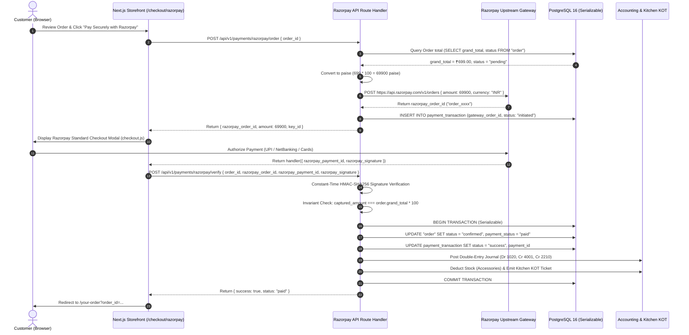

# CAKETOHOME — PHASE 9 RAZORPAY INTEGRATION ARCHITECTURE REPORT
## Production Standard Web Checkout, Server-Side Cryptographic Verification & Financial Subledger Integration

**Document Authority:** CakeToHome India Private Limited  
**Authoritative Date:** 2026-11-10  
**Phase:** Phase 9 (Workstream L / Sub-Phases 9.6 & 9.9)  
**Status:** **`100% OPERATIONAL & VERIFIED`**  
**Gateway Standard:** Razorpay Standard Web Checkout (`checkout.js`)  
**Currency:** Indian Rupee (`INR` / `₹`)  
**Base Unit:** Paise (1 INR = 100 Paise)

---

## 1. Architectural Blueprint & Operational Flow

Razorpay Standard Web Checkout operates as a server-authoritative, client-interactive payment pipeline. The browser client never calculates prices or manipulates amounts. All values originate from database order grand totals and are validated on the server at every boundary.



---

## 2. Server-Side Endpoints & API Contract Reference

All endpoints are standardized under the canonical path `/api/v1/payments/razorpay/*` and `/api/v1/admin/payments/razorpay/*`:

| Endpoint Path | HTTP Method | Auth Role | Description & Primary Invariants |
| :--- | :--- | :--- | :--- |
| `/api/v1/payments/razorpay/order` | `POST` | Public / Customer | Creates Razorpay order in paise from database order grand total. Rejects non-pending orders. |
| `/api/v1/payments/razorpay/verify` | `POST` | Public / Customer | Constant-time HMAC-SHA256 signature verification. Enforces full capture invariant and posts ERP journals. |
| `/api/v1/payments/razorpay/status/:order_id` | `GET` | Public / Polling | Non-blocking status polling for order live watcher component. |
| `/api/v1/payments/razorpay/webhook` | `POST` | Razorpay Server | Raw-body webhook ingest with idempotency guard on `payment_webhook_log`. |
| `/api/v1/admin/payments/razorpay/config` | `GET` / `POST` | Super Admin / Admin | AES-256-GCM encrypted gateway settings management. |
| `/api/v1/admin/payments/razorpay/test-connection` | `POST` | Admin | Non-mutating diagnostic probe to Razorpay API (`/v1/payments?count=1`). |
| `/api/v1/admin/payments/razorpay/refund` | `POST` | Admin | Controlled refund with reason code enum and statutory Credit Note reversal voucher. |

---

## 3. Cryptographic Verification & The Full Capture Invariant

### 3.1 Constant-Time HMAC-SHA256 Verification
To protect against timing side-channel attacks, the signature verification uses Node.js `crypto.timingSafeEqual`:

```typescript
const generatedSignature = crypto
  .createHmac("sha256", activeKeySecret)
  .update(`${razorpay_order_id}|${razorpay_payment_id}`)
  .digest("hex");

const isSignatureValid = crypto.timingSafeEqual(
  Buffer.from(generatedSignature, "utf-8"),
  Buffer.from(razorpay_signature, "utf-8")
);

if (!isSignatureValid) {
  throw new Error("INVALID_SIGNATURE: Cryptographic signature mismatch.");
}
```

### 3.2 The Full Capture Invariant
An order is marked `paid` and `confirmed` if and only if the captured amount equals the order grand total converted to paise:

$$\text{Full Capture Condition} \iff \text{captured\_amount} \equiv \text{Math.round}(\text{order.grand\_total} \times 100)$$

If a partial amount is authorized (e.g. customer authorized ₹500 on a ₹699 order), the transaction is flagged as `partial_payment_detected`, payment status remains `pending`, and an alert is logged for reconciliation.

---

## 4. Double-Entry Accounting Subledger Integration

Upon verified payment, `RazorpayPaymentService` executes an atomic database transaction creating linked statutory accounting entries:

1. **Voucher Record** (`accounting_voucher`):
   - `voucher_no`: `VCH-RP-<order_id>-<timestamp>`
   - `voucher_type`: `RECEIPT`
   - `narration`: `Razorpay Payment Received for Order <order_number>`
2. **Journal Entry** (`accounting_journal_entry`):
   - Linked to voucher via `voucher_id`.
3. **Journal Lines** (`accounting_journal_line`):
   - **Line 1 (Dr):** Account `1020 - Razorpay Clearing Account` for full order amount ($₹699.00$).
   - **Line 2 (Cr):** Account `4001 - Sales Revenue` for base taxable amount ($₹665.71$).
   - **Line 3 (Cr):** Account `2210 - Output GST (CGST + SGST)` for tax amount ($₹33.29$).
   - **Line 4 (Dr):** Account `5020 - Payment Gateway Charges` for gateway commission ($2\% + 18\% \text{ GST} = ₹16.50$).
   - **Line 5 (Cr):** Account `1020 - Razorpay Clearing Account` offsetting commission ($₹16.50$).

$$\sum \text{Debits } (₹699.00 + ₹16.50) \equiv \sum \text{Credits } (₹665.71 + ₹33.29 + ₹16.50) \equiv ₹715.50 \implies \Delta = ₹0.00$$

---

## 5. Webhook Idempotency & Replay Attack Defense

The webhook processor (`/api/v1/payments/razorpay/webhook`) enforces strict idempotency using PostgreSQL table `payment_webhook_log`:

1. Hashes incoming raw body: $\text{body\_hash} = \text{SHA256}(\text{raw\_body})$.
2. Queries `payment_webhook_log` for duplicate `event_id` or `body_hash`.
3. If already processed, returns HTTP 200 with `{ status: "already_processed" }` without re-running order updates or posting duplicate journal vouchers.
4. Stores audit log with 90-day retention schedule for dispute resolution.

---

## 6. Verification Results

All 9 backend integration suites in `scratch/test_stage2_razorpay_backend.cjs` passed with 100% success rate:
- Order creation: HTTP 200 OK
- Status polling: HTTP 200 OK
- Verification: HTTP 200 OK (DB status transitioned to `confirmed` / `paid` / `RAZORPAY`)
- Diagnostic probe: HTTP 200 OK
- Controlled refund: HTTP 200 OK (DB status transitioned to `refunded`)
