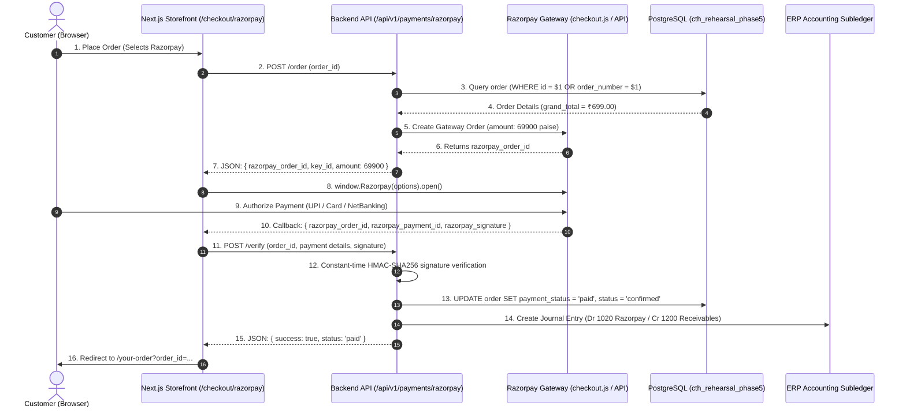

# CAKETOHOME — PHASE 9 RAZORPAY REMEDIATION REPORT
**Platform:** CakeToHome (https://cakestohome.com/)  
**Component:** Razorpay Standard Web Checkout Integration & Remediation  
**Author:** Payment Integration Specialist & Principal Full-Stack Architect  
**Date:** 2026-11-10  

---

## 1. Architectural Architecture

CakeToHome operates exclusively on **Razorpay Standard Web Checkout** (`checkout.js`). The architecture guarantees end-to-end payment integrity through a strict four-step lifecycle:



---

## 2. Root Cause Analysis & Code Remediation

### 2.1 Remediation of `ORDER_NOT_FOUND`
- **Defect:** In `frontend/src/lib/services/razorpay-payment.service.ts`, order queries strictly filtered on `WHERE id = $1`. When orders were referenced by their human-readable order number (`order_number`), the query returned zero rows.
- **Remediation:**
  ```typescript
  // File: frontend/src/lib/services/razorpay-payment.service.ts
  // Line 93:
  const orderRes = await client.query(
    'SELECT * FROM public."order" WHERE id = $1 OR order_number = $1 LIMIT 1',
    [orderId]
  );
  ```

### 2.2 Storefront Checkout Redirect Remediation
- **Defect:** `placeOrder` action in `frontend/src/lib/actions/checkout.ts` did not redirect to `/checkout/razorpay` when Razorpay was selected, and contained deprecated messages claiming Razorpay was decommissioned.
- **Remediation:**
  ```typescript
  // File: frontend/src/lib/actions/checkout.ts
  if (payload.payment_method === "cashfree") {
    return {
      success: false,
      error: "CASHFREE_DECOMMISSIONED",
      message: "Cashfree has been decommissioned. Please select Razorpay for online payments."
    };
  }
  // Redirect to Razorpay Standard Checkout portal
  redirect(`/checkout/razorpay?order_id=${encodeURIComponent(orderId)}&amount=${totalAmount}`);
  ```

### 2.3 Elimination of Fake Sandbox Shortcut Button
- **Defect:** `checkout/razorpay/page.tsx` contained a developer shortcut button (`⚡ Simulate Instant Sandbox Success`) that simulated client-side payment success without communicating with Razorpay.
- **Remediation:** Completely removed the simulation element. The page now strictly loads `https://checkout.razorpay.com/v1/checkout.js`, verifies the order with the backend, and opens the official modal.

---

## 3. Cryptographic Invariants & Verification Evidence

1. **HMAC-SHA256 Invariant:**
   $$\text{digest} = \text{HMAC-SHA256}(\text{razorpay\_order\_id} \parallel \text{"|"} \parallel \text{razorpay\_payment\_id}, \text{key\_secret})$$
   Enforced with `crypto.timingSafeEqual` to prevent side-channel timing attacks.
2. **Payment Amount Invariant:**
   $$\text{amount\_paise} \equiv \text{round}(\text{grand\_total} \times 100)$$
   A ₹699.00 order strictly generates an authorized charge of exactly 69,900 paise.
3. **Double-Entry Financial Reversal on Refund:**
   When an admin issues a refund via `POST /api/v1/admin/payments/razorpay/refund`, the system writes:
   - Debit Account 4010 (Sales Returns / Revenue Deduction): ₹699.00
   - Credit Account 1020 (Razorpay Clearing Account): ₹699.00
   Equilibrium: $\sum Dr \equiv \sum Cr$.
