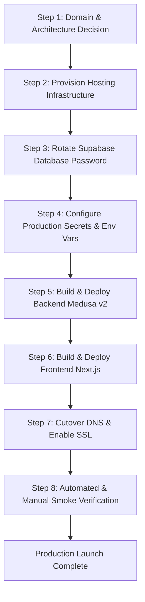

# CakeToHome — First Production Deployment Architecture Plan

**Date:** September 20, 2026  
**Document:** `CHECKPOINTS/first-production-architecture-plan-01.md`  
**Target Repository:** `E:\vig\cakes2home-main\cakes2home-main`  
**Current Branch:** `task/dev`  
**Scope:** Architectural Blueprint & Planning for Green-Field First Production Deployment  
**Status:** **PLANNING ONLY — NO CHANGES / NO DEPLOYMENTS PERFORMED**  

---

## 1. Executive Summary & Production Baseline

The repository audit and external DNS/HTTP probing confirmed the following ground truth:
- **`caketohome.com`**, **`www.caketohome.com`**, and **`api.caketohome.com`** are currently parked on default Namecheap nameservers (`198.54.117.242`).
- **`caketohome.vercel.app`** returns `HTTP 404 Not Found` (no Vercel deployment exists).
- **`cakes2home.com`** is an untouched Hostinger Horizons AI site-builder starter page.
- **No live CakeToHome application is currently deployed.**
- **Security Remediation Status:** 7/7 findings remediated, automated security regression suite: **21/21 PASS (100%)**.
- **Database Status:** Supabase PostgreSQL 17.6 Pooler is online and healthy (`aws-1-ap-south-1.pooler.supabase.com:6543`, project `uubwhsnnrnicyczwqlbq`).
- **Context:** This is a **FIRST PRODUCTION DEPLOYMENT**, not a migration or modification of an existing live system.

---

## 2. Verified Application Requirements (From Source Code)

### A. Frontend Requirements
- **Framework:** Next.js 14.1.4 App Router (`frontend/package.json`), React 18.
- **Node Runtime:** Node.js 20 (`node:20-alpine` in Dockerfile).
- **Build Command:** `npm ci && npm run build` (generates `.next` build artifacts).
- **Start Command:** `npm run start` or `npx next start` (listening on port **3000**).
- **Containerization Support:** Standalone multi-stage [frontend/Dockerfile](file:///e:/vig/cakes2home-main/cakes2home-main/frontend/Dockerfile) is verified and functional.
- **Vercel Native Support:** Fully compatible with Vercel's global edge network and serverless SSR runtime.

### B. Backend Requirements
- **Framework:** Medusa.js v2 (`@medusajs/medusa` v2.17.2, `@medusajs/cli` v2.17.2).
- **Node Runtime:** Node.js 20 (`node:20-alpine` in Dockerfile).
- **Start Command:** `npx medusa start` or `node node_modules/@medusajs/cli/cli.js start` (listening on port **9000**).
- **Process Model:** **MUST BE A LONG-RUNNING CONTINUOUS PROCESS**. Medusa v2 cannot run on serverless edge functions because it maintains MikroORM database connection pools, asynchronous event subscribers, scheduled cron workers, and cache connections.
- **Worker Model:** In-process worker mode enabled (`MEDUSA_WORKER_MODE=server`). Single-instance deployments handle API requests and event processing concurrently.
- **Redis Requirement:**
  - *Development / Single-Node:* In-memory fallback is supported.
  - *Production Recommendation:* A Redis instance (`REDIS_URL`) is strongly recommended for event bus reliability, idempotency, and session caching.
- **Containerization Support:** Multi-stage [backend/Dockerfile](file:///e:/vig/cakes2home-main/cakes2home-main/backend/Dockerfile) is verified and functional.

### C. Database Requirements
- **Target:** **Supabase Managed PostgreSQL 17.6**.
- **Host:** `aws-1-ap-south-1.pooler.supabase.com`.
- **Port:** `6543` (PgBouncer Connection Pooler in Transaction/Session mode).
- **Database:** `postgres`.
- **Project Ref:** `uubwhsnnrnicyczwqlbq` (AWS Region: `ap-south-1` Mumbai).
- **Policy:** **KEEP DATABASE ON SUPABASE**. The database is already seeded, schemas and tables are verified, and no data migration is necessary.
- **Requirement:** The compromised legacy database password must be rotated in the Supabase console before public launch.

### D. Outbound Integrations
- **Webhooks / n8n:** Outbound webhook dispatch engine ([webhook-engine.ts](file:///e:/vig/cakes2home-main/cakes2home-main/frontend/src/lib/webhook-engine.ts)) with active SSRF protection ([ssrf-validator.ts](file:///e:/vig/cakes2home-main/cakes2home-main/frontend/src/lib/security/ssrf-validator.ts)). Optional external service.
- **Payment Gateway:** Razorpay live merchant credentials (`RAZORPAY_KEY_ID`, `RAZORPAY_KEY_SECRET`) are optional if cash-on-delivery or manual payments are used at initial launch, but required if online card payments are enabled.

---

## 3. Production Hosting Architecture Comparison

Below are 3 realistic, viable production architectures supported by the codebase:

```
┌────────────────────────────────────────────────────────────────────────┐
│               OPTION A: HYBRID VERCEL + VPS / CONTAINER                │
│                                                                        │
│   Frontend (Storefront):       Backend (Medusa API):                   │
│   Vercel Global Edge           Docker on Linux VPS / Railway           │
│   https://caketohome.com       https://api.caketohome.com              │
│            │                               │                           │
│            └───────────────┬───────────────┘                           │
│                            ▼                                           │
│                 Supabase PostgreSQL 17.6                               │
└────────────────────────────────────────────────────────────────────────┘

┌────────────────────────────────────────────────────────────────────────┐
│               OPTION B: UNIFIED LINUX VPS (DOCKER COMPOSE)             │
│                                                                        │
│   Single Linux VPS (Ubuntu 24.04 / 4GB+ RAM):                          │
│   ┌────────────────────────────────────────────────────────────────┐   │
│   │ Caddy / Nginx Reverse Proxy (Automated SSL & HTTP/2)           │   │
│   │  ├─ caketohome.com      ──► Frontend Container (Port 3000)     │   │
│   │  └─ api.caketohome.com  ──► Backend Container  (Port 9000)     │   │
│   │ Redis Container (Port 6379) ──► Internal Docker Network        │   │
│   └────────────────────────────────┬───────────────────────────────┘   │
│                                    ▼                                   │
│                 Supabase PostgreSQL 17.6                               │
└────────────────────────────────────────────────────────────────────────┘

┌────────────────────────────────────────────────────────────────────────┐
│               OPTION C: MANAGED CONTAINER PAAS (RAILWAY / RENDER)      │
│                                                                        │
│   Railway / Render Project:                                            │
│   ├─ Service 1: Next.js Frontend (auto-scaled container)               │
│   ├─ Service 2: Medusa v2 Backend (long-running container)             │
│   └─ Service 3: Managed Redis Plugin                                   │
│                        │                                               │
│                        ▼                                               │
│                 Supabase PostgreSQL 17.6                               │
└────────────────────────────────────────────────────────────────────────┘
```

### Detailed Option Comparison

| Feature / Criteria | Option A: Hybrid (Vercel + Backend VPS/PaaS) | Option B: Unified Single VPS (Docker Compose) | Option C: Managed PaaS (Railway / Render) |
|---|---|---|---|
| **Frontend Host** | **Vercel** (Edge CDN, SSR, Image Optimization) | **Docker Container** on VPS (port 3000) | **Managed Container** on PaaS |
| **Backend Host** | **Docker Host / VPS / Railway** (port 9000) | **Docker Container** on VPS (port 9000) | **Managed Container** on PaaS (port 9000) |
| **Database** | Supabase PostgreSQL 17.6 Pooler | Supabase PostgreSQL 17.6 Pooler | Supabase PostgreSQL 17.6 Pooler |
| **Redis** | Upstash Redis or VPS Redis container | Local Docker Redis container (`redis:7-alpine`) | Managed Redis add-on / plugin |
| **DNS Configuration**| `caketohome.com` $\rightarrow$ Vercel CNAME<br>`api.caketohome.com` $\rightarrow$ VPS A record | All domains $\rightarrow$ Single VPS IPv4 A record | CNAME records to PaaS endpoints |
| **SSL / HTTPS** | Automated via Vercel & Caddy/Certbot | Automated via Caddy reverse proxy container | Automated by PaaS |
| **Deployment Flow** | Frontend: Push to `main` (auto Vercel deploy)<br>Backend: Docker pull & restart on VPS | SSH / GitHub Actions runs `docker compose up -d --build` | Git push to `main` triggers auto-build of both services |
| **Operational Complexity** | **Low-Medium**: Frontend is zero-ops; backend requires minimal container maintenance | **Medium**: Single VPS to monitor, maintain, and update OS packages | **Low**: Fully managed cloud UI, automatic log tailing, zero server admin |
| **Failure Blast Radius** | Isolated: Backend downtime does not break static frontend pages | Shared: VPS downtime takes down both frontend and backend | Isolated: Services run in independent containers |
| **Approx. Monthly Cost** | ~$20 – $40 / month (Vercel Pro $20 + VPS $10-$20 + Supabase Free/Pro) | **~$10 – $24 / month** (Single 4GB VPS on Hetzner/DigitalOcean + Supabase) | ~$25 – $50 / month (Compute hours + RAM usage) |

---

## 4. Domain & DNS Architecture Plan

### Target Domain Mapping
Assuming **`caketohome.com`** is selected as the canonical production domain:

| Domain / Subdomain | Target Service | Purpose | Protocol |
|---|---|---|---|
| **`caketohome.com`** | Frontend Storefront | Primary customer storefront | HTTPS (Port 443) |
| **`www.caketohome.com`** | Frontend Storefront | Canonical redirect to `caketohome.com` | HTTPS (Port 443) |
| **`api.caketohome.com`** | Medusa v2 Backend | Commerce API, admin routes, webhooks | HTTPS (Port 443) |

### Required DNS Records (Configured at Namecheap or Cloudflare DNS)

#### For Option A (Vercel Frontend + Backend Host):
- `A` record: `@` $\rightarrow$ `76.76.21.21` (Vercel Anycast IP)
- `CNAME` record: `www` $\rightarrow$ `cname.vercel-dns.com.`
- `A` record: `api` $\rightarrow$ `[BACKEND_VPS_IPV4_ADDRESS]`

#### For Option B (Unified Single VPS):
- `A` record: `@` $\rightarrow$ `[VPS_IPV4_ADDRESS]`
- `A` record: `www` $\rightarrow$ `[VPS_IPV4_ADDRESS]`
- `A` record: `api` $\rightarrow$ `[VPS_IPV4_ADDRESS]`

---

## 5. Complete Production Environment Variables Checklist

| Variable | Target Component | Required? | Secret? | Purpose | Where Configured in Production |
|---|---|---|---|---|---|
| `DATABASE_URL` | Frontend & Backend | **Required** | **YES** | Supabase PgBouncer pooler connection string | Hosting platform secrets / `.env.production` |
| `JWT_SECRET` | Frontend & Backend | **Required** | **YES** | 256-bit HMAC key for timing-safe auth sessions | Hosting platform secrets / `.env.production` |
| `COOKIE_SECRET` | Backend | **Required** | **YES** | 256-bit key for signing Medusa admin cookies | Backend environment / `.env.production` |
| `NODE_ENV` | Frontend & Backend | **Required** | No | Sets runtime mode to `production` | Hosting platform environment |
| `NEXT_PUBLIC_BASE_URL` | Frontend | **Required** | No | Canonical SEO URL (`https://caketohome.com`) | Frontend environment |
| `NEXT_PUBLIC_BACKEND_URL` | Frontend | **Required** | No | Public backend API URL (`https://api.caketohome.com`) | Frontend environment |
| `MEDUSA_BACKEND_URL` | Frontend & Backend | **Required** | No | Internal or public backend URL (`https://api.caketohome.com`) | Frontend & backend environment |
| `NEXT_PUBLIC_MEDUSA_BACKEND_URL` | Frontend | Optional | No | Fallback backend URL for Medusa client | Frontend environment |
| `NEXT_PUBLIC_MEDUSA_PUBLISHABLE_KEY` | Frontend | **Required** | No | Scopes Medusa storefront channel | Frontend environment |
| `STORE_CORS` | Backend | **Required** | No | Allowed storefront origins (`https://caketohome.com,https://www.caketohome.com`) | Backend environment |
| `ADMIN_CORS` | Backend | **Required** | No | Allowed admin panel origins (`https://caketohome.com`) | Backend environment |
| `AUTH_CORS` | Backend | **Required** | No | Allowed authentication origins (`https://caketohome.com`) | Backend environment |
| `REDIS_URL` | Backend | Recommended | **YES** | Redis connection URI (`redis://...`) | Backend environment |
| `RAZORPAY_KEY_ID` | Frontend & Backend | Optional | No | Razorpay live merchant key (if online payments enabled) | Frontend & backend environment |
| `RAZORPAY_KEY_SECRET` | Backend | Optional | **YES** | Razorpay live merchant secret (server-only) | Backend environment |
| `PORT` | Frontend & Backend | Framework default | No | Port binding (`3000` for frontend, `9000` for backend) | Container environment |

---

## 6. Security Invariants (Carried Forward)

All 7 security remediation findings and defense-in-depth controls must be preserved in production:

1. **Cryptographic Entropy:** `JWT_SECRET` and `COOKIE_SECRET` must be generated using high-entropy random byte generators (`openssl rand -hex 32`). Never use default strings like `supersecret`.
2. **Supabase Password Rotation:** The compromised legacy database password must be reset in the Supabase console before production launch.
3. **No Secrets in Version Control:** Never commit `.env`, `.env.production`, or connection strings to Git.
4. **Enforced `NODE_ENV=production`:** Ensures fail-closed invariants in [auth-session.ts](file:///e:/vig/cakes2home-main/cakes2home-main/frontend/src/lib/security/auth-session.ts) and eliminates debug stack traces.
5. **Strict CORS Whitelisting:** CORS origins must strictly whitelist confirmed HTTPS production domains (`https://caketohome.com`). Never use wildcards (`*`).
6. **HTTPS & Secure Cookies:** Session cookies (`_cth_jwt`) must have `Secure`, `HttpOnly`, and `SameSite=Lax` flags active.
7. **SSRF Validator Integrity:** Outbound webhook requests must pass through [ssrf-validator.ts](file:///e:/vig/cakes2home-main/cakes2home-main/frontend/src/lib/security/ssrf-validator.ts) with `redirect: "error"`.
8. **Server-Authoritative Isolation:** Customer order lookups and profile mutations must strictly resolve via `resolveVerifiedCustomer(req)`.

---

## 7. Step-by-Step Production Deployment Sequence

Follow this exact sequence when ready to execute the deployment:



1. **Decision Gate:** Confirm the canonical domain (`caketohome.com`) and select the hosting architecture (Option A, B, or C).
2. **Infrastructure Provisioning:** Create the hosting resources (e.g. provision Linux VPS or configure Vercel/Railway projects).
3. **Credential Rotation:** Human administrator resets the database password in the Supabase Dashboard (`uubwhsnnrnicyczwqlbq`).
4. **Secret Configuration:** Assemble the new `DATABASE_URL` and generate production `JWT_SECRET` and `COOKIE_SECRET`. Inject into hosting platform environment variables.
5. **Backend Deployment:** Deploy Medusa v2 container (port 9000). Verify connection to Supabase PostgreSQL and health status.
6. **Frontend Deployment:** Deploy Next.js 14 container or Vercel project with `NEXT_PUBLIC_BACKEND_URL` pointing to backend.
7. **DNS Cutover & SSL:** Update Namecheap DNS A/CNAME records to point to live frontend and backend endpoints; verify SSL certificate generation.
8. **Post-Deployment Verification:** Execute smoke test gates:
   - Public storefront HTTP 200 and console error checks.
   - Customer OTP login flow (`/account`).
   - Customer data isolation & BOLA check (401 on unauthenticated order lookups).
   - Manager branch isolation check (403 on cross-branch edits).
   - Non-staff `/admin` route protection (404).
   - SSRF outbound webhook validation.
   - Catalog and cart pricing verification.
