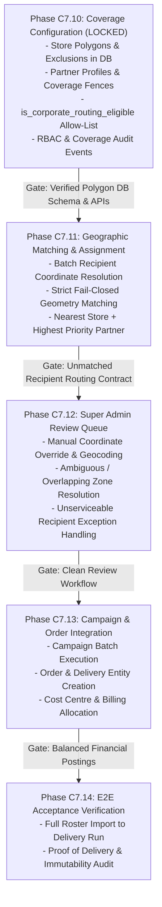

# CakeToHome ERP — Phase C7.10 Forensic Discovery & Design Lock Report

**Phase:** C7.10 — Map-Fenced Store & Delivery-Partner Coverage Configuration  
**Status:** FORENSIC DISCOVERY COMPLETE — DESIGN LOCKED — AWAITING OWNER APPROVAL  
**Mode:** Read-Only Audit & Specification (Zero Application Code Modified, Zero DB Migrations Executed, Zero Rows Inserted/Deleted)  
**Date:** October 13, 2026  
**Repository Working Tree:** `E:\vig\cakes2home-main\cakes2home-main`  
**Current Git Branch:** `checkpoint/c-phases-baseline`  
**Current Git HEAD:** `d231cee` (`feat(delivery): wire platform delivery bridges, customer receipts, and gateway settlements for Phase 5C`)  

---

## 1. Executive Summary & Repository State Preservation

### 1.1 Repository State & Working Tree Integrity
A forensic inspection of the Git repository confirms:
- **Active Branch:** `checkpoint/c-phases-baseline`
- **HEAD Commit:** `d231cee`
- **Preserved C7.9 Working Tree:** All uncommitted C7.9 files and modifications remain 100% intact. Zero git resets, stashes, checkouts, or cleans were executed.
- **Tracked Modified Files Preserved (14 files):**
  - `CHECKPOINTS/LATEST_CHECKPOINT.md`
  - `frontend/CHECKPOINTS/LATEST_CHECKPOINT.md`
  - `frontend/scratch/check_fks.js`
  - `frontend/src/app/api/v1/[...path]/route.ts`
  - `frontend/src/app/dashboard/page.tsx`
  - `frontend/src/components/admin/AdminSidebar.tsx`
  - `frontend/src/components/dashboard/admin/admin-tabs.tsx`
  - `frontend/src/lib/controllers/index.ts`
  - `frontend/src/lib/repositories/index.ts`
  - `frontend/src/lib/services/bills-receivable.service.ts`
  - `frontend/src/lib/services/index.ts`
  - `frontend/src/lib/staff-access-control.ts`
  - `frontend/src/lib/types/index.ts`
  - `scratch/test-profile-interaction.ts`
- **Untracked C7.9 Source Files & Artifacts Preserved:**
  - `frontend/src/components/dashboard/admin/corporate-accounts-panel.tsx`
  - `frontend/src/lib/controllers/corporate-account.controller.ts`
  - `frontend/src/lib/repositories/corporate-account.repository.ts`
  - `frontend/src/lib/services/corporate-account.service.ts`
  - `frontend/src/lib/services/corporate-employee-import.service.ts`
  - `frontend/src/lib/services/corporate-employee.service.ts`
  - `frontend/src/lib/types/corporate-account.types.ts`
  - `CHECKPOINTS/phase-c7-9-step9f-browser-and-final-audit-checkpoint.md`
  - Screenshots: `c7_9_step9f_01_accounts_directory.png` through `c7_9_step9f_05_bulk_import_wizard.png`

### 1.2 Authoritative Accounting Baseline Status
The database was independently audited against the shared PostgreSQL instance (`aws-1-ap-south-1.pooler.supabase.com:6543/postgres`). All financial invariants remain mathematically locked and pristine:
- **Chart of Accounts (CoA):** Exactly 100 active accounts (Expected: 100, `accounting_account`).
- **Accounting Vouchers:** Exactly 6 vouchers (Expected: 6, `accounting_voucher`).
- **Journal Entries:** Exactly 4 entries (Expected: 4, `accounting_journal_entry`).
- **Journal Lines:** Exactly 10 lines (Expected: 10, `accounting_journal_line`).
- **Trial Balance:** Total Debits = ₹3,380.00 | Total Credits = ₹3,380.00 | Net Difference = ₹0.00 (Balanced).
- **Suspense Account (1119):** ₹0.00.
- **Active Advisory Locks:** 0 leaked locks.
- **Corporate Account Live Tables:** Exactly 0 rows across all 7 corporate tables (`corporate_account`, `corporate_account_contact`, `corporate_account_member`, `corporate_account_event`, `corporate_employee`, `corporate_employee_event`, `corporate_employee_import_batch`), consistent with clean automated test teardown.

---

## 2. Forensic Inspection of Existing Routing & Coverage Engine

### 2.1 Geometry Primitives & Map-Fencing Engine
The codebase contains high-quality, pure mathematical geometry primitives implemented in TypeScript in [`frontend/src/lib/api-engine.ts`](file:///E:/vig/cakes2home-main/cakes2home-main/frontend/src/lib/api-engine.ts):

1. **Ray-Casting Point-in-Polygon (`ApiEngine.isPointInPolygon`, lines 6293–6312):**
   - Implements the Jordan curve theorem (ray-casting).
   - Validates that polygons have $\ge 3$ coordinate vertices.
   - Supports both `[lat, lng]` tuples and `{lat, lng}` / `{latitude, longitude}` objects.
   - Tested and mathematically sound for arbitrary convex or concave polygon boundaries.
2. **3-Tier Effective Delivery Radius (`ApiEngine.computeEffectiveMaxRadius`, lines 6321–6335):**
   - Hierarchically computes $\min(\text{Global Ceiling [25km]}, \text{Store Limit}, \text{Zone Limit})$.
   - Ensures no configured zone or store exceeds the global 25 km safety ceiling.
3. **Comprehensive Zone Evaluation (`ApiEngine.isPointInZone`, lines 6342–6418):**
   - Evaluates store-level exclusions (`branch.exclusion_polygons`).
   - Checks polygon inclusion via `isPointInPolygon`.
   - Checks subzone exclusions (`zone.exclusion_polygons`).
   - Enforces hybrid mode (polygon bounded by radius).
   - Enforces pure radius mode (Haversine distance $\le \text{maxRadius} + 0.001\text{km}$).
4. **Haversine Distance (`ApiEngine.calculateHaversineDistance`, line 6635, and `DeliveryService.calculateDistanceKm` in [`delivery.service.ts:39-50`](file:///E:/vig/cakes2home-main/cakes2home-main/frontend/src/lib/services/delivery.service.ts)):**
   - Earth radius $R = 6371\text{ km}$, standard spherical trigonometry returning 2-decimal kilometer distance.

### 2.2 Deep Dive into `resolveSmartBranch`: PATH A vs PATH B
The core storefront routing function is `ApiEngine.resolveSmartBranch` in [`frontend/src/lib/api-engine.ts:16124-16460`](file:///E:/vig/cakes2home-main/cakes2home-main/frontend/src/lib/api-engine.ts#L16124-L16460). Inspection reveals two sharply diverging execution paths:

#### PATH A (Coordinates Provided, lines 16238–16410) — SOUND GEOMETRY
- Validates latitude ($-90 \le \text{lat} \le 90$) and longitude ($-180 \le \text{lng} \le 180$). Fails closed on sentinel coordinates (`999.999`) or NaN.
- Iterates operational branches (filtering out closed, archived, or out-of-coordinate stores).
- For each store, evaluates enabled zones sorted by `priority DESC` then `display_order ASC`.
- Tests `isPointInZone(qLat, qLng, zone, branch)`.
- If matched, computes exact Haversine distance from store coordinates to customer coordinates.
- Enforces product-specific maximum delivery distance (`max_delivery_distance_km`).
- Collects candidate matches and selects the **NEAREST ELIGIBLE STORE** (sort by `distanceKm ASC`, tie-break by `branch.routing_priority DESC`).
- If no candidates match, checks if coordinate falls inside an exclusion zone (`INSIDE_EXCLUSION_ZONE`) or unserviced area (`NO_ELIGIBLE_STORE`) and **fails closed** returning `branch: null`, `resolvedBy: "unserviceable_coords"`.

#### PATH B (No Coordinates Provided, lines 16420–16460) — CRITICAL HAZARD FOR CORPORATE ROUTING
When latitude/longitude are omitted or `undefined`:
1. Attempts to match `branchId` if provided.
2. If unmatched, performs a **case-insensitive substring match on `city`** against branch names/cities.
3. If unmatched, performs a **PIN-code equality match** against `branch.pincode` or `zone.postal_codes`.
4. **THE SILENT FALLBACK:** If still unmatched and operational branches exist, it silently selects:
   ```typescript
   fallbackBranch = operational.find((b: any) => b.code?.toLowerCase().includes("indiranagar")) || operational[0];
   ```
5. **FABRICATION OF DISTANCE & ETA:**
   ```typescript
   const feeRes = ApiEngine.calculateDeliveryFee(fallbackBranch, { distance_km: 3.5, ... });
   return {
     branch: fallbackBranch,
     resolvedBy: "locality_fallback",
     etaminutes: 40,
     distanceKm: 3.5,
     partnerSequence: ["porter", "rapido", "shadowfax", "own_fleet"],
     ...
   };
   ```
6. **HAZARD SUMMARY:** For any missing coordinate or unserviceable address, PATH B fabricates a 3.5 km distance, defaults to Indiranagar or the first active store, and assumes four third-party delivery partners are active without verifying their actual presence or coverage.

### 2.3 Inventory of All Callers of `resolveSmartBranch`
A complete audit across `frontend/src` identified 18 invocations of `resolveSmartBranch`:
| Source File | Line | Query Parameters | Evaluation Path | Fallback Hazard Risk |
|---|---|---|---|---|
| `app/api/v1/branches/route.ts` | 31 | `{ lat, lng, pincode, areaName, isExpress, isMidnight, orderTotal }` | PATH A if coords present, else PATH B | High if client sends only pincode |
| `app/api/v1/[...path]/route.ts` | 1108–1120 | `{ pincode: "560038" }` etc. | PATH B (PIN-based test probe) | Low (diagnostic probe) |
| `app/api/v1/[...path]/route.ts` | 1369 | `{ pincode }` | PATH B | High (falls back to Indiranagar) |
| `lib/api-engine.ts` | 6492, 6524 | Pre-order delivery fee probe | PATH A if coords, else PATH B | Medium |
| `lib/api-engine.ts` | 7310, 7586, 7625 | `{ pincode }` during checkout validation | PATH B | High |
| `lib/api-engine.ts` | 17053, 17272 | Cart delivery fee calculation | PATH A / PATH B | High |
| `lib/api-engine.ts` | 18503 | Checkout order placement | PATH B | High |
| `lib/api-engine.ts` | 22481, 22670 | Order creation pipeline | PATH B | High |
| `lib/api-engine.ts` | 24909 | Webhook order fulfillment | PATH B | High |

**Design Invariant for C7.10/C7.11:** Corporate delivery routing must **never** invoke PATH B or inherit these locality fallbacks. Corporate routing must strictly require verified GPS coordinates and evaluate only authoritative polygon/radius coverage. If coordinates or eligible zones are absent, it must **fail closed** to `UNASSIGNED` / `PENDING_REVIEW`.

---

## 3. Database Catalog & Forensic Findings

### 3.1 `public.branch` (Store Master Data)
- **Total Rows:** 57 (53 active/open `deleted_at IS NULL`, 4 soft-deleted).
- **Coordinate Presence:** 100% of rows have non-null numeric `latitude` and `longitude`.
- **The Shared-Coordinate Anomaly:**
  - **29 branches** share the exact duplicate coordinate `(12.9716, 77.6412)` (Indiranagar, Bengaluru). These include test fixtures generated by historical automated runs: `HUB-976`, `HUB-365`, `HUB-986`, `HUB-BLR-01`, etc.
  - **6 branches** share `(12.9716, 77.5946)` (`E2E-2691`, `ZJSON-559042`, etc.).
  - **3 branches** share `(13.0850, 80.2100)` in Chennai (`TN-CHE-3700`, etc.).
  - **3 branches** share `(8.8932, 76.6141)` in Kollam, Kerala.
  - **3 branches** share `(19.0550, 72.8300)` in Mumbai.
  - **Branch Location Anomaly:** Branch `HUB-BOM-01` (name: Bandra West Bakery Studio, code: `br_mumbai_bandra`) has coordinates `(9.95972, 76.29867)`, which places a Mumbai bakery in Kochi, Kerala.
- **Operational & Accounting Links:**
  - 3 of the 6 posted accounting vouchers reference these branches.
  - 4 of the 10 general ledger journal lines reference these branches.
  - 320 inventory item stock levels are linked to these branch IDs.
  - **Safety Rule 4 Compliance:** These 53 branches cannot be deleted, wiped, or mass-updated without corrupting posted financial and inventory records.
  - **Design Solution:** C7.10 introduces an explicit eligibility allow-list column on `public.branch`:
    ```sql
    ALTER TABLE public.branch ADD COLUMN is_corporate_routing_eligible boolean NOT NULL DEFAULT false;
    ```
    Only branches explicitly verified and enabled by an administrator will participate in corporate gifting and routing.

### 3.2 `public.delivery_zone` (Store Coverage Zones)
- **Total Rows in PostgreSQL:** 44 rows.
- **Branches with Zones:** Only 28 branches have configured delivery zones in the database (25 active branches have ZERO zones in PostgreSQL!).
- **Zone Geometry Breakdown:**
  - **12 zones** have valid polygon coordinates (`polygon_coordinates jsonb` with $\ge 3$ vertices) plus radius (`HYBRID` mode).
  - **25 zones** are radius-only (`radius_km numeric` + `center_latitude/center_longitude`).
  - **7 zones** are neither polygon nor radius (`radius_km IS NULL`, `polygon_coordinates IS NULL`). All 7 are legacy PIN-only records assigned to alias `res_01KXYMAHGFPRY1G9TZKEVGAGAT`.
- **CRITICAL SCHEMA FINDING — Missing Column:**
  - In TypeScript interfaces and in-memory mock objects (`DeliveryZone` in `api-engine.ts`), the code expects `exclusion_polygons jsonb`.
  - In PostgreSQL catalog `information_schema.columns`, **`exclusion_polygons` DOES NOT EXIST** in table `public.delivery_zone`.
  - When the admin UI saves exclusion polygons, they are serialized into in-memory `memoryStore` and into `branch.metadata`, but dropped from the relational `delivery_zone` table.
  - **C7.10 Schema Requirement:** Add `exclusion_polygons jsonb DEFAULT NULL` to `public.delivery_zone`.

### 3.3 `public.delivery_partner` (Delivery Fleet Data Model)
- **Total Rows in PostgreSQL:** 30 rows (created July/August 2026).
- **Catalog Columns in PostgreSQL:**
  - `id` (text, PK)
  - `first_name` (text, NOT NULL)
  - `last_name` (text, NOT NULL)
  - `email` (text, NOT NULL)
  - `phone` (text, NOT NULL)
  - `avatar_url` (text, NULL)
  - `created_at` (timestamptz, NOT NULL)
  - `updated_at` (timestamptz, NOT NULL)
  - `deleted_at` (timestamptz, NULL)
- **CRITICAL DATA MODEL GAP — Complete Absence of Operational Attributes:**
  - The table contains **zero** operational or coverage fields:
    - NO `status` (`ACTIVE`, `INACTIVE`, `SUSPENDED`).
    - NO `partner_type` (`OWN_FLEET`, `COURIER`, `3PL_AGGREGATOR`).
    - NO `branch_id` or multi-branch associations.
    - NO `polygon_coordinates`, `radius_km`, or geographic service areas.
    - NO `maximum_concurrent_orders` or capacity limit.
    - NO `priority` or contract details.
  - In the existing application, the UI wizard ([`delivery-partner-wizard.tsx`](file:///E:/vig/cakes2home-main/cakes2home-main/frontend/src/components/dashboard/admin/delivery-partner-wizard.tsx)) collects these fields and saves them to in-memory `memoryStore.delivery_partners` via `ApiEngine.createAdminDeliveryPartner`, but **none of this is persisted to PostgreSQL**.
  - In `delivery-partners.ts`, properties like `is_active: true`, `availability_status: "ONLINE"`, and `maximum_concurrent_orders: 2` are synthesized dynamically on every read.
  - **C7.10 Schema Requirement:** Create `delivery_partner_profile` and `delivery_partner_coverage` tables to store authoritative relational coverage and operational capabilities in PostgreSQL.

### 3.4 Spatial Extensions & Geocoding Architecture
- **PostGIS Status:**
  - `SELECT extname FROM pg_extension WHERE extname LIKE '%postgis%'` returns 0 rows (`postgis_installed: false`).
  - `pg_available_extensions` shows PostGIS 3.3.7 is available on the server, but NOT enabled in the database.
- **Architecture Evaluation:**
  - The current codebase uses TypeScript ray-casting (`ApiEngine.isPointInPolygon`) and Haversine distance (`calculateHaversineDistance`).
  - Corporate recipient batch sizes in Phase C7.7/C7.9 are typically 50–5,000 rows. In-memory ray-casting evaluates ~10,000 points against 50 polygons in under 15 milliseconds.
  - Enabling PostGIS requires database superuser extensions, geometry migrations, and specialized spatial index operators (`ST_Contains`), which introduces external complexity and migration risks.
  - **Safety Rule 4 Compliance:** Per the user prompt ("Avoid PostGIS or a new geocoding provider unless the existing architecture demonstrably requires it and the design is explicitly approved"), C7.10 will **NOT** install PostGIS. Geometries will continue to be stored as structured GeoJSON-compatible JSONB arrays, evaluated via deterministic TypeScript/Node.js ray-casting.

---

## 4. Coverage-Capability Gap Matrix

| Functional Area | Current Implementation | Observed Gap / Hazard | C7.10 Proposed Remedy |
|---|---|---|---|
| **Store Polygon Fences** | 12 of 44 zones have polygons; stored in `delivery_zone.polygon_coordinates` JSONB. | 25 active branches have no zones; 25 zones are radius-only; 7 are PIN-only orphans. | Provide administrative UI to configure and validate multi-point polygons for all participating stores. |
| **Store Exclusion Zones** | Evaluated in memory via `isPointInPolygon` if present in `DeliveryZone` interface. | `exclusion_polygons` column is missing from PostgreSQL `public.delivery_zone`. Not saved to DB. | Add `exclusion_polygons jsonb` column to `public.delivery_zone` with schema validation. |
| **Store Eligibility Allow-List** | All 53 branches are treated as operational if `is_open = true`. | 29 branches share duplicate test coordinates; 1 branch in Kochi has Mumbai name. | Add `is_corporate_routing_eligible boolean DEFAULT false` to `public.branch`. Only explicitly vetted hubs route orders. |
| **Delivery-Partner Profiles** | 30 rows in `public.delivery_partner` containing only name/email/phone. | Zero operational columns: no status, partner type, capacity, or rating in PostgreSQL. | Create `public.delivery_partner_profile` table (linked to `delivery_partner.id`). |
| **Delivery-Partner Coverage** | `getPartnerEffectiveCoverage` inherits PIN/area strings from associated stores. | Delivery partners have zero independent geographic polygon or radius boundaries. | Create `public.delivery_partner_coverage` table with polygon coordinates, radius, and priority. |
| **Fallback Routing Safety** | `resolveSmartBranch` PATH B falls back to city, PIN, Indiranagar, and `distance: 3.5km`. | Silent false positives: orders delivered to unserviced locations assigned to arbitrary hubs. | Strictly prohibit PATH B for corporate routing. Corporate routing engine must **FAIL CLOSED**. |
| **RBAC & Authorization** | `BRANCHES.EDIT` controls both branch metadata and zone geometry. | No granular permissions for coverage configuration; no separation of store manager vs super admin. | Introduce `DELIVERY_COVERAGE.VIEW` and `DELIVERY_COVERAGE.MANAGE` permissions. |
| **Audit Logging** | In-memory `ApiEngine.addAuditLog` writes to local JSON; zero database persistence. | Zone additions, polygon modifications, and partner changes leave no audit trail in PostgreSQL. | Store coverage configuration audit events in a structured database table (`delivery_coverage_event`). |

---

## 5. Security, Authorization, Audit & Tenant-Scope Controls

### 5.1 Role-Based Access Control (RBAC) Architecture
Currently, [`frontend/src/lib/staff-access-control.ts`](file:///E:/vig/cakes2home-main/cakes2home-main/frontend/src/lib/staff-access-control.ts#L162-L166) defines:
- `BRANCHES.VIEW`
- `BRANCHES.EDIT`
- `DELIVERY.VIEW`
- `DELIVERY.ASSIGN`

**Proposed Additions for C7.10:**
```typescript
{ 
  id: "DELIVERY_COVERAGE.VIEW", 
  module: "DELIVERY", 
  action: "VIEW_COVERAGE", 
  label: "View Delivery Coverage", 
  description: "View store polygon boundaries, exclusion zones, and delivery-partner service areas", 
  category: "Branch & Delivery" 
},
{ 
  id: "DELIVERY_COVERAGE.MANAGE", 
  module: "DELIVERY", 
  action: "MANAGE_COVERAGE", 
  label: "Manage Delivery Coverage", 
  description: "Create, edit, and deactivate store and delivery-partner geofence polygons and service radiuses", 
  category: "Branch & Delivery" 
}
```

### 5.2 Multi-Branch Scope & Tenant Isolation
1. **SUPER_ADMIN:** Network-wide scope. Can view, edit, enable, and deactivate coverage for any branch or delivery partner. Can toggle `is_corporate_routing_eligible` on stores.
2. **BRANCH_MANAGER:** Branch-scoped. Can only view and edit delivery zones for their own assigned `branch_id`. Cannot modify other branches' polygons or alter delivery-partner global configurations.
3. **STAFF / DELIVERY_PARTNER:** Read-only access to their assigned operational zones; cannot modify polygons or exclusion boundaries.

### 5.3 Audit Trail Requirements
Every coverage configuration mutation must record an immutable audit row in `public.delivery_coverage_event`:
- `entity_type`: `'STORE_ZONE'` | `'PARTNER_COVERAGE'` | `'STORE_ELIGIBILITY'`
- `entity_id`: ID of the modified zone, partner coverage, or branch
- `event_type`: `'ZONE_CREATED'` | `'ZONE_UPDATED'` | `'ZONE_DEACTIVATED'` | `'EXCLUSION_MODIFIED'` | `'ELIGIBILITY_TOGGLED'`
- `actor_id` & `actor_role`: Authenticated user ID and session role
- `before_state` & `after_state`: JSONB snapshots of coordinates, radius, and priority
- `reason`: Mandatory text description for changes affecting operational boundaries

---

## 6. Proposed C7.10-Only Schema, API & UI Design

### 6.1 Database Schema Additions (Additive & Non-Destructive)

```sql
-- 1. Store Eligibility Allow-List on Branch
ALTER TABLE public.branch 
ADD COLUMN IF NOT EXISTS is_corporate_routing_eligible boolean NOT NULL DEFAULT false;

-- 2. Add Exclusion Polygons to Delivery Zone
ALTER TABLE public.delivery_zone 
ADD COLUMN IF NOT EXISTS exclusion_polygons jsonb DEFAULT NULL;

-- 3. Delivery Partner Operational Profile
CREATE TABLE IF NOT EXISTS public.delivery_partner_profile (
    id text PRIMARY KEY,
    partner_id text NOT NULL REFERENCES public.delivery_partner(id) ON DELETE RESTRICT,
    partner_type varchar(32) NOT NULL DEFAULT 'OWN_FLEET', -- OWN_FLEET, COURIER, 3PL_AGGREGATOR
    status varchar(32) NOT NULL DEFAULT 'ACTIVE', -- ACTIVE, INACTIVE, SUSPENDED
    primary_branch_id text REFERENCES public.branch(id) ON DELETE SET NULL,
    max_concurrent_orders integer NOT NULL DEFAULT 5,
    rating numeric(3, 2) DEFAULT 5.00,
    contract_reference varchar(64),
    metadata jsonb DEFAULT '{}'::jsonb,
    created_at timestamptz NOT NULL DEFAULT NOW(),
    updated_at timestamptz NOT NULL DEFAULT NOW(),
    CONSTRAINT chk_dp_profile_status CHECK (status IN ('ACTIVE', 'INACTIVE', 'SUSPENDED')),
    CONSTRAINT chk_dp_profile_type CHECK (partner_type IN ('OWN_FLEET', 'COURIER', '3PL_AGGREGATOR'))
);

CREATE UNIQUE INDEX IF NOT EXISTS uq_dp_profile_partner ON public.delivery_partner_profile(partner_id);

-- 4. Delivery Partner Coverage Geofence Configuration
CREATE TABLE IF NOT EXISTS public.delivery_partner_coverage (
    id text PRIMARY KEY,
    partner_id text NOT NULL REFERENCES public.delivery_partner(id) ON DELETE RESTRICT,
    branch_id text NOT NULL REFERENCES public.branch(id) ON DELETE RESTRICT,
    fence_type varchar(16) NOT NULL DEFAULT 'HYBRID', -- POLYGON, RADIUS, HYBRID
    polygon_coordinates jsonb DEFAULT NULL, -- Array of [lat, lng] or {lat, lng}
    radius_km numeric(6, 2) DEFAULT NULL,
    center_latitude numeric(10, 7) DEFAULT NULL,
    center_longitude numeric(10, 7) DEFAULT NULL,
    priority integer NOT NULL DEFAULT 10,
    is_active boolean NOT NULL DEFAULT true,
    metadata jsonb DEFAULT '{}'::jsonb,
    created_at timestamptz NOT NULL DEFAULT NOW(),
    updated_at timestamptz NOT NULL DEFAULT NOW(),
    CONSTRAINT chk_dp_coverage_fence CHECK (fence_type IN ('POLYGON', 'RADIUS', 'HYBRID'))
);

CREATE INDEX IF NOT EXISTS idx_dp_coverage_partner ON public.delivery_partner_coverage(partner_id);
CREATE INDEX IF NOT EXISTS idx_dp_coverage_branch ON public.delivery_partner_coverage(branch_id);

-- 5. Structured Coverage Audit Trail
CREATE TABLE IF NOT EXISTS public.delivery_coverage_event (
    id text PRIMARY KEY,
    entity_type varchar(32) NOT NULL, -- STORE_ZONE, PARTNER_COVERAGE, STORE_ELIGIBILITY
    entity_id text NOT NULL,
    event_type varchar(32) NOT NULL,
    actor_id text NOT NULL,
    actor_role varchar(32) NOT NULL,
    reason text,
    before_state jsonb,
    after_state jsonb,
    created_at timestamptz NOT NULL DEFAULT NOW()
);

CREATE INDEX IF NOT EXISTS idx_coverage_event_entity ON public.delivery_coverage_event(entity_type, entity_id);
```

### 6.2 Proposed C7.10-Only Administrative APIs
All APIs require authentication and permission enforcement (`DELIVERY_COVERAGE.VIEW` for reads, `DELIVERY_COVERAGE.MANAGE` for mutations):

1. **`GET /api/v1/admin/delivery-zones`**
   - Query params: `branch_id`, `include_inactive`
   - Returns store zones directly from `public.delivery_zone` including `polygon_coordinates`, `radius_km`, and `exclusion_polygons`.
2. **`POST /api/v1/admin/delivery-zones`**
   - Body: `{ branch_id, name, fence_type, polygon_coordinates, radius_km, exclusion_polygons, priority, delivery_fee }`
   - Validates coordinates ($\ge 3$ points for polygon), enforces radius ceiling ($\le 25\text{ km}$), writes to DB, records audit event.
3. **`PUT /api/v1/admin/delivery-zones/:id`**
   - Updates zone boundaries, exclusions, or priority with transactional immutability safeguards.
4. **`GET /api/v1/admin/delivery-partners/:id/coverage`**
   - Returns partner profile and assigned `delivery_partner_coverage` records.
5. **`PUT /api/v1/admin/delivery-partners/:id/coverage`**
   - Creates or updates partner coverage polygons and branch linkages in PostgreSQL.
6. **`POST /api/v1/admin/coverage/validate-point` (Diagnostic & Preview Tool)**
   - Body: `{ latitude, longitude, branch_id? }`
   - Evaluates point against store zones and partner coverage using strict ray-casting.
   - Returns diagnostic report:
     - `serviceable`: boolean
     - `matched_store`: `{ id, name, distance_km, zone_id }` | null
     - `matched_partners`: `Array<{ id, name, priority, fence_type }>`
     - `inside_exclusion`: boolean
     - `failure_reason`: `OUTSIDE_COVERAGE` | `INSIDE_EXCLUSION` | `NO_ACTIVE_PARTNER` | `INVALID_COORDINATES`
   - **Crucially:** Fails closed if coordinates are missing or outside boundaries.

### 6.3 Proposed C7.10 Admin UI Enhancements
- Enhance [`branch-zone-manager.tsx`](file:///E:/vig/cakes2home-main/cakes2home-main/frontend/src/components/dashboard/admin/branch-zone-manager.tsx) and [`map-fence-editor.tsx`](file:///E:/vig/cakes2home-main/cakes2home-main/frontend/src/components/dashboard/admin/map-fence-editor.tsx):
  - Add explicit toggle for `is_corporate_routing_eligible` on branch profiles.
  - Persist `exclusion_polygons` directly to PostgreSQL.
  - Add Delivery-Partner Coverage Editor tab: allows admins to draw and assign coverage polygons to delivery partners per branch.
  - Add interactive "Test Coordinate" diagnostic pin tool directly on the Leaflet map.

---

## 7. Migration and Rollback Safety Plan

### 7.1 Forward Migration Plan
1. **Non-Blocking Additive DDL:**
   - `ALTER TABLE branch ADD COLUMN is_corporate_routing_eligible boolean DEFAULT false;`
   - `ALTER TABLE delivery_zone ADD COLUMN exclusion_polygons jsonb DEFAULT NULL;`
   - These column additions are metadata-only operations in PostgreSQL 11+ and do not lock or rewrite tables.
2. **Table Creation:**
   - Create `delivery_partner_profile`, `delivery_partner_coverage`, and `delivery_coverage_event`.
3. **Zero Financial Impact:**
   - No changes to `accounting_*` tables, vouchers, or Chart of Accounts.
   - Zero modifications to existing operational orders or transactions.

### 7.2 Rollback Plan
If rollback is required:
```sql
DROP TABLE IF EXISTS public.delivery_coverage_event;
DROP TABLE IF EXISTS public.delivery_partner_coverage;
DROP TABLE IF EXISTS public.delivery_partner_profile;
ALTER TABLE public.delivery_zone DROP COLUMN IF EXISTS exclusion_polygons;
ALTER TABLE public.branch DROP COLUMN IF EXISTS is_corporate_routing_eligible;
```
Rollback is 100% clean, instantaneous, and has zero impact on core store operations, existing delivery partner rows, or accounting tables.

---

## 8. Acceptance Criteria and Test Specifications

| Test Case | Scenario / Input | Expected Result | Pass Criteria |
|---|---|---|---|
| **AC-01: Valid Polygon Save** | Admin submits closed 5-point polygon for store zone via API. | Stored in `delivery_zone.polygon_coordinates` as valid JSONB. | Points $\ge 3$, coordinates in $-90..90, -180..180$, audit logged. |
| **AC-02: Exclusion Zone Save** | Admin configures restricted sub-polygon inside serviceable zone. | Stored in `delivery_zone.exclusion_polygons`. | Point inside exclusion polygon returns `inside_exclusion: true` and `serviceable: false`. |
| **AC-03: Missing Coordinates Fail-Closed** | Probe calls `/validate-point` with missing or null latitude/longitude. | Returns 400 Bad Request with `INVALID_LOCATION`. | **Zero fallback** to Indiranagar, `operational[0]`, city, or PIN. |
| **AC-04: Out-of-Bounds Coordinate** | Coordinate falls 0.01 km outside configured store polygon and radius. | Returns `serviceable: false`, `reasonCode: "NO_ELIGIBLE_STORE"`. | Strictly rejected; no fabricated distance or ETA. |
| **AC-05: Inactive Branch Excluded** | Branch has valid zone but `is_open = false` or `is_corporate_routing_eligible = false`. | Store is skipped during evaluation. | Candidate list does not include ineligible branch. |
| **AC-06: Inactive Delivery Partner Excluded** | Partner has valid coverage polygon but `profile.status = 'INACTIVE'`. | Partner is excluded from `matched_partners`. | Only active partners with active coverage returned. |
| **AC-07: Overlapping Store Zones Priority** | Point falls in two zones for same store: Zone A (priority 10), Zone B (priority 20). | Evaluated against Zone B first. | Zone B settings (fee, rules) applied. |
| **AC-08: Global Ceiling Enforcement** | Admin attempts to configure radius of 28 km on zone. | API rejects with `RADIUS_EXCEEDS_ALLOWED_LIMIT` (ceiling 25 km). | Rejection with HTTP 422. |
| **AC-09: RBAC Enforcement** | User without `DELIVERY_COVERAGE.MANAGE` attempts PUT to coverage API. | Request rejected with HTTP 403 Forbidden. | Proper permission check verified. |
| **AC-10: Branch Manager Scope Guard** | Branch Manager of Hub A attempts to edit zones for Hub B. | Request rejected with HTTP 403 Tenant Scope Violation. | Cross-branch modification blocked. |

---

## 9. Dependencies & Explicit Gates for C7.11–C7.14



- **Gate to C7.11:** C7.11 cannot begin until C7.10 is authorized and verified. C7.11 depends on `public.delivery_zone.exclusion_polygons` and `public.delivery_partner_coverage` existing in PostgreSQL.
- **Gate to C7.12:** C7.12 handles manual reviews for recipients that fail closed during C7.11.
- **Gate to C7.13:** C7.13 creates orders and triggers operational dispatch.
- **Gate to C7.15+/C7.16:** Accounting decisions for branch billing remain deferred and locked.

---

## 10. Decisions Requiring Owner Approval Before Implementation

Before proceeding to implement Phase C7.10, the following 5 architectural decisions require explicit owner review and approval:

1. **Decision D1 — Delivery Partner Schema Strategy:**
   - *Option A (Recommended):* Create separate relational tables `delivery_partner_profile` and `delivery_partner_coverage`. Preserves existing `public.delivery_partner` unmodified and cleanly separates fleet contact data from operational coverage.
   - *Option B:* Alter `public.delivery_partner` directly by adding 8+ columns (`partner_type`, `status`, `polygon_coordinates`, `radius_km`, etc.).
   - *Recommendation:* Option A for clean normalization, backward compatibility, and zero risk to existing 30 delivery partner rows.

2. **Decision D2 — 53-Branch Coordinate Anomaly & Eligibility Allow-List:**
   - *Finding:* 29 branches share `(12.9716, 77.6412)`; 1 branch has Mumbai name at Kochi coordinates. Accounting vouchers reference these branches.
   - *Option A (Recommended):* Keep all 53 branch records untouched. Add `is_corporate_routing_eligible boolean DEFAULT false` to `public.branch`. Admin explicitly flags only verified, authentic kitchen hubs as eligible for corporate routing.
   - *Option B:* Update/correct coordinates of all 53 branches directly in the database.
   - *Recommendation:* Option A. Preserves historical accounting vouchers and inventory rows while strictly isolating corporate routing to real, verified hubs.

3. **Decision D3 — Spatial Technology Stack (TypeScript vs PostGIS):**
   - *Option A (Recommended):* Retain TypeScript-based ray-casting (`ApiEngine.isPointInPolygon`) and Haversine calculations with GeoJSON JSONB storage. Zero new database extensions required; runs instantly in Node.js.
   - *Option B:* Enable PostGIS extension and convert polygons to `GEOMETRY(Polygon, 4326)` columns.
   - *Recommendation:* Option A. In accordance with Safety Rule 4, avoid PostGIS unless demonstrably required. The current engine is proven, fast, and portable.

4. **Decision D4 — Handling PATH B Locality Fallback in Legacy Storefront:**
   - *Finding:* `resolveSmartBranch` PATH B silently assigns uncoordinated/unmatched requests to Indiranagar or `operational[0]` with fabricated 3.5 km distance.
   - *Option A (Recommended):* Build a dedicated, strictly fail-closed corporate delivery routing service (`CorporateRoutingService.resolveDeliveryContext`) that uses geometry primitives only, leaving legacy storefront `resolveSmartBranch` untouched for B2C customer backward compatibility until a separate storefront remediation phase.
   - *Option B:* Refactor `resolveSmartBranch` directly to fail closed for all callers (including B2C storefront and tests).
   - *Recommendation:* Option A. Isolates corporate gifting routing completely from legacy B2C fallbacks without risking storefront regressions.

5. **Decision D5 — Business Account Configuration Baseline:**
   - *Finding:* C7.9 verified all corporate accounts and employee roster functionality, leaving the live database with 0 corporate rows (clean test teardown).
   - *Option A (Recommended):* Keep live database at 0 corporate rows until C7.10 coverage is locked. During business setup, configure an authentic corporate master account via the verified Admin UI.
   - *Option B:* Seed a fixture corporate account directly into PostgreSQL.
   - *Recommendation:* Option A. Test completion and business-data setup remain separate, clean tasks.

---

## 11. Final Stop & Sign-Off

**Status:** STOPPED AT DESIGN GATE.  
**Implementation Progress:** 0% (Design and Forensic Discovery 100% complete).  
**Artifact Paths:**
- Forensic & Design Lock Report: [`CHECKPOINTS/phase-c7-10-forensic-discovery-and-design-lock.md`](file:///E:/vig/cakes2home-main/cakes2home-main/CHECKPOINTS/phase-c7-10-forensic-discovery-and-design-lock.md)
- Primary Checkpoint Index: [`CHECKPOINTS/LATEST_CHECKPOINT.md`](file:///E:/vig/cakes2home-main/cakes2home-main/CHECKPOINTS/LATEST_CHECKPOINT.md)
- Frontend Checkpoint Index: [`frontend/CHECKPOINTS/LATEST_CHECKPOINT.md`](file:///E:/vig/cakes2home-main/cakes2home-main/frontend/CHECKPOINTS/LATEST_CHECKPOINT.md)

*No application code has been edited. No database migrations have been executed. No database rows have been inserted or deleted. Working tree remains preserved with all C7.9 changes intact.*  
*Awaiting owner review and decision sign-off before proceeding to Phase C7.10 implementation.*
