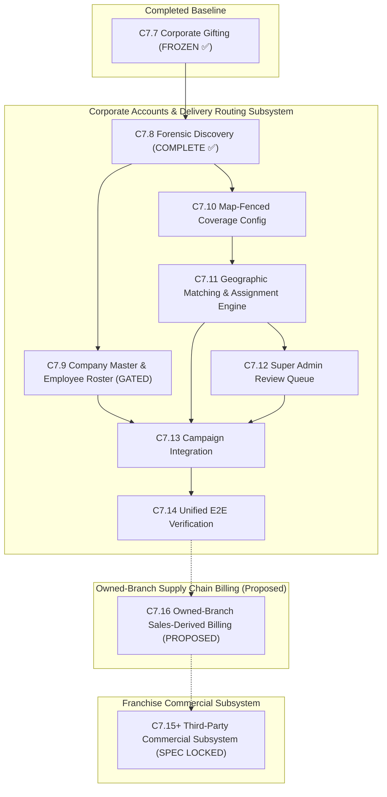

# CakeToHome ERP — Phases C7.8 through C7.14 Master Plan
# Corporate Account Management, Employee Roster Lifecycle, Map-Fenced Delivery Routing

> **Status**: 📋 **PLANNED — NOT STARTED**
> **Prerequisite**: Phase C7.7 Corporate Gifting Subsystem — **COMPLETE, VERIFIED & FROZEN**
> **Date Proposed**: 2026-10-10
> **Document Version**: `v1.0.0-PLAN-PROPOSED`

---

## 0. Preamble & Relationship to C7.7

Phase C7.7 established the Corporate Gifting subsystem: Excel-based recipient ingestion, dry-run validation, single master corporate invoice, RBAC-protected UI, and full browser E2E verification. **C7.7 is frozen and accepted.** No modifications to the C7.7 subsystem will occur unless a demonstrated, reproducible defect requires a correction.

Phases C7.8–C7.14 extend the corporate subsystem with three new capabilities:

1. **Corporate Company & Employee Roster Management** — Treat corporate clients as managed business accounts with full employee lifecycle.
2. **Map-Fenced Delivery Routing** — Replace PIN-code-based routing with geographic boundary (geofence) matching using coordinates.
3. **Super Admin Unresolved Location Review** — Explicit queue for deliveries that cannot be confidently assigned.

These phases are **proposed scope**. No database migrations, API endpoints, or UI components will be created until the relevant phase's forensic discovery is complete and its implementation plan is accepted.

---

## 1. Scope: Corporate Company & Employee Management

### 1.1 Corporate Company Profiles

Each corporate client must be modelled as a **managed business account**, not merely a customer name on a gifting order.

| Requirement | Detail |
|---|---|
| Legal identity | Legal name, trade name, GSTIN, PAN, registered address |
| Billing details | Billing address, billing contact, payment terms |
| Credit controls | Credit limit, credit period days, approval status (`PENDING`, `APPROVED`, `SUSPENDED`, `CLOSED`) |
| Contacts | Primary contact, secondary contact, accounts payable contact |
| Relationship to accounting customer | **One corporate company record ↔ one existing `customer` record**. Enforced FK relationship. No duplicate customers for the same company. |
| Approval workflow | New company accounts require explicit approval before orders can be placed |
| Audit trail | Created by, approved by, modified by, timestamps |

### 1.2 Employee Roster Lifecycle

| Requirement | Detail |
|---|---|
| Add employees | Authorized staff can add employees linked to their corporate company |
| Update employees | Edit employee details (name, phone, email, department, designation, delivery address) |
| Deactivate employees | Departing employees are **deactivated, never deleted**. Historical orders, invoices, and delivery records are preserved. |
| Reactivate employees | Re-joining employees can be reactivated with their history intact |
| Bulk import | Excel upload for bulk employee creation with validation |
| Duplicate detection | Validate employee ID uniqueness within a company; reject duplicates during import |
| Employee ID | Each employee has a unique identifier within their company (e.g., company-assigned employee code) |
| Historical preservation | When an employee is deactivated, all past gifting batches, deliveries, and invoices referencing that employee remain intact and queryable |

### 1.3 Bulk Employee Import

| Requirement | Detail |
|---|---|
| Excel format | Standard template with columns: Employee ID, Name, Phone, Email, Department, Designation, Delivery Address, City, State, PIN Code |
| Dry-run validation | Validate all rows before persisting; report duplicate IDs, missing required fields, invalid formats |
| Error reporting | Row-level error detail (same pattern as C7.7 gifting ingestion) |
| Commit | Only after successful dry-run, authorized user commits the import |

### 1.4 Role-Based Access Control

| Permission | Scope |
|---|---|
| `CORPORATE_COMPANY.VIEW` | View company profiles and employee rosters |
| `CORPORATE_COMPANY.MANAGE` | Create, update, approve, suspend company accounts |
| `CORPORATE_EMPLOYEE.MANAGE` | Add, update, deactivate, reactivate employees |
| `CORPORATE_EMPLOYEE.IMPORT` | Bulk import employees via Excel |
| `CORPORATE_CREDIT.MANAGE` | Modify credit limits and payment terms |

### 1.5 Critical Constraint: No Duplicate Customers

> [!CAUTION]
> A corporate company account and its accounting `customer` record must have a **clear, enforced 1:1 relationship**. The system must prevent creating a second `customer` row for the same company. This constraint must be enforced at the database level (UNIQUE constraint or equivalent) and validated in the domain layer.

---

## 2. Scope: Corporate Orders Routed to Stores or Delivery Partners

Corporate orders must be deliverable even when the recipient's delivery location has no CakeToHome-operated store.

### 2.1 Routing Requirements

| Requirement | Detail |
|---|---|
| Per-recipient assignment | Each recipient delivery is assigned to a specific store **or** authorized delivery partner — not just to the overall campaign |
| Store fulfillment | When a store serves the delivery area, assign the delivery to that store's fulfillment workflow |
| Partner fulfillment | When no CakeToHome store covers the area, assign to an eligible authorized delivery partner |
| Automatic assignment | The system assigns automatically **only** when it has a reliable, unambiguous match |
| No silent guessing | When coverage is uncertain, the system must **not** silently guess. It must flag the delivery for review. |

### 2.2 Assignment Statuses

| Status | Meaning |
|---|---|
| `UNASSIGNED` | No store or partner has been matched yet |
| `ASSIGNED` | Matched to a store or partner via automatic or manual assignment |
| `PENDING_REVIEW` | Ambiguous or unresolvable; awaiting Super Admin review |
| `ACCEPTED` | Store or partner has acknowledged the assignment |
| `DELIVERED` | Delivery completed |
| `REASSIGNED` | Previously assigned, then reassigned to a different store/partner |

### 2.3 Reassignment & Audit Trail

| Requirement | Detail |
|---|---|
| Reassignment | Authorized staff can reassign a delivery from one store/partner to another |
| Audit trail | Every assignment change records: previous assignee, new assignee, who changed it, when, and the stated reason |
| No accounting rewrite | Reassignment must **not** rewrite posted accounting history (invoices, GL vouchers) |

---

## 3. Scope: Map-Fenced Delivery Coverage

> [!IMPORTANT]
> **Routing decisions are based on geographic coordinates and polygon boundaries, not PIN codes.** PIN codes may remain as address metadata but must not determine the routing decision.

### 3.1 Service Area Configuration

| Requirement | Detail |
|---|---|
| Polygon geofences | Each store and delivery partner has one or more polygon-based service areas |
| Coordinate resolution | Delivery addresses are resolved to latitude/longitude coordinates |
| Point-in-polygon matching | A delivery's coordinates are tested against all configured geofences |
| Priority rules | When service areas overlap, explicit priority and assignment rules determine the winner |
| Coverage changes | Service areas can be updated as stores open, close, or change boundaries |
| Auditability | The selected coverage area and the reason for the assignment are stored on each delivery record |

### 3.2 Address-to-Coordinate Resolution

| Requirement | Detail |
|---|---|
| Geocoding process | The system needs a reliable process to convert delivery addresses into coordinates |
| Provider flexibility | The geocoding provider must be identified during C7.8 discovery; no provider is pre-selected |
| Fallback handling | When geocoding fails or returns low-confidence results, flag for Super Admin review |

### 3.3 What a City Name Is and Is Not

| ✅ City names are used for | ❌ City names are NOT used for |
|---|---|
| Display and searching | Final geographic assignment |
| Normalization (`Kollam` = `KOLLAM` = `kollam`) | Routing decisions |
| Helping operators locate deliveries | Boundary matching |
| Super Admin review context | Determining which store serves an area |

---

## 4. Scope: Super Admin Review & Unresolved Delivery Locations

### 4.1 Detection Rules for Review Cases

| Trigger | Example |
|---|---|
| Unrecognized city | City text does not match any known normalized city |
| Ambiguous address | Geocoding returns multiple candidates with low confidence |
| Missing coordinates | Address could not be resolved to lat/lng |
| Outside all geofences | Coordinates resolved but fall outside every configured service area |

### 4.2 City Name Normalization

| Requirement | Detail |
|---|---|
| Case-insensitive matching | `Kollam`, `KOLLAM`, `kollam` → same normalized form |
| Original preservation | **The customer's original address text is never erased or replaced**. Normalization produces a parallel lookup key. |
| Display consistency | Normalized city name is used for display and filtering; original text remains on the delivery record |

### 4.3 Super Admin Review Queue

| Requirement | Detail |
|---|---|
| Queue visibility | Unresolved deliveries appear in a dedicated **"Needs Super Admin Review"** queue |
| Map inspection | Super Admin can view the delivery location on a map |
| Location correction | Super Admin can correct the geocoded coordinates |
| Coverage selection | Super Admin can select or configure the correct coverage area |
| Store/partner mapping | Super Admin maps the area to a store or partner |
| Decision recording | Reviewer identity, decision, timestamp, and reason are recorded |
| Reprocessing | After the mapping is approved, affected unassigned deliveries are automatically reprocessed |

### 4.4 Fail-Safe Rule

> [!CAUTION]
> **If there is no reliable match, leave the delivery UNASSIGNED and alert the authorized reviewer. Never assign it to an arbitrary store or partner.**

---

## 5. End-to-End Workflow Example

The following illustrates how the system should work for a typical corporate gifting campaign:

### Step 1 — Corporate uploads 150 employee gifts

Each recipient has a delivery address and scheduled delivery date. The campaign retains **one master corporate invoice** as established in C7.7.

### Step 2 — Resolve delivery coordinates

The system standardizes the city text and resolves each address to coordinates. It then checks those coordinates against store and partner geofences.

| Outcome | Action |
|---|---|
| **Store coverage** | Assign the delivery to the matching store and its fulfillment workflow |
| **Partner coverage** | Assign the delivery to an eligible partner when no suitable store covers the area |
| **No reliable match** | Create a review task for the Super Admin. The delivery stays `UNASSIGNED` until the mapping is resolved. |

### Step 3 — Dashboard visibility

| View | Content |
|---|---|
| Campaign dashboard | Shows 150 recipients with assignment status breakdown |
| Store manager | Sees only deliveries assigned to their store |
| Partner portal | Sees only deliveries assigned to their partner account |
| Super Admin review queue | Shows only unresolved deliveries requiring manual mapping |

---

## 6. Proposed Implementation Roadmap

> [!IMPORTANT]
> These are **proposed phases, not completed work**. The accepted C7.7 subsystem remains frozen unless a demonstrated defect requires a correction.
> Corporate Account & Employee Roster Management (**C7.9**) is strictly isolated from internal inter-branch billing and franchise accounting.
> Detailed architectural specifications for branch billing are documented in [`phase-c7-owned-and-third-party-branch-billing-specification.md`](phase-c7-owned-and-third-party-branch-billing-specification.md).

| Phase | Scope | Status |
|---|---|---|
| **C7.8** | **Forensic Discovery** — Inspect existing company, customer, employee, delivery, partner, store, and geographic data models. Identify what already exists. | `DISCOVERY COMPLETE (read-only)` — [report](phase-c7-8-forensic-discovery-report.md) |
| **C7.9** | **Corporate Company Master & Employee Roster Lifecycle** — Company profiles, employee CRUD, bulk import, deactivation/reactivation, RBAC, 1:1 customer linkage. | `DESIGN LOCK PROPOSED — GATED, AWAITING AUTHORIZATION` — [lock](phase-c7-9-design-lock-and-acceptance-checklist.md) |
| **C7.10** | **Map-Fenced Store & Delivery-Partner Coverage Configuration** — Geofence polygon storage, service area CRUD, store/partner coverage management UI, address-to-coordinate resolution integration. | `NOT STARTED` |
| **C7.11** | **Geographic Matching, Routing Rules & Assignment Engine** — Point-in-polygon matching, priority/eligibility rules, automatic assignment with no-silent-guess constraint. | `NOT STARTED` |
| **C7.12** | **Super Admin Unresolved-Location Review Queue & Mapping Approval** — Detection rules, review queue UI, map inspection, location correction, decision recording, reprocessing. | `NOT STARTED` |
| **C7.13** | **Corporate Campaign Integration** — Recipient-level store/partner assignments on gifting batches, reassignment workflow, delivery status tracking, audit trail, no duplicate invoices. | `NOT STARTED` |
| **C7.14** | **Unified E2E Verification** — Browser Playwright tests, permission tests, concurrency tests, independent PostgreSQL audits across all C7.8–C7.13 features. | `NOT STARTED` |
| **C7.15+** | **Third-Party-Owned Branch Commercial Billing Subsystem** — Franchise owner contracts, negotiated rate cards (valid_from/to), owner bill submission, 3-way OTP reconciliation, bi-directional settlements. | `SPECIFICATION LOCKED — NOT STARTED` |
| **C7.16** | **CakeToHome-Owned Branch Sales-Derived Purchase Billing (Proposed)** — Central kitchen manufacturing, uniform approved rates per SKU, automatic sales-derived bill derivation, Maker-Checker SoD, Bills Payable integration, zero-duplicate-liability GR/IR clearing. | `PROPOSED — SPECIFICATION CREATED` |

### Dependency Graph

> **Architectural Separation Note**: C7.9–C7.14 handle Corporate Clients and Geographic Order Routing. C7.16 handles Internal Inter-Branch Factory-to-Store Billing. C7.15+ handles External Franchise Partner Settlements. Physical GRN stock receipts and sales-derived purchase bills must reconcile cleanly without duplicate AP liabilities.

---

## 7. Decisions Locked Before Development

These architectural decisions are binding constraints for all C7.8–C7.14 phases:

| # | Decision | Rationale |
|---|---|---|
| **D1** | **Corporate identity**: One corporate business account linked 1:1 to the existing accounting `customer` record and its credit controls. | Prevents duplicate customers, preserves accounting integrity. |
| **D2** | **Employee departure**: Deactivate rather than delete. Preserve all historical delivery and financial records. | Financial audit trail must never be broken. |
| **D3** | **Routing**: Coordinates and geofences decide coverage. City names help address resolution and review, not final geographic assignment. | PIN codes and city names alone are not precise enough for boundary assignment. |
| **D4** | **Store versus partner**: Use configured coverage polygons and explicit eligibility/priority rules. No implicit fallback. | Deterministic, auditable routing. |
| **D5** | **Ambiguous locations**: Super Admin review queue. No silent fallback. No arbitrary assignment. | Fail-safe: never assign to the wrong store/partner. |
| **D6** | **Billing**: Retain C7.7's single master corporate invoice per campaign. Recipient-level routing must not create duplicate invoices. | Preserve established accounting invariant. |
| **D7** | **Data integrity**: Assignment changes must not rewrite posted accounting history (invoices, GL vouchers, journal entries). | Statutory compliance; accounting records are immutable once posted. |

---

## 8. Architecture Dependencies to Identify in C7.8

The following dependencies **must be identified and documented during C7.8 forensic discovery**, not pre-selected:

| Dependency | Question to Answer |
|---|---|
| **Address-to-coordinate resolution** | What geocoding capability exists or is available? What provider(s) should be evaluated? What are the latency, cost, and accuracy trade-offs? |
| **Geofence storage** | Can PostGIS be used? Is it already available in the stack? What is the polygon storage and query strategy? |
| **Map rendering** | What map library/service will the Super Admin review UI use for map inspection and polygon editing? |
| **Existing data models** | What `store`, `delivery_partner`, `delivery_zone`, or geographic tables already exist? What can be reused vs. what must be created? |
| **Existing customer model** | How does the current `customer` table relate to corporate accounts? What columns and constraints exist? |
| **Existing employee data** | Are there any employee-like records in the current schema (from C7.7 gifting recipients)? What is the relationship? |

---

## 9. Phase C7.8 — Forensic Discovery Scope

> **Next action**: Create a checkpointed forensic-discovery prompt for C7.8.

C7.8 is a **read-only discovery phase**. No database migrations, no new API endpoints, no new UI components. Its deliverable is a forensic discovery report that answers:

### 9.1 What C7.8 Must Inspect

1. **Current database schema** — All tables related to: `customer`, `corporate_gifting_batch`, `corporate_gifting_recipient`, `store`, `delivery_partner`, `delivery_zone`, any geographic/location tables.
2. **Current delivery architecture** — How are deliveries currently assigned? Is there any existing store-matching or zone-matching logic?
3. **Current customer model** — What fields exist on `customer`? How are corporate customers currently distinguished from retail customers?
4. **Current employee-like records** — Do C7.7 gifting recipients have employee IDs? What is their lifecycle?
5. **Geographic infrastructure** — Is PostGIS available? Are there any lat/lng columns? Any existing geofence logic?
6. **Existing RBAC permissions** — What corporate-related permissions exist? What new ones are needed?
7. **Existing partner model** — Is there a `delivery_partner` table? What fields does it have?

### 9.2 What C7.8 Must Produce

1. **Current-state schema diagram** — ERD of all relevant tables and their relationships.
2. **Gap analysis** — What exists vs. what is needed for C7.9–C7.13.
3. **Migration plan** — Proposed new tables, columns, constraints, and indexes.
4. **Integration points** — Where new code connects to existing domain services.
5. **Risk register** — Known risks, unknowns, and decisions that need stakeholder input.
6. **Exact implementation sequence** — Step-by-step plan for each subsequent phase.

---

## 10. Reconciliation with Prior Roadmap

The original C7 forensic plan ([`phase-c7-party-accounting-bills-cash-cost-centre-forensic.md`](file:///e:/vig/cakes2home-main/cakes2home-main/frontend/CHECKPOINTS/phase-c7-party-accounting-bills-cash-cost-centre-forensic.md)) listed a provisional "C7.8 — Unified Workspaces UI & Full E2E Browser Testing" that was **never implemented as described**. The actual C7.6 and C7.7 implementations evolved with different scope than that early plan anticipated.

**This master plan supersedes the old C7.8 placeholder.** The new C7.8 is forensic discovery for the corporate account management and delivery routing subsystem. Any UI workspace consolidation work, if needed, will be scoped as a separate initiative after C7.14.

---

## 11. Regression Baseline (Frozen & Protected)

All existing regression suites remain in force. No C7.8–C7.14 work may break these:

| Suite | Result | Status |
|---|---|---|
| Phase C7.7 Step 7D Browser E2E (`scratch/verify_c7_7_step7d_browser.js`) | **68 / 68 PASSED** | ✅ FROZEN |
| Phase C7.7 Step 7D PostgreSQL Audit (`scratch/audit_c7_7_step7d_independent.js`) | **19 / 19 PASSED** | ✅ FROZEN |
| Phase C7.7 Step 7C API Suite (`scratch/test_phase_c7_7_step7c_api.js`) | **13 / 13 PASSED** | ✅ FROZEN |
| Phase C7.7 Step 7C PostgreSQL Audit (`scratch/audit_c7_7_step7c_independent.js`) | **19 / 19 PASSED** | ✅ FROZEN |
| Phase C7.7 Step 7B Domain Suite (`scratch/test_phase_c7_7_step7b_domain.js`) | **13 / 13 PASSED** | ✅ FROZEN |
| Phase C7.7 Step 7A Schema Suite (`scratch/test_phase_c7_7_step7a_schema.js`) | **56 / 56 PASSED** | ✅ FROZEN |
| Phase C7.6 Step 4D API & RBAC Suite (`scratch/test_phase_c7_6_step4d_api.js`) | **102 / 102 PASSED** | ✅ FROZEN |
| TypeScript Static Analysis (`npx tsc --noEmit`) | **0 ERRORS** | ✅ FROZEN |

---

> **Next Step**: When authorized, begin C7.8 forensic discovery. No implementation code until the discovery report is accepted.
