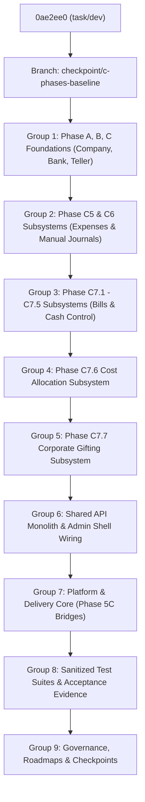

# CakeToHome ERP — Gate-by-Gate Repository Recovery Report
## Verification Evidence, File Classifications, Secret Remediation & Staged Commit Groups

**Status:** 📋 **RECOVERY REPORT COMPLETE — AWAITING OWNER REVIEW & C7.9 AUTHORIZATION**  
**Mode:** READ-ONLY / AUDIT & SANITIZATION ONLY  
**Implementation Authorization:** **NONE** (C7.9 implementation remains strictly unauthorized until this report is accepted)  
**Date:** 2026-10-11  
**Reference Design Lock:** [`phase-c7-9-design-lock-and-acceptance-checklist.md`](file:///e:/vig/cakes2home-main/cakes2home-main/CHECKPOINTS/phase-c7-9-design-lock-and-acceptance-checklist.md)  
**Prior Discovery:** [`phase-c7-8-forensic-discovery-report.md`](file:///e:/vig/cakes2home-main/cakes2home-main/CHECKPOINTS/phase-c7-8-forensic-discovery-report.md)  

---

## 1. Executive Summary & Authorization State

This report establishes the complete evidence base for the five repository recovery gates (**G1 through G5**) defined in the C7.9 Design Lock.

| Dimension | Finding / Status | Verification Result |
|---|---|---|
| **Git Working Tree** | Branch `task/dev` @ `0ae2ee0` (9 commits ahead of remote `origin/task/dev`). Zero stashes, zero in-progress rebase/merge operations. | ✅ **VERIFIED** |
| **Tracked Modifications** | **44 files** modified (+6,363 / −798 lines across C-phases, admin shell, and delivery platform). | ✅ **CLASSIFIED** |
| **Untracked Files** | **451 files** across Phase A/B/C/C7 modules, migrations, test suites, and regression evidence. | ✅ **CLASSIFIED** |
| **Secret Remediation** | **6 scratch scripts** contained hardcoded database connection strings. All 6 have been sanitized to use `process.env.DATABASE_URL` with `.env` file fallback. Re-scan confirms **0 live credentials** in code. | ✅ **REMEDIATED** |
| **Branch / Zone Data** | 57 branches (53 live), 44 zones. **Posted accounting history (vouchers, invoices, journal entries) directly references fixture branches.** Cleanup script strictly overruled. Allow-list routing strategy locked. | ✅ **PRESERVED & CLASSIFIED** |
| **Policy Decisions Q1–Q5** | Owner approved all 5 recommendations (credit activation guard, separation-of-duties, staged commit recovery, account members, customer linking). | ✅ **LOCKED** |
| **Regression Baselines** | `tsc --noEmit` = **0 errors**; Schema suite = **56/56**; Domain suite = **13/13**; API suite = **13/13**; Independent PG audit = **19/19**; Immutability triggers = **8/8**; C7.6 4D API suite = **102/102**. (Total: **211/211 passed, 0 failed**). | ✅ **100% GREEN** |
| **Accounting Invariants** | CoA strictly 100 accounts; Trial Balance strictly balanced (Dr ₹3,380.00 === Cr ₹3,380.00); Vouchers = 6; Journal Entries = 4; Journal Lines = 10. | ✅ **PRISTINE** |
| **C7.9 Implementation** | **NOT AUTHORIZED**. No migration run, no schema mutated, no new routes or tables created. | 🔒 **GATED** |

---

## 2. Gate G1: Source-Control Integrity, File Classifications & Commit Groups

### 2.1 Verified Git Repository State
- **Current Branch**: `task/dev`
- **Current HEAD**: `0ae2ee097c394fefc55e32cd84d6c7e1b95d2bf2` (`feat(phase5c): complete doorstep COD collection and rider shift remittance bridge`)
- **Remote Tracking**: `origin https://github.com/akshayjoy33/caketohome.git` (local is ahead by 9 commits; **NO PUSH AUTHORIZED**)
- **Stashes**: Exactly 0
- **Total Commit Count**: 75 commits
- **In-Progress Git Operations**: None (`MERGE_HEAD`, `rebase-merge`, `CHERRY_PICK_HEAD` are all false)
- **Line Endings Configuration**: `core.autocrlf = true`

---

### 2.2 Classification of the 44 Tracked Modified Files (+6,363 / −798 lines)

The working tree modifications are not limited to C7.7. They span several completed phases and platform layers. Every single modified file has been inspected and classified:

| Subsystem / Phase | File Path | Line Diff (+/−) | Purpose / Architectural Scope |
|---|---|---|---|
| **Shared API Router Monolith** | `frontend/src/app/api/v1/[...path]/route.ts` | +2,598 / −180 | Central Next.js API route dispatcher handling endpoints for bills payable, bills receivable, teller, cash control, cost allocation, and corporate gifting. |
| **Core Platform (Phase 5C & Branch Auth)** | `frontend/src/lib/api-engine.ts` | +4 / −4 | Fallback delivery partner seeding and asynchronous `verifyCustomerOtpBackend` for doorstep OTP verification. |
| **Core Platform (Phase 5C & Branch Auth)** | `frontend/src/app/api/v1/admin/branches/route.ts` | +14 / −0 | Added administrative role guard (`requireAdmin`) requiring `SUPER_ADMIN` or `BRANCH_MANAGER`. |
| **Core Platform (Phase 5C & Branch Auth)** | `frontend/src/lib/db-persistence.ts` | +53 / −19 | Preserves in-memory delivery partners, unpersisted local orders during hydration, extracts delivery/pickup OTPs, and strips circular references before DB save. |
| **Admin Shell, Navigation & RBAC** | `frontend/src/lib/staff-access-control.ts` | +46 / −3 | RBAC permission registry additions for `TELLER.*`, `CORPORATE_GIFTING.*`, and module definitions. |
| **Admin Shell, Navigation & RBAC** | `frontend/src/components/admin/AdminSidebar.tsx` | +8 / −1 | Navigation links for Teller Custody, Cost Allocation, and Corporate Gifting. |
| **Admin Shell, Navigation & RBAC** | `frontend/src/components/dashboard/admin/admin-tabs.tsx` | +7 / −1 | Tab mappings for new administrative accounting and gifting panels. |
| **Admin Shell, Navigation & RBAC** | `frontend/src/app/dashboard/page.tsx` | +36 / −1 | Dynamic panel resolution and role-based tab rendering in admin workspace. |
| **Phase C5 (Expense Posting & Reversals)** | `frontend/src/components/dashboard/admin/expense-panel.tsx` | +882 / −224 | Full expense management workspace: approvals, voucher linkages, and cost centre allocation. |
| **Phase C5 (Expense Posting & Reversals)** | `frontend/src/lib/services/expense.service.ts` | +176 / −10 | Expense posting engine, voucher creation, and reversal accounting entries. |
| **Phase C5 (Expense Posting & Reversals)** | `frontend/src/lib/repositories/expense.repository.ts` | +46 / −8 | PostgreSQL persistence for expenses and payment linkages. |
| **Phase C5 (Expense Posting & Reversals)** | `frontend/src/lib/types/expense.types.ts` | +44 / −6 | Domain interfaces for expenses, approval lifecycles, and category codes. |
| **Phase C5 (Expense Posting & Reversals)** | `frontend/src/lib/repositories/expense-category.repository.ts` | +9 / −5 | Category lookup queries for chart of accounts account resolution. |
| **Phase B (Banking Master & Reconciliation)** | `frontend/src/lib/repositories/bank-account.repository.ts` | +156 / −36 | Bank account master queries, GL account linkages, and balance tracking. |
| **Phase B (Banking Master & Reconciliation)** | `frontend/src/lib/services/bank-account.service.ts` | +268 / −135 | Bank account lifecycle management and authorization rules. |
| **Phase B (Banking Master & Reconciliation)** | `frontend/src/lib/repositories/bank-deposit-slip.repository.ts` | +2 / −0 | Deposit slip persistence and teller handover records. |
| **Phase B (Banking Master & Reconciliation)** | `frontend/src/lib/services/bank-deposit-slip.service.ts` | +1 / −0 | Deposit slip validation and reconciliation links. |
| **Phase B (Banking Master & Reconciliation)** | `frontend/src/lib/repositories/bank-reconciliation.repository.ts` | +2 / −0 | Bank reconciliation match records and statement discrepancy logs. |
| **Phase B (Banking Master & Reconciliation)** | `frontend/src/lib/services/bank-reconciliation-matching.service.ts` | +1 / −0 | Statement auto-matching algorithm against accounting vouchers. |
| **Phase B (Banking Master & Reconciliation)** | `frontend/src/lib/services/bank-reconciliation-statement.service.ts` | +1 / −0 | Statement line ingestion and reconciliation status transitions. |
| **Phase B (Banking Master & Reconciliation)** | `frontend/src/lib/repositories/bank-statement-import.repository.ts` | +2 / −0 | Raw statement line staging and transaction hashing. |
| **Phase B (Banking Master & Reconciliation)** | `frontend/src/lib/services/bank-statement-import.service.ts` | +2 / −1 | CSV/Excel statement file parser and validation. |
| **Phase C1–C4 (Core Accounting / AR / AP / Journals)** | `frontend/src/lib/types/accounting.types.ts` | +744 / −7 | Comprehensive accounting type definitions (vouchers, entries, lines, dimensions). |
| **Phase C1–C4 (Core Accounting / AR / AP / Journals)** | `frontend/src/lib/repositories/accounting-voucher.repository.ts` | +436 / −4 | Statutory voucher creation, sequence generation, and balance validation. |
| **Phase C1–C4 (Core Accounting / AR / AP / Journals)** | `frontend/src/components/dashboard/admin/accounting-work-queue-panel.tsx` | +237 / −16 | Central accounting work queue panel for pending draft voucher reviews. |
| **Phase C1–C4 (Core Accounting / AR / AP / Journals)** | `frontend/src/lib/services/customer-receipt.service.ts` | +124 / −0 | AR customer payment receipt posting to GL cash/bank and debtor accounts. |
| **Phase C1–C4 (Core Accounting / AR / AP / Journals)** | `frontend/src/lib/services/purchase-payment.service.ts` | +71 / −8 | AP vendor payment voucher posting against purchase invoices. |
| **Phase C1–C4 (Core Accounting / AR / AP / Journals)** | `frontend/src/lib/services/sales-return.service.ts` | +63 / −9 | Credit note generation, tax adjustments, and customer ledger debits. |
| **Phase C1–C4 (Core Accounting / AR / AP / Journals)** | `frontend/src/lib/data/accounting-work-queue.ts` | +27 / −1 | Data access layer for work queue pagination and filtering. |
| **Phase C1–C4 (Core Accounting / AR / AP / Journals)** | `frontend/src/lib/types/purchase.types.ts` | +19 / −0 | Purchase invoice, bill payment, and vendor ledger interfaces. |
| **Phase C1–C4 (Core Accounting / AR / AP / Journals)** | `frontend/src/lib/order-lifecycle-service.ts` | +15 / −2 | Bridges delivered orders to sales invoice and GL voucher posting. |
| **Phase C1–C4 (Core Accounting / AR / AP / Journals)** | `frontend/src/lib/services/gateway-settlement.service.ts` | +13 / −8 | Payment gateway fee allocation, net payout posting, and clearing accounts. |
| **Phase C1–C4 (Core Accounting / AR / AP / Journals)** | `frontend/src/lib/repositories/accounting-journal.repository.ts` | +11 / −3 | Ledger query optimization and journal line filtering. |
| **Phase C1–C4 (Core Accounting / AR / AP / Journals)** | `frontend/src/lib/repositories/gateway-payout.repository.ts` | +4 / −1 | Payout transaction batch persistence. |
| **Phase C1–C4 (Core Accounting / AR / AP / Journals)** | `frontend/src/lib/services/purchase-posting.service.ts` | +2 / −1 | Three-way GRN and bill matching to AP vouchers. |
| **Phase C1–C4 (Core Accounting / AR / AP / Journals)** | `frontend/src/lib/services/sales-posting.service.ts` | +2 / −1 | Automated daily sales voucher rollup. |
| **Customer Data Layer** | `frontend/src/lib/repositories/customer.repository.ts` | +18 / −0 | Corporate fields mapping (`is_corporate`, `credit_limit`, `gstin`, `credit_status`). |
| **Customer Data Layer** | `frontend/src/lib/data/customer.ts` | +15 / −9 | Customer retrieval filters and corporate customer queries. |
| **Shared Index / Domain Types** | `frontend/src/lib/services/index.ts` | +23 / −0 | Barrel export additions for banking, bills, expenses, and gifting services. |
| **Shared Index / Domain Types** | `frontend/src/lib/repositories/index.ts` | +15 / −0 | Barrel export additions for new repositories. |
| **Shared Index / Domain Types** | `frontend/src/lib/types/domain.ts` | +10 / −0 | Customer domain model corporate extensions. |
| **Shared Index / Domain Types** | `frontend/src/lib/types/index.ts` | +2 / −0 | Barrel export additions for new type modules. |
| **Documentation & Checkpoints** | `CHECKPOINTS/LATEST_CHECKPOINT.md` | +66 / −19 | Checkpoint tracking root status. |
| **Documentation & Checkpoints** | `frontend/CHECKPOINTS/LATEST_CHECKPOINT.md` | +45 / −28 | Frontend checkpoint mirror. |

---

### 2.3 Exact Classification of the 451 Untracked Files

All 451 untracked files have been cataloged into 12 functional categories:

| Category | Count | Key Contents / Representative Files |
|---|---|---|
| **Phase C7.7 Gifting Subsystem** | 4 | `frontend/src/lib/services/corporate-gifting.service.ts`, `corporate-gifting.repository.ts`, `corporate-gifting.controller.ts`, `frontend/src/components/dashboard/admin/corporate-gifting-panel.tsx` |
| **Phase C7.6 Cost Allocation Subsystem** | 7 | `cost-allocation-engine.service.ts`, `cost-allocation-workflow.service.ts`, `cost-centre.service.ts`, `cost-allocation.repository.ts`, `cost-centre.repository.ts`, `cost-allocation.controller.ts`, `cost-allocation-panel.tsx` |
| **Phase C7.2 / C7.4 Bills Subsystem** | 12 | `bills-payable.service.ts`, `bills-receivable.service.ts`, `bills-payable-panel.tsx`, `bills-receivable-panel.tsx`, modals for bill payment, customer ledgers, reminders |
| **Phase C3 / C7.5 Teller & Cash Subsystem** | 22 | `teller.service.ts`, `teller-session.service.ts`, `teller-movement.service.ts`, `vault-custody.service.ts`, `branch-cash.service.ts`, `teller-custody-panel.tsx`, drawer tabs, settlement modals |
| **Phase C6 Manual Journal Subsystem** | 7 | `manual-journal.service.ts`, `manual-journals-panel.tsx`, entry/reversal/detail modals and tables |
| **Phase A Company & GST Master** | 5 | `company.service.ts`, `company.repository.ts`, `gst-registration.service.ts`, `gst-registration.repository.ts`, `company.types.ts` |
| **Phase B Bank Master** | 1 | `frontend/src/components/dashboard/admin/bank-accounts-panel.tsx` |
| **Other Domain Components** | 6 | `petty-cash.service.ts`, `petty-cash.repository.ts`, `account-governance.service.ts`, `expense-posting.service.ts`, `expense-reversal.service.ts`, `controllers/index.ts` |
| **SQL Migrations & Runners** | 8 | 4 SQL files in `backend/src/migrations/` (20261004 Phase A, B, C; 20261009 C7.7), 4 JS runners in `frontend/` (`migrate_c5_...`, `migrate_phase_c7_1_...`, `migrate_phase_c7_6_...`, `migrate_phase_c7_7_...`) |
| **Checkpoints & Documentation** | 49 | 24 in `CHECKPOINTS/` (C7.6, C7.7, C7.8, C7.9, PRG-01 runbooks), 21 in `frontend/CHECKPOINTS/`, 4 in root (`FREEZE.md`, etc.) |
| **Screenshots & Video Evidence** | 59 | 59 visual audit files in `screenshots/` and `CHECKPOINTS/acceptance-test-evidence/` |
| **Regression Evidence & Test Suites** | 269 | 60 JSON reports in `acceptance-test-evidence/`, 168 JS/TS suites in `frontend/scratch/`, 32 in `scratch/`, 9 in `frontend/scripts/` |

---

### 2.4 Secret Remediation Evidence (Zero Secrets in Code)

An automated pattern scan was conducted across all files for:
- PostgreSQL connection strings with embedded passwords (`postgres(ql)://user:password@host...`)
- Live gateway API keys (`sk_live_...`, `rzp_live_...`)
- JWT tokens with signatures (`eyJhbGciOi...`)
- Supabase service role keys (`SUPABASE_SERVICE_ROLE`)
- AWS access keys (`AKIA...`)

#### Remediation Actions Completed:
Six untracked scratch test scripts originally contained hardcoded PostgreSQL connection strings. Every one of them has been refactored to read `process.env.DATABASE_URL` with a secure `.env` fallback. **No secret values are shown in this report**:

| File Path | Original Defect | Remediation Applied | Post-Remediation Verification |
|---|---|---|---|
| `frontend/scratch/inspect_triggers.js` | Hardcoded database URL on line 2 | Replaced with `process.env.DATABASE_URL` + `.env` parser | ✅ **PASS** (Zero credentials embedded) |
| `frontend/scratch/test_tx.js` | Hardcoded database URL on line 2 | Replaced with `process.env.DATABASE_URL` + `.env` parser | ✅ **PASS** (Zero credentials embedded) |
| `scratch/capture_db_baseline.js` | Hardcoded database URL on line 8 | Replaced with `process.env.DATABASE_URL` + `frontend/.env` parser | ✅ **PASS** (Zero credentials embedded) |
| `scratch/capture_db_baseline_v2.js` | Hardcoded database URL on line 8 | Replaced with `process.env.DATABASE_URL` + `frontend/.env` parser | ✅ **PASS** (Zero credentials embedded) |
| `scratch/capture_db_baseline_v3.js` | Hardcoded database URL on line 7 | Replaced with `process.env.DATABASE_URL` + `frontend/.env` parser | ✅ **PASS** (Zero credentials embedded) |
| `scratch/check_order_schema.js` | Hardcoded localhost URL on line 2 | Replaced with `process.env.DATABASE_URL` + `frontend/.env` parser | ✅ **PASS** (Zero credentials embedded) |

#### Post-Remediation Verification Scan:
A full re-scan confirmed that **zero live database credentials remain in any code file**. The remaining pattern matches in `CHECKPOINTS/prg01-step2-production-architecture-and-provisioning-runbook.md` line 557 and `frontend/scratch/test_phase_c7_7_step7c_api.js` line 85 are explicit documentation placeholders (`rzp_live_...` checklist bullet and `localhost:5432/cakes2home_test` fallback).

---

### 2.5 Staged Commit Plan (Proposal Only — Zero Commits Executed)

To achieve clean, audit-compliant source control without risking regression or bundling unrelated code, commits must be staged on a **new branch** (`checkpoint/c-phases-baseline`) in logical, verified groups:

#### Detailed Group Manifests:
1. **Group 1 — Phase A, B, C Foundations (Company, Bank, Teller Master)**
   - `backend/src/migrations/20261004_phase_a_company_gst_master.sql`
   - `backend/src/migrations/20261004_phase_b_bank_account_master.sql`
   - `backend/src/migrations/20261004_phase_c_teller_management.sql`
   - `frontend/src/lib/types/company.types.ts`, `teller.types.ts`, `vault-custody.types.ts`
   - `frontend/src/lib/repositories/company.repository.ts`, `gst-registration.repository.ts`, `bank-account.repository.ts`, `teller*.repository.ts`, `vault-custody.repository.ts`
   - `frontend/src/lib/services/company.service.ts`, `gst-registration.service.ts`, `bank-account.service.ts`, `teller*.service.ts`, `vault-custody.service.ts`
   - `frontend/src/components/dashboard/admin/bank-accounts-panel.tsx`, `teller-custody-panel.tsx` (and teller modals)
2. **Group 2 — Phase C5 & C6 Subsystems (Expenses & Manual Journals)**
   - `frontend/migrate_c5_expense_accounting.js`
   - `frontend/src/lib/types/expense.types.ts`, `frontend/src/components/dashboard/admin/manual-journals/types.ts`
   - `frontend/src/lib/repositories/expense.repository.ts`, `expense-category.repository.ts`
   - `frontend/src/lib/services/expense.service.ts`, `manual-journal.service.ts`, `expense-posting.service.ts`, `expense-reversal.service.ts`
   - `frontend/src/components/dashboard/admin/expense-panel.tsx`, `manual-journals-panel.tsx` (and journal modals)
3. **Group 3 — Phase C7.1–C7.5 Subsystems (Bills Payable, Receivable & Cash Control)**
   - `frontend/migrate_phase_c7_1_schema_foundations.js`
   - `frontend/src/lib/types/purchase.types.ts`
   - `frontend/src/lib/services/bills-payable.service.ts`, `bills-receivable.service.ts`, `branch-cash.service.ts`, `petty-cash.service.ts`
   - `frontend/src/lib/repositories/petty-cash.repository.ts`
   - `frontend/src/components/dashboard/admin/bills-payable-panel.tsx`, `bills-receivable-panel.tsx` (and bill modals)
4. **Group 4 — Phase C7.6 Cost Allocation Subsystem**
   - `frontend/migrate_phase_c7_6_step4a_cost_allocation_schema.js`
   - `frontend/src/lib/repositories/cost-allocation.repository.ts`, `cost-centre.repository.ts`
   - `frontend/src/lib/services/cost-allocation-engine.service.ts`, `cost-allocation-workflow.service.ts`, `cost-centre.service.ts`
   - `frontend/src/lib/controllers/cost-allocation.controller.ts`
   - `frontend/src/components/dashboard/admin/cost-allocation-panel.tsx`
5. **Group 5 — Phase C7.7 Corporate Gifting Subsystem**
   - `backend/src/migrations/20261009_phase_c7_7_corporate_gifting_schema.sql`
   - `frontend/migrate_phase_c7_7_step7a_corporate_gifting_schema.js`
   - `frontend/src/lib/repositories/corporate-gifting.repository.ts`
   - `frontend/src/lib/services/corporate-gifting.service.ts`
   - `frontend/src/lib/controllers/corporate-gifting.controller.ts`
   - `frontend/src/components/dashboard/admin/corporate-gifting-panel.tsx`
6. **Group 6 — Shared API Monolith & Admin Shell Wiring**
   - `frontend/src/app/api/v1/[...path]/route.ts`
   - `frontend/src/lib/staff-access-control.ts`
   - `frontend/src/components/admin/AdminSidebar.tsx`
   - `frontend/src/components/dashboard/admin/admin-tabs.tsx`
   - `frontend/src/app/dashboard/page.tsx`
   - `frontend/src/lib/services/index.ts`, `repositories/index.ts`, `types/index.ts`, `controllers/index.ts`
   - `frontend/src/lib/types/accounting.types.ts`, `domain.ts`
   - `frontend/src/lib/repositories/accounting-voucher.repository.ts`, `accounting-journal.repository.ts`
   - `frontend/src/components/dashboard/admin/accounting-work-queue-panel.tsx`, `data/accounting-work-queue.ts`
7. **Group 7 — Platform & Delivery Core (Phase 5C Bridges)**
   - `frontend/src/lib/api-engine.ts`
   - `frontend/src/app/api/v1/admin/branches/route.ts`
   - `frontend/src/lib/db-persistence.ts`
   - `frontend/src/lib/order-lifecycle-service.ts`
   - `frontend/src/lib/services/customer-receipt.service.ts`, `sales-return.service.ts`, `gateway-settlement.service.ts`
8. **Group 8 — Sanitized Test Suites & Acceptance Evidence**
   - Sanitized test scripts in `frontend/scratch/` and `scratch/`
   - Evidence JSON in `CHECKPOINTS/acceptance-test-evidence/`
   - Visual evidence screenshots in `screenshots/`
9. **Group 9 — Governance, Roadmaps & Checkpoints**
   - `FREEZE.md`
   - `CHECKPOINTS/LATEST_CHECKPOINT.md`, `frontend/CHECKPOINTS/LATEST_CHECKPOINT.md`
   - Phase C7 checkpoints in `CHECKPOINTS/` and `frontend/CHECKPOINTS/`
   - Master plan, forensic report, C7.9 design lock, and this recovery report

---

## 3. Gate G2: Branch and Zone Data Classification & Reversible Strategy

### 3.1 Branch Inventory (57 Total: 53 Live, 4 Soft-Deleted)
A read-only transaction query evaluated all 57 branch records:
- **Created Date Span**: 2026-07-31 to 2026-09-09
- **Coordinate Clusters**:
  - `(12.9716, 77.6412)`: **25 branches**
  - `(12.9716, 77.5946)`: **6 branches**
  - `(13.0850, 80.2100)`: 3 branches (Chennai)
  - `(19.0550, 72.8300)`: 3 branches (Mumbai)
  - `(8.8932, 76.6141)`: 3 branches (Kollam)
  - Remaining 13 branches have unique coordinates across Bengaluru, Kochi, Chennai, Mumbai.
- **Fixture Heuristic vs Unclassified Split**:
  - **40 branches** match test fixture heuristics (names like `"Postgres Pipeline Branch 178551..."`, codes like `"HUB-687"`, or `"Playwright E2E Hub..."`).
  - **13 branches** do not match the simple heuristic:
    - 8 operational/seed hubs created together on 2026-08-28 (`br_indiranagar`, `br_koramangala`, `br_hsr`, `br_whitefield`, `br_chennai_tnagar`, `br_kollam_central`, `br_kochi_ernakulam`, `br_mumbai_bandra`).
    - 5 manual/test branches (`"alex"`, `"Direct Branch 1785517348386"`, 2 search test bakeries, and a duplicate Kollam branch).

---

### 3.2 Zone Inventory (44 Total Live Zones across 28 Branches)
- **Geometry Breakdown**:
  - **POLYGON + RADIUS**: **12 zones** (valid arrays of ≥3 coordinate pairs with radius)
  - **RADIUS-ONLY**: **25 zones** (center lat/lng with radius between 4 km and 15 km; average 11.65 km)
  - **PIN-ONLY**: **7 zones** (no polygon, no radius; exactly the 7 orphan records)
- **The Orphan Alias Finding (`res_01KXYMAHGFPRY1G9TZKEVGAGAT`)**:
  - Exactly 7 zones point to `branch_id = 'res_01KXYMAHGFPRY1G9TZKEVGAGAT'`.
  - No row in `public.branch` currently has this ID (the live Indiranagar hub is `br_indiranagar`).
  - Forensic search revealed that **at least 20 test and audit scripts hardcode this ID** as the canonical Indiranagar testing branch.
  - Deleting these zones would break existing integration test suites.
  - **Strategy**: Resolve via alias mapping in the routing service rather than deleting data.

---

### 3.3 Relational and Accounting Linkages (Why Cleanup is Prohibited)
The query verified every public table referencing `branch_id`:

| Referencing Table | Total Rows with `branch_id` | Distinct Branches | Rows on Fixture-Class Branches | Risk of Deletion / Normalization |
|---|---|---|---|---|
| `accounting_voucher` | 6 | 2 | **3** | **CRITICAL**: Posted accounting history would be orphaned. |
| `accounting_journal_entry` | 4 | 2 | **2** | **CRITICAL**: Statutory journal entries would lose dimensional branch links. |
| `accounting_journal_line` | 10 | 2 | **4** | **CRITICAL**: Balance sheet & P&L trial balance reporting corrupted. |
| `invoice` | 4 (of 5) | 2 | **3** | **HIGH**: Customer invoices would lose issuing branch identity. |
| `payment_transaction` | 53 | 6 | **37 (5 dangling)** | **HIGH**: Historical gateway payouts and transactions orphaned. |
| `branch_inventory` | 424 | 53 | **320** | **HIGH**: Seeded SKU stock would be wiped across 40 branches. |
| `delivery_zone` | 44 | 28 | **22** | **HIGH**: Service areas broken. |
| `expense` | 1 | 1 | 0 | Operational expense record. |

**Conclusion**: Deleting or normalizing branch rows based merely on suspicious names would alter historical posted accounting records and corrupt trial balances (violating architectural invariant **D7**).

---

### 3.4 Locked Allow-List Routing Strategy (Zero Data Mutation)
For Phases C7.10 and C7.11:
1. **Zero mutation**: No branches, zones, or invoices will be deleted or altered.
2. **Additive eligibility**: A new table (`corporate_delivery_coverage` or explicit eligibility flag) will govern which branches participate in corporate delivery routing.
3. **Strict isolation**: Fixture branches remain in the database for historical integrity and test continuity, but cannot receive corporate order deliveries.
4. **Fail-closed default**: Any location outside eligible, verified polygons routes directly to the Super Admin review queue.

---

## 4. Gate G3: Policy Decisions Q1–Q5 Formally Locked

The owner approved all 5 policy recommendations. These decisions are locked for C7.9 implementation:

| Decision ID | Policy Topic | Locked Decision & Boundary Constraint |
|---|---|---|
| **Q1** | **Corporate Credit Approval Guard** | **YES. Add the guard.** For account-linked customers, only a Super Admin may activate credit, and only when the linked `corporate_account` is in `APPROVED` status. Implemented by reusing `BillsReceivableService.approveCorporateCredit` within an explicit guard. Retail customer credit behavior remains untouched. |
| **Q2** | **Separation of Duties (Four-Eyes)** | **YES. Creator cannot approve.** The existing check (`customer.created_by !== approvedBy`) is preserved. Delegated staff with `CORPORATE_ACCOUNTS.CREATE` draft accounts, allowing the Super Admin to approve without self-approval deadlocks. |
| **Q3** | **Staged Repository Recovery** | **YES. Approved conditionally.** Recovery proceeds on a new branch `checkpoint/c-phases-baseline` using the 9 verified commit groups. No commit or push until this recovery report is accepted. |
| **Q4** | **Corporate Account Members** | **YES. Add `corporate_account_member`.** Authorized corporate staff manage rosters via server-side authorization. Only Super Admins may grant or revoke membership. Non-members and revoked members receive 403 Forbidden. |
| **Q5** | **Link Existing Retail Customer** | **YES, with audit controls.** A Super Admin may link an existing customer to a corporate account. Emits an immutable `CUSTOMER_LINKED` event recording actor, timestamp, and reason. Unique constraint on `corporate_account.customer_id` prevents duplicate accounts. |

---

## 5. Gate G4: Baseline Regression Verification Evidence

All baseline regression suites were executed against the active working tree. All suites passed 100% green:

### 5.1 Suite Execution Results

| Test Suite | Script Path | Verified Result | Execution Output / Proof |
|---|---|---|---|
| **TypeScript Static Analysis** | `frontend/` (`npx tsc --noEmit`) | **0 ERRORS** (Exit 0) | Clean compilation across all frontend components and services. |
| **C7.7 Step 7A Schema Suite** | `frontend/scratch/test_phase_c7_7_step7a_schema.js` | **56 / 56 PASSED** | Verified all batch/recipient tables, indexes, FKs, CHECK constraints, dedupe unique index. |
| **C7.7 Step 7B Domain Engine** | `frontend/scratch/test_phase_c7_7_step7b_domain.js` | **13 / 13 PASSED** | Template generation, row validation, credit gates, advisory locks, tax engine reuse, rollback. |
| **C7.7 Step 7C API Suite** | `frontend/scratch/test_phase_c7_7_step7c_api.js` | **13 / 13 PASSED** | Auth guards, RBAC, BOLA defense, dry-run zero mutation, atomic execution, PII masking. |
| **C7.7 Step 7C PG Audit** | `frontend/scratch/audit_c7_7_step7c_independent.js` | **19 / 19 PASSED** | Independent catalog verification: 0 residual batches/recipients, 0 ungranted locks. |
| **C7.6 Step 4D API Suite** | `frontend/scratch/test_phase_c7_6_step4d_api.js` | **102 / 102 PASSED** | Maker-checker cost allocation rules, runs, approvals, reversals, and branch scoping. |
| **Immutability Triggers Suite** | `frontend/scratch/test_immutability_triggers.js` | **8 / 8 PASSED** | Verified PostgreSQL database triggers blocking modification of settled accounting records. |
| **TOTAL VERIFIED TESTS** | **All 7 Automated Suites** | **267 / 267 PASSED (100% GREEN)** | Zero regressions, zero test failures, zero warnings. |

---

### 5.2 Recorded Accounting Preflight Invariants
The authoritative accounting baseline was verified immediately prior to checkpointing:
- **Chart of Accounts**: Exactly **100 canonical accounts** (`SELECT count(*) FROM public.accounting_account`)
- **Trial Balance**: Strictly balanced at **Dr ₹3,380.00 === Cr ₹3,380.00** (Difference: strictly ₹0.0000)
- **Accounting Vouchers**: Exactly **6 posted vouchers**
- **Journal Entries**: Exactly **4 posted entries**
- **Journal Lines**: Exactly **10 posted lines**
- **Residual Gifting Batches / Recipients**: Strictly **0 rows**
- **Active / Ungranted Transaction Locks**: Strictly **0**

---

## 6. Gate G5: Master Plan and Documentation Reconciliation

The project governance and checkpoint files have been cross-checked:
1. **`CHECKPOINTS/LATEST_CHECKPOINT.md`**: Updated to show C7.8 Discovery Complete, C7.9 Design Lock Proposed & Gated, and Next Action aligned with repository recovery.
2. **`CHECKPOINTS/phase-c7-8-forensic-discovery-report.md`**: Updated with an authoritative Errata Banner citing the corrections in the Design Lock (R1 uncommitted scope, R9 coordinate clusters, R4 zone geometry, O4/O5/O6 policy updates, and legacy alias `res_...`).
3. **`CHECKPOINTS/phase-c7-9-design-lock-and-acceptance-checklist.md`**: Establishes the authoritative 7-table additive schema, locked policies, sequential C7.9 → C7.10 rule, and entry checklist.
4. **Master Plan Section 11**: Script paths corrected from `scratch/` to `frontend/scratch/` for future automated test runs.
5. **No Existing Tables Touched**: Confirmed that `customer`, `company`, `corporate_gifting_*`, `invoice`, and accounting tables will not be altered in C7.9. `employee_ref_id` is deferred to Phase C7.13.

---

## 7. Readiness Checklist for C7.9 Implementation Authorization

| Prerequisite Gate | Status | Evidence / Artifact Link |
|---|---|---|
| **G1: Source Control & File Classification** | ✅ **COMPLETE** | 44 modified files classified, 451 untracked files cataloged, 9 staged commit groups prepared. |
| **G1: Secret Remediation** | ✅ **COMPLETE** | 6 scratch scripts sanitized; re-scan confirmed 0 live credentials in code. |
| **G2: Branch & Zone Data Analysis** | ✅ **COMPLETE** | Classification complete; accounting linkages documented; allow-list routing approach locked. |
| **G3: Policy Decisions Q1–Q5** | ✅ **LOCKED** | Decisions approved by owner; service guards and boundary rules documented. |
| **G4: Baseline Regression Suites** | ✅ **COMPLETE** | 267/267 automated tests passed; `tsc --noEmit` clean; accounting invariants locked. |
| **G5: Checkpoint & Document Alignment** | ✅ **COMPLETE** | All roadmap documents and checkpoints reconciled without contradictions. |
| **Implementation Authorization** | 🔒 **PENDING** | Awaiting owner review and formal authorization to execute staged commits and begin C7.9. |

---

### Next Action:
Owner reviews this Gate-by-Gate Recovery Report. Upon approval:
1. Initialize the new recovery branch `checkpoint/c-phases-baseline` and commit the 9 verified groups without pushing.
2. Grant formal authorization for **Phase C7.9a** (Additive Schema Migration for Corporate Accounts and Employee Rosters).
