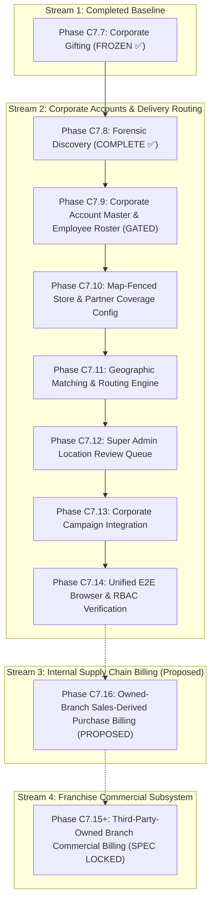

# CakeToHome ERP — Branch Purchase Billing & Commercial Settlements Specification
## Architecture Alignment: Owned Branches (Phase C7.16 Proposed) vs. Third-Party Branches (Phase C7.15+)

> **Document Status**: 📋 **PROPOSAL & SPECIFICATION ONLY — NOT IMPLEMENTED**  
> **Target Subsystems**: Internal Owned-Branch Purchase Billing & Third-Party Franchise Commercial Settlement  
> **Preservation Baseline**: Group 7 commit `d231cee7e55f716526e62f5799cc7377c555fed3` (Clean index, frozen CoA = 100, zero DB mutations)  
> **Date**: 2026-10-12  
> **Author**: Antigravity (AI Engineering Lead)  

---

## 1. Executive Summary

This specification establishes the architectural foundations, accounting rules, and implementation phase boundaries for branch billing across the CakeToHome ERP network.

Following forensic discovery in **Phase C7.9a**, a fundamental architectural boundary is enforced:
1. **Domain A (Corporate Accounts & Employee Rosters — Phase C7.9)** remains strictly focused on external B2B corporate customer management, contact profiles, employee roster lifecycle, and delivery recipient linking. It contains **zero** internal purchase billing, inter-branch transfers, franchise rate cards, or settlement engines.
2. **Domain B (CakeToHome-Owned Branch Automatic Purchase Billing — Proposed Phase C7.16)** governs internal supply-chain billing where the parent company/central kitchen manufactures cakes and automatically derives item-wise purchase bills from verified, fulfilled retail customer sales at a centrally approved, uniform transfer rate per SKU across all owned branches.
3. **Domain C (Third-Party-Owned Branch Commercial Billing & Settlements — Phase C7.15+)** governs commercial franchise operations where external owners operate branches under contract, with negotiated owner-specific rate cards, owner bill submission and 3-way delivery reconciliation, and bi-directional settlement engines.

```
                                  CakeToHome Central Kitchen / Factory
                                                    │
                   ┌────────────────────────────────┴────────────────────────────────┐
                   ▼                                                                 ▼
      Domain B: Owned Branches                                          Domain C: Third-Party Branches
     (Proposed Phase C7.16)                                                 (Phase C7.15+)
                   │                                                                 │
  • Parent central manufacturing                                    • Contract manufacturing or partner supply
  • Uniform approved transfer rate per SKU                          • Negotiated owner-specific rate cards (valid_from/to)
  • Automatic item-wise bills from eligible sales                   • Owner bill submission against verified fulfillment
  • Maker-Checker confirmation feeding Bills Payable                • Bi-directional settlement (Platform ↔ Owner)
                   │                                                                 │
                   └────────────────────────┬────────────────────────────────────────┘
                                            ▼
                          CRITICAL ACCOUNTING DESIGN CONSTRAINT
                      Sales-Derived Purchase Bill vs. Physical GRN
                (Zero Duplicate Liabilities • Zero Phantom Inventory • SoD Enforced)
```

---

## 2. Strict Domain Scope Boundaries

| Dimension | Domain A: Corporate Accounts (C7.9) | Domain B: Owned Branch Billing (C7.16 Proposed) | Domain C: Third-Party Branch Billing (C7.15+) |
|---|---|---|---|
| **Primary Focus** | Corporate client master & employee rosters | Factory-to-store sales-derived transfer bills | Franchise commercial billing & 2-way settlements |
| **Counterparty** | B2B Corporate Customers (`public.customer`) | Internal Operating Branches (`public.branch`) | Third-Party Branch Owners / Franchise Entities |
| **Pricing Model** | Retail / Corporate order selling prices | Centrally approved uniform transfer rate per SKU | Negotiated, contract-specific owner rate cards |
| **Bill Generation** | Sales Invoices (`public.invoice`) | Automatic derivation from verified sales | Owner submits bill; ERP runs 3-way reconciliation |
| **Accounting Impact**| Accounts Receivable (`1121 AR`) | Bills Payable / Internal Clearing (`2111 AP` / Clearing) | Bills Payable / Two-Way Settlement Clearing |
| **Fulfillment Check**| Address coordinates & map geofences | Fulfilled customer orders (`status = 'delivered'`) | OTP-verified doorstep completion (`delivered_at`) |
| **Phasing Boundary**| **Phase C7.9 (Immediate next phase)** | **Phase C7.16 (Post-Routing Roadmap)** | **Phase C7.15+ (Extended Commercial Subsystem)** |

---

## 3. Confirmed Requirements vs. Unresolved Business Decisions

### 3.1 Confirmed Requirements

1. **Central Manufacturing (Owned Branches)**: The parent company / central kitchen produces cakes centrally for all CakeToHome-owned branches.
2. **Uniform Approved Rate (Owned Branches)**: Every CakeToHome-owned branch uses the exact same centrally approved transfer rate per SKU. Rates are versioned and audited; historical bills retain the rate active at the time of sale.
3. **Automatic Item-Wise Bill Derivation**: Purchase bill drafts for owned branches are automatically calculated from verified, eligible customer sales (not created manually through purchase orders).
4. **Mandatory Bill Attributes**: Every derived bill must display: branch, sales period, source order references, SKU/product title, eligible quantity, unit transfer rate, item gross amount, taxes/adjustments, and total payable.
5. **Maker-Checker Governance**: Draft bills require operational confirmation and central finance approval (`ACCOUNTING.APPROVE` / `ACCOUNTING.POST`) before booking into Bills Payable.
6. **Negotiated Rate Cards (Third-Party Branches)**: Third-party branches have contract-specific rates per SKU with temporal validity (`valid_from`, `valid_to`) and audit logs.
7. **Owner Bill Submission & 3-Way Reconciliation**: Franchise owners submit commercial bills that must reconcile against system-fulfilled transactions with verified delivery OTP evidence (`order.status = 'delivered'`, `delivery_otp_verified_at IS NOT NULL`).
8. **Two-Way Settlement**: The system must support settlements where CakeToHome pays the owner (platform collection) or the owner pays CakeToHome (cash/till collection).
9. **No Duplicate Liability**: Physical inventory receipt evidence (GRN/stock transfer) and commercial sales-derived billing must reconcile to a single accounting liability. Neither flow may create double payables or double inventory.

### 3.2 Unresolved Decisions Requiring Owner / Accountant Confirmation

The following questions cannot be decided autonomously by engineering and are formally submitted for owner and statutory accountant confirmation:

- [ ] **UD-1: Parent Company vs. CakeToHome Distinct GST Registrations & Legal Entity Structure**:
  - *Confirmed Fact*: The Parent Company (Central Factory / Manufacturing) holds its own GST registration, and CakeToHome (Retail / Platform / Branches) holds a separate distinct GST registration.
  - *Statutory Invoicing Mandate*: Because the Parent Company and CakeToHome hold distinct GST registrations, they are legally distinct registered persons under GST law (even if affiliated/under common group ownership).
  - *Accounting Consequence*: Central kitchen supply from the Parent Company to CakeToHome is legally an **Inter-Registration Commercial Supply**. The Parent Company must issue a statutory GST Tax Invoice to CakeToHome. In CakeToHome's books, this represents a commercial purchase bill with statutory Input Tax Credit (ITC) and an inter-company commercial payable.
  - *Owned-Branch Internal Movement*: Once goods are received by CakeToHome under its GST registration, transfers between CakeToHome hubs and CakeToHome-owned branches (if operating under CakeToHome's GSTIN) are intra-GSTIN movements governed by Rule 55 Delivery Challans with zero additional GST.
- [ ] **UD-2: Chart of Accounts Baseline Freeze (100 Accounts) & Candidate Clearing Codes**:
  - *Authoritative Baseline*: The live Chart of Accounts contains **exactly 100 accounts** in `public.accounting_account` (verified live).
  - *Status of Candidate Codes (`1118B`, `2118`, `2119`, `5114`, `5115`)*: These codes are **STRICTLY UNAPPROVED PROPOSALS** for discussion. They do **not** exist in the active Chart of Accounts.
  - *Posting Ban*: **Zero application code, posting services, or migrations may post to or create these accounts** without a formal, separately authorized Chart of Accounts amendment migration signed off by the statutory auditor. Any interim posting must map strictly to existing authorized accounts (`1132 Inventory - Cakes`, `2111 Accounts Payable`, `1119 Unclassified Suspense`, `5110 COGS - Cakes`).
- [ ] **UD-3: Counterparty Master for Owned Branches**:
  - *Question*: In `public.purchase`, records require a `supplier_id REFERENCES public.supplier(id)`. When an automatic purchase bill is derived for an owned branch, which entity serves as the supplier?
  - *Resolution*: Since Parent Company is a distinct GST-registered entity, it is registered in `public.supplier` as the official manufacturing vendor, allowing conventional `public.purchase` bills with statutory GST tracking.
- [ ] **UD-4: Sales Returns, Wastage & Replacement Eligibility Rules**:
  - *Question*: If a customer returns a cake, cancels post-dispatch, or receives a free replacement due to transit damage, does the owned branch get billed for the transfer cost?
  - *Options*: (A) Only net fulfilled and accepted sales are eligible; (B) All dispatched items are billed, and damaged/returned items generate separate credit claims.
- [ ] **UD-5: Timing of Inventory Recognition**:
  - *Question*: Does branch inventory increase upon central kitchen dispatch, physical branch receipt, or is inventory tracked purely at the central kitchen until point-of-sale?

---

## 4. Critical Accounting Design Constraint: No Duplicate Liability

### 4.1 The Core Invariant

> [!CAUTION]
> **ACCOUNTING INTEGRITY INVARIANT**: Physical goods movement evidence (GRN / stock transfer) and commercial sales-derived purchase billing must reconcile to **exactly one valid accounting outcome**, never two AP liabilities and never duplicate inventory debits.

### 4.2 Potential Duplicate Posting Pitfalls

1. **Double Inventory Debit**:
   - If physical receipt debits `1132 Inventory - Cakes` and credits `2111 Accounts Payable`; AND
   - The sales-derived bill also debits `1132 Inventory - Cakes` and credits `2111 Accounts Payable`;
   - *Result*: Inventory is double-counted, and liabilities to suppliers are booked twice.
2. **Double COGS Recognition**:
   - If the retail customer sale debits `5110 COGS - Cakes` and credits `1132 Inventory`; AND
   - The sales-derived purchase bill debits `5110 COGS - Cakes` and credits `2111 Accounts Payable`;
   - *Result*: Cost of goods sold is overstated on the P&L, artificially depressing earnings.

### 4.3 Proposed Reconciliation Models (Illustrative — Unapproved)

The table below illustrates three candidate accounting models for owner and accountant review:

```
┌────────────────────────────────────────────────────────────────────────────────────────┐
│ MODEL 1: Standard GR/IR Clearing (Recommended if Physical Receipt is Tracked)          │
├────────────────────────────────────────────────────────────────────────────────────────┤
│ 1. Physical Goods Receipt (GRN):                                                       │
│    DEBIT   1132 Merchandise Inventory - Cakes               ₹10,000                   │
│    CREDIT  2119 Goods Received Not Invoiced (GR/IR)                   ₹10,000          │
│                                                                                        │
│ 2. Retail Customer Sale (Fulfilled):                                                   │
│    DEBIT   1111/1112/1121 Cash / Bank / Customer AR         ₹15,000                   │
│    CREDIT  4110 Operating Cake Sales Revenue                          ₹14,285.71       │
│    CREDIT  2121/2122 Output GST (CGST+SGST)                             ₹714.29        │
│    DEBIT   5110 COGS - Cakes                                ₹10,000                   │
│    CREDIT  1132 Merchandise Inventory - Cakes                        ₹10,000          │
│                                                                                        │
│ 3. Sales-Derived Commercial Purchase Bill (Approved & Posted):                        │
│    DEBIT   2119 Goods Received Not Invoiced (GR/IR)         ₹10,000                   │
│    CREDIT  2111 Trade Accounts Payable (Central Factory)              ₹10,000          │
│                                                                                        │
│ Outcome: Inventory balances to zero net. GR/IR clears to zero. Payable stands at ₹10,000.
└────────────────────────────────────────────────────────────────────────────────────────┘

┌────────────────────────────────────────────────────────────────────────────────────────┐
│ MODEL 2: Direct Sales-Derived Concession (Pay-On-Scan / Retail Stock Accounting)        │
├────────────────────────────────────────────────────────────────────────────────────────┤
│ 1. Physical Stock Transfer:                                                            │
│    Memo / Operational quantity record only. No general ledger valuation posted.        │
│                                                                                        │
│ 2. Retail Customer Sale (Fulfilled):                                                   │
│    DEBIT   1111/1112 Cash / Bank                            ₹15,000                   │
│    CREDIT  4110 Operating Cake Sales Revenue                          ₹14,285.71       │
│    CREDIT  2121/2122 Output GST                                         ₹714.29        │
│                                                                                        │
│ 3. Sales-Derived Commercial Purchase Bill (Approved & Posted):                        │
│    DEBIT   5110 COGS - Cakes (or Transfer Cost)             ₹10,000                   │
│    CREDIT  2111 Trade Accounts Payable (Central Factory)              ₹10,000          │
│                                                                                        │
│ Outcome: Zero inventory accounting at branch level; transfer cost booked only on sale. │
└────────────────────────────────────────────────────────────────────────────────────────┘
```

---

## 5. Detailed Accounting & Operational Analysis: Five Core Architectural Mandates

### 5.1 Legal-Entity & GST Architecture: Parent Company vs. CakeToHome vs. Owned Branches

The operational and accounting structure involves two distinct organizational tiers:

```
    [Tier 1: Inter-Entity Statutory Supply]
    Parent Company (Central Factory / Manufacturing) ──[Separate Factory GSTIN]
                     │
                     │ Statutory GST Tax Invoice (Section 31) + e-Way Bill
                     │ Output GST charged by Parent Company
                     ▼
    CakeToHome Operating Entity ─────────────────────[Separate Retail/Platform GSTIN]
    (Receives goods into central stock; books Purchase Bill & Claims Input Tax Credit)
                     │
                     │ [Tier 2: Intra-Entity Branch Distribution]
                     │ Internal Delivery Challans (Rule 55) • Zero GST
                     ▼
    CakeToHome-Owned Operating Branches (Indiranagar, Koramangala, etc.)
    (Dispense cakes to retail customers; collect revenue & Output GST on retail sales)
```

#### Tier 1: Parent Company $\rightarrow$ CakeToHome Statutory Transaction
- **Legal Status**: Because the Parent Company and CakeToHome hold distinct GST registrations, they are distinct taxable persons under GST law.
- **Invoicing**: The Parent Company must issue a formal statutory **GST Tax Invoice** to CakeToHome.
- **CakeToHome ERP Posting**: Recorded in `public.purchase` against Parent Company (registered in `public.supplier`). Debits `1132 Merchandise Inventory - Cakes` + `1141/1142 Input GST` (or `1143 Input IGST`), and credits `2111 Trade Accounts Payable`.

#### Tier 2: CakeToHome Hub $\rightarrow$ CakeToHome-Owned Branches
- **Legal Status**: Operates within CakeToHome's single legal entity and GST registration.
- **Invoicing**: Stock moves under Rule 55 internal **Delivery Challans**. No GST tax invoice is issued; zero GST liability arises.
- **Branch-Level P&L**: Internal performance accounting tracks the transfer cost of sales without creating external balance sheet debt.

#### Chart of Accounts Invariant & Candidate Codes Warning
> [!CAUTION]
> **CHART OF ACCOUNTS FREEZE INVARIANT**:
> 1. The live authoritative Chart of Accounts contains **exactly 100 accounts** in `public.accounting_account` (verified live).
> 2. All candidate account codes mentioned in planning discussions (`1118B Inter-Branch Clearing`, `2118 Franchise Settlement Clearing`, `2119 GR/IR Clearing`, `5114 Spoilage & Damaged Goods`, `5115 Factory Transit Damage`) are **STRICTLY UNAPPROVED PROPOSALS**.
> 3. **NO APPLICATION CODE, SERVICE, REPOSITORY, OR POSTING ENGINE MAY POST TO OR CREATE THESE ACCOUNTS** without an explicit, formal Chart of Accounts amendment migration authorized by the statutory auditor.
> 4. All active accounting workflows must map strictly to verified active accounts (`1132`, `2111`, `1119`, `5110`, `1141`, `1142`, `2121`, `2122`).

---

### 5.2 GRN Mandatoriness & Quantity Reconciliation Against Sales

The design must decouple physical intake evidence from sales consumption:

```
                  CENTRAL FACTORY DISPATCH: 100 Cakes
                               │
                               ▼
         [Physical Goods Receipt Note (GRN) Intake]
         • Branch physically inspects shipment
         • Quantity Received Intact: 98 Cakes
         • Transit Breakage: 2 Cakes (Damaged in Transit)
         • Establishes branch physical custody: 98 Cakes
                               │
         ┌─────────────────────┴─────────────────────┐
         ▼                                           ▼
[Customer Sales Fulfillment]              [Periodic Reconciliation Equation]
• Eligible Fulfilled Sales: 90 Cakes     Opening Stock (0) + GRN Intake (98)
• Unsold Fresh Store Stock: 8 Cakes      - Fulfilled Sales (90) - Wastage (0)
• Billed under Sales-Derived Bill:       = Expected Physical Stock: 8 Cakes
  Strictly 90 Cakes                      Actual Physical Count: 8 Cakes
                                         Variance / Shrinkage: 0 Cakes
```

1. **Is GRN Mandatory?**
   - **Physical Custody Gate**: Physical GRN is **mandatory for inventory custody and stock ledger integrity**, but **does NOT trigger the commercial sales-derived purchase bill**.
   - Physical intake updates physical on-hand quantities in `branch_inventory` (establishing custody).
   - The commercial purchase bill is generated strictly from *verified customer sales* (`order.status = 'delivered'`).
2. **Reconciliation Mechanism & Timing Mismatches**:
   - Central factory dispatches at $T_0$, store receives GRN at $T_1$, customer orders and receives cake at $T_2$.
   - Because cakes are perishable, the system runs an automated periodic stock-reconciliation equation:
     $$\text{Opening Stock} + \text{GRN Receipts} - \text{Eligible Fulfilled Sales} - \text{Logged Wastage} = \text{Closing Book Stock}$$
   - **Physical Stock Variance**: If an end-of-week or end-of-month physical count reveals a variance ($\text{Actual Count} \ne \text{Book Stock}$), the system generates an internal **Stock Discrepancy / Shrinkage Voucher** (`5114 Spoilage & Damaged Goods`). Commercial billing remains strictly tied to verified sales, preventing unverified shrinkage from inflating trade payables.

---

### 5.3 Impact of Sales Returns, Wastage, Damaged Stock & Discrepancies

The bill calculation engine must enforce rigorous, deterministic line-item eligibility:

1. **Eligible Billable Sales Formula**:
   $$\text{Eligible Billable Qty} = \text{Delivered Orders} - \text{Post-Dispatch Cancellations} - \text{Customer Returns}$$
2. **Treatment of Operational Exceptions**:
   - **Pre-Dispatch Cancellations**: Zero transfer charge. Cake remains in fresh inventory or is redirected to another order.
   - **Post-Delivery Customer Returns**: When a customer returns a cake and a credit note is issued, the item is deducted from the branch's billable sales for that period (or generates a negative adjustment line on the next derived bill).
   - **Transit Damage (Factory $\rightarrow$ Store)**: Recorded at GRN intake as *Transit Damage*. Absorbed centrally by Central Logistics / Factory Waste (`5115 Factory Transit Damage`); **strictly ₹0 billed to the receiving store**.
   - **In-Store Spoilage / Shelf-Life Expiry**: Cakes exceeding shelf-life at the store are logged in `branch_inventory_adjustment` with reason `EXPIRED`. Under the sales-derived model, the store is **not billed for expired cakes that were never sold**. Central accounting logs the loss via inventory write-down (`Dr 5114 Spoilage & Damaged Goods`, `Cr 1132 Store Inventory`).
   - **Complimentary Customer Replacement**: If a replacement cake is dispatched free of charge due to store-level delivery defect, the replacement order is flagged `COMPLIMENTARY_REPLACEMENT` and carries a ₹0 transfer charge, ensuring the store is not charged twice for a single sale.

---

### 5.4 Legal Counterparty & Debt Direction under Third-Party Branch Contracts

Unlike internal owned branches, third-party branches represent independent commercial corporate or proprietorship entities. The contractual flow dictates the direction of legal debt:

```
┌─────────────────────────────────────────────────────────────────────────────────────────────────┐
│ SCENARIO A: Platform-Collected Online Orders (Default E-Commerce Route)                         │
├─────────────────────────────────────────────────────────────────────────────────────────────────┤
│ 1. Customer pays CakeToHome Platform online: ₹1,000                                            │
│ 2. Third-Party Branch fulfills delivery: Order Delivered with OTP verified                      │
│ 3. Commercial Contract Terms: Rate-card cost ₹650, Platform commission ₹350                     │
│ 4. Legal Debt: CakeToHome Platform OWES Third-Party Owner:                                      │
│    Gross Payable = ₹650                                                                         │
│    Less: TDS u/s 194-O (1% on ₹1,000) = ₹10                                                     │
│    Less: GST TCS u/s 52 (1% on net taxable) = ₹10                                               │
│    Net Payable = ₹630 (Disbursed via automated bank payout)                                     │
└─────────────────────────────────────────────────────────────────────────────────────────────────┘

┌─────────────────────────────────────────────────────────────────────────────────────────────────┐
│ SCENARIO B: Store-Collected Counter / COD Orders (Offline Cash Route)                           │
├─────────────────────────────────────────────────────────────────────────────────────────────────┤
│ 1. Customer pays Cash directly to Store Owner's counter / till: ₹1,000                          │
│ 2. Third-Party Branch holds 100% of customer funds in owner's bank account / till               │
│ 3. Commercial Contract Terms: Platform royalty 15% (₹150), Central raw materials supplied ₹200 │
│ 4. Legal Debt: Third-Party Owner OWES CakeToHome Platform:                                      │
│    Net Receivable = ₹350 (Owner remits to CakeToHome via bank transfer / direct debit)          │
└─────────────────────────────────────────────────────────────────────────────────────────────────┘

┌─────────────────────────────────────────────────────────────────────────────────────────────────┐
│ SCENARIO C: Bi-Directional Settlement Clearing Ledger                                           │
├─────────────────────────────────────────────────────────────────────────────────────────────────┤
│ At the end of each settlement period (weekly/monthly), the engine nets Scenario A and B:       │
│ Net Settlement = Sum(Platform Owing Owner) - Sum(Owner Owing Platform)                          │
│ • If Positive: CakeToHome executes automated disbursement payout to Franchise Owner.            │
│ • If Negative: CakeToHome issues demand note / collection recovery against Franchise Owner.     │
└─────────────────────────────────────────────────────────────────────────────────────────────────┘
```

---

### 5.5 Explicit Governance Gates: Approvals Required Before Posting is Enabled

To protect statutory books, general ledger posting for branch billing must remain **hard-locked** in code until the following formal sign-offs are logged:

- [ ] **Gate 1: Statutory Accounting Classification Sign-Off**:
  - *Authority*: Chief Financial Officer / Lead Chartered Accountant.
  - *Deliverable*: Formal determination whether owned-branch bills are internal transfer-clearing vouchers (`1118B`) or formal inter-GSTIN purchase invoices (`2111`).
- [ ] **Gate 2: Chart of Accounts Clearing Account Sign-Off**:
  - *Authority*: Statutory Accounting Auditor.
  - *Deliverable*: Approval to add account `2119 GR/IR Clearing` or `1118B Inter-Branch Transfer Clearing` to the canonical Chart of Accounts.
- [ ] **Gate 3: Central Kitchen Transfer Pricing Policy Sign-Off**:
  - *Authority*: Business Owner / Board of Directors.
  - *Deliverable*: Formal rate schedule defining approved transfer rates per SKU and revision frequency.
- [ ] **Gate 4: Third-Party Franchise Commercial Contract Terms Sign-Off**:
  - *Authority*: Legal Counsel & Commercial Director.
  - *Deliverable*: Standardized franchise schedule establishing rate cards, settlement cadence, commission percentages, and dispute resolution windows.
- [ ] **Gate 5: GST TCS / TDS Withholding Compliance Sign-Off**:
  - *Authority*: Tax Compliance Advisor.
  - *Deliverable*: Written policy on whether GST Section 52 (TCS for e-commerce operators) and Section 194O (Income Tax TDS) apply to third-party branch settlements.

---

## 6. Domain B: CakeToHome-Owned Branch Sales-Derived Purchase Billing (Proposed Phase C7.16)

### 6.1 Architecture & Workflow

```
[Retail Orders: Delivered & Verified]
                │
                ▼
  [Sales Aggregation Service]
  • Filters eligible sales by branch & date window
  • Excludes cancelled, refunded, & unfulfilled orders
  • Aggregates quantities by SKU
                │
                ▼
  [Central Uniform Transfer Rate Engine]
  • Resolves active approved transfer price per SKU
  • Appends versioned rate snapshot to each line
                │
                ▼
  [Draft Purchase Bill Generation]
  • Generates Draft Bill (status = 'DRAFT')
  • Links source order IDs & items for traceability
  • Previews item totals, taxes, and net payable
                │
                ▼
  [Maker-Checker Review & Segregation of Duties]
  • Branch Operations verifies eligible sales (Maker)
  • Central Finance Manager approves (ACCOUNTING.APPROVE)
  • GL Posting Engine commits statutory voucher (ACCOUNTING.POST)
                │
                ▼
  [Bills Payable Integration]
  • Posted bill enters public.purchase & Accounts Payable
  • Appears in Financial Work Queue & Aging Reports
```

### 6.2 Key Entities & Schemas (Proposed — Future Phase C7.16)

1. **`branch_transfer_rate_card`**:
   - `id`: PK (`trc_<uuid>`)
   - `sku`: Product SKU (e.g. `CK-CHO-500`)
   - `transfer_rate`: Approved unit transfer price (e.g. `₹350.00`)
   - `effective_from`: Timestamptz
   - `effective_to`: Timestamptz nullable
   - `approved_by`: User ID (Super Admin / Central Finance)
   - `is_active`: Boolean
   - Constraint: Strict temporal uniqueness per SKU (`no overlapping active windows`).
2. **`branch_sales_derived_bill`**:
   - `id`: PK (`sdb_<uuid>`)
   - `branch_id`: References `public.branch(id)`
   - `billing_period_start`: Date
   - `billing_period_end`: Date
   - `status`: Enum (`DRAFT`, `CONFIRMED`, `APPROVED`, `POSTED`, `REVERSED`, `CANCELLED`)
   - `total_quantity`: Integer
   - `subtotal_amount`: Numeric(15, 2)
   - `tax_amount`: Numeric(15, 2)
   - `total_amount`: Numeric(15, 2)
   - `purchase_id`: Nullable FK to `public.purchase(id)` (linked upon posting)
   - `voucher_id`: Nullable FK to `public.accounting_voucher(id)`
   - `created_by`, `confirmed_by`, `approved_by`, `posted_by`: User references
   - `idempotency_hash`: Unique SHA-256 hash of `(branch_id, billing_period_start, billing_period_end)`
3. **`branch_sales_derived_bill_item`**:
   - `id`: PK (`sdbi_<uuid>`)
   - `bill_id`: References `branch_sales_derived_bill(id)`
   - `sku`: Product SKU
   - `product_name`: Text
   - `sold_quantity`: Integer
   - `unit_transfer_rate`: Numeric(15, 2) (Snapshot at calculation time)
   - `line_total`: Numeric(15, 2)
   - `source_order_ids`: JSONB array of contributing `order.id` references

---

## 7. Domain C: Third-Party-Owned Branch Commercial Billing (Phase C7.15+)

### 7.1 Architecture & Workflow

```
[Third-Party Store Fulfilled Orders]
(order.status = 'delivered' with verified delivery OTP)
                │
                ▼
[Franchise Owner Submits Commercial Bill]
• Invoices CakeToHome for fulfilled items & service fees
• Submits itemized list, claim amount, and tax breakdown
                │
                ▼
[Automated 3-Way Reconciliation Engine]
• Matches claimed items against system-delivered orders
• Verifies contracted rate from Owner-Specific Rate Card
• Identifies discrepancy types:
  - Missing delivery proof
  - Quantity mismatch
  - Rate variance
  - Returned / Cancelled order
                │
                ▼
[Discrepancy Resolution & Approval]
• Discrepancies reviewed by Operations Manager
• Approved bill converted to Bills Payable (Draft AP Voucher)
                │
                ▼
[Two-Way Settlement Engine]
• Case 1 (Platform Collected Online): CakeToHome pays Owner net amount
• Case 2 (Owner Collected Store Cash): Owner pays CakeToHome platform fee
```

### 7.2 Key Entities & Schemas (Phase C7.15+ Specification)

1. **`third_party_branch_contract`**:
   - Links `branch_id` to owner legal entity, commercial terms, settlement cycle (weekly/monthly), and collection route.
2. **`third_party_rate_card`**:
   - Contract-specific transfer rates per SKU, with `valid_from`, `valid_to`, revision tracking, and store-specific overrides.
3. **`third_party_owner_bill`**:
   - Owner-submitted commercial bill, invoice reference, claimed amounts, and submission timestamp.
4. **`third_party_reconciliation_run`**:
   - System match results, matched orders count, discrepancy count, accepted amount, and discrepancy detail JSONB.
5. **`third_party_settlement_ledger`**:
   - Net balance tracker between CakeToHome and Owner, supporting dual-direction payouts/receipts.

---

## 8. Controls: Idempotency, Concurrency, Immutability & Segregation of Duties

| Control Category | Owned-Branch Automatic Billing (C7.16) | Third-Party Commercial Billing (C7.15+) |
|---|---|---|
| **Idempotency** | Unique hash on `(branch_id, period_start, period_end)` prevents duplicate bill generation for the same sales window. | Unique index on `(owner_contract_id, external_invoice_no)` prevents duplicate submission of identical owner invoices. |
| **Concurrency** | Advisory transaction lock `pg_advisory_xact_lock(hashtext('branch_bill_' || branch_id || '_' || period))` during derivation. | Advisory lock `pg_advisory_xact_lock(hashtext('owner_reconcile_' || bill_id))` during 3-way reconciliation run. |
| **Immutability** | Database triggers prevent `UPDATE` or `DELETE` on finalized or posted bills (`status = 'POSTED'`). Amendments require reversing credit bills. | Posted settlement vouchers are strictly immutable under existing accounting triggers (`trg_accounting_voucher_immutable`). |
| **Segregation of Duties (SoD)** | Four-Eyes check: The user confirming draft sales quantities (`confirmed_by`) cannot approve or post the bill (`approved_by !== confirmed_by`). | Four-Eyes check: Operations reviewer accepting reconciliation cannot approve financial payout vouchers (`ACCOUNTING.APPROVE` SoD). |
| **Audit Logging** | Every status transition records actor ID, timestamp, before/after state, and reason in append-only event logs. | Discrepancy overrides and rate-card revisions require explicit reason logs and Super Admin authorization. |

---

## 9. Master Roadmap Integration

The master implementation roadmap is organized into four distinct sequential streams:



### Proposed Phase Sequence

1. **Phase C7.8: Forensic Discovery & Baseline Audit** — `COMPLETE (Read-Only)`.
2. **Phase C7.9: Corporate Account Master & Employee Roster Lifecycle** — `GATED — AWAITING OWNER AUTHORIZATION FOR STEP C7.9a`.
3. **Phases C7.10 – C7.14: Map-Fenced Coverage, Geographic Routing & Review** — `PLANNED`.
4. **Phase C7.16 (Proposed): CakeToHome-Owned Branch Sales-Derived Purchase Billing** — `PROPOSED (Specification Complete)`.
   - *Scope*: Uniform central rates, automatic bill derivation from sales, Maker-Checker confirmation, Bills Payable integration, zero-duplicate-liability clearing.
5. **Phase C7.15+ (Extended Roadmap): Third-Party-Owned Branch Commercial Subsystem** — `SPECIFICATION LOCKED`.
   - *Scope*: Negotiated owner rate cards, bill submission, 3-way delivery reconciliation, bi-directional settlement engine.

---

## 10. Formal Sign-Off Questionnaire for Statutory Accountant & Business Owner

Prior to scheduling schema migrations or business logic implementation for **Phase C7.16 (Owned Branches)** or **Phase C7.15+ (Third-Party Franchises)**, the Lead Chartered Accountant and Business Owner must formally complete and sign off on the following six determinations:

| Decision Item | Statutory / Technical Context | Options for Accountant Selection | Selected & Approved Option |
|---|---|---|---|
| **DQ-1: Parent Company vs. CakeToHome Commercial Supply** | Parent Company (Factory) holds one GSTIN; CakeToHome (Retail) holds a separate distinct GSTIN. | **[A] Standard Trade Purchase Invoice (Recommended)**: Dr 1132 Inventory + Dr 1141/1142 Input GST, Cr 2111 Trade Accounts Payable to Parent Company (registered in `public.supplier`).<br>**[B] Inter-Company Loan / Equity Clearing**: Non-trade inter-company ledger (requires auditor confirmation). | `[   ]` |
| **DQ-2: Intra-CakeToHome Owned Branch Distribution** | Once goods are in CakeToHome, how do owned branches operate? | **[A] Single CakeToHome GSTIN (Intra-State / Shared)**: Internal Rule 55 Delivery Challan. Zero tax invoice, zero GST posting.<br>**[B] Multi-State CakeToHome GSTINs (Sec 25(4))**: Mandatory inter-branch GST Tax Invoice under Schedule I deemed supply at valuation under Rule 28. | `[   ]` |
| **DQ-3: Chart of Accounts Freeze (100 Accounts)** | The active Chart of Accounts is locked at exactly 100 accounts. Proposed candidate codes (`1118B`, `2118`, `2119`, `5114`, `5115`) are strictly unapproved. | **[A] Prohibit Posting to Unapproved Codes**: All interim postings must map strictly to active accounts (`1132`, `2111`, `1119`, `5110`).<br>**[B] Authorize Formal CoA Expansion Migration**: Submit formal request to auditor to add approved clearing/breakage accounts. | `[   ]` |
| **DQ-4: GRN vs. Sales Reconciliation & Discrepancies** | Reconciling central dispatch vs branch physical receipt vs customer sold cakes. | **[A] Sales-Derived Bill strictly for delivered cakes**; physical shrinkage and expiry written off via periodic inventory adjustment (`5114 Spoilage & Wastage`).<br>**[B] Dispatch-Triggered Billing** with store credit note adjustments for spoilage. | `[   ]` |
| **DQ-5: Third-Party Statutory Tax Withholdings** | Statutory compliance for settlements paid to third-party franchise owners. | **[A] Deduct Income Tax TDS u/s 194-O (1%) and GST TCS u/s 52 (1%)** before bank disbursement.<br>**[B] Gross Settlement without withholding** (requires written legal opinion on platform exemption). | `[   ]` |
| **DQ-6: Counterparty Identification for Owned Branches** | In `public.purchase`, bills require `supplier_id`. | **[A] Create an internal pseudo-supplier entity** ("Central Kitchen / Factory Internal") marked with `is_internal = true`.<br>**[B] Introduce a new dedicated table `branch_transfer_bill`** distinct from `public.purchase`. | `[   ]` |

### Sign-Off Signatures:
- **Chief Financial Officer / Chartered Accountant**: ___________________________ Date: ____________
- **Business Owner / Managing Director**: ___________________________ Date: ____________

---

## 11. Verification & Safety Gate Summary

- **File Created & Refined**: `CHECKPOINTS/phase-c7-owned-and-third-party-branch-billing-specification.md` (Statutory accounting rules, GST framework, GRN reconciliation, and CA questionnaire complete).
- **C7.9 Design Lock Accepted**: `CHECKPOINTS/phase-c7-9-design-lock-and-acceptance-checklist.md` (Decisions Q1–Q5 locked by owner; Gate G3 ✅).
- **Master Plan Updated**: `CHECKPOINTS/phase-c7-8-to-c7-14-corporate-account-delivery-routing-master-plan.md` (Roadmap harmonized with 4 distinct streams).
- **Code & Database State**: **100% UNTOUCHED**. Zero migrations executed, zero application files modified, zero database records created.
- **Next Step**: Await execution authorization from the business owner to begin Step C7.9a (Corporate Account Master & Employee Roster schema migration).
