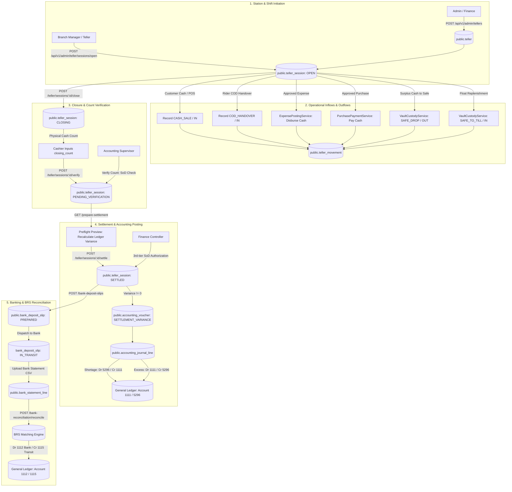

# Phase 1: Complete Teller & Accounting Workflow Inventory and Dependency Map

**Project:** CakeToHome ERP  
**Document ID:** `CHECKPOINTS/phase1-complete-workflow-inventory-and-dependency-map.md`  
**Date & Time:** 2026-10-16 20:45:00 IST  
**Git Branch:** `checkpoint/c-phases-baseline`  
**Working Directory:** `E:\vig\cakes2home-main\cakes2home-main`  
**Authoritative Database:** Live Supabase PostgreSQL 17.6 (`aws-1-ap-south-1.pooler.supabase.com:6543/postgres`)  
**Status:** ✅ **WORKFLOW INVENTORY & CONSOLIDATION ARCHITECTURE COMPLETE**

---

## 1. Master Workflow Inventory & Dependency Matrix (All 28 Core Workflows)

Below is the complete, evidence-based technical inventory of all teller, cash custody, purchase, expense, approval, settlement, banking, and accounting workflows discovered in the CakeToHome repository.

| # | Workflow Name | Business Purpose | Initiator / User | UI Entry Point | API Route & Method | Service & Repository | PostgreSQL Objects Affected | Accounting Effect | Permissions Required | Dependencies | Current Status |
|:---|:---|:---|:---|:---|:---|:---|:---|:---|:---|:---|:---|
| **1** | **Teller Counter Creation** | Provisions a physical or virtual cash drawer station for a branch | Administrator / Finance Manager | `TellerCustodyPanel` -> `TellerMasterTab` -> "Add Counter" button | `POST /api/v1/admin/tellers` | `TellerService.createTeller` -> `TellerRepository.create` | `public.teller` (`id`, `branch_id`, `name`, `code`, `user_id`, `status`) | None | `TELLER.MANAGE` | Active Branch in `public.branch` | **CANONICAL IMPLEMENTED** |
| **2** | **Teller Session Opening** | Begins a cashier/manager shift and records opening physical cash float | Branch Manager / Cashier | `TellerCustodyPanel` -> `ActiveDrawerTab` -> "Open Shift" button | `POST /api/v1/admin/teller/sessions/open` | `TellerSessionService.openSession` -> `TellerSessionRepository.create` | `public.teller_session` (`id`, `teller_id`, `branch_id`, `opening_float`, `expected_cash`, `status='OPEN'`, `opened_by`) | None on open; float tracked in custody ledger | `TELLER.SESSION_OPEN` | Active Teller record in `public.teller` | **CANONICAL IMPLEMENTED** |
| **3** | **Cash Sale / In-Store Receipt** | Acknowledges physical cash collected from a retail customer | Cashier / Branch Manager | Store Order Checkout / POS Modal / Manual Adjustment | `POST /api/v1/admin/teller/sessions/:id/movements` | `TellerMovementService.recordCashSale` -> `TellerMovementRepository.create` | `public.teller_movement` (`movement_type='CASH_SALE'`, `direction='IN'`, `amount>0`) | Increases expected drawer cash. Order posting credits `4110` Sales Revenue, debits `1111` Cash | `TELLER.MOVEMENT_CREATE` | Active open teller session | **CANONICAL IMPLEMENTED** |
| **4** | **COD Courier Handover** | Ingests cash collected by delivery fleet rider into store drawer | Delivery Dispatcher / Cashier | `BranchOperationsManager` (Cash Tab) / `ActiveDrawerTab` | `POST /api/v1/admin/reports/cod/collection` & `/movements` | `CodCollectionService` -> `TellerMovementService` | `public.teller_movement` (`movement_type='COD_HANDOVER'`, `direction='IN'`), `public.order` metadata | Relieves rider custody; Dr `1111 Cash in Hand` / Cr `1121 Trade AR` (or COD in Transit) | `TELLER.MOVEMENT_CREATE` | Delivered COD order with uncollected status | **CANONICAL IMPLEMENTED** |
| **5** | **Direct Cash Expense** | Records local operating disbursement (e.g. ice, packaging, courier) from drawer | Branch Manager / Store Staff | `ExpensePanel` -> "Add Expense" (`payment_method='CASH'`) | `POST /api/v1/admin/expenses` | `ExpenseService.createExpense` -> `ExpenseRepository.create` | `public.expense` (`status='DRAFT'`, `branch_id`, `total`, `payment_method='CASH'`, `teller_session_id`) | None in DRAFT | `EXPENSES.CREATE` | Active branch | **VERIFIED** |
| **6** | **Expense Bill Attachment** | Captures photo/PDF receipt proof to prevent ghost expenses | Branch Manager / Staff | `ExpensePanel` -> File Upload input | `POST /api/v1/admin/expenses/attachments` | Stored in `expense.metadata->'attachment_url'` | `public.expense` (`metadata`) | None | `EXPENSES.CREATE` | Existing expense record | **VERIFIED** |
| **7** | **Expense Bill Approval** | Verifies legitimate business expense with segregation of duties | Accounting Supervisor / Area Manager | `ExpensePanel` -> "Approve" button | `POST /api/v1/admin/expenses/:id/approve` | `ExpensePostingService.approveExpense` | `public.expense.status='APPROVED'`, `public.accounting_voucher.status='APPROVED'` | None (Approval permits payment; does NOT disburse cash) | `EXPENSES.APPROVE` | `expense.created_by != approved_by` (Strict SoD) | **VERIFIED** |
| **8** | **Cash Disbursement Execution** | Atomically verifies cash availability, records drawer movement, posts GL | Cashier / Finance Controller | `ExpensePanel` -> "Post to GL" / "Disburse" button | `POST /api/v1/admin/expenses/:id/post-gl` | `ExpensePostingService.postExpenseToGL` | `public.expense.status='POSTED'`, `public.teller_movement` (`EXPENSE_PAYMENT`, `OUT`), `accounting_journal_line` | Dr `52xx Expense` / Dr `1141-1149 Input GST` / Cr `1111 Cash in Hand` | `ACCOUNTING.POST` | Active session with `opening_float + net_mov >= amount` | **VERIFIED (Cash Guard Enforced)** |
| **9** | **Petty Cash Imprest Funding** | Replenishes fixed branch petty cash float from company bank account | Branch Manager / Finance | `AccountingWorkQueuePanel` / Petty Cash Modal | `POST /api/v1/admin/accounting/petty-cash/disburse-funding` | `PettyCashService.disburseFunding` | `public.petty_cash_request`, `public.accounting_journal_line` | Dr `1114 Petty Cash` / Cr `1112 Bank Operating A/c` | `ACCOUNTING.POST` | Approved petty cash request, active bank GL | **VERIFIED** |
| **10** | **Petty Cash Disbursement** | Disburses small office expense without a retail teller session | Branch Staff | `ExpensePanel` (`payment_method='PETTY_CASH'`) | `POST /api/v1/admin/expenses/:id/post-gl` | `ExpensePostingService.postExpenseToGL` (Path B) | `public.expense`, `public.accounting_journal_line` | Dr `52xx Expense` / Cr `1114 Petty Cash` | `ACCOUNTING.POST` | Advisory lock on (branch, account); positive GL balance | **VERIFIED (Cash Guard Enforced)** |
| **11** | **Purchase Order Creation** | Records supplier order for bakery raw ingredients or packaging | Purchasing Agent / Branch Staff | `PurchasePanel` -> "Create Purchase" | `POST /api/v1/admin/purchases` | `PurchasePostingService.createPurchase` | `public.purchase` (`status='DRAFT'`), `public.purchase_item` | None | `PURCHASES.CREATE` | Active supplier in `public.supplier` | **VERIFIED** |
| **12** | **Purchase Bill Approval** | Approves supplier order with 2-tier managerial SoD | Store Manager / Inventory Head | `PurchasePanel` -> "Approve Purchase" | `POST /api/v1/admin/purchases/:id/approve` | `PurchasePostingService.approvePurchase` | `public.purchase.status='APPROVED'`, `public.accounting_voucher.status='APPROVED'` | None | `PURCHASES.APPROVE` | `created_by != approved_by` | **VERIFIED** |
| **13** | **Goods Receipt (GRN) & Stock Inward** | Records receipt of items, updates cost lots & inventory movements | Store Receiving Clerk | `PurchasePanel` -> "Receive Goods (GRN)" | `POST /api/v1/admin/purchases/:id/grn` | `PurchasePostingService.recordGrn` | `public.inventory_cost_lot`, `public.inventory_movement`, `public.branch_inventory` | Updates physical inventory and valuation cost lots | `INVENTORY.EDIT` | Approved purchase order | **VERIFIED** |
| **14** | **Purchase GL Posting (AP Recognition)** | Recognizes accounts payable liability and input GST tax credits | AP Clerk / Accountant | `PurchasePanel` -> "Post to GL" | `POST /api/v1/admin/purchases/:id/post` | `PurchasePostingService.postPurchase` | `public.purchase.status='POSTED'`, `public.accounting_journal_line` | Dr `1131 Raw Materials / 1133 Packaging` / Dr `1141 Input GST` / Cr `2111 Accounts Payable` | `ACCOUNTING.POST` | GRN completed, open fiscal period | **VERIFIED** |
| **15** | **Cash Purchase Payment** | Settles supplier payable liability using drawer cash | Cashier / Finance Manager | `PurchasePanel` -> "Record Payment" (`method='CASH'`) | `POST /api/v1/admin/purchases/:id/payments` | `PurchasePaymentService.recordPayment` | `public.purchase_payment`, `public.teller_movement`, `public.accounting_journal_line` | Dr `2111 Accounts Payable` (supplier dim) / Cr `1111 Cash in Hand` | `ACCOUNTING.POST` | Posted purchase, active drawer with sufficient cash | **VERIFIED** |
| **16** | **Bank Purchase Payment** | Settles supplier payable liability via bank transfer, cheque, or NEFT | Accounts Payable / Treasury | `BillsPayablePanel` -> "Pay Bill" (`method='BANK_TRANSFER'`) | `POST /api/v1/admin/purchases/:id/payments` | `PurchasePaymentService.recordPayment` | `public.purchase_payment`, `public.accounting_journal_line` | Dr `2111 Accounts Payable` / Cr `1112 Bank Operating A/c` | `ACCOUNTING.POST` | Posted purchase, active bank account GL | **VERIFIED** |
| **17** | **Safe Drop (Till to Vault)** | Moves surplus cash from retail till to secure branch safe | Cashier & Supervisor | `TellerCustodyPanel` -> `ActiveDrawerTab` -> "Safe Drop" | `POST /api/v1/admin/teller/safe-drop` | `VaultCustodyService.recordSafeDrop` | `public.teller_movement` (`movement_type='SAFE_DROP'`, `direction='OUT'`) | Reduces till cash, increases branch safe custody | `TELLER.SAFE_DROP` | Active open session, 4-eyes witness | **CANONICAL IMPLEMENTED** |
| **18** | **Safe to Till (Replenishment)** | Replenishes change float from vault into retail till | Cashier & Supervisor | `TellerCustodyPanel` -> `ActiveDrawerTab` -> "Safe to Till" | `POST /api/v1/admin/teller/safe-to-till` | `VaultCustodyService.recordSafeToTill` | `public.teller_movement` (`movement_type='SAFE_TO_TILL'`, `direction='IN'`) | Increases till cash, decreases vault custody | `TELLER.SAFE_TO_TILL` | Active open session, 4-eyes witness | **CANONICAL IMPLEMENTED** |
| **19** | **Teller Shift End & Physical Count** | Cashier counts physical notes, inputs closing count, initiates closure | Cashier / Branch Manager | `TellerCustodyPanel` -> `ActiveDrawerTab` -> "End Shift" button | `POST /api/v1/admin/teller/sessions/:id/close` | `TellerSessionService.closeSession` | `public.teller_session` (`status='CLOSING'`, `closing_count`, `closed_by`, `closed_at`) | None | `TELLER.SESSION_CLOSE` | Open session | **CANONICAL IMPLEMENTED** |
| **20** | **Supervisor Count Verification** | Supervisor verifies physical cash count and records variance | Accounting Supervisor / Area Manager | `TellerCustodyPanel` -> `VerificationSettlementQueueTab` -> "Verify" | `POST /api/v1/admin/teller/sessions/:id/verify` | `TellerSessionService.verifySession` | `public.teller_session` (`status='PENDING_VERIFICATION'`, `variance`, `verified_by`) | Calculates `variance = closing_count - expected_cash` | `TELLER.SESSION_VERIFY` | `verified_by != opened_by` AND `verified_by != closed_by` | **CANONICAL IMPLEMENTED** |
| **21** | **Settlement Preflight Preview** | Read-only calculation of variance and proposed GL adjustment | Finance Controller / Settler | `TellerCustodyPanel` -> `SettlementWorkspaceModal` | `GET /api/v1/admin/teller/sessions/:id/prepare-settlement` | `TellerSessionService.prepareSettlement` | Read-only audit from `teller_movement` | Displays proposed Dr 5296/Cr 1111 (short) or Dr 1111/Cr 5296 (excess) | `TELLER.SETTLE` | Session in `PENDING_VERIFICATION` | **CANONICAL IMPLEMENTED** |
| **22** | **Settlement Authorization & GL Posting**| Authorizes final settlement, closes session, posts variance voucher | Finance Controller / Treasury | `TellerCustodyPanel` -> `SettlementWorkspaceModal` -> "Authorize" | `POST /api/v1/admin/teller/sessions/:id/settle` | `TellerSessionService.settleSession` | `public.teller_session` (`status='SETTLED'`), `accounting_voucher`, `accounting_journal_line` | Shortage: Dr `5296 Cash Over/Short` / Cr `1111 Cash`. Zero variance: no entry | `TELLER.SETTLE` | `settler != opener != closer != verifier` (3-tier SoD) | **CANONICAL IMPLEMENTED** |
| **23** | **Bank Deposit Slip Preparation** | Bundles physical branch cash into sealed deposit bag with slip number | Store Manager / Cashier | `BranchOperationsManager` / `BankAccountsPanel` -> "Prepare Slip" | `POST /api/v1/admin/bank-deposit-slips` | `BankDepositSlipService.prepareSlip` | `public.bank_deposit_slip` (`status='PREPARED'`, `amount`, `slip_number`) | Dr `1115 Cash in Transit` / Cr `1111 Cash in Hand` | `BANK.DEPOSIT_CREATE` | Physical cash available in store safe | **VERIFIED** |
| **24** | **Deposit In Transit Tracking** | Monitors cash dispatched via courier/armored van before bank credit | Treasury Staff | `BankAccountsPanel` -> "Deposits in Transit" | `GET /api/v1/admin/bank-deposit-slips?status=IN_TRANSIT` | `BankDepositSlipService.listTransit` | `public.bank_deposit_slip` (`status='IN_TRANSIT'`) | Keeps deposit visible in transit; bank account not yet debited | `BANK.VIEW` | Prepared deposit slip handed to courier | **VERIFIED** |
| **25** | **Bank Statement Ingestion** | Uploads raw bank CSV statement lines into staging tables | Treasury Clerk | `BankReconciliationPanel` -> "Upload Bank Statement" | `POST /api/v1/admin/bank-reconciliation/statements/import` | `BankStatementImportService.importCsv` | `public.bank_statement_import`, `public.bank_statement_line` | None (Staging table ingestion) | `BANK.RECONCILE` | Valid bank CSV format | **VERIFIED** |
| **26** | **Bank Reconciliation (BRS Matching)** | Links bank statement credit lines to deposit slips and debits bank GL | Finance Manager / Auditor | `BankReconciliationPanel` -> "Run Auto-Match" / "Reconcile" | `POST /api/v1/admin/bank-reconciliation/reconcile` | `BankReconciliationMatchingService.match` | `public.bank_statement_line.is_reconciled=true`, `accounting_journal_line` | Dr `1112 Bank Operating A/c` / Cr `1115 Cash in Transit` (Discrepancy = ₹0.00) | `BANK.RECONCILE` | Matched statement line & deposit slip | **VERIFIED** |
| **27** | **General Ledger & Trial Balance** | Generates authoritative running account balances from journal lines | Finance Controller / Management | `GeneralLedgerPanel` -> "Trial Balance" | `GET /api/v1/admin/accounting/trial-balance` | `AccountingReportRepository.getTrialBalance` | Aggregation over `public.accounting_journal_line` | Verifies $\sum \text{Debits} = \sum \text{Credits}$ across all 100 accounts | `ACCOUNTING.VIEW` | Posted journal entries | **VERIFIED (Live Balanced)** |
| **28** | **Financial Statements (P&L & BS)** | Computes accrual Revenue, COGS, Opex, Assets, Liabilities, Equity | CFO / Executive Leadership | `ProfitLossPanel` & `BalanceSheetPanel` | `GET /api/v1/admin/accounting/profit-loss`, `/balance-sheet` | `FinancialStatementService.generatePnl` & `generateBs` | Aggregation over canonical chart of accounts | Net Profit = Revenue (4xxx) - Expenses (5xxx). Assets = Liab + Equity | `ACCOUNTING.VIEW` | Balanced General Ledger | **VERIFIED** |

---

## 2. Duplicate and Unnecessary Workflow Analysis

### 2.1 The Two Competing Teller Interfaces

#### Interface 1: Canonical Relational Teller Engine (`TellerCustodyPanel`)
- **Classification:** **CANONICAL & MANDATORY.**
- **Code Assets:**
  - Component: `frontend/src/components/dashboard/admin/teller-custody-panel.tsx` and sub-tabs (`ActiveDrawerTab`, `BranchCashTab`, `TellerMasterTab`, `SessionHistoryTab`, `VerificationSettlementQueueTab`).
  - Services: `TellerService`, `TellerSessionService`, `TellerMovementService`, `VaultCustodyService`.
  - Repositories: `TellerRepository`, `TellerSessionRepository`, `TellerMovementRepository`, `VaultCustodyRepository`.
  - Tables: `public.teller`, `public.teller_session`, `public.teller_movement`, `public.vault_custody_transfer`.
- **Strengths:** Full 3-tier SoD, atomic row locking (`SELECT FOR UPDATE`), immutable partial unique index (`uq_teller_session_active`), direct GL voucher generation for Cash Over/Short (`5296`).

#### Interface 2: Disconnected Shop Manager Cash Tab (`BranchOperationsManager`)
- **Classification:** **DISCONNECTED LEGACY TO BE CONSOLIDATED.**
- **Code Assets:**
  - Component: `frontend/src/components/dashboard/shop/branch-operations-manager.tsx` (`activeTab === 'cash'`).
  - Endpoints: `manager/cash/position`, `manager/cash/drawer/open`, `manager/cash/drawer/close`, `manager/cash/cod/shortage`.
  - Storage: Updates `branch.metadata->'drawer_session'` JSONB directly.
- **Flaws Identified:**
  1. Writes operational float solely to a JSONB blob inside `branch`. Zero rows inserted into `public.teller_session`.
  2. Does not connect to `ExpensePostingService`. When an expense disbursement checks for an active teller session, it queries `public.teller_session` and fails with `TELLER_SESSION_NOT_FOUND`.
  3. Closing the drawer writes `{ status: "CLOSED" }` into JSON metadata without supervisor count verification, variance calculation, or General Ledger settlement vouchers.

### 2.2 Safe Consolidation Plan (Preserving Zero Breakage)
To establish one single canonical source of truth while keeping both `/dashboard` and `/dashboard/shop` fully functional:
1. **Unify the API Handlers (`route.ts`):**
   - In `POST /api/v1/manager/cash/drawer/open`: Instead of writing only to JSONB, look up or create the branch's active teller station in `public.teller` and call `TellerSessionService.openSession`. Maintain `branch.metadata->'drawer_session'` as a synced mirror for backwards compatibility.
   - In `POST /api/v1/manager/cash/drawer/close`: Instead of setting JSON status, look up the active session in `public.teller_session` and call `TellerSessionService.closeSession` with the closing count.
   - In `GET /api/v1/manager/cash/position`: Query the live active `public.teller_session` and `public.teller_movement` rows so that both `/dashboard` and `/dashboard/shop` display the exact same persisted balance!
2. **Assign Teller Permissions to Branch Manager:**
   - Update `prof_branch_ops` in `frontend/src/lib/staff-access-control.ts` to include `TELLER.VIEW`, `TELLER.SESSION_OPEN`, `TELLER.MOVEMENT_CREATE`, and `TELLER.SESSION_CLOSE`.
   - Supervisor verification (`TELLER.SESSION_VERIFY`) and settlement (`TELLER.SETTLE`) remain strictly reserved for Supervisor and Finance Controller roles, preserving 3-tier Segregation of Duties.

---

## 3. Workflow Dependency Map

---

## 4. Beginner-Friendly Explanation of the Entire Financial Flow

Imagine our bakery store in Indiranagar as a real brick-and-mortar cake shop:
1. **The Cash Box (Teller Counter):** When the store opens in the morning, the branch manager (Rajesh) puts ₹500 in small bills into the drawer so he can give change to customers. The computer records this as the **Opening Float**.
2. **Selling Cakes & Taking Cash:** A walk-in customer buys a chocolate truffle cake for ₹800 in cash. Rajesh puts the ₹800 into the drawer. The computer adds ₹800 to the drawer ledger. The computer now expects ₹1,300 in the drawer.
3. **Paying an Approved Supplier Bill:** Later, an approved delivery of packing boxes arrives costing ₹300. Rajesh has an approved receipt on the screen. The computer checks: *"Is there at least ₹300 in the drawer?"* Yes (we have ₹1,300). Rajesh pays ₹300. The computer records that ₹300 left the drawer and tells the accounting books to record a ₹300 packaging expense. The computer now expects ₹1,000.
4. **End of the Day (Counting the Money):** At 9:00 PM, Rajesh closes the store. He counts the actual paper bills in the drawer. He counts ₹1,000. He types `1000` into the computer and clicks **End Shift**.
5. **Supervisor Double-Checks (No Cheating):** Because of **Segregation of Duties**, Rajesh is not allowed to approve his own count. A supervisor (Anil) counts the cash to make sure Rajesh didn't make a mistake. Anil clicks **Verify Cash Count**.
6. **Closing the Books (Settlement):** The finance manager looks at the verified session. If Rajesh had ₹990 instead of ₹1,000 (a ₹10 shortage), the computer automatically creates an accounting entry charging ₹10 to **Cash Over / Short (Account 5296)**. If the money matches perfectly (₹1,000 counted vs ₹1,000 expected), the variance is ₹0 and the session is marked **Settled**.
7. **Taking Money to the Bank:** Rajesh takes the cash, fills out a bank deposit slip, and sends it with an armored courier. In the books, this money is marked as **Cash in Transit (Account 1115)**.
8. **Bank Statement (Reconciliation):** The next morning, the bank sends its statement showing that ₹1,000 was deposited into CakeToHome's HDFC Bank account. The bank reconciliation system automatically matches the bank statement to Rajesh's deposit slip and moves the money into **Bank Operating Account (1112)**. Discrepancy is **₹0.00**.

Every single button, screen, API, and table row exists to ensure this real-world flow happens accurately, without theft, without math errors, and without fake numbers.
