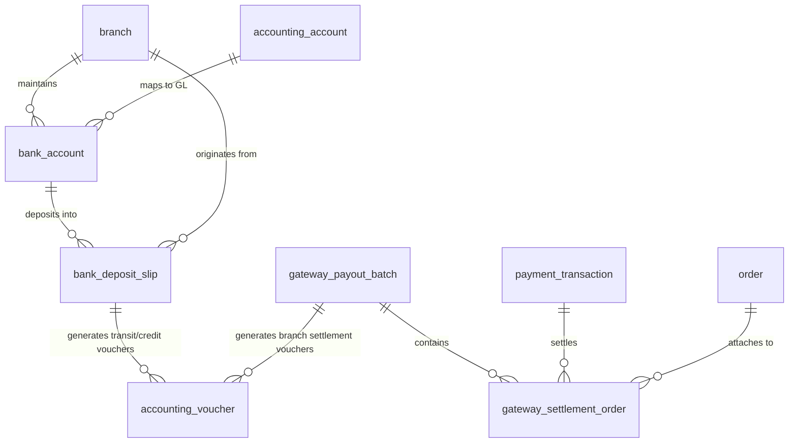

# CakeToHome ERP — Phase 4F Step 4.10 Architecture Decision Record (ADR)
## Bank Deposits, Gateway Settlements, MDR Accounting & Multi-Branch Treasury Architecture
### Milestone: `PHASE-4F-STEP-4.10-BANK-DEPOSITS-GATEWAY-SETTLEMENT-DESIGN-01`
### Gate Classification: ARCHITECTURE DECISION GATE — IMPLEMENTATION NOT AUTHORIZED

---

## 1. Executive Summary & Purpose

This Architecture Decision Record (ADR) formally documents the **six locked and schema-verified architectural decisions** established during the **Step 4.10 Architecture Decision Gate**.

These decisions govern the design of:
1. Physical cash drawer deposits into bank accounts (`1111 Cash in Hand` $\to$ Deposit in Transit $\to$ `1112 Bank Operating A/c`).
2. Payment gateway payout settlements (`1113 Gateway Clearing` $\to$ `1112 Bank Operating A/c`).
3. Merchant Discount Rate (MDR) processing fee accounting, deduction classification, and Input Tax Credit (ITC) tax invoice treatment (`5290` / `1143`, `1144`, `1146`).
4. Authoritative multi-branch balance isolation based strictly on live PostgreSQL schema (`payment_transaction.branch_id`) with fail-closed order validation.
5. Strict, symmetrical 3-tier Segregation of Duties (SoD) across treasury, branch management, and accounting.

**Implementation Status**: Strictly **NOT STARTED**. This document serves as the binding specification for subsequent implementation once authorized.

---

## 2. Locked Architecture Decisions Matrix

| # | Architectural Dimension | Locked Decision | Core Mechanism |
|---|-------------------------|-----------------|----------------|
| **ADR-4.10-01** | **Bank Account Topology & Identity** | **Relational Bank Account Master + GL 1112 Control** | Account `1112` remains canonical GL control. Authoritative `bank_account` master entity stores physical bank details. Valid `bank_account_id` mandated on all bank transactions. |
| **ADR-4.10-02** | **Gateway Payout Allocation & Multi-Branch Clearing** | **Branch-Partitioned Settlement Vouchers via Authoritative `payment_transaction.branch_id`** | Settlement branch is derived strictly from `payment_transaction.branch_id` (since `public.order` has no relational `branch_id`). Ingestion validates linked order existence. If order metadata contains branch info, it must match; otherwise fails closed as unposted exception (`SETTLEMENT_ORDER_BRANCH_UNVERIFIED`). Balanced voucher posted per branch (`Dr 1112 / Dr 5290 / Cr 1113`). |
| **ADR-4.10-03** | **MDR Processing Fees, Deduction Classification & GST Treatment** | **Strict Evidence-Backed Classification + Two-Stage ITC** | • **Identified Gateway Processing Fees** $\to$ `5290 Payment Gateway MDR Fees`.<br>• **Provider GST Component** $\to$ `1143/1144/1146` **only** upon monthly provider tax invoice validation.<br>• **Other Deductions (Disputes, Reserves, Chargebacks)** $\to$ **UNRECONCILED / EXCEPTION**; never dumped into `5290` or fabricated into tax. |
| **ADR-4.10-04** | **Cash Drawer $\to$ Bank Deposit Workflow & Transit Account** | **Two-Stage Deposit-in-Transit Control (`1118` Preferred / `1119` Fallback)** | Stage 1 (Dispatch): `Dr Deposit-in-Transit / Cr 1111 Cash in Hand`. Stage 2 (Bank Credit): `Dr 1112 Bank Operating A/c / Cr Deposit-in-Transit`. Dedicated account `1118 Deposit in Transit` under `1110` is recommended via additive migration upon implementation; `1119 Unclassified Suspense` serves as unexpanded-CoA fallback. |
| **ADR-4.10-05** | **Settlement Variance & Rounding Policy** | **Controlled Rounding Tolerance ($\le$ ₹1.00)** | Discrepancies $\le$ ₹1.00 (or $\le$ 100 paise) book to `5295 Cash Rounding / Variance`. Discrepancies $>$ ₹1.00 fail closed as unposted exceptions (`SETTLEMENT_VARIANCE_MISMATCH`). Genuine disputes never hidden in rounding. |
| **ADR-4.10-06** | **Permissions & Segregation of Duties** | **Symmetrical 3-Tier Permissions + Strict Non-Bypass SoD** | Dedicated permissions: `BANK.DEPOSIT_PREPARE`, `BANK.DEPOSIT_APPROVE`, `BANK.DEPOSIT_POST`, and `GATEWAY.SETTLE_PREPARE`, `GATEWAY.SETTLE_APPROVE`, `GATEWAY.SETTLE_POST`. Strict rule: $\text{Preparer} \ne \text{Approver} \ne \text{Poster}$. `SUPER_ADMIN` cannot self-approve or self-post. |

---

## 3. Detailed Architectural Specifications

### ADR-4.10-01: Bank Topology & Authoritative Identity

#### Problem Statement
In the existing 98-account Chart of Accounts, only a single global ledger account exists: `1112 Bank Operating A/c`. There are no relational entities representing physical bank accounts, branch bank relationships, IFSC codes, or account numbers. Storing all bank transactions in `1112` without bank identity makes bank statement reconciliation and multi-branch treasury impossible.

#### Decision
1. **Preserve Canonical GL**: Retain `1112 Bank Operating A/c` as the primary liquid asset GL account. Avoid polluting the CoA with ad-hoc GL accounts per physical bank.
2. **Authoritative Master Entity**: Create a dedicated relational entity `bank_account` to track physical banking relationships:
   - `id`: Primary key (e.g., `bnk_hdfc_main_01`).
   - `company_id`: Company tenancy.
   - `branch_id`: Nullable foreign key. If `NULL`, the bank account is a Corporate / Central Treasury account. If populated, it represents a dedicated branch bank account.
   - `bank_name`: Legal bank name (e.g., "HDFC Bank Ltd", "ICICI Bank Ltd").
   - `account_number_masked`: Masked display format (e.g., "XXXXXXXX4920").
   - `account_number_hash`: Deterministic SHA-256 hash for duplicate detection.
   - `ifsc_code`: Indian Financial System Code (e.g., "HDFC0001234").
   - `account_type`: Enum (`CURRENT`, `SAVINGS`, `OVERDRAFT`, `VIRTUAL`).
   - `gl_account_id`: Foreign key to `accounting_account` (defaults to `1112`).
   - `is_active`: Boolean status flag.
3. **Mandatory Foreign Key on Bank Vouchers**:
   Every voucher and journal line touching Account `1112` must record the authoritative `bank_account_id` in its relational link or validated metadata. Bank reconciliation balances will be computed per `bank_account_id`.

---

### ADR-4.10-02: Gateway Payout Allocation & Authoritative Branch Source

#### Problem Statement
An online order creates customer receipt voucher lines:
$$\text{Dr 1113 Gateway Clearing} \quad [\text{Branch } X] \quad / \quad \text{Cr 1121 Accounts Receivable} \quad [\text{Branch } X]$$
When Razorpay generates a daily payout batch (e.g., ₹500,000 settling 250 orders), the orders originate from multiple different branches (Branch A, Branch B, Branch C).
In `public.accounting_journal_line`, `branch_id` is `NOT NULL` and must strictly match `accounting_voucher.branch_id` (`BRANCH_MISMATCH` check). A single voucher cannot mix journal lines across branches.

#### Schema Reality & Live Database Ground Truth
Direct inspection of the live PostgreSQL database (`information_schema.columns`) established:
1. **`public.order` has NO relational `branch_id` column**:
   - The table `public.order` contains only: `id`, `region_id`, `display_id`, `customer_id`, `version`, `sales_channel_id`, `status`, `is_draft_order`, `email`, `currency_code`, `shipping_address_id`, `billing_address_id`, `no_notification`, `metadata`, `created_at`, `updated_at`, `deleted_at`, `canceled_at`, `custom_display_id`, `locale`.
   - In the prototype/historical architecture, branch representation on orders exists only optionally inside unstructured JSONB (`order.metadata->>'branch_id'`), and some prototype orders lack branch metadata entirely.
   - An `order.branch_id` relational column does **NOT** exist in the schema and must **NEVER** be assumed, referenced, or invented.
2. **`public.payment_transaction` DOES have a relational `branch_id` column**:
   - Schema: `payment_transaction.branch_id text NOT NULL`.
   - Relational linkage: `payment_transaction.order_id text NOT NULL` references `public.order.id`.

#### Decision: Authoritative Branch Invariant & Branch-Partitioned Vouchers (Model A)
1. **Authoritative Branch Source**:
   - The primary authoritative source for settlement branch attribution is strictly:
     $$\mathbf{payment\_transaction.branch\_id}$$
2. **Order-Payment Relationship Validation Invariants**:
   - **Condition 1 (Transaction Belongs to Batch)**: The payment transaction must be part of the ingested gateway payout batch.
   - **Condition 2 (Transaction Branch Present & Valid)**: `payment_transaction.branch_id` must be present, non-null, and resolve to an active record in `public.branch`.
   - **Condition 3 (Linked Order Exists)**: `payment_transaction.order_id` must resolve to an active, valid record in `public.order`.
   - **Condition 4 (Order-Side Branch Representation Validation)**:
     - If an authoritative order-side branch representation exists (specifically: `order.metadata->>'branch_id'` is present and non-empty):
       The engine strictly validates:
       $$\mathbf{payment\_transaction.branch\_id} \equiv \mathbf{order.metadata \to> 'branch\_id'}$$
       If they contradict each other, settlement fails closed with error code:
       $$\mathbf{BRANCH\_RELATIONSHIP\_MISMATCH}$$
     - If the linked order does **not** contain an authoritative branch representation:
       The engine must **NOT infer, guess, or manufacture a branch relationship**.
       The settlement fails closed and flags the transaction as an unposted exception:
       $$\mathbf{SETTLEMENT\_ORDER\_BRANCH\_UNVERIFIED}$$
   - **Condition 5 (Zero Client Trust)**:
     Client-supplied branch headers, URL query parameters, or client-provided metadata are strictly forbidden from determining or influencing branch allocation.
3. **Branch Voucher Construction**:
   For each distinct, verified `branch_id` in the payout batch, the system constructs a separate, balanced `VOUCHER_TYPE.RECEIPT` or `GATEWAY_SETTLEMENT` voucher:
   - **Branch A Voucher** (`voucher.branch_id = Branch A`):
     - `Dr 1112 Bank Operating A/c` (Net Payout allocated to Branch A) $\to$ `bank_account_id = Central Bank`
     - `Dr 5290 Payment Gateway MDR Fees` (Identified processing fee for Branch A orders)
     - `Cr 1113 Gateway Clearing` (Gross Collections for Branch A orders)
   - **Branch B Voucher** (`voucher.branch_id = Branch B`):
     - `Dr 1112 Bank Operating A/c` (Net Payout allocated to Branch B) $\to$ `bank_account_id = Central Bank`
     - `Dr 5290 Payment Gateway MDR Fees` (Identified processing fee for Branch B orders)
     - `Cr 1113 Gateway Clearing` (Gross Collections for Branch B orders)
4. **Audit Trail & Exact Allocation**:
   - Every credit line to `1113` preserves the specific `order_id` and `payment_transaction_id` in its metadata.
   - The branch's `1113 Gateway Clearing` subledger clears to exactly ₹0.00 for the settled orders.
   - Branch Profit & Loss statements accurately reflect the MDR expense incurred by each branch.

---

### ADR-4.10-03: Tightened MDR, Deduction Classification & GST Treatment

#### Problem Statement
Payment gateway payouts often contain diverse deductions: standard transaction processing fees (MDR), chargeback debits, customer refund reversals, dispute holdbacks, or rolling reserves.
Classifying 100% of payout deductions as "MDR Fees" merely because they reduce net payout is an accounting violation. It distorts operating expenses, obscures chargebacks, and violates the "no fabrication" rule.
Furthermore, claiming Input Tax Credit (ITC) without an authoritative provider tax invoice violates GST statutory requirements.

#### Decision: Strict Evidence-Backed Deduction Classification + Two-Stage ITC
1. **Deduction Classification Engine**:
   Every deduction in the provider payout report must be classified strictly based on authoritative source evidence:
   - **Type 1: Authoritative Gateway Processing Fees (MDR)**:
     - Strictly identified fee amounts backed by provider line-item fee metadata.
     - Debited to:
       $$\text{Dr 5290 Payment Gateway MDR Fees}$$
   - **Type 2: Provider GST Component (SAC 997159 18% GST)**:
     - Reported as operational reference data during daily settlement; **NO Input GST is posted at daily payout time**.
     - Reclassified to `1143 Input CGST` / `1144 Input SGST` (intra-state) or `1146 Input IGST` (inter-state) **only in Stage 2** upon receipt and validation of the official monthly provider tax invoice.
   - **Type 3: Other Provider Deductions (Disputes, Reserves, Chargebacks, Unidentified Deductions)**:
     - **STRICT PROHIBITION**: Such deductions must **NEVER** be booked to `5290 Payment Gateway MDR Fees` and must **NEVER** have tax fabricated.
     - They must be flagged as:
       $$\mathbf{UNRECONCILED\_SETTLEMENT\_EXCEPTION}$$
     - The batch is held in an unposted or quarantined state until the exact accounting nature is established with legal/operational evidence (e.g., chargeback voucher, reserve deposit, refund debit).
2. **Stage 2 — Monthly Tax Invoice ITC Reclassification**:
   - Upon receipt of the provider's monthly GST Tax Invoice, an authorized accountant uploads and verifies:
     - Provider GSTIN (e.g., Razorpay Software Private Limited)
     - Invoice Number & Invoice Date
     - Taxable Value
     - CGST Amount / SGST Amount or IGST Amount
   - An adjustment journal entry (`VOUCHER_TYPE.JOURNAL`) is posted:
     - `Dr 1146 Input IGST 18.0%` (or `1143 Input CGST 9.0%` + `1144 Input SGST 9.0%`)
     - `Cr 5290 Payment Gateway MDR Fees`
   - This ensures full statutory compliance with GST rules and eliminates tax fabrication.

---

### ADR-4.10-04: Cash Drawer $\to$ Bank Deposit Workflow & CoA Governance

#### Problem Statement
Cash collected from COD deliveries sits in `1111 Cash in Hand` at the branch. There is a time lag between when a branch cashier packages cash for deposit (or hands it to a cash-in-transit agency) and when the physical bank branch processes the slip and credits the funds into the bank statement.
A direct single-stage transfer (`Dr 1112 / Cr 1111`) creates a blind spot where money neither in the drawer nor in the bank is prematurely recognized as bank liquidity.
Furthermore, using `1119 Unclassified Suspense` for regular cash deposits is problematic because "Unclassified Suspense" implies an accounting anomaly or unidentified transaction, not an operational deposit in transit.

#### Decision: Two-Stage Deposit-in-Transit Control (`1118` Preferred / `1119` Fallback)
1. **Chart of Accounts Governance & Placement**:
   When Step 4.10 implementation is authorized, the creation of a dedicated transit account will strictly follow existing CoA hierarchy:
   ```text
   1110 Cash & Cash Equivalents (Group, Level 2)
    ├── 1111 Cash in Hand (Asset, Level 3)
    ├── 1112 Bank Operating A/c (Asset, Level 3)
    ├── 1113 Gateway Clearing (Asset, Level 3)
    ├── 1114 Petty Cash - Branches (Asset, Level 3)
    ├── 1118 Deposit in Transit (Asset, Level 3 — PROPOSED ADDITIVE MIGRATION UPON AUTHORIZATION)
    └── 1119 Unclassified Suspense (Asset, Level 3 — EXISTING UNEXPANDED-COA FALLBACK)
   ```
   - **Option A (Dedicated Transit Account — Architectural Recommendation)**:
     When Step 4.10 implementation is authorized and database migrations are permitted, introduce additive account `1118 Deposit in Transit` under `1110 Cash and Cash Equivalents` (Asset, Level 3, Active). This cleanly reflects cash that has left the physical drawer but is awaiting verified bank acknowledgement.
   - **Option B (Zero-CoA-Change Fallback)**:
     If CoA modification is strictly prohibited, Account `1119 Unclassified Suspense` may be used as a technical fallback, provided it is strictly bounded by voucher metadata:
     `{ subledger: "DEPOSIT_IN_TRANSIT", deposit_slip_id: "slip_xyz" }`
     and verified to net to ₹0.00 upon bank confirmation.
   - **CRITICAL GOVERNANCE NOTE**: Account `1118` is **NOT** created during this design gate. Its creation belongs strictly to implementation authorization via a formal database migration script. The live CoA remains at its pristine 98 accounts.

2. **Two-Stage Workflow**:
   - **Stage 1 — Cash Handover & Deposit Slip Generation**:
     - Cashier counts cash, specifies denomination breakdown, and creates Deposit Slip.
     - Supervisor approves physical dispatch.
     - Voucher 1 Posted:
       $$\text{Dr 1118 Deposit in Transit (or 1119 Fallback)} \quad [\text{Branch } X]$$
       $$\text{Cr 1111 Cash in Hand} \quad [\text{Branch } X]$$
     - Physical drawer balance in `1111` decreases immediately.
   - **Stage 2 — Bank Credit & Acknowledgement**:
     - Upon receipt of the stamped bank receipt or bank statement credit, the accountant enters bank transaction reference and value date.
     - Voucher 2 Posted:
       $$\text{Dr 1112 Bank Operating A/c} \quad [\text{Branch } X, \text{bank\_account\_id}]$$
       $$\text{Cr 1118 Deposit in Transit (or 1119 Fallback)} \quad [\text{Branch } X]$$
     - Transit account balance clears to ₹0.00; bank operating balance increases with verified bank confirmation.

---

### ADR-4.10-05: Settlement Variance & Rounding Policy

#### Problem Statement
Because payment gateways calculate fees at the individual transaction level with rounding (paise rounding) and aggregate them into daily payouts, minute rounding discrepancies (e.g., ₹0.01 to ₹0.40) frequently arise between:
$$\text{Gross Transaction Sum} - \text{Total Provider Fees} \quad \text{vs.} \quad \text{Net Bank Payout}$$

#### Decision: Controlled Rounding Tolerance ($\le$ ₹1.00)
1. **Controlled Rounding Threshold**:
   - If the mathematical discrepancy $|\Delta| \le \text{₹1.00}$ (or $\le 100 \text{ paise}$):
     - The variance is automatically booked to:
       $$\text{Account 5295 Cash Rounding / Variance}$$
     - If $\Delta > 0$: $\text{Dr 5295 / Cr 1113}$ (or balancing line).
     - If $\Delta < 0$: $\text{Cr 5295 / Dr 1113}$.
2. **Fail-Closed Threshold ($> ₹1.00$)**:
   - If $|\Delta| > \text{₹1.00}$:
     - The settlement batch execution **fails closed**.
     - Returns error code `SETTLEMENT_VARIANCE_MISMATCH`.
     - Zero vouchers or journal entries are posted.
     - Genuine settlement disputes, unexpected deductions, or fee errors are never hidden inside rounding.

---

### ADR-4.10-06: Symmetrical 3-Tier Permissions & Strict SoD Model

#### Problem Statement
Allowing the same employee to prepare a deposit slip or gateway payout and post the journal entry invites embezzlement and fraudulent clearing. Furthermore, in Step 4.5, a prototype method hardcoded an artificial supervisor (`usr_settlement_supervisor`), which circumvents audit trails.

#### Decision: Symmetrical 3-Tier Permissions & Strict SoD
1. **Granular Functional Permissions**:
   The permission matrix provides dedicated, symmetrical permissions for both bank deposits and gateway settlements:

   | Operational Area | Stage 1: Preparer | Stage 2: Approver | Stage 3: Poster |
   |---|---|---|---|
   | **Bank Cash Deposits** | `BANK.DEPOSIT_PREPARE`<br>(Cashier counts cash, creates slip) | `BANK.DEPOSIT_APPROVE`<br>(Branch Manager verifies cash dispatch) | `BANK.DEPOSIT_POST`<br>(Accountant posts upon bank credit) |
   | **Gateway Payouts** | `GATEWAY.SETTLE_PREPARE`<br>(Integration Clerk ingests & partitions batch) | `GATEWAY.SETTLE_APPROVE`<br>(Treasury Manager verifies allocations/MDR) | `GATEWAY.SETTLE_POST`<br>(Finance Accountant triggers canonical GL posting) |
   | **Bank Reconciliation** | — | — | `BANK.RECONCILE`<br>(Bank statement line matching) |

2. **Strict 3-Tier Separation Invariant**:
   $$\text{Preparer (Created By)} \ne \text{Approver (Approved By)} \ne \text{Poster (Posted By)}$$
   - A single staff user ID cannot act as both Preparer and Approver.
   - A single staff user ID cannot act as both Approver and Poster.
   - A single staff user ID cannot act as both Preparer and Poster.
3. **Super Admin Invariant**:
   - `SUPER_ADMIN` has permission to execute any single stage, but **CANNOT bypass SoD by executing two consecutive stages on the same voucher, deposit record, or payout batch**.

---

## 4. Proposed Data Model (Design Specification)



### Table 1: `public.bank_account` (New Table — Additive)
- `id` VARCHAR(64) PRIMARY KEY
- `company_id` VARCHAR(64) NOT NULL
- `branch_id` VARCHAR(64) NULL (NULL = Corporate / Central Treasury)
- `bank_name` VARCHAR(128) NOT NULL
- `account_number_masked` VARCHAR(32) NOT NULL
- `account_number_hash` VARCHAR(64) NOT NULL UNIQUE
- `ifsc_code` VARCHAR(16) NOT NULL
- `account_type` VARCHAR(32) NOT NULL DEFAULT 'CURRENT'
- `gl_account_id` VARCHAR(64) NOT NULL REFERENCES accounting_account(id)
- `is_active` BOOLEAN NOT NULL DEFAULT TRUE
- `created_at` TIMESTAMPTZ NOT NULL DEFAULT NOW()
- `updated_at` TIMESTAMPTZ NOT NULL DEFAULT NOW()

### Table 2: `public.bank_deposit_slip` (New Table — Additive)
- `id` VARCHAR(64) PRIMARY KEY
- `slip_number` VARCHAR(64) NOT NULL UNIQUE
- `company_id` VARCHAR(64) NOT NULL
- `branch_id` VARCHAR(64) NOT NULL REFERENCES branch(id)
- `bank_account_id` VARCHAR(64) NOT NULL REFERENCES bank_account(id)
- `deposit_date` DATE NOT NULL
- `amount` NUMERIC(15,2) NOT NULL CHECK (amount > 0)
- `denominations` JSONB NOT NULL
- `status` VARCHAR(32) NOT NULL DEFAULT 'DRAFT' -- DRAFT, DISPATCHED, CONFIRMED, REJECTED
- `prepared_by` VARCHAR(64) NOT NULL
- `approved_by` VARCHAR(64) NULL
- `confirmed_by` VARCHAR(64) NULL
- `bank_ref_number` VARCHAR(128) NULL
- `bank_value_date` DATE NULL
- `transit_voucher_id` VARCHAR(64) NULL REFERENCES accounting_voucher(id)
- `credit_voucher_id` VARCHAR(64) NULL REFERENCES accounting_voucher(id)
- `created_at` TIMESTAMPTZ NOT NULL DEFAULT NOW()
- `updated_at` TIMESTAMPTZ NOT NULL DEFAULT NOW()

### Table 3: `public.gateway_payout_batch` (New Table — Additive)
- `id` VARCHAR(64) PRIMARY KEY
- `payout_id` VARCHAR(128) NOT NULL UNIQUE -- e.g. Razorpay payout ID / UTR
- `company_id` VARCHAR(64) NOT NULL
- `provider` VARCHAR(32) NOT NULL DEFAULT 'razorpay'
- `bank_account_id` VARCHAR(64) NOT NULL REFERENCES bank_account(id)
- `payout_date` DATE NOT NULL
- `bank_value_date` DATE NULL
- `gross_amount` NUMERIC(15,2) NOT NULL
- `identified_fee_amount` NUMERIC(15,2) NOT NULL DEFAULT 0.00 -- Verified MDR
- `reported_tax_amount` NUMERIC(15,2) NOT NULL DEFAULT 0.00 -- Reference GST
- `other_deductions_amount` NUMERIC(15,2) NOT NULL DEFAULT 0.00 -- Disputes/Reserves
- `unreconciled_exception_count` INT NOT NULL DEFAULT 0
- `net_amount` NUMERIC(15,2) NOT NULL
- `rounding_variance` NUMERIC(6,2) NOT NULL DEFAULT 0.00
- `status` VARCHAR(32) NOT NULL DEFAULT 'INGESTED' -- INGESTED, APPROVED, PARTITIONED, POSTED, EXCEPTION
- `prepared_by` VARCHAR(64) NOT NULL
- `approved_by` VARCHAR(64) NULL
- `posted_by` VARCHAR(64) NULL
- `posted_at` TIMESTAMPTZ NULL
- `created_at` TIMESTAMPTZ NOT NULL DEFAULT NOW()
- `updated_at` TIMESTAMPTZ NOT NULL DEFAULT NOW()

### Table 4: `public.gateway_settlement_order` (New Table — Additive)
- `id` VARCHAR(64) PRIMARY KEY
- `payout_batch_id` VARCHAR(64) NOT NULL REFERENCES gateway_payout_batch(id)
- `order_id` VARCHAR(64) NOT NULL REFERENCES "order"(id)
- `payment_transaction_id` VARCHAR(64) NOT NULL REFERENCES payment_transaction(id)
- `branch_id` VARCHAR(64) NOT NULL REFERENCES branch(id) -- Sourced strictly from payment_transaction.branch_id
- `gross_amount` NUMERIC(15,2) NOT NULL
- `fee_amount` NUMERIC(15,2) NOT NULL DEFAULT 0.00
- `tax_amount` NUMERIC(15,2) NOT NULL DEFAULT 0.00
- `other_deduction_amount` NUMERIC(15,2) NOT NULL DEFAULT 0.00
- `net_amount` NUMERIC(15,2) NOT NULL
- `voucher_id` VARCHAR(64) NULL REFERENCES accounting_voucher(id)
- `created_at` TIMESTAMPTZ NOT NULL DEFAULT NOW()

---

## 5. Database Baseline & Compliance Verification

The live PostgreSQL database (`cakes2home`) was independently audited and confirmed to be 100% pristine:

```text
=== POSTGRESQL PRISTINE BASELINE AUDIT ===
[PASS] [1/18] accounting_account: 98 (expected 98)
[PASS] [2/18] accounting_voucher: 0 (expected 0)
[PASS] [3/18] accounting_journal_entry: 0 (expected 0)
[PASS] [4/18] accounting_journal_line: 0 (expected 0)
[PASS] [5/18] accounting_fiscal_period: 0 (expected 0)
[PASS] [6/18] purchase: 0 (expected 0)
[PASS] [7/18] purchase_item: 0 (expected 0)
[PASS] [8/18] purchase_payment: 0 (expected 0)
[PASS] [9/18] supplier: 0 (expected 0)
[PASS] [10/18] branch: 57 (expected 57)
[PASS] [11/18] branch_inventory: 424 (expected 424)
[PASS] [12/18] inventory_cost_lot: 0 (expected 0)
[PASS] [13/18] inventory_movement: 0 (expected 0)
[PASS] [14/18] inventory_cost_consumption: 0 (expected 0)
[PASS] [15/18] order: 173 (expected 173)
[PASS] [16/18] payment_transaction: 53 (expected 53)
[PASS] [17/18] accounting_start_date: 0 (expected 0)
[PASS] [18/18] synthetic accounting rows: 0 (expected 0)

BASELINE AUDIT SUMMARY: 18/18 checks passed, 0 failed.
STATUS: 18 / 18 PASSED (100% PRISTINE)
```

---

## 6. Git State Verification

- **Current HEAD Commit**: `f7d9a47073d64b0da305cc537a6eccb45938fd1b` (Authored Sat Sep 19 20:33:06 2026 by `alexclicks15-lab`).
- **Working Tree**: Pre-existing uncommitted work from Steps 4.1–4.9 preserved.
- **Step 4.10 Changes**: **0 commits, 0 pushes**.

---

## 7. Gate Conclusion & Governance Status

```text
STEP 4.10 ARCHITECTURE DECISION GATE
STATUS: DECISIONS LOCKED & SCHEMA-VERIFIED — IMPLEMENTATION NOT AUTHORIZED

STEP 4.10 IMPLEMENTATION:
NOT STARTED

DATABASE MUTATIONS:
0

MIGRATIONS:
0

COMMITS:
0

PUSHES:
0
```
