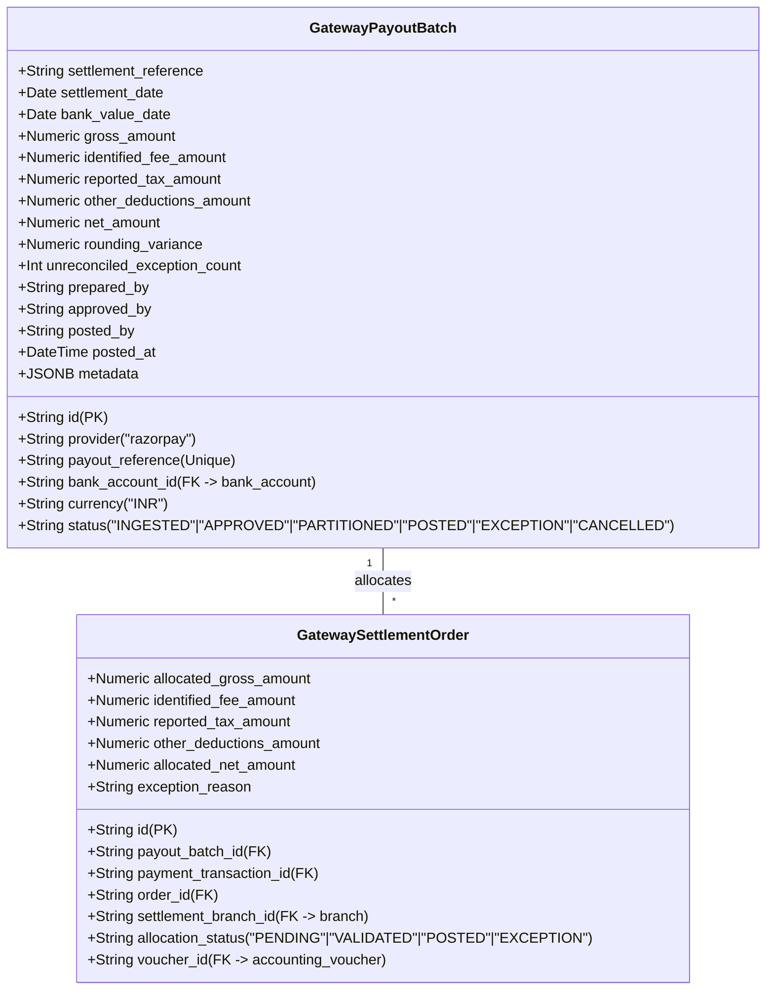

# CakeToHome ERP — Phase 4F Step 4.10 Substep 4.10.3 Forensic & Architecture Design Gate
## Gateway Payout Batch & Order Settlement Allocation Design
### Milestone: `PHASE-4F-STEP-4.10-BANK-DEPOSITS-GATEWAY-SETTLEMENT-IMPLEMENTATION-01`
### Substep: 4.10.3 — Forensic Inspection, Data Modeling & Architectural Design Gate
### Gate Classification: READ-ONLY FORENSIC & ARCHITECTURE DESIGN GATE — IMPLEMENTATION NOT AUTHORIZED

---

## 1. Executive Summary & Authorization Context

This document constitutes the formal **Forensic & Architectural Design Gate** for **Phase 4F Step 4.10 Substep 4.10.3: Gateway Payout Batch & Order Settlement Allocation**.

### Governance Invariants Upheld During This Gate:
- **Zero implementation code was written or modified.**
- **Zero database DDL, schema mutations, or table drops were executed.**
- **Zero production or historical financial data was mutated.**
- **Zero accounting vouchers, journal entries, or temporary accounts were created.**
- **Zero test fixtures or synthetic transactions were persisted.**
- **Zero Git commits, pushes, or resets were made.**
- **Substep 4.10.3 implementation remains strictly NOT STARTED.**

This design gate synthesizes live PostgreSQL forensic inspection, existing Razorpay and payment integration analysis, and the six binding decisions from [`phase4f-step4-10-architecture-decision-record-01.md`](file:///E:/vig/cakes2home-main/cakes2home-main/CHECKPOINTS/phase4f-step4-10-architecture-decision-record-01.md) into a complete, mathematically balanced implementation specification.

---

## 2. Forensic Inspection of Existing Razorpay & Payment Integration

### 2.1 Codebase Routes & Payment Handlers
Direct code inspection of [`frontend/src/app/api/v1/[...path]/route.ts`](file:///E:/vig/cakes2home-main/cakes2home-main/frontend/src/app/api/v1/%5B...path%5D/route.ts) (lines 4280–4395) revealed:
1. **Order Creation (`payments/razorpay/create-order`)**: Calls `ApiEngine.createRazorpayOrder(body)` returning Razorpay order parameters.
2. **Signature Verification (`payments/razorpay/verify-signature`)**: Verifies HMAC SHA-256 signature and synchronizes `public.payment_transaction`:
   ```sql
   UPDATE "payment_transaction"
   SET status = 'captured', settlement_status = 'settled', provider_ref = $1, updated_at = NOW()
   WHERE order_id = $2 OR provider_ref = $2
   ```
3. **Webhook Ingestion (`payments/razorpay/webhook`)**:
   - Handles `payment.captured` webhooks with idempotency checking against `idempotency_key` or `provider_ref`.
   - Inserts row into `public.payment_transaction` with `status='captured'`, `settlement_status='settled'`, `provider='razorpay'`.
   - Updates `order.metadata->'payment_status'` to `'captured'` and appends `order_status_history`.

### 2.2 Live PostgreSQL State of `public.payment_transaction`
Inspection of `public.payment_transaction` (total: 53 historical rows) established:
```text
Provider & Status Breakdown:
- cod  | pending   | pending   : 42 rows | Sum: ₹19,068
- cod  | captured  | settled   :  2 rows | Sum:  ₹1,596
- cod  | pending   | unsettled :  1 row  | Sum:  ₹1,500
- cod  | refunded  | settled   :  1 row  | Sum:  ₹2,000
- cod  | part_ref  | settled   :  3 rows | Sum:  ₹6,500
- upi  | captured  | settled   :  2 rows | Sum:  ₹2,138
- card | captured  | settled   :  2 rows | Sum:  ₹1,068
Total: 53 transactions (Historical Prototype Baseline)
```

### 2.3 Critical Forensic Realities & Asynchronous Settlement Decoupling
1. **Settlement is Asynchronous and Separate from Payment Capture**:
   - In Razorpay, a customer payment is captured immediately (`pay_xxx`), but payouts to the merchant's bank account are batched and settled $T+1$ or $T+2$ days later (`setl_xxx`).
   - The capture webhook only provides gross customer charge information. Payout batch details (net bank credit, MDR processing fees, GST deductions) arrive asynchronously via Razorpay Settlement Reports or Settlement APIs.
2. **Prototype Legacy Quirk**:
   - Prototype orders in `order.service.ts` wrote `settlement_status='settled'` immediately upon capture.
   - However, in canonical GAAP/IFRS accounting, an online capture debits `1113 Gateway Clearing` (not Bank Operating `1112`). The funds remain in `1113` until an authoritative gateway payout batch is ingested, approved, and posted to the General Ledger.

---

## 3. Exact `payment_transaction` and `order` Relationships

### 3.1 Live Database Column Comparison
A forensic schema inspection of live PostgreSQL tables `public.order` and `public.payment_transaction` confirmed:

| Property | `public.order` | `public.payment_transaction` |
|:---|:---|:---|
| **Relational `branch_id`** | **DOES NOT EXIST** (Absence confirmed in DB) | **EXISTS**: `branch_id text NOT NULL` |
| **Branch Storage** | Unstructured JSONB only: `order.metadata->>'branch_id'` | Relational column with foreign key to `public.branch(id)` |
| **Linkage Key** | Primary key: `id` | Foreign key: `order_id text NOT NULL REFERENCES public.order(id)` |
| **Amount Representation** | Total in metadata / items | Integer column: `amount integer NOT NULL` (Rupees) |
| **Settlement Flag** | `metadata->>'payment_status'` | Relational column: `settlement_status text NOT NULL` |

### 3.2 Factual Order Linkage Audit
Querying all 53 live `payment_transaction` rows against `public.order`:
- **41 transactions** link to active, historical orders in `public.order`.
- **41 of 41 (100%)** exhibit perfect parity: `payment_transaction.branch_id === order.metadata->>'branch_id'`.
- **12 transactions** are legacy prototype test records where the referenced `order_id` does not exist in `public.order` (quarantined test data).

### 3.3 Binding Relational Invariants for Settlement Allocation
1. **Primary Branch Authority**: The settlement branch is derived strictly from `payment_transaction.branch_id`.
2. **Order Integrity Validation**:
   - If `order.metadata->>'branch_id'` exists, the engine strictly asserts:
     $$\mathbf{payment\_transaction.branch\_id} \equiv \mathbf{order.metadata \to> 'branch\_id'}$$
     Any contradiction fails closed with `BRANCH_RELATIONSHIP_MISMATCH`.
   - If `order.metadata->>'branch_id'` is absent or empty, the engine must **never synthesize or guess** a branch; it fails closed with `SETTLEMENT_ORDER_BRANCH_UNVERIFIED`.
3. **No Unlinked Orders**: An order cannot be settled in a gateway payout batch without an authoritative, verified `payment_transaction_id`.

---

## 4. Gateway Payout Evidence Model

The evidence model for an ingested gateway payout batch is governed by `public.gateway_payout_batch`:



### Batch Ingestion Arithmetic Identity
Every ingested payout batch must satisfy the exact mathematical identity before approval:
$$\mathbf{gross\_amount} - \mathbf{identified\_fee\_amount} - \mathbf{reported\_tax\_amount} - \mathbf{other\_deductions\_amount} \pm \mathbf{rounding\_variance} \equiv \mathbf{net\_amount}$$

---

## 5. Branch Attribution & Enterprise Payout Splitting

### 5.1 The Multi-Branch Treasury Dilemma
- Payment aggregators (Razorpay) transfer a single lump sum into the corporate headquarters bank account (`bank_account_id = Central Corporate Bank`).
- However, online orders are fulfilled by distributed physical branches (e.g. Indiranagar, Koramangala, Whitefield).
- At order invoicing (Step 4.5), the General Ledger debited `1113 Gateway Clearing` tagged with the specific branch:
  $$\text{Branch A: Dr 1113 Gateway Clearing (Branch A)} \quad / \quad \text{Cr 1121 Trade AR (Branch A)}$$
  $$\text{Branch B: Dr 1113 Gateway Clearing (Branch B)} \quad / \quad \text{Cr 1121 Trade AR (Branch B)}$$

### 5.2 Strict Single-Branch Voucher Integrity Rule
- In CakeToHome ERP, every `accounting_voucher` has a single `branch_id`, and `AccountingJournalRepository` strictly checks that every line's `branch_id` matches the voucher's `branch_id` (`BRANCH_MISMATCH`).
- Cross-branch mixing within a single voucher is strictly forbidden.

### 5.3 Locked Architecture: Branch-Partitioned Vouchers (ADR-4.10-02)
When posting an approved payout batch:
1. The engine groups all validated `gateway_settlement_order` records by `settlement_branch_id`.
2. For each distinct branch $k \in \{\text{Branch}_1, \dots, \text{Branch}_N\}$, a dedicated, balanced `RECEIPT` voucher is posted:
   - **Voucher Attributes**:
     - `voucher_type`: `'RECEIPT'`
     - `branch_id`: $k$
     - `reference_type`: `'GATEWAY_PAYOUT'`
     - `reference_id`: `${payout_reference}_${branch_id}`
     - `reference_event`: `'GATEWAY_SETTLEMENT'`
   - **Journal Lines for Branch $k$**:
     - Line 1: $\text{Dr 1112 Bank Operating A/c}$ $[\text{Net Share}_k]$ (linked to corporate `bank_account_id`)
     - Line 2: $\text{Dr 5290 Payment Gateway MDR Fees}$ $[\text{MDR Share}_k]$
     - Line 3: $\text{Cr 1113 Gateway Clearing}$ $[\text{Gross Share}_k]$ (with order-level metadata)
3. **Mathematical Invariant**:
   $$\text{Gross Share}_k = \sum_{i \in \text{Orders}_k} \text{allocated\_gross\_amount}_i$$
   $$\text{MDR Share}_k = \sum_{i \in \text{Orders}_k} (\text{identified\_fee}_i + \text{reported\_tax}_i)$$
   $$\text{Net Share}_k = \text{Gross Share}_k - \text{MDR Share}_k$$
   $$\text{Net Share}_k + \text{MDR Share}_k \equiv \text{Gross Share}_k \quad (\text{Balanced to ₹0.00})$$

---

## 6. Gross / Fee / Tax / Other-Deduction Treatment

### 6.1 Line-Item Deduction Classification

| Deduction Component | Accounting Nature | Target Ledger Code | Timing & Authority |
|:---|:---|:---:|:---|
| **Gross Order Value** | Settlement of Customer Receivable | **`Cr 1113 Gateway Clearing`** | Real-time at daily payout posting |
| **Identified MDR Fee** | Direct Merchant Processing Expense | **`Dr 5290 Payment Gateway MDR Fees`** | Real-time at daily payout posting |
| **Reported GST on MDR** | SAC 997159 Input Tax (Pending Tax Invoice) | **`Dr 5290 Payment Gateway MDR Fees`**<br>(Stage 1 Operational Booking) | Real-time daily payout; reclassified to ITC in Stage 2 |
| **Rounding Variance** | Fractional paise discrepancy ($\le$ ₹1.00) | **`Dr/Cr 5295 Cash Rounding / Variance`** | Real-time at daily payout posting |
| **Other Deductions** | Chargebacks, Dispute Reserves, Holdbacks | **UNPOSTED EXCEPTION** (`other_deductions_amount`) | Held in exception status until formal dispute resolution |

### 6.2 The Statutory GST / ITC Constraint (CGST Act Section 16(2))
- Under Indian GST statutory law, Input Tax Credit (ITC) cannot be claimed without possessing a valid, authoritative tax invoice containing the supplier's GSTIN, invoice number, and tax breakdown.
- Payment gateway daily payout statements are financial settlement summaries, **not tax invoices**.
- Therefore, in Substep 4.10.3, daily settlement **never posts directly to ITC accounts `1143`, `1144`, or `1146`**. The fee plus reported GST is recognized as processing expense (`5290`).
- Reclassification to ITC occurs in Stage 2 (Monthly GSTR-2B Reconciliation) upon formal verification of the monthly aggregator tax invoice.

---

## 7. Exact Settlement Allocation Rules

When ingesting a payout report into `gateway_settlement_order`:
1. **Transaction Uniqueness**: `payment_transaction_id` must not be already settled (`allocation_status = 'POSTED'` or linked to an existing active voucher).
2. **Order Matching**:
   - `payment_transaction.order_id` must resolve to an active row in `public.order`.
   - `order.deleted_at IS NULL` and `order.canceled_at IS NULL` (unless a valid refund/cancellation workflow is linked).
3. **Amount Verification**:
   - `allocated_gross_amount` must equal `payment_transaction.amount`.
   - Fee deductions must be non-negative ($\ge 0$).
4. **Batch Sum Integrity**:
   $$\sum \text{allocated\_gross\_amount} \equiv \text{batch.gross\_amount}$$
   $$\sum \text{allocated\_net\_amount} \pm \text{rounding\_variance} \equiv \text{batch.net\_amount}$$

---

## 8. Exception States & Fail-Closed Guards

If any invariant is breached during ingestion, validation, or posting, the system fails closed with exact error codes:

| Error Code | Trigger Condition | Accounting Outcome |
|:---|:---|:---|
| `DUPLICATE_PAYOUT_REFERENCE` | Same `provider` and `payout_reference` already exists | Ingestion rejected; zero rows inserted |
| `SETTLEMENT_MATH_MISMATCH` | $\text{Gross} - \text{Fee} - \text{Tax} - \text{Deductions} \pm \Delta \ne \text{Net}$ | Batch rejected; zero vouchers created |
| `SETTLEMENT_VARIANCE_MISMATCH` | Rounding discrepancy $|\Delta| > \text{₹1.00}$ (or $> 100 \text{ paise}$) | Batch rejected; genuine dispute suspected |
| `PAYMENT_TRANSACTION_NOT_FOUND` | `payment_transaction_id` does not exist in DB | Order flagged `EXCEPTION`; batch unposted |
| `ORDER_NOT_FOUND` | `payment_transaction.order_id` not found in `public.order` | Order flagged `EXCEPTION`; batch unposted |
| `ORDER_ALREADY_SETTLED` | `payment_transaction` already settled in another batch | Order flagged `EXCEPTION`; batch unposted |
| `BRANCH_RELATIONSHIP_MISMATCH` | `payment_transaction.branch_id` contradicts `order.metadata->>'branch_id'` | Order flagged `EXCEPTION`; batch unposted |
| `SETTLEMENT_ORDER_BRANCH_UNVERIFIED`| Linked order contains no verifiable branch identity | Order flagged `EXCEPTION`; batch unposted |
| `BANK_ACCOUNT_INACTIVE` | Destination `bank_account_id` is `INACTIVE` or `FROZEN` | Posting blocked; funds cannot hit frozen bank |
| `UNRECONCILED_SETTLEMENT_EXCEPTION`| `other_deductions_amount > 0` without legal documentation | Posting blocked; deductions cannot be swept to expense |

---

## 9. 5290 MDR Treatment

- Account `5290 Payment Gateway MDR Fees` is an active Level 3 leaf expense account under `5200 Operating Expenses`.
- In Substep 4.10.3:
  - Each branch voucher debits `5290` with that branch's exact share of transaction processing fees.
  - Narration and metadata capture provider name, payout reference, and settled transaction count.
  - Branch Profit & Loss reporting truthfully reflects the cost of payment acceptance for each branch.

---

## 10. Segregation of Duties (SoD) & Permissions

### 10.1 Symmetrical 3-Tier SoD Model
In accordance with ADR-4.10-06 and database constraints (`chk_payout_sod_*`), gateway settlement enforces strict three-way separation:

$$\mathbf{prepared\_by} \ne \mathbf{approved\_by} \ne \mathbf{posted\_by}$$

1. **Stage 1 (Prepare)**:
   - **Permission**: `GATEWAY.SETTLE_PREPARE`
   - **Actor**: Treasury Clerk / Integration Service
   - **Action**: Ingests batch, validates orders, computes branch partitions (`status = 'INGESTED'`).
2. **Stage 2 (Approve)**:
   - **Permission**: `GATEWAY.SETTLE_APPROVE`
   - **Actor**: Treasury Manager / Finance Controller
   - **Action**: Verifies fee reconciliation, branch allocations, and exception flags (`status = 'APPROVED'`).
   - **Constraint**: Cannot be the user who prepared the batch.
3. **Stage 3 (Post)**:
   - **Permission**: `GATEWAY.SETTLE_POST` or `ACCOUNTING.POST`
   - **Actor**: General Ledger Accountant
   - **Action**: Executes atomic posting of branch vouchers to the General Ledger (`status = 'POSTED'`).
   - **Constraint**: Cannot be the user who prepared or approved the batch.

### 10.2 Super Admin Governance Rule
`SUPER_ADMIN` has permission to execute any individual stage, but **CANNOT bypass SoD by executing two consecutive stages on the same payout batch**. Database check constraints enforce this unconditionally.

---

## 11. Idempotency & Concurrency

1. **Unique Key Constraints**:
   - `public.gateway_payout_batch(provider, payout_reference)`: Guarantees a payout batch is ingested exactly once.
   - `public.gateway_settlement_order(payout_batch_id, payment_transaction_id)`: Guarantees a payment transaction is allocated to a batch at most once.
2. **Deterministic Lock Ordering**:
   To prevent deadlocks during high-concurrency ingestion and posting:
   $$\text{gateway\_payout\_batch} \;\to\; \text{gateway\_settlement\_order} \;\to\; \text{payment\_transaction} \;\to\; \text{bank\_account} \;\to\; \text{accounting\_voucher}$$
3. **Idempotent Retry**:
   If an already posted payout reference is submitted again, the service returns the authoritative existing result with `wasDuplicate: true` and zero duplicate GL postings.

---

## 12. Reconciliation with Account 1113 Gateway Clearing

### 12.1 Mathematical Parity Formula
For any branch and reporting period:
$$\begin{aligned}
\text{Total Prepaid Sales Recognized} &= \sum \text{Posted Debits to Account 1113} \\
\text{Total Settled Payouts} &= \sum \text{Posted Credits to Account 1113} \\
\mathbf{\text{Uncleared Gateway Balance}} &= \sum \text{Debits} - \sum \text{Credits} = \mathbf{\text{Net Balance of Account 1113}}
\end{aligned}$$

### 12.2 Subledger Audit Trail
Every credit line to Account `1113` retains:
- `reference_id`: `${payout_reference}_${branch_id}`
- `metadata->'order_ids'`: Array of settled order IDs
- `metadata->'payout_batch_id'`: Foreign key to `gateway_payout_batch`
- `metadata->'payment_transaction_ids'`: Array of settled transaction IDs

This guarantees complete traceability from bank deposit credit back to individual customer orders.

---

## 13. Required Schema Status

### 13.1 Database DDL Status: ALREADY COMPLETE ✅
All required relational tables, columns, indexes, and constraints were created during **Substep 4.10.1**:
- `public.gateway_payout_batch`: Verified in live DB (25 columns, 7 constraints, 4 indexes).
- `public.gateway_settlement_order`: Verified in live DB (17 columns, 8 constraints, 5 indexes).
- **NO further database DDL or migrations are required for Substep 4.10.3.**

### 13.2 Application Catalog Updates Needed in Substep 4.10.3
1. **Permissions Catalog (`staff-access-control.ts`)**:
   Add `GATEWAY.VIEW`, `GATEWAY.SETTLE_PREPARE`, `GATEWAY.SETTLE_APPROVE`, `GATEWAY.SETTLE_POST`.
2. **TypeScript Domain Types (`accounting.types.ts`)**:
   Add `GatewayPayoutBatchRow`, `GatewaySettlementOrderRow`, parameter interfaces, and error codes.

---

## 14. Explicit Implementation Boundaries for Substep 4.10.3

| Component / Action | In Scope for Substep 4.10.3 | Deferred to Later Steps |
|:---|:---:|:---:|
| `GatewayPayoutRepository` & `GatewaySettlementOrderRepository` | **YES** | — |
| `GatewaySettlementService` (Ingestion, Validation, SoD, GL Posting) | **YES** | — |
| Branch-Partitioned Voucher Generation (`Dr 1112 / Dr 5290 / Cr 1113`) | **YES** | — |
| Dedicated Substep 4.10.3 Test Suite (`test_step4_10_3_gateway_settlement.js`) | **YES** | — |
| 100% Zero Persistent Financial Test Rows (Pristine DB Baseline) | **YES** | — |
| API Route Handlers & Next.js UI Dashboard Panels | ❌ | Substep 4.10.4 |
| Bank Statement CSV / MT940 Import & Automated Reconciliation | ❌ | Substep 4.10.5 |
| Monthly GST Tax Invoice ITC Reclassification Workflow | ❌ | Substep 4.10.5 |
| Git Commits, Pushes, or Resets | ❌ | STRICTLY PROHIBITED |

---

## 15. Gate Conclusion & Sign-Off

The forensic inspection, architectural specifications, mathematical identities, and boundary controls for **Substep 4.10.3** are complete, schema-verified, and frozen.

**Next Action**: Stand by for formal user review and authorization to proceed with Substep 4.10.3 implementation. Zero code or data modifications have been executed.
