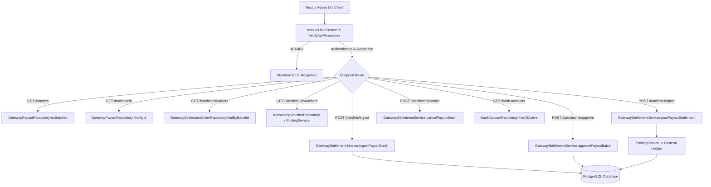
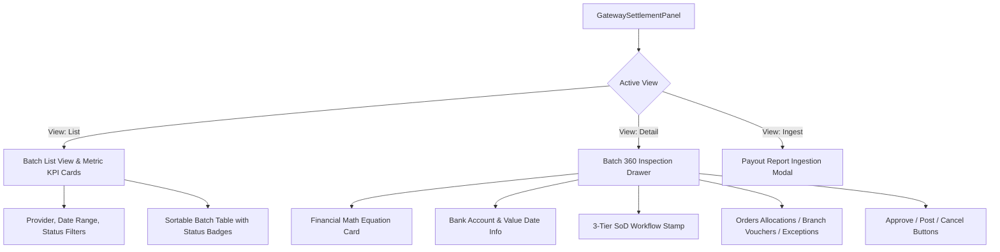

# CakeToHome ERP — Phase 4F Step 4.10 Substep 4.10.4 Forensic & Architecture Design Gate
## Gateway Settlement API Endpoints & Enterprise UI Dashboard Design
### Milestone: `PHASE-4F-STEP-4.10-BANK-DEPOSITS-GATEWAY-SETTLEMENT-IMPLEMENTATION-01`
### Substep: 4.10.4 — Forensic Inspection, Route Architecture & UI Design Gate
### Gate Classification: READ-ONLY FORENSIC & ARCHITECTURE DESIGN GATE — IMPLEMENTATION NOT AUTHORIZED

---

## 1. Executive Summary & Authorization Context

This document establishes the formal **Forensic & Architectural Design Gate** for **Phase 4F Step 4.10 Substep 4.10.4: Gateway Settlement API & UI Dashboard**.

### Governance Invariants Upheld During This Gate:
- **Zero implementation code was written or modified.**
- **Zero database DDL, schema mutations, or table drops were executed.**
- **Zero production or historical financial data was mutated.**
- **Zero accounting vouchers, journal entries, or temporary accounts were created.**
- **Zero test fixtures or synthetic transactions were persisted.**
- **Zero Git commits, pushes, or resets were made.**
- **Substep 4.10.4 implementation remains strictly NOT STARTED.**

This design gate connects the frozen accounting settlement engine ([`GatewaySettlementService`](file:///E:/vig/cakes2home-main/cakes2home-main/frontend/src/lib/services/gateway-settlement.service.ts)) developed in **Substep 4.10.3** to CakeToHome ERP's Next.js administrative routing and dashboard surface.

---

## 2. Forensic Inspection of Existing Admin API & Dashboard Architecture

### 2.1 API Route Architecture (`frontend/src/app/api/v1/[...path]/route.ts`)
Inspection of the unified administrative routing engine revealed the standardized enterprise pattern:
1. **Authentication & Session Resolution**:
   - Every request is resolved via `resolveUserContext(req)` calling `resolveServerSession(req)`.
   - Returns `{ userId, role, phone, branchId, partnerId, isSuperAdmin }`.
   - Never trusts client-supplied headers or body parameters for user identity.
2. **Permission Gating (`verifyApiPermission`)**:
   - `verifyApiPermission(req, module, action)` enforces RBAC against `StaffAccessControl.hasPermission(userCtx, module, action)`.
   - Fails closed: 401 if unauthenticated, 403 if missing permission.
3. **Server-Side Branch Isolation**:
   - `isSuperAdmin` grants enterprise-wide access with optional branch filtering via query parameter.
   - Non-super-admins are strictly bound to their verified `userCtx.branchId`. Any attempt to request another branch fails closed with `403 FORBIDDEN` (BOLA defense).
4. **Existing Module Precedents**:
   - `admin/purchases` (lines 1125–1195, 3317–3385)
   - `admin/expenses` (lines 1200–1270, 3390–3450)
   - `admin/reports/ar` (lines 1391–1515)
   - `admin/reports/cod` (lines 1517–1610, 3244–3315)

### 2.2 Dashboard Component & Tab Structure
1. **Tab Navigation (`frontend/src/components/dashboard/admin/admin-tabs.tsx`)**:
   - Controlled tab bar filtering tabs via `StaffAccessControl.isTabPermitted(user, tabId)`.
   - Mobile and tablet responsive dropdown selector (`< lg`) alongside horizontal scroller (`>= lg`).
2. **Sidebar Navigation (`frontend/src/components/admin/AdminSidebar.tsx`)**:
   - Grouped navigation accordion (`NAV_GROUPS`) mapping sidebar links to `AdminTabId`.
   - Collapsible state with responsive mobile drawer.
3. **Panel Registry (`frontend/src/app/dashboard/page.tsx`)**:
   - Lazy-loaded dynamic panel loader with chunk failure retry (`createDynamicPanel`).
   - `PANEL_MAP` mapping `AdminTabId` to corresponding panel component.
   - Wrapped in `AdminShell` and `DashboardErrorBoundary`.

---

## 3. Gateway Settlement API Endpoints Specification

All gateway settlement endpoints will be mounted under `/api/v1/admin/gateway-settlements/*` in `frontend/src/app/api/v1/[...path]/route.ts`:



### 3.1 Endpoint Matrix

| Method | Endpoint Path | Required Permission | Description |
|:---|:---|:---:|:---|
| **GET** | `/api/v1/admin/gateway-settlements/batches` | `GATEWAY.VIEW` | List payout batches with filters (`provider`, `status`, `date_from`, `date_to`, `bank_account_id`, `limit`, `offset`). |
| **GET** | `/api/v1/admin/gateway-settlements/batches/:id` | `GATEWAY.VIEW` | Fetch single payout batch by ID with financial aggregates and SoD audit stamps. |
| **GET** | `/api/v1/admin/gateway-settlements/batches/:id/orders` | `GATEWAY.VIEW` | Fetch allocated orders for batch with order, transaction, fee, and exception details. |
| **GET** | `/api/v1/admin/gateway-settlements/batches/:id/vouchers` | `GATEWAY.VIEW` | Fetch posted branch vouchers (`Dr 1112`, `Dr 5290`, `Cr 1113`) for a posted batch. |
| **GET** | `/api/v1/admin/bank-accounts` | `BANK.VIEW` or `GATEWAY.VIEW` | List active destination bank accounts for batch ingestion selection. |
| **POST** | `/api/v1/admin/gateway-settlements/batches/ingest` | `GATEWAY.SETTLE_PREPARE` | Ingest new normalized payout batch payload and validate transaction allocations. |
| **POST** | `/api/v1/admin/gateway-settlements/batches/:id/approve` | `GATEWAY.SETTLE_APPROVE` | Review and approve ingested batch. Enforces `approved_by !== prepared_by`. |
| **POST** | `/api/v1/admin/gateway-settlements/batches/:id/post` | `GATEWAY.SETTLE_POST` | Post approved batch to GL. Enforces `posted_by !== approved_by && posted_by !== prepared_by`. |
| **POST** | `/api/v1/admin/gateway-settlements/batches/:id/cancel` | `GATEWAY.SETTLE_APPROVE` | Cancel unposted batch with required reason. Fails closed if batch is `POSTED`. |

### 3.2 Request / Response Schemas

#### A. Ingest Batch (`POST /api/v1/admin/gateway-settlements/batches/ingest`)
- **Request Body**:
  ```json
  {
    "provider": "razorpay",
    "payout_reference": "pout_20260928_001",
    "settlement_reference": "UTR9876543210",
    "bank_account_id": "ba_corp_hdfc_01",
    "settlement_date": "2026-09-28",
    "gross_amount": 10500.00,
    "identified_fee_amount": 178.00,
    "reported_tax_amount": 32.04,
    "other_deductions_amount": 0.00,
    "rounding_variance": 0.04,
    "net_amount": 10290.00,
    "orders": [
      {
        "payment_transaction_id": "paytxn_01...",
        "order_id": "order_01...",
        "allocated_gross_amount": 5500.00,
        "identified_fee_amount": 93.24,
        "reported_tax_amount": 16.78
      }
    ]
  }
  ```
- **Response** (HTTP 201 Created):
  ```json
  {
    "success": true,
    "data": {
      "payoutBatch": { "id": "gpb_...", "status": "INGESTED", ... },
      "settlementOrdersCount": 1,
      "wasDuplicate": false
    }
  }
  ```

#### B. Approve Batch (`POST /api/v1/admin/gateway-settlements/batches/:id/approve`)
- **Request Body**: `{ "notes": "Verified against aggregator settlement report" }`
- **Response** (HTTP 200 OK):
  ```json
  {
    "success": true,
    "data": {
      "payoutBatch": { "id": "gpb_...", "status": "APPROVED", "approved_by": "usr_mgr_01", ... }
    }
  }
  ```

#### C. Post Batch (`POST /api/v1/admin/gateway-settlements/batches/:id/post`)
- **Request Body**: `{ "posting_date": "2026-09-28" }`
- **Response** (HTTP 200 OK):
  ```json
  {
    "success": true,
    "data": {
      "payoutBatch": { "id": "gpb_...", "status": "POSTED", "posted_by": "usr_acct_01", "posted_at": "..." },
      "vouchersCount": 2,
      "vouchers": [
        {
          "voucherId": "vch_...",
          "voucherNumber": "REC-2026-0001",
          "branchId": "br_indiranagar",
          "netShare": 5389.98,
          "mdrShare": 110.02,
          "grossShare": 5500.00
        }
      ]
    }
  }
  ```

---

## 4. Branch & Enterprise Visibility Security Model

### 4.1 Treasury vs Branch Visibility Invariants
1. **Enterprise Scope (Super Admin / Corporate Treasury)**:
   - Users with unrestricted corporate scope can view all payout batches across all providers and bank accounts.
   - Full access to all branch allocations and consolidated MDR analytics.
2. **Branch Scope (Branch Managers / Cashiers)**:
   - When a user has a specific `userCtx.branchId`:
     - Batch Listing: Filtered to show batches containing at least one transaction fulfilling at `userCtx.branchId`.
     - Order Allocations: Filtered strictly to `settlement_branch_id === userCtx.branchId`.
     - Vouchers: Filtered strictly to vouchers where `branch_id === userCtx.branchId`.
     - **BOLA Defense**: An attempt by a branch-scoped user to query another branch's vouchers or allocations returns `403 FORBIDDEN` or empty set.

### 4.2 Immutable Financial State Protections
- **Zero Client-Controlled Accounting Data**:
  - The client UI can never send GL account codes (e.g. `1112`, `1113`, `5290`). These are hardcoded in the server engine.
  - The client UI can never specify the voucher's branch ID. It is extracted relationally from `payment_transaction.branch_id`.
  - The client UI can never set `status = 'POSTED'` or forge SoD audit fields (`prepared_by`, `approved_by`, `posted_by`).
- **Posted Batch Immutability**:
  - Once a batch is `POSTED`, its status cannot be changed to `CANCELLED`, `INGESTED`, or `APPROVED`.
  - All financial allocations and GL vouchers become permanently read-only.

---

## 5. UI / UX Design: `GatewaySettlementPanel`

### 5.1 Component Architecture
A dedicated, responsive component [`gateway-settlement-panel.tsx`](file:///E:/vig/cakes2home-main/cakes2home-main/frontend/src/components/dashboard/admin/gateway-settlement-panel.tsx) will be added to `frontend/src/components/dashboard/admin/`.



### 5.2 Key Views & Features

#### 1. Metric KPI Cards (Top of List View)
- **Total Settled Volume**: Gross customer payments cleared through gateways in period.
- **Net Bank Deposits**: Realized cash credited to operational bank accounts (`1112`).
- **MDR Processing Cost**: Total fee and tax recognized under operating expenses (`5290`).
- **Pending Approvals**: Batches awaiting review by treasury controller.
- **Unreconciled Exceptions**: Batches flagged with dispute holdbacks or variance.

#### 2. Batch List Table
- Columns: `Provider`, `Payout Reference`, `Settlement Date`, `Gross`, `MDR Fee`, `Net Bank Credit`, `Orders`, `Status`, `Actions`.
- Status Badges:
  - `INGESTED`: Blue (`bg-blue-100 text-blue-800`)
  - `APPROVED`: Amber (`bg-amber-100 text-amber-800`)
  - `POSTED`: Green (`bg-emerald-100 text-emerald-800`)
  - `EXCEPTION`: Red (`bg-rose-100 text-rose-800`)
  - `CANCELLED`: Slate (`bg-slate-100 text-slate-800`)

#### 3. Detail Drawer (360° Payout Inspection)
- **Financial Equation Banner**:
  $$\text{Gross (₹)} - \text{MDR Fee (₹)} - \text{Tax (₹)} - \text{Other (₹)} \pm \text{Rounding (₹)} = \mathbf{\text{Net Credit (₹)}}$$
  Displays exact paise balances with visual green/red balancing indicator.
- **SoD Governance Card**:
  - `Prepared By`: Staff ID, timestamp, and role.
  - `Approved By`: Manager ID, timestamp, and status.
  - `Posted By`: GL Accountant ID, posting timestamp, and voucher references.
  - **Dynamic In-UI SoD Warnings**: If the logged-in user prepared the batch, the "Approve" button is disabled with an explanatory tooltip: *"Segregation of Duties Violation: You cannot approve a batch you prepared."*
- **Sub-Tabs in Detail**:
  1. **Allocated Orders**: Table listing all customer orders settled in this batch with branch breakdown and allocated gross/fee/net.
  2. **Branch Vouchers** (Visible when `POSTED`): Cards displaying each branch's balanced `RECEIPT` voucher with exact `Dr 1112`, `Dr 5290`, `Cr 1113` lines.
  3. **Exceptions & Disputes**: Details of any held deductions (`other_deductions_amount > 0`) or transaction anomalies.

#### 4. Ingestion Modal (`IngestPayoutModal`)
- Select Destination Bank Account (populated from active corporate bank accounts).
- Settlement Date & Bank Value Date pickers.
- Aggregate summary inputs (Gross, Fee, Tax, Deductions, Net, Rounding).
- Order Allocation inputs: CSV upload or JSON paste or interactive order row builder.
- Real-time arithmetic validation: Computes $\text{Gross} - \text{Fee} - \text{Tax} - \text{Other} \pm \Delta$ dynamically, alerting user of math mismatches before submission.

---

## 6. Audit Trail & Immutability Presentation

1. **Timeline Visualization**:
   - Visual step-by-step progress stepper:
     `Ingested` $\to$ `Approved` $\to$ `Branch Partitioned` $\to$ `Posted to GL`.
2. **Journal Voucher Deep-Linking**:
   - For `POSTED` batches, the UI provides direct clickable links to the generated General Ledger vouchers, displaying journal line details and voucher reference tokens.
3. **Cancellation Reason Log**:
   - If a batch was cancelled, the cancellation reason, timestamp, and user ID are displayed in a prominent warning banner.

---

## 7. API Idempotency & Error Handling Semantics

The API adheres to consistent error contracts:

```json
{
  "success": false,
  "error": "DUPLICATE_PAYOUT_REFERENCE",
  "message": "Gateway payout batch with provider 'razorpay' and reference 'pout_001' already exists.",
  "module": "GATEWAY",
  "action": "SETTLE_PREPARE"
}
```

### Handled Error Codes:
- `401 UNAUTHORIZED`: Authentication session absent or invalid.
- `403 FORBIDDEN`: Missing `GATEWAY.*` permission or SoD violation (`SELF_APPROVAL_FORBIDDEN`, `SEGREGATION_OF_DUTIES_VIOLATION`).
- `404 NOT_FOUND`: Batch, bank account, or transaction not found.
- `409 CONFLICT`: Duplicate payout reference, transaction already settled, or invalid lifecycle state transition.
- `422 UNPROCESSABLE_ENTITY`: Financial math mismatch or excessive rounding variance.
- `400 BAD_REQUEST`: Missing required body parameters or invalid date formats.

---

## 8. Dedicated Test Strategy for Substep 4.10.4

Implementation verification will require a dedicated integration and security test suite (`frontend/scratch/test_step4_10_4_gateway_api.js`):

1. **Authentication & RBAC Testing**:
   - Anonymous request $\to$ `401 UNAUTHORIZED`.
   - Missing `GATEWAY.VIEW` $\to$ `403 FORBIDDEN`.
   - Non-preparer attempting ingestion $\to$ `403 FORBIDDEN`.
   - Non-approver attempting approval $\to$ `403 FORBIDDEN`.
   - Non-poster attempting GL post $\to$ `403 FORBIDDEN`.
2. **API Endpoint Functionality**:
   - Ingestion API: Successfully ingests valid batch, rejects bad math, rejects duplicate reference.
   - Batch Listing API: Filters by status, provider, date range, and pagination.
   - Batch Detail API: Returns full batch data, orders, and calculated totals.
   - Approval API: Successfully marks batch `APPROVED`, rejects preparer self-approval.
   - Posting API: Successfully posts to GL, creates branch-partitioned vouchers, rejects approver self-posting.
   - Cancellation API: Cancels unapproved/approved batch, rejects cancellation on `POSTED` batch.
3. **Branch Scoping & BOLA Security**:
   - Branch manager query filtered strictly to assigned branch orders and vouchers.
   - Cross-branch access attempts blocked.
4. **Zero Persistent Mutation & Database Audit**:
   - 100% test fixture teardown.
   - Independent verification of pristine database baseline (0 vouchers, 0 journals, 0 batches).

---

## 9. Gate Conclusion & Sign-Off

The forensic inspection, API routing architecture, UI component designs, security constraints, and test specifications for **Substep 4.10.4** are complete, schema-verified, and frozen.

**Next Action**: Stand by for formal user authorization before writing any implementation code. Zero code or database mutations were executed during this gate.
