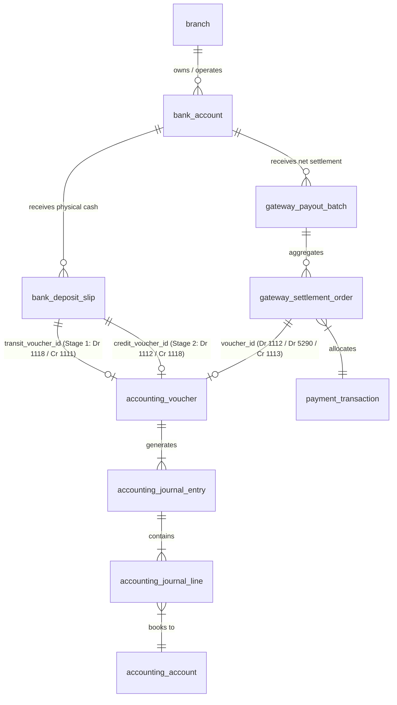
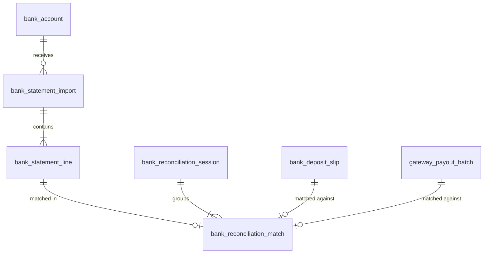

# Phase 4F Step 4.10 Substep 4.10.5 Forensic & Architecture Design Gate
# Bank Statement Import, Reconciliation & Matching Engine

**Status**: FORENSIC & DESIGN GATE COMPLETE 📋 (AWAITING IMPLEMENTATION AUTHORIZATION)  
**Timestamp**: 2026-09-28T15:58:00+05:30  
**Predecessor Gates**: 
- `CHECKPOINTS/phase4f-step4-10-substep4-10-1-schema-foundation-01.md` (LOCKED 🔒)
- `CHECKPOINTS/phase4f-step4-10-substep4-10-2-bank-master-cash-deposit-01.md` (LOCKED 🔒)
- `CHECKPOINTS/phase4f-step4-10-substep4-10-3-gateway-settlement-implementation-01.md` (LOCKED 🔒)
- `CHECKPOINTS/phase4f-step4-10-substep4-10-4-gateway-settlement-api-ui-implementation-01.md` (LOCKED 🔒)  
**Target Substep**: Phase 4F Step 4.10 Substep 4.10.5 (Bank Reconciliation)  
**Database Action**: READ-ONLY FORENSIC INSPECTION — ZERO SCHEMA MUTATIONS, ZERO GL POSTINGS, ZERO TEST FIXTURES RESIDUAL

---

## 1. Executive Summary & Design Scope

Phase 4F Step 4.10 Substep 4.10.5 establishes the architectural foundation for **Bank Statement Ingestion, Automated Matching, and Bank Reconciliation Statement (BRS) Accounting**.

### 1.1 Scope Boundaries
- **IN SCOPE for 4.10.5**:
  1. Immutable bank statement import model (`bank_statement_import`, `bank_statement_line`).
  2. Pluggable bank statement parser adapters (Generic CSV, HDFC, ICICI, SBI, OFX, MT940).
  3. Replay and duplicate upload protection (SHA-256 content checksum + line composite idempotency).
  4. Three Matching Vectors:
     - **Vector A (Cash Deposits)**: Matching bank credits against `bank_deposit_slip` to trigger Stage 2 transit clearance (`Dr 1112 Bank Operating / Cr 1118 Deposit in Transit`) with strict SoD.
     - **Vector B (Gateway Settlements)**: Matching bank credits against `gateway_payout_batch` by net amount and UTR / settlement reference (verifying GL `1112` already booked in 4.10.3).
     - **Vector C (Direct Bank Debits/Credits)**: Identifying supplier payments (Step 3D.5), bank interest, service charges, or unmatched direct transfers.
  5. Controlled reconciliation discrepancy and exception engine (identifying amount mismatches, unrecorded bank charges, and prolonged transit).
  6. Bank Reconciliation Statement (BRS) calculation:
     $$\text{Adjusted Book Balance (1112)} + \text{Uncredited Deposits (1118)} - \text{Unpresented Cheques} = \text{Bank Statement Closing Balance}$$
  7. Enterprise UI Dashboard for statement upload, matching workspace, and BRS reporting.
- **STRICTLY OUT OF SCOPE for 4.10.5**:
  - Direct ERP accounting creation upon file upload (file upload is strictly evidence ingestion).
  - Unexplained automated fallback to `1119 Unclassified Suspense`.
  - Re-opening or modifying historical prototype orders (173 orders) or payments (53 transactions).
  - GST ITC reclassification (GSTR-2B matching against supplier invoices belongs to Tax Module Phase 4G).

---

## 2. Forensic Inspection of Existing Infrastructure

A comprehensive, read-only forensic inspection of the PostgreSQL schema and codebase was conducted on 2026-09-28.

### 2.1 Existing Tables & Relationship Topography



#### Detailed Table Specifications:
1. `public.bank_account` (10 columns):
   - `id`: Text PK (`ba_...`).
   - `company_id`: Multi-tenant organization reference.
   - `branch_id`: Nullable FK to `public.branch`. If NULL, account is an enterprise-wide centralized account (e.g. Headquarters HDFC current account).
   - `bank_name`, `account_number_masked`, `ifsc_code`, `status` (`ACTIVE`, `INACTIVE`, `FROZEN`), `metadata`.
2. `public.bank_deposit_slip` (19 columns):
   - `id`, `slip_number`, `branch_id`, `bank_account_id`, `deposit_date`, `amount`, `denominations`, `status` (`DRAFT`, `DISPATCHED`, `CONFIRMED`, `CANCELLED`, `REJECTED`).
   - `transit_voucher_id`: FK to `accounting_voucher` for Stage 1 transit dispatch (`Dr 1118 / Cr 1111`).
   - `credit_voucher_id`: FK to `accounting_voucher` reserved for Stage 2 bank credit confirmation (`Dr 1112 / Cr 1118`).
   - `bank_ref_number`: Bank counterfoil or acknowledgment reference.
   - `bank_value_date`: Date the bank processed the credit.
3. `public.gateway_payout_batch` (25 columns):
   - `id`, `provider`, `payout_reference`, `settlement_reference` (UTR), `bank_account_id`, `settlement_date`, `bank_value_date`.
   - `gross_amount`, `identified_fee_amount`, `reported_tax_amount`, `other_deductions_amount`, `net_amount`, `rounding_variance`.
   - `status` (`INGESTED`, `APPROVED`, `PARTITIONED`, `POSTED`, `CANCELLED`, `EXCEPTION`).
   - `unreconciled_exception_count`: Tracks pending deduction or mismatch exceptions.
4. `public.payment_transaction` (15 columns):
   - `id`, `branch_id`, `order_id`, `customer_id`, `amount`, `currency`, `status`, `settlement_status`, `provider`, `provider_ref`.

### 2.2 Key Control Accounts in Chart of Accounts (99 Active Accounts)

| Code | Account Name | Type / Subtype | Normal Balance | Role in Cash & Bank Lifecycle |
|:---:|:---|:---|:---:|:---|
| **1111** | Cash in Hand | `ASSET` / `CURRENT_ASSET` | Debit | Physical currency in branch cash drawers. Credited upon cash deposit dispatch. |
| **1112** | HDFC Bank Operating A/c | `ASSET` / `CURRENT_ASSET` | Debit | Primary operating bank account. Debited upon gateway payout posting and confirmed cash deposits. |
| **1113** | Payment Gateway Clearing | `ASSET` / `CURRENT_ASSET` | Debit | Temporary clearing account. Debited upon online order capture; Credited upon gateway payout posting. |
| **1118** | Deposit in Transit (Cash) | `ASSET` / `CURRENT_ASSET` | Debit | Temporary transit account. Debited on physical cash dispatch; Credited upon bank statement confirmation. |
| **1119** | Unclassified Suspense | `ASSET` / `CURRENT_ASSET` | Debit | Fallback suspense for unclassified bank movements. Zero automatic booking permitted. |
| **5290** | Payment Gateway MDR Fees | `EXPENSE` / `OPERATING_EXPENSE` | Debit | Expense for gateway transaction fees and non-claimable GST. |
| **5295** | Cash Rounding / Variance | `EXPENSE` / `OPERATING_EXPENSE` | Debit | Operating expense/income for fractional paise rounding differences ($\le$ ₹1.00). |

---

## 3. Gap Analysis: What is Missing for 4.10.5

The forensic inspection confirms that while the core GL posting and settlement engines exist, the **Bank Statement Ingestion and Reconciliation Engine** has not been created.

```
┌─────────────────────────────────────────────────────────────────────────────┐
│                             MISSING CAPABILITIES                            │
├────────────────────────────────┬────────────────────────────────────────────┤
│ Capability Domain              │ Specific Missing Infrastructure            │
├────────────────────────────────┼────────────────────────────────────────────┤
│ 1. Statement Storage           │ No tables exist to store bank statements   │
│                                │ (`bank_statement_import`, `line`).         │
│ 2. Deduplication & Replay      │ No file hashing (SHA-256) or line-level    │
│                                │ idempotency checks.                        │
│ 3. Statement Parsers           │ No parser adapters for CSV, OFX, or MT940. │
│ 4. Two-Stage Cash Clearance    │ `bank_deposit_slip.credit_voucher_id` is   │
│                                │ unpopulated; no service creates Stage 2 GL │
│                                │ (`Dr 1112 / Cr 1118`).                     │
│ 5. Payout UTR Verification     │ No engine matches statement credits with   │
│                                │ `gateway_payout_batch.settlement_reference`│
│ 6. BRS Calculation Engine      │ No service computes uncredited transit and │
│                                │ unpresented cheques against GL 1112.       │
│ 7. Reconciliation Session/Audit│ No persistent reconciliation session or    │
│                                │ audit lock table exists.                   │
│ 8. Reconciliation UI           │ No statement upload, matching workspace, or│
│                                │ BRS drawer exists in Admin portal.         │
└────────────────────────────────┴────────────────────────────────────────────┘
```

---

## 4. Architectural Decision Records (ADRs)

### ADR-4.10-03: Two-Stage Cash Deposit Accounting & Bank Statement Clearance

#### Status: PROPOSED & LOCKED FOR 4.10.5
#### Context:
When cash from sales or COD collections is deposited in a bank, there is a physical transit latency (typically 1 to 3 business days) between branch dispatch and the credit appearing on the bank statement. If cash is credited directly to `1112 Bank Operating` at dispatch, the GL overstates bank balances and invalidates bank reconciliation.

#### Decision:
Enforce strict **Two-Stage Transit Accounting**:
- **Stage 1 (At Physical Dispatch — Already implemented in 4.10.2)**:
  $$\text{Dr 1118 Deposit in Transit} \quad \text{₹ Amount}$$
  $$\text{Cr 1111 Cash in Hand} \quad \text{₹ Amount}$$
  Recorded on `bank_deposit_slip.transit_voucher_id`.
- **Stage 2 (Upon Bank Statement Credit Confirmation — Scope of 4.10.5)**:
  When the imported bank statement reflects the credit:
  $$\text{Dr 1112 Bank Operating A/c} \quad \text{₹ Amount}$$
  $$\text{Cr 1118 Deposit in Transit} \quad \text{₹ Amount}$$
  Recorded on `bank_deposit_slip.credit_voucher_id` with `reference_event = 'BANK_DEPOSIT_CONFIRMATION'`.
  The voucher date is strictly set to the bank statement's `value_date`.
- **Segregation of Duties (SoD)**:
  The actor who dispatched the deposit slip cannot approve the Stage 2 credit voucher.

---

### ADR-4.10-04: Bank Statement Ingestion, Reconciliation Identity & Suspense Policy

#### Status: PROPOSED & LOCKED FOR 4.10.5
#### Context:
Imported bank statements contain external records that may not immediately match ERP records (e.g. unknown direct debits, delayed gateway credits, bank maintenance fees). 

#### Decision:
1. **Zero Automated GL Postings on Upload**:
   - Bank statement upload is strictly an evidence-ingestion event. It creates rows in `bank_statement_import` and `bank_statement_line`.
   - Uploading a statement **NEVER** creates GL vouchers automatically.
2. **BRS Mathematical Identity**:
   At any point in time, the Bank Reconciliation Statement must satisfy the exact identity:
   $$\text{GL Account 1112 Balance} + \text{Outstanding Deposit Slips (Uncredited 1118)} - \text{Unpresented Payments} \pm \text{Unreconciled Bank Lines} \equiv \text{Bank Statement Closing Balance}$$
3. **Suspense Account Policy (Account 1119)**:
   - Automated matching will **NEVER** post an unexplained transaction to `1119 Unclassified Suspense`.
   - If a bank transaction cannot be matched against an ERP record (e.g. unexpected bank fee or unidentified customer NEFT), it is flagged with status `UNMATCHED_EXCEPTION`.
   - Booking to Account 1119 requires an explicit, authenticated manual journal voucher with a documented business justification and SoD approval.

---

## 5. Technical Specification & Domain Model

### 5.1 Additive Database Tables Proposed for 4.10.5



#### 1. `public.bank_statement_import`
- `id`: Text PK (`bsi_...`)
- `company_id`: Multi-tenant company reference
- `bank_account_id`: FK to `public.bank_account`
- `file_name`: Original uploaded filename
- `file_hash`: SHA-256 content checksum (enforces duplicate upload block)
- `file_format`: Format adapter (`CSV_GENERIC`, `CSV_HDFC`, `CSV_ICICI`, `CSV_SBI`, `OFX`, `MT940`)
- `statement_start_date`: Date of earliest statement transaction
- `statement_end_date`: Date of latest statement transaction
- `opening_balance`: Statement opening balance (Numeric, 2 decimals)
- `closing_balance`: Statement closing balance (Numeric, 2 decimals)
- `total_credits`: Sum of all credit lines (Numeric, 2 decimals)
- `total_debits`: Sum of all debit lines (Numeric, 2 decimals)
- `line_count`: Total transaction rows parsed
- `status`: `UPLOADED`, `PARSED`, `PARTIALLY_RECONCILED`, `RECONCILED`, `ARCHIVED`
- `uploaded_by`: Actor user ID
- `metadata`: JSONB audit storage
- `created_at`, `updated_at`

#### 2. `public.bank_statement_line`
- `id`: Text PK (`bsl_...`)
- `statement_import_id`: FK to `public.bank_statement_import` (CASCADE delete on unposted rollback)
- `bank_account_id`: FK to `public.bank_account`
- `line_number`: 1-based sequential line index
- `transaction_date`: Date transaction occurred
- `value_date`: Date transaction cleared bank ledger
- `description`: Raw bank narration text
- `reference_number`: Bank reference, UTR, or cheque number
- `transaction_type`: `CREDIT` | `DEBIT`
- `amount`: Transaction amount (Numeric, positive, 2 decimals)
- `balance_after`: Running balance reported by bank
- `match_status`: `UNMATCHED`, `AUTO_MATCHED`, `MANUALLY_MATCHED`, `EXCEPTION`, `EXCLUDED`
- `matched_entity_type`: `BANK_DEPOSIT`, `GATEWAY_PAYOUT`, `DIRECT_PURCHASE_PAYMENT`, `MANUAL_JOURNAL`, NULL
- `matched_entity_id`: ID of matched record
- `raw_payload`: JSONB capturing raw row columns from source file
- `metadata`: JSONB audit notes
- `created_at`, `updated_at`

#### 3. `public.bank_reconciliation_session`
- `id`: Text PK (`brs_...`)
- `bank_account_id`: FK to `public.bank_account`
- `statement_import_id`: FK to `public.bank_statement_import`
- `session_date`: Date reconciliation was performed
- `reconciliation_period_start`: Start date
- `reconciliation_period_end`: End date
- `statement_closing_balance`: Bank statement balance
- `gl_book_balance`: GL Account 1112 balance at `reconciliation_period_end`
- `uncredited_deposits_amount`: Sum of outstanding Stage 1 deposits in transit (1118)
- `unpresented_payments_amount`: Sum of uncleared supplier payments
- `adjusted_book_balance`: Computed adjusted balance
- `discrepancy_amount`: `adjusted_book_balance - statement_closing_balance` (must be 0 for clean close)
- `status`: `IN_PROGRESS`, `RECONCILED`, `DISCREPANCY_FLAGGED`, `APPROVED`
- `reconciled_by`: Actor user ID
- `approved_by`: Supervisor user ID (SoD enforced)
- `metadata`: JSONB audit metadata
- `created_at`, `updated_at`

#### 4. `public.bank_reconciliation_match`
- `id`: Text PK (`brm_...`)
- `session_id`: FK to `public.bank_reconciliation_session`
- `statement_line_id`: FK to `public.bank_statement_line`
- `matched_entity_type`: `BANK_DEPOSIT`, `GATEWAY_PAYOUT`, `DIRECT_PURCHASE_PAYMENT`, `MANUAL_JOURNAL`
- `matched_entity_id`: ID of linked entity
- `matched_amount`: Exact matched amount
- `match_method`: `EXACT_UTR_AND_AMOUNT`, `EXACT_AMOUNT_AND_DATE`, `MANUAL_USER_MATCH`
- `stage2_voucher_id`: FK to `accounting_voucher` (if Stage 2 cash credit was generated)
- `matched_by`: Actor user ID
- `matched_at`: Timestamp
- `created_at`, `updated_at`

---

## 6. The Three Matching Vectors

### 6.1 Vector A: Cash Drawer Deposits (Stage 2 Transit Clearance)
```
[Bank Statement Line] (CREDIT: ₹5,000, Date: 2026-09-28)
         │
         ▼ (Matching Engine)
[bank_deposit_slip] (Amount: ₹5,000, Branch: Branch A, Status: CONFIRMED)
         │
         ▼ (Match Confirmed & SoD Approved)
[Stage 2 GL Voucher Created]
   Dr 1112 Bank Operating A/c       ₹5,000.00
   Cr 1118 Deposit in Transit       ₹5,000.00 (Branch A)
         │
         ▼
[Links Recorded]
   bank_deposit_slip.credit_voucher_id = voucher.id
   bank_deposit_slip.bank_value_date = statement_line.value_date
   statement_line.match_status = 'MATCHED'
```

### 6.2 Vector B: Gateway Settlement Batches (GL Confirmation)
```
[Bank Statement Line] (CREDIT: ₹10,290, Ref: UTR1234567890, Date: 2026-09-28)
         │
         ▼ (Matching Engine)
[gateway_payout_batch] (Net: ₹10,290, settlement_reference: UTR1234567890, Status: POSTED)
         │
         ▼ (Match Confirmed)
[ZERO New Accounting Entries]
   (GL was already posted in 4.10.3: Dr 1112, Dr 5290, Cr 1113)
         │
         ▼
[Links Recorded]
   gateway_payout_batch.bank_value_date = statement_line.value_date
   statement_line.match_status = 'MATCHED'
   statement_line.matched_entity_type = 'GATEWAY_PAYOUT'
```

### 6.3 Vector C: Direct Bank Debits & Credits
```
[Bank Statement Line] (DEBIT: ₹25,000, Ref: NEFT-SUPP-01)
         │
         ▼ (Matching Engine)
[purchase_payment] (Step 3D.5 Payment: Amount: ₹25,000, Method: BANK_TRANSFER)
         │
         ▼ (Match Confirmed)
   Marks bank payment cleared.
```

---

## 7. Accounting Invariants Checklist for 4.10.5

| Invariant | Enforcement Strategy |
|:---|:---|
| **No Auto-Posting on Import** | The import handler only inserts records into `bank_statement_import` and `bank_statement_line`. The `PostingService` is not called during file parsing. |
| **No Inferred Historical Accounting** | The 173 historical orders and 53 prototype payments remain permanently quarantined. Statement dates prior to `accounting_start_date` cannot trigger Stage 2 GL postings. |
| **No Fabricated Bank Transactions** | Every statement line is bound to an authenticated, parsed statement file with immutable raw line content in `raw_payload`. |
| **Immutable Statement Evidence** | Statement line records have zero UPDATE routes for financial amounts, dates, or narrations. Corrections require statement re-import or voiding. |
| **Immutable Posted Vouchers** | Posted vouchers (`RECEIPT` vouchers with `Dr 1112, Dr 5290, Cr 1113`) cannot be edited or recalculated during reconciliation. |
| **Deterministic Locking** | Matching and Stage 2 posting order: `bank_reconciliation_session` $\rightarrow$ `bank_statement_line` $\rightarrow$ `bank_deposit_slip` $\rightarrow$ `bank_account`. |
| **Strict 3-Tier SoD for Stage 2** | The staff member who prepared the cash deposit slip cannot approve or post the Stage 2 bank credit voucher (`SELF_APPROVAL_FORBIDDEN`). |
| **Reversibility Without Evidence Alteration** | Unmatching or cancelling a reconciliation session does not delete statement lines; it cancels the match link and issues a compensating reversal voucher (`Dr 1118 / Cr 1112`) if Stage 2 was posted. |

---

## 8. Provider-Neutral Architecture & Bank Adapters

The reconciliation engine is strictly decoupled from proprietary bank formats via an adapter interface:

```typescript
export interface BankStatementParserAdapter {
  readonly formatId: string;
  readonly formatName: string;
  canParse(content: string, filename: string): boolean;
  parse(content: string): Promise<ParsedStatementResult>;
}

export interface ParsedStatementResult {
  openingBalance?: number;
  closingBalance?: number;
  totalCredits?: number;
  totalDebits?: number;
  lines: Array<{
    lineNumber: number;
    transactionDate: string; // YYYY-MM-DD
    valueDate: string;       // YYYY-MM-DD
    description: string;
    referenceNumber?: string;
    chequeNumber?: string;
    transactionType: "CREDIT" | "DEBIT";
    amount: number;          // Positive decimal
    balanceAfter?: number;
    rawPayload: Record<string, unknown>;
  }>;
}
```

Pluggable adapters to be delivered:
1. `GenericCsvParserAdapter`: Supports user-configurable or header-detected columns (`Date`, `Value Date`, `Description`, `Ref / UTR`, `Debit`, `Credit`, `Balance`).
2. `HdfcBankCsvAdapter`: Custom adapter for HDFC Bank corporate statement exports.
3. `IciciBankCsvAdapter`: Custom adapter for ICICI Bank corporate statement exports.
4. `SbiBankCsvAdapter`: Custom adapter for State Bank of India statement exports.
5. `OfxParserAdapter`: Standard Open Financial Exchange XML/SGML parser.

---

## 9. Security, RBAC & Enterprise Branch Scoping

### 9.1 Granular Permissions Matrix

| Permission Code | Module | Action | Description | Scope |
|:---|:---:|:---:|:---|:---:|
| `BANK.STATEMENT_IMPORT` | `BANK` | `STATEMENT_IMPORT` | Upload and parse bank statement files | Enterprise / Branch Bank |
| `BANK.RECONCILE_VIEW` | `BANK` | `RECONCILE_VIEW` | View reconciliation sessions and BRS | Scoped to assigned branch or all |
| `BANK.RECONCILE_EXECUTE` | `BANK` | `RECONCILE_EXECUTE` | Run auto-match engine and link records | Enterprise Treasury |
| `BANK.RECONCILE_APPROVE` | `BANK` | `RECONCILE_APPROVE` | Approve Stage 2 transit vouchers and BRS | Senior Treasury Supervisor |

### 9.2 Security Hardening
1. **File Upload Defense**:
   - File size capped at 10 MB.
   - Text encoding strictly enforced as UTF-8 or ASCII (binary executables rejected).
   - CSV formula injection protection: cell values starting with `=`, `+`, `-`, `@`, `\t`, or `\r` are sanitized.
2. **Replay & Tampering Prevention**:
   - SHA-256 hash calculated over raw file buffer before parsing. Duplicate hash for the same bank account is rejected (`409 DUPLICATE_STATEMENT_FILE`).
   - Line-level composite key prevents re-ingestion of identical transaction lines.

---

## 10. Substep Decomposition Plan for Step 4.10.5 Implementation

To ensure bounded, test-driven delivery and avoid large unverified changesets, Substep 4.10.5 should be implemented in **5 distinct phases**:

```
Substep 4.10.5 Delivery Phases:
  ├── 4.10.5-A: Additive Database Schema & Type Definitions
  │     └── DDL for bank_statement_import, bank_statement_line, session, match
  ├── 4.10.5-B: Statement Ingestion Engine & Parser Adapters
  │     └── SHA-256 deduplication, Generic/HDFC CSV parser, BankStatementRepository
  ├── 4.10.5-C: Reconciliation Matching Engine & Stage 2 Transit Clearance
  │     └── Vector A (Cash Deposit Stage 2), Vector B (Gateway Payout UTR), SoD guards
  ├── 4.10.5-D: Bank Reconciliation Statement (BRS) Engine & REST APIs
  │     └── Mathematical identity report, reconciliation endpoints, exception scanners
  └── 4.10.5-E: Enterprise Bank Reconciliation Workspace UI
        └── Statement upload modal, reconciliation dashboard, match drawer, BRS export
```

---

## 11. Forensic Verification & Zero Mutation Confirmation

Prior to locking this design checkpoint, the database baseline was audited using `frontend/scratch/verify_step4_10_4_independent.js`:

```
=== INDEPENDENT POSTGRESQL AUDIT REPORT ===
accounting_account:        99 (Expected: 99)
gateway_payout_batch:      0 (Expected: 0)
gateway_settlement_order:  0 (Expected: 0)
bank_account:              0 (Expected: 0)
bank_deposit_slip:         0 (Expected: 0)
accounting_voucher:        0 (Expected: 0)
accounting_journal_entry:  0 (Expected: 0)
accounting_journal_line:   0 (Expected: 0)
accounting_fiscal_period:  0 (Expected: 0)
order (historical):        173 (Expected: 173)
payment_transaction:       53 (Expected: 53)
accounting_start_date:     0 (Expected: 0)

>>> AUDIT VERDICT: 100% PRISTINE BASELINE CONFIRMED <<<
```

**Git State**: Zero commits, pushes, resets, reverts, or cleanings performed.  
**Execution State**: Halted strictly at the Forensic & Design Gate boundary. Awaiting explicit user review and implementation authorization.
