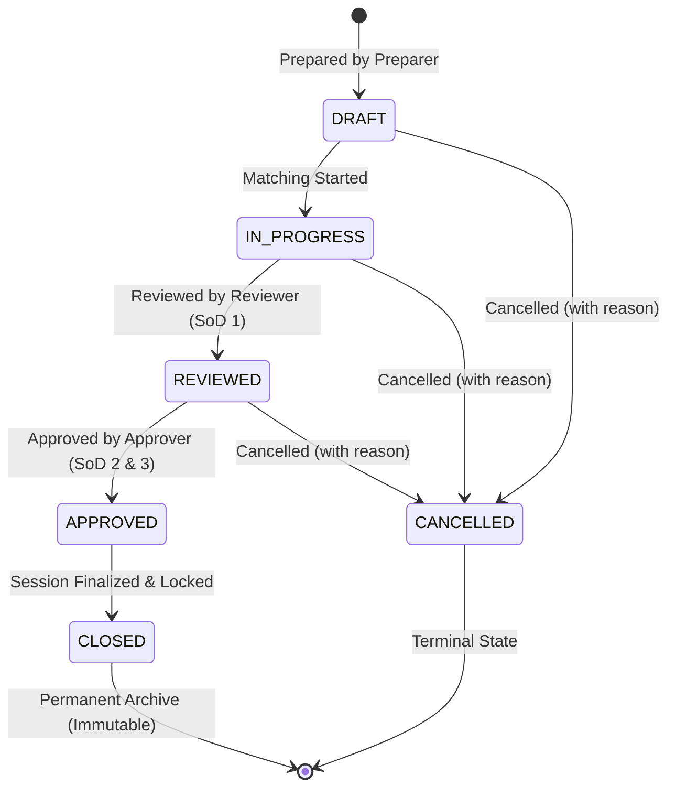

# Phase 4F Step 4.10 Substep 4.10.5-D: Forensic & Architecture Design Gate
# Bank Reconciliation Statement (BRS) Engine & REST API Endpoints

**Status**: FORENSIC & DESIGN GATE COMPLETE 📋 (AWAITING IMPLEMENTATION AUTHORIZATION)  
**Timestamp**: 2026-09-29T14:15:00+05:30  
**Checkpoint Reference**: `phase4f-step4-10-substep4-10-5d-brs-engine-design-01.md`  
**Predecessor Boundaries**:
- `CHECKPOINTS/phase4f-step4-10-substep4-10-5a-schema-foundation-01.md` (LOCKED & FROZEN 🔒)
- `CHECKPOINTS/phase4f-step4-10-substep4-10-5b-import-service-01.md` (LOCKED & FROZEN 🔒)
- `CHECKPOINTS/phase4f-step4-10-substep4-10-5c-matching-engine-01.md` (LOCKED & FROZEN 🔒)
- `CHECKPOINTS/phase4f-step4-10-substep4-10-4-gateway-settlement-api-ui-implementation-01.md` (LOCKED & FROZEN 🔒)
- `CHECKPOINTS/phase4f-step4-10-substep4-10-3-gateway-settlement-implementation-01.md` (LOCKED & FROZEN 🔒)
- `CHECKPOINTS/phase4f-step4-10-substep4-10-2-bank-master-cash-deposit-01.md` (LOCKED & FROZEN 🔒)

**Target Scope**: Bank Reconciliation Statement (BRS) Engine, Reconciling Bridge Math, Session Lifecycle Transitions, and Admin REST API Endpoints.  
**Execution Mode**: READ-ONLY FORENSIC & DESIGN GATE — ZERO CODE IMPLEMENTATION, ZERO SCHEMA MUTATIONS, ZERO GL ENTRIES, ZERO TEST RESIDUALS.

---

## 1. Executive Summary & Design Scope

Phase 4F Step 4.10 Substep 4.10.5-D establishes the computational and API layer for the **Bank Reconciliation Statement (BRS) Engine and Reconciliation Workspace API**. 

Having completed:
- Substep 4.10.5-A: Additive Schema Foundation & DTOs (84/84 PASS)
- Substep 4.10.5-B: Bank Statement Parsing & Ingestion Service (79/79 PASS)
- Substep 4.10.5-C: Automated Matching Engine & Stage-2 Transit Clearance (95/95 PASS)

Substep 4.10.5-D bridges external statement evidence with internal general ledger reality, providing deterministic mathematical proof of the variance between the bank statement closing balance and GL Account 1112 (Bank Operating A/c).

### Core Boundaries for Substep 4.10.5-D:
1. **STRICTLY EVIDENCE & REPORTING ONLY**:
   - The BRS Engine is a read-only mathematical calculation.
   - Calling BRS generation or viewing reconciliation reports generates **ZERO financial vouchers**, modifies **ZERO journal lines**, and creates **ZERO database mutations** in accounting tables.
2. **ZERO SUSPENSE FABRICATION**:
   - Discrepancies and unmatched lines are reported explicitly as reconciling items.
   - Account 1119 (Unclassified Bank Suspense) is **NEVER** touched or used as an automatic dumping ground.
3. **SEGREGATION OF DUTIES (SoD)**:
   - Enforces 3-tier session lifecycle SoD: $\text{preparer} \ne \text{reviewer} \ne \text{approver}$.
   - Match confirmation SoD: $\text{matcher} \ne \text{confirmer}$.
   - `SUPER_ADMIN` cannot bypass SoD constraints.
4. **STRICT BOLA & BRANCH ISOLATION**:
   - Non-super-admin staff are strictly bound to their verified branch bank accounts.
   - Cross-branch access is rejected with `BRANCH_ACCESS_DENIED`. Enterprise accounts (`branch_id IS NULL`) require corporate authority (`SUPER_ADMIN` or authorized enterprise financial roles).

---

## 2. Mathematical Foundation & Reconciliation Invariants

### 2.1 The Two Authoritative Poles
At any given cutoff date $T$ (`as_of_date`), the reconciliation compares two distinct authoritative data sources:
1. **Bank Statement Closing Balance ($B_{\text{bank}}$)**:
   - Sourced from the bank statement line running balance as of $T$, or the authenticated reconciliation session closing balance (`closing_balance_per_bank`).
   - Sign convention: **Positive (+) = Favorable Credit balance** (asset); **Negative (-) = Overdraft / Debit balance** (liability).
2. **General Ledger 1112 Book Balance ($B_{\text{gl}}$)**:
   - Sourced strictly from posted general ledger lines in `public.accounting_journal_line` joined with `public.accounting_voucher` where `account_id` maps to Account 1112 and `voucher_date <= T` and `status = 'POSTED'`.
   - Sign convention: Normal Debit balance. $B_{\text{gl}} = \sum \text{debits} - \sum \text{credits}$.
   - **Positive (+) = Net Debit balance** (asset); **Negative (-) = Net Credit balance** (overdraft).

### 2.2 Reconciling Items Breakdown
The variance between $B_{\text{bank}}$ and $B_{\text{gl}}$ arises exclusively from four well-defined categories of timing differences and unbooked items:

| Category | Notation | Definition | Direction / Effect |
| :--- | :---: | :--- | :--- |
| **Deposits in Transit** | $D_{\text{transit}}$ | Cash deposits dispatched (Stage 1: Dr 1118) where bank statement has not yet credited the account as of $T$. | Dispatched by business, not yet on bank statement. |
| **Outstanding Payments** | $P_{\text{outstanding}}$ | Supplier payments / refunds credited in GL 1112 as of $T$, but not yet presented to or cleared by the bank as of $T$. | Deducted in books, not yet debited on bank statement. |
| **Unmatched Bank Debits** | $U_{\text{debit}}$ | Bank charges, interest, tax, or direct debits appearing on bank statement $\le T$, not yet booked in GL. | Debited by bank, not yet credited in books. |
| **Unmatched Bank Credits** | $U_{\text{credit}}$ | Direct customer transfers, interest received, or unnotified deposits appearing on bank statement $\le T$, not yet booked in GL. | Credited by bank, not yet debited in books. |

### 2.3 Authoritative BRS Reconciling Identity

#### Method A: From Bank Statement Balance to Reconciled Book Balance
$$\text{Reconciled Book Balance} = B_{\text{bank}} + D_{\text{transit}} - P_{\text{outstanding}} + U_{\text{debit}} - U_{\text{credit}}$$

- **Add $D_{\text{transit}}$**: Cash deposits sent to the bank that the bank has not yet credited.
- **Deduct $P_{\text{outstanding}}$**: Cheques / bank transfers issued by the business that have not yet cleared the bank statement.
- **Add $U_{\text{debit}}$**: Bank charges already deducted by the bank that the business has not yet booked in GL.
- **Deduct $U_{\text{credit}}$**: Direct deposits credited by the bank that the business has not yet booked in GL.

#### Method B: Mathematical Identity & Discrepancy
$$\text{Discrepancy} = \text{Reconciled Book Balance} - B_{\text{gl}} \equiv 0.00$$

Alternatively, viewed from the variance bridge:
$$B_{\text{bank}} - B_{\text{gl}} \equiv P_{\text{outstanding}} - D_{\text{transit}} - U_{\text{debit}} + U_{\text{credit}}$$

### 2.4 Exact Integer Paise Precision
All monetary operations MUST be computed in exact integer paise:
$$\text{Amount}_{\text{paise}} = \text{ROUND}(\text{Amount} \times 100)$$
No calculation may rely on floating-point arithmetic. Discrepancy is zero if and only if:
$$|\text{Discrepancy}_{\text{paise}}| = 0$$

---

## 3. Detailed Component Architecture

### 3.1 Statement Balance vs GL 1112 (Book Balance)
- **GL 1112 Query**:
  ```sql
  SELECT 
    COALESCE(SUM(ROUND(jl.debit_amount * 100)), 0) - 
    COALESCE(SUM(ROUND(jl.credit_amount * 100)), 0) AS net_paise
  FROM public.accounting_journal_line jl
  JOIN public.accounting_voucher v ON v.id = jl.voucher_id
  JOIN public.accounting_account aa ON aa.id = jl.account_id
  WHERE aa.code = '1112'
    AND v.status = 'POSTED'
    AND v.voucher_date <= $1::date
    AND ($2::text IS NULL OR v.branch_id = $2::text);
  ```
- **Bank Statement Balance**:
  Sourced from the latest `bank_statement_line.running_balance` on or before $T$, or the active session's `closing_balance_per_bank`.

### 3.2 Opening & Closing Balance Semantics
- **Session Opening Balance**:
  - Validated against the closing balance of the immediately preceding `CLOSED` reconciliation session for the same bank account.
  - If it is the initial session, sourced from the first statement import opening balance.
- **Session Closing Balance**:
  - Represents the final bank position as of `period_end`.
  - Must equal the closing running balance of the bank statement lines in that period.

### 3.3 Account 1118 Uncleared Deposits (Deposits in Transit)
- **Accounting Reality**:
  - In Step 4.10.2, cash deposit dispatch creates Stage 1: $\text{Dr } 1118 \text{ (Deposit in Transit)} / \text{Cr } 1111 \text{ (Cash in Hand)}$.
  - Account 1112 is NOT debited during Stage 1.
  - Stage 2 ($\text{Dr } 1112 / \text{Cr } 1118$) is posted ONLY upon bank statement match confirmation (Step 4.10.5-C).
- **Uncleared Transit Items**:
  Deposit slips where:
  * `status IN ('DISPATCHED', 'CONFIRMED')`
  * `deposit_date <= as_of_date`
  * `transit_voucher_id IS NOT NULL`
  * `credit_voucher_id IS NULL` (or credit voucher date $> \text{as\_of\_date}$)
- **Mathematical Consistency**:
  $$\sum D_{\text{transit}} \equiv \text{Net Debit Balance of Account 1118 as of } T$$

### 3.4 Outstanding / Unpresented Items (Disbursements in Books)
- **Supported Internal Sources**:
  1. `PURCHASE_PAYMENT`: Supplier payments posted with payment mode `BANK_TRANSFER`, `CHEQUE`, `UPI`, `CARD` ($\text{Dr } 2111 / \text{Cr } 1112$) on or before $T$.
  2. `CUSTOMER_REFUND`: Customer refunds disbursed via bank ($\text{Dr } 4190 \text{ or AR} / \text{Cr } 1112$) on or before $T$.
  3. `EXPENSE_PAYMENT`: Direct expense payments credited to 1112 on or before $T$.
- **Uncleared / Unpresented Condition**:
  A disbursement is outstanding as of $T$ if:
  * Voucher date $\le T$.
  * It has NOT been matched to any confirmed bank statement line with $\text{bank line date} \le T$.

### 3.5 Unmatched Bank Statement Lines
- Sourced from `public.bank_statement_line` for the target bank account:
  * $\text{COALESCE}(\text{value\_date}, \text{transaction\_date}) \le T$
  * `reconciliation_status IN ('UNMATCHED', 'EXCEPTION')`
- Partitioned into:
  * **Unmatched Debits** ($U_{\text{debit}}$): $\text{debit\_amount} > 0$. Bank deducted funds, books have not yet booked.
  * **Unmatched Credits** ($U_{\text{credit}}$): $\text{credit\_amount} > 0$. Bank added funds, books have not yet booked.

---

## 4. Date Semantics: Value-Date vs Transaction-Date

1. **Bank Statement Line Cutoff**:
   - Financial value at the bank is governed by **`value_date`**.
   - Formula: `statement_effective_date = COALESCE(bsl.value_date, bsl.transaction_date)`.
   - A statement line is included in BRS as of $T$ if and only if $\text{statement\_effective\_date} \le T$.
2. **General Ledger Cutoff**:
   - Internal books are governed by **`voucher_date`**.
   - A voucher line is included in BRS as of $T$ if and only if $\text{v.voucher\_date} \le T$ and $\text{v.status} = \text{'POSTED'}$.
3. **Point-in-Time Repeatability**:
   - Historical BRS queries are fully deterministic. Requesting BRS for `as_of_date = '2026-08-31'` produces the exact identical figures regardless of how many future transactions were imported or posted after that date.

---

## 5. Reconciliation Session Lifecycle & State Machine



### 5.1 Segregation of Duties Matrix
Governed by database constraints (`chk_brs_sod_preparer_reviewer`, `chk_brs_sod_preparer_approver`, `chk_brs_sod_reviewer_approver`):

| Transition | From Status | To Status | Required Actor | SoD Invariant Enforced |
| :--- | :---: | :---: | :--- | :--- |
| **Create Session** | — | `DRAFT` | Preparer | Sets `prepared_by = actor.id`, `prepared_at = NOW()` |
| **Start Matching** | `DRAFT` | `IN_PROGRESS` | Matcher | Proposes / matches statement lines |
| **Review Session** | `IN_PROGRESS` | `REVIEWED` | Reviewer | $\text{reviewer\_id} \ne \text{prepared\_by}$ |
| **Approve Session** | `REVIEWED` | `APPROVED` | Approver | $\text{approver\_id} \ne \text{prepared\_by} \land \text{approver\_id} \ne \text{reviewer\_id}$ |
| **Close Session** | `APPROVED` | `CLOSED` | Approver / Finance Lead | Locks session permanently; all matches become final |
| **Cancel Session** | Any pre-CLOSED | `CANCELLED` | Manager / Lead | Requires documented `cancellation_reason` |

`SUPER_ADMIN` cannot self-review or self-approve own prepared sessions.

---

## 6. Evidence-Only Boundary & Reconciliation Adjustments

### 6.1 Zero Financial Postings
The BRS calculation engine and reporting API are **strictly read-only**:
- ZERO rows inserted into `public.accounting_voucher`.
- ZERO rows inserted into `public.accounting_journal_entry`.
- ZERO rows inserted into `public.accounting_journal_line`.
- ZERO mutations to historical orders or payment transactions.

### 6.2 Handling Legitimate Reconciliation Adjustments
When an unmatched bank line represents a legitimate, unrecorded transaction (e.g. ₹150 bank charge or ₹500 bank interest):
1. BRS lists the item as an `UNMATCHED_BANK_DEBIT` or `UNMATCHED_BANK_CREDIT`.
2. The BRS engine **DOES NOT** fabricate a journal entry or post to Account 1119 (Suspense).
3. The operator creates a standard accounting voucher through the existing canonical posting workflow (`PostingService`), subject to standard voucher construction, approval, and posting controls.
4. Once posted to GL, the voucher is matched to the statement line via the matching engine (Step 4.10.5-C).
5. The subsequent BRS calculation automatically moves the item from "Unmatched Bank Line" to "Cleared", resolving the variance naturally.

---

## 7. Scope, Access Control & Security Architecture

### 7.1 Enterprise vs Branch Bank Account Scoping
- **Enterprise Bank Account** (`bank_account.branch_id IS NULL`):
  - Represents central treasury, corporate operating accounts, or gateway aggregation accounts.
  - Accessible ONLY by `SUPER_ADMIN` or staff with enterprise scope (`branch_id = null` and corporate financial roles).
- **Branch Bank Account** (`bank_account.branch_id IS NOT NULL`):
  - Represents local branch deposit accounts.
  - Branch Managers and branch staff can ONLY access sessions, statement lines, and BRS reports for their assigned branch.

### 7.2 API-Level BOLA / IDOR Defense
Every API route handler must execute server-side authorization:
```typescript
// 1. Resolve actor context from authenticated session
const actor = resolveUserContext(req);

// 2. Fetch target bank account from DB
const bankAccount = await BankAccountRepository.findById(bankAccountId);
if (!bankAccount) {
  return NextResponse.json({ success: false, error: "BANK_ACCOUNT_NOT_FOUND" }, { status: 404 });
}

// 3. BOLA Guard
if (!actor.isSuperAdmin) {
  if (!actor.branchId || bankAccount.branch_id !== actor.branchId) {
    return NextResponse.json({ success: false, error: "BRANCH_ACCESS_DENIED" }, { status: 403 });
  }
}
```

### 7.3 Permissions Catalog
- `BANK.RECON_VIEW`: Allows querying sessions, reading BRS reports, listing matches and unmatched lines.
- `BANK.RECON_MATCH`: Allows triggering automated matching and proposing manual matches.
- `BANK.RECON_CONFIRM`: Allows confirming proposed matches and transitioning sessions to `REVIEWED`.
- `ACCOUNTING.APPROVE` (or `SUPER_ADMIN`): Allows transitioning sessions to `APPROVED` and `CLOSED`.

---

## 8. REST API Endpoint Specifications

All endpoints are hosted under `/api/v1/admin/bank-reconciliation/` within the centralized catch-all route architecture:

### 8.1 Session Endpoints
1. **`GET /api/v1/admin/bank-reconciliation/sessions`**
   - **Query Params**: `bankAccountId`, `status`, `startDate`, `endDate`, `limit`, `offset`.
   - **Perm**: `BANK.RECON_VIEW`.
   - **Response**: Paginated list of `BankReconciliationSessionRow` with calculated progress metrics.

2. **`POST /api/v1/admin/bank-reconciliation/sessions`**
   - **Body**: `{ bankAccountId, periodStart, periodEnd, openingBalancePerBank, closingBalancePerBank, metadata }`.
   - **Perm**: `BANK.RECON_MATCH`.
   - **Response**: Created session in `DRAFT` status.

3. **`GET /api/v1/admin/bank-reconciliation/sessions/:id`**
   - **Perm**: `BANK.RECON_VIEW`.
   - **Response**: Session detail with statement counts, match statistics, and SoD audit history.

4. **`POST /api/v1/admin/bank-reconciliation/sessions/:id/transition`**
   - **Body**: `{ targetStatus: 'REVIEWED' | 'APPROVED' | 'CLOSED' | 'CANCELLED', reason?: string }`.
   - **Perm**: `BANK.RECON_CONFIRM` (for `REVIEWED`), `ACCOUNTING.APPROVE` (for `APPROVED`, `CLOSED`).
   - **Response**: Updated session. Enforces DB-level SoD constraints.

### 8.2 BRS Calculation & Report Endpoint
5. **`GET /api/v1/admin/bank-reconciliation/sessions/:id/brs`**
   - **Query Params**: `asOfDate` (optional, defaults to `session.period_end`).
   - **Perm**: `BANK.RECON_VIEW`.
   - **Response**: Complete BRS Report Object:
     ```json
     {
       "session": { "id": "brs_...", "bankAccountId": "ba_...", "periodStart": "...", "periodEnd": "..." },
       "bankAccount": { "id": "ba_...", "bankName": "...", "accountNumberMasked": "...", "ifscCode": "..." },
       "asOfDate": "2026-09-30",
       "summary": {
         "statementClosingBalance": 154200.50,
         "gl1112BookBalance": 128450.00,
         "totalDepositsInTransit": 35000.00,
         "totalOutstandingDisbursements": 12500.00,
         "totalUnmatchedBankDebits": 250.00,
         "totalUnmatchedBankCredits": 4500.50,
         "reconciledBookBalance": 128450.00,
         "discrepancy": 0.00,
         "isReconciled": true
       },
       "breakdowns": {
         "depositsInTransitCount": 3,
         "outstandingDisbursementsCount": 2,
         "unmatchedBankDebitsCount": 1,
         "unmatchedBankCreditsCount": 1
       }
     }
     ```

### 8.3 Detailed Itemized Breakdown Endpoints (Paginated)
6. **`GET /api/v1/admin/bank-reconciliation/sessions/:id/uncleared-deposits`**
   - **Query Params**: `limit`, `offset`.
   - **Response**: List of uncleared `bank_deposit_slip` records contributing to $D_{\text{transit}}$.

7. **`GET /api/v1/admin/bank-reconciliation/sessions/:id/outstanding-payments`**
   - **Query Params**: `limit`, `offset`.
   - **Response**: List of unpresented disbursements contributing to $P_{\text{outstanding}}$.

8. **`GET /api/v1/admin/bank-reconciliation/sessions/:id/unmatched-lines`**
   - **Query Params**: `type` (`DEBIT` | `CREDIT` | `ALL`), `limit`, `offset`.
   - **Response**: List of unmatched statement lines contributing to $U_{\text{debit}}$ and $U_{\text{credit}}$.

9. **`GET /api/v1/admin/bank-reconciliation/sessions/:id/matches`**
   - **Query Params**: `matchSourceType`, `matchStatus`, `limit`, `offset`.
   - **Response**: Paginated list of confirmed and proposed match records.

### 8.4 Operational Match Actions (Forwarded to Step 4.10.5-C Engine)
10. **`POST /api/v1/admin/bank-reconciliation/sessions/:id/auto-match`**
    - Triggers `BankReconciliationMatchingService.autoMatchSession`.
11. **`POST /api/v1/admin/bank-reconciliation/sessions/:id/confirm-match`**
    - Triggers `BankReconciliationMatchingService.confirmAndPostCashDepositClearance` (or Vector B / Vector C confirmation).
12. **`POST /api/v1/admin/bank-reconciliation/sessions/:id/manual-match`**
    - Triggers `BankReconciliationMatchingService.manualMatch`.

---

## 9. Performance, Indexing & Query Architecture

### 9.1 Fast KPI Aggregations (<50ms Target)
The BRS summary calculation will use optimized aggregate subqueries:
```sql
WITH gl_balance AS (
  SELECT COALESCE(SUM(ROUND(jl.debit_amount * 100)) - SUM(ROUND(jl.credit_amount * 100)), 0) AS gl_paise
  FROM public.accounting_journal_line jl
  JOIN public.accounting_voucher v ON v.id = jl.voucher_id
  WHERE jl.account_id = $glAccountId AND v.status = 'POSTED' AND v.voucher_date <= $asOfDate
),
transit_deposits AS (
  SELECT COALESCE(SUM(ROUND(bds.amount * 100)), 0) AS transit_paise
  FROM public.bank_deposit_slip bds
  WHERE bds.bank_account_id = $bankAccountId
    AND bds.status IN ('DISPATCHED', 'CONFIRMED')
    AND bds.transit_voucher_id IS NOT NULL
    AND bds.deposit_date <= $asOfDate
    AND (bds.credit_voucher_id IS NULL OR EXISTS (
      SELECT 1 FROM public.accounting_voucher cv WHERE cv.id = bds.credit_voucher_id AND cv.voucher_date > $asOfDate
    ))
),
unmatched_lines AS (
  SELECT
    COALESCE(SUM(CASE WHEN bsl.debit_amount > 0 THEN ROUND(bsl.debit_amount * 100) ELSE 0 END), 0) AS unmatched_debit_paise,
    COALESCE(SUM(CASE WHEN bsl.credit_amount > 0 THEN ROUND(bsl.credit_amount * 100) ELSE 0 END), 0) AS unmatched_credit_paise
  FROM public.bank_statement_line bsl
  WHERE bsl.bank_account_id = $bankAccountId
    AND COALESCE(bsl.value_date, bsl.transaction_date) <= $asOfDate
    AND bsl.reconciliation_status IN ('UNMATCHED', 'EXCEPTION')
)
SELECT * FROM gl_balance, transit_deposits, unmatched_lines;
```

### 9.2 Existing & Required Indexes
Existing schema already includes indexes verified in Step 4.10.5-A:
- `idx_bsl_account_date`: `(bank_account_id, transaction_date)`
- `idx_bsl_recon_status`: `(reconciliation_status)`
- `idx_brm_session_id`: `(session_id)`
- `idx_brm_statement_line`: `(statement_line_id)`
- `idx_bds_bank_account`: `(bank_account_id, status)`

---

## 10. Comprehensive Test & Verification Plan

Substep 4.10.5-D verification suite (`scratch/test_step4_10_5D_brs_engine.js`) will assert the following 10 domains:

| Domain | Invariants Tested | Expected Assertions |
| :--- | :--- | :---: |
| **Domain 0: Pre-test Baseline** | Database clean baseline (CoA=99, Vouchers=0, Slips=0, Sessions=0, Orders=173, Txns=53) | ~12 |
| **Domain 1: Mathematical BRS Identity** | $\text{Discrepancy} \equiv 0.00$, exact integer paise matching across all four reconciling categories | ~15 |
| **Domain 2: Uncleared Deposits (1118)** | Dispatched slips tracked; cleared slips excluded; exact alignment with GL Account 1118 | ~10 |
| **Domain 3: Outstanding Disbursements** | Posted supplier payments prior to bank presentation; cleared payments excluded | ~10 |
| **Domain 4: Unmatched Bank Lines** | Bank debits and credits correctly itemized; zero automatic fallback to 1119 | ~10 |
| **Domain 5: As-of Date Repeatability** | Point-in-time calculation invariant; past date query completely ignores future transactions | ~8 |
| **Domain 6: Session Lifecycle & SoD** | 3-tier SoD enforcement (`chk_brs_sod`); transitions: DRAFT → IN_PROGRESS → REVIEWED → APPROVED → CLOSED | ~12 |
| **Domain 7: Evidence-Only Invariant** | BRS report generation creates exactly ZERO GL vouchers, ZERO journal entries, ZERO accounting mutations | ~6 |
| **Domain 8: Branch Isolation & BOLA** | Cross-branch session / report access rejected with HTTP 403; enterprise account restricted to corporate roles | ~8 |
| **Domain 9: REST API Response Shapes** | HTTP status codes (200, 400, 401, 403, 404, 409), JSON structure, pagination contracts | ~12 |
| **Domain 10: Complete Teardown & Audit** | 100% test fixture cleanup; pristine PostgreSQL baseline audit across all tables | ~12 |
| **TOTAL EXPECTED** | **Comprehensive BRS Engine & REST API Suite** | **~105** |

---

## 11. Implementation Readiness Gate

### Sign-off Checklist:
- [x] BRS opening/closing balance semantics strictly defined.
- [x] Statement balance vs GL 1112 relationship formalized.
- [x] Account 1118 (Deposit in Transit) handling locked to 2-stage lifecycle.
- [x] Outstanding/unpresented disbursements explicitly defined and bounded.
- [x] Unmatched bank debits and credits itemized without suspense fallback.
- [x] Reconciliation session lifecycle and 3-tier SoD matrix specified.
- [x] Exact sign conventions and integer paise precision locked.
- [x] `value_date` vs `transaction_date` cutoff semantics established.
- [x] Branch-specific vs enterprise account scope locked.
- [x] Centralized staff permission mappings defined.
- [x] Server-side BOLA / IDOR defense architecture documented.
- [x] Evidence-only / zero-GL invariant explicitly enforced.
- [x] Reconciliation adjustment boundaries defined (standard posting pipeline routing).
- [x] Point-in-time as-of date determinism specified.
- [x] Audit trail and metadata capture requirements locked.
- [x] Fast aggregation queries (<50ms) and pagination specified.

**HARD STOP**: Do NOT begin implementation of Step 4.10.5-D until this architecture design gate is explicitly reviewed and authorized by the user.
