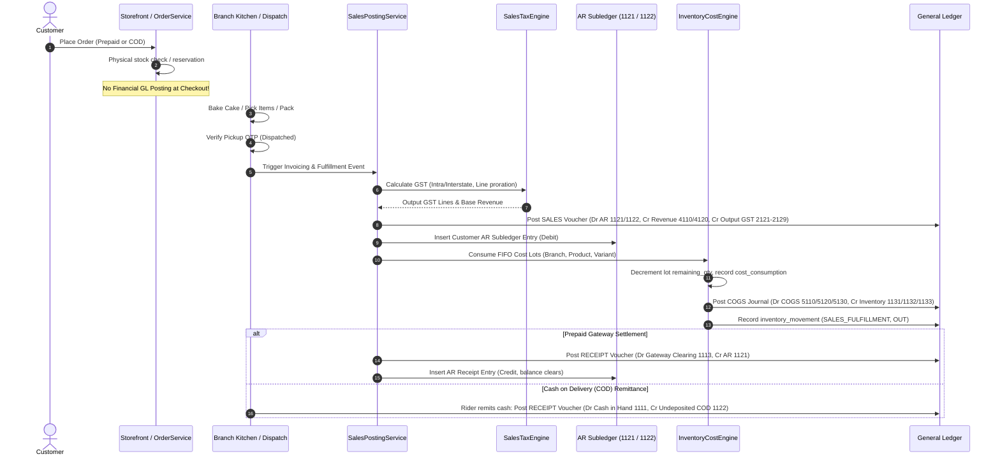
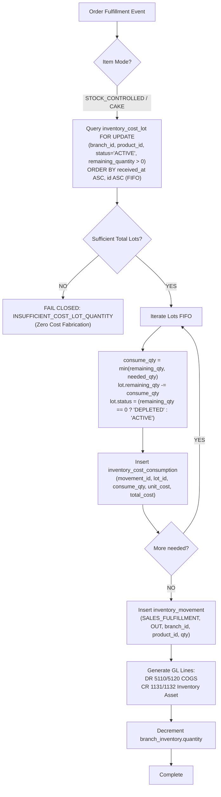

# Phase 4F Step 4: Sales, Revenue Recognition, Output GST, Customer AR & COGS — Forensic & Design Gate

**Checkpoint Identifier:** `CHECKPOINTS/phase4f-step4-sales-cogs-design-01.md`  
**Timestamp:** `2026-09-26 09:45:00 IST`  
**Status:** `DESIGN GATE ONLY — AWAITING USER AUTHORIZATION`  
**Preceding Milestone:** `CHECKPOINTS/phase4f-step3d7b-ap-subledger-01.md` (Complete & Frozen)  

---

## 1. Executive Summary & Architectural Position

The Accounts Payable (AP) domain for CakeToHome ERP is complete and frozen across Steps 3D.1 through 3D.7-B (Purchase Tax Engine, Voucher Lifecycle, Atomic Purchase Posting, Supplier Payments, Debit Notes, Purchase Reversals, Payment Reversals, Supplier Subledger, AP Aging, and AP ↔ GL Reconciliation).

We now establish the authoritative **Forensic & Design Gate** for **Phase 4F Step 4: Sales, Revenue Recognition, Output GST, Customer Accounts Receivable (AR), Customer Receipts, Inventory Fulfillment, and Cost of Goods Sold (COGS)**.

### Strict Boundary Conditions for this Design Gate
1. **Design Gate Only**: No production or feature code implementation is executed during this gate.
2. **Accounting Start Date Hard-Block**: `accounting_start_date` remains strictly **UNCONFIGURED** in `public.setting` (0 rows). All live posting attempts must fail closed.
3. **Fiscal Period Hard-Block**: `public.accounting_fiscal_period` remains strictly **0 rows**. All live posting attempts must fail closed.
4. **Historical Data Quarantine**: Zero posting, zero inference of historical revenue, GST, AR, COGS, inventory cost, or customer receipts for the existing 173 historical orders or 53 payment transactions.
5. **No Cost Fabrication**: Cost prices must never be synthesized or fabricated. If an inventory cost lot does not exist in `inventory_cost_lot`, fulfillment fails closed.

---

## 2. Forensic Database Audit of Historical Sales Data

A deep inspection of the live PostgreSQL database was conducted on 2026-09-26. The findings define the exact boundary between pre-accounting prototype data and future ledger-eligible orders.

### 2.1 The 173 Historical Orders (`public.order`)
- **Total Orders**: 173 rows in `public.order`.
- **Date Range**: Earliest order: `2026-08-01T15:29:10.530Z`; Latest order: `2026-09-19T14:08:18.012Z`.
- **Status Distribution**: All 173 orders have `status = 'pending'`.
- **Line Items Storage**:
  - `public.order_item`: **0 rows**.
  - `public.order_line_item`: **0 rows**.
  - `public.line_item`: **Table does not exist**.
  - Order line items are stored entirely as unstructured JSON arrays inside `public.order.metadata->'items'` (e.g., Butter Croissant, Chocolate Truffle Cake, Birthday Toppers).
- **Financial Metadata Coverage**:
  - `metadata->'items'`: Present in 172/173 orders.
  - `metadata->'total'`: Present in only 37/173 orders (others store total in `grand_total`, `total_amount`, or uncalculated).
  - `metadata->'tax_amount'`: Explicitly recorded in only 45/173 orders; others have tax recorded as 0 or null.
  - `metadata->'branch_id'`: Present in 172/173 orders across 10 distinct branches.
  - `customer_id`: 42 distinct customer identifiers, of which 29 orders are tagged as `'guest'`.
- **Existing Ledger Activity**: **0 vouchers, 0 journal entries, 0 cost lots, 0 inventory movements**.

### 2.2 The 53 Historical Payment Transactions (`public.payment_transaction`)
- **Total Transactions**: 53 rows in `public.payment_transaction`.
- **Date Range**: `2026-08-01T15:20:08.000Z` to `2026-09-20T12:52:05.994Z`.
- **Status & Settlement Breakdown**:
  - COD Pending / Unsettled: 43 transactions (Total: ₹20,568).
  - Settled & Captured: 6 transactions (UPI: 2 [₹2,138], Card: 2 [₹1,068], COD: 2 [₹1,596]).
  - Settled & Refunded / Partially Refunded: 4 transactions (COD: ₹8,500).
- **Referential Integrity Integrity**:
  - 41 transactions link to orders in `public.order`.
  - **12 transactions are orphaned**: `order_id` does not exist in `public.order`.
- **Amounts**: Stored as integer values, without tax breakdown or ledger cross-references.

### 2.3 Historical Quarantine & Failsafe Rules
Can existing historical orders or payment transactions ever participate in accounting?
**DECISION: STRICTLY NO.**

They are classified as **`LEGACY_PROTOTYPE_DATA`**. The exact controls preventing them from being silently posted or inferred into the general ledger are:
1. **`validateAccountingStartDate` Fail-Closed Rule**:
   All 173 historical orders have timestamps prior to `2026-09-20`. When `accounting_start_date` is configured in the future (e.g. `2026-10-01`), any posting attempt for these orders is rejected by `PostingService.validateAccountingStartDate(orderDate)` with `POSTING_BEFORE_ACCOUNTING_START_DATE`.
2. **Current Unconfigured Guard**:
   While `accounting_start_date` is unconfigured, `PostingService.validateAccountingStartDate` throws `ACCOUNTING_START_DATE_NOT_CONFIGURED`.
3. **Fiscal Period Guard**:
   `public.accounting_fiscal_period` currently contains 0 rows. Any posting attempt throws `FISCAL_PERIOD_NOT_CONFIGURED`.
4. **FIFO Cost Lot Guard**:
   `public.inventory_cost_lot` currently contains 0 rows. Any fulfillment COGS posting fails closed with `INSUFFICIENT_COST_LOT_QUANTITY`.
5. **No Historical Inferences**:
   No background job, report, or service shall backfill, infer, or synthesize journals, revenue, tax liabilities, or COGS for historical orders.

---

## 3. Chart of Accounts (CoA) Architecture for Sales & COGS

The 98-account Master Chart of Accounts seeded in Phase 4D contains all necessary accounts for sales, revenue, tax, AR, inventory, and COGS:

```
├── 1000 ASSETS
│   ├── 1110 Cash and Bank Balances
│   │   ├── 1111 Cash in Hand (Branch Cash Registers)
│   │   ├── 1112 Bank Operating Account (Current Account)
│   │   ├── 1113 Gateway Clearing (Stripe / Razorpay / Netbanking)
│   │   └── 1114 Petty Cash - Branches
│   ├── 1120 Receivables and Advances [GROUP]
│   │   ├── 1121 Accounts Receivable (Customer AR Control — Normal DEBIT)
│   │   └── 1122 Undeposited COD (Delivery Rider Collections — Normal DEBIT)
│   └── 1130 Inventories [GROUP]
│       ├── 1131 Merchandise Inventory - Accessories (Asset)
│       ├── 1132 Merchandise Inventory - Cakes (Asset)
│       └── 1133 Packaging Supplies Stock (Asset)
│
├── 2000 LIABILITIES
│   ├── 2120 Duties & Taxes - Output Tax Liability [GROUP]
│   │   ├── 2121 Output CGST 2.5% (Food/Bakery)
│   │   ├── 2122 Output SGST 2.5% (Food/Bakery)
│   │   ├── 2123 Output CGST 9.0% (Accessories)
│   │   ├── 2124 Output SGST 9.0% (Accessories)
│   │   ├── 2125 Output IGST 5.0% (Interstate Food)
│   │   ├── 2126 Output IGST 18.0% (Interstate Accessories)
│   │   ├── 2127 Output CGST 6.0% (Toys)
│   │   ├── 2128 Output SGST 6.0% (Toys)
│   │   └── 2129 Output IGST 12.0% (Interstate Toys)
│   └── 2140 Customer Advances / Unearned Revenue (Future Option: 2141)
│
├── 4000 REVENUE
│   └── 4100 Operating Revenue [GROUP]
│       ├── 4110 Cake & Bakery Sales Revenue (5% GST)
│       ├── 4120 Accessory & Merchandise Sales Revenue (18% GST)
│       ├── 4130 Delivery & Shipping Charges Collected
│       ├── 4140 Customization & Midnight Surcharges
│       └── 4190 Sales Returns, Refunds & Allowances (Contra-Revenue — Normal DEBIT)
│
└── 5000 EXPENSES
    ├── 5100 Cost of Goods Sold (COGS) [GROUP]
    │   ├── 5110 COGS - Cakes
    │   ├── 5120 Accessory Merchandise Sold (Cost of Accessories)
    │   ├── 5130 Packaging Materials Consumed
    │   └── 5140 Kitchen Direct Labour / Chef Wages
    └── 5200 Operational & Administrative Expenses [GROUP]
        └── 5290 Payment Gateway MDR Fees (Gateway commission/processing)
```

---

## 4. End-to-End Accounting Event Lifecycle & Invariants

The critical transaction flow locked for CakeToHome ERP is:

$$\text{Customer Order} \longrightarrow \text{Sale Invoicing} \longrightarrow \text{Output GST} + \text{Revenue} \longrightarrow \text{AR} \longrightarrow \text{Receipt Settlement} \longrightarrow \text{Fulfillment} \longrightarrow \text{FIFO Cost Lot} \longrightarrow \text{COGS} \longrightarrow \text{GL}$$



### 4.1 Revenue Recognition Point (Ind AS 115 / IFRS 15 Compliance)
- **Principle**: Revenue is recognized when performance obligations are satisfied by transferring promised goods or services to the customer (control transfer).
- **Application to CakeToHome**:
  1. **At Checkout (Order Placement)**:
     - Goods are neither baked nor handed over.
     - For prepaid orders, customer cash receipt prior to fulfillment represents an Advance/Clearing liability, not recognized revenue.
     - Zero revenue or output GST is posted at checkout.
  2. **At Dispatch / Fulfillment (`OUT_FOR_DELIVERY` or `DELIVERED`)**:
     - Fresh cakes have been baked, inspected, boxed; accessories picked.
     - The sales invoice is generated and posted:
       - **Debit**: Account `1121` (Accounts Receivable) for Prepaid/Account customers, or Account `1122` (Undeposited COD) for COD orders.
       - **Credit**: Account `4110` (Cake Revenue), Account `4120` (Accessory Revenue), Account `4130` (Delivery Charges).
       - **Credit**: Account `2121`–`2129` (Output GST Liabilities).
     - Performance obligation is legally and operationally satisfied.

### 4.2 Payment Workflows: Prepaid vs Cash on Delivery (COD)

| Dimension | Prepaid Orders (Card, UPI, Netbanking) | Cash on Delivery (COD) Orders |
|---|---|---|
| **Order Placement** | Payment captured by gateway; pending dispatch. | Order placed with payment_status = `'pending'`. |
| **Invoice Posting** | Dr `1121 Accounts Receivable`<br>Cr `4110/4120 Revenue`<br>Cr `212x Output GST` | Dr `1122 Undeposited COD`<br>Cr `4110/4120 Revenue`<br>Cr `212x Output GST` |
| **Payment Receipt Posting** | Dr `1113 Gateway Clearing`<br>Cr `1121 Accounts Receivable` | Dr `1111 Cash in Hand` (Branch Cashier)<br>Cr `1122 Undeposited COD` |
| **Bank Settlement** | Dr `1112 Bank Operating`<br>Dr `5290 Gateway MDR Fees`<br>Cr `1113 Gateway Clearing` | Dr `1112 Bank Operating`<br>Cr `1111 Cash in Hand` (Cash deposit) |
| **Default AR Subledger** | Cleared upon gateway capture confirmation. | Cleared upon rider cash remittance at branch. |

---

## 5. Output GST Calculation Engine Specification

The Output GST Engine must follow the same deterministic precision established in the Purchase Tax Engine (`purchase-tax-engine.ts`):

### 5.1 Supply Classification & Jurisdiction Resolution
- **Supplier Location**: Branch address where order is fulfilled (`branch.metadata->>'state_code'` or `branch.state_id`).
- **Place of Supply (POS)**: Customer delivery address (`order.metadata->'delivery_address'->>'state'` or delivery pincode state).
- **Jurisdiction Determination**:
  $$\text{Branch State} == \text{Customer State} \implies \text{INTRA\_STATE} \quad (\text{CGST} + \text{SGST})$$
  $$\text{Branch State} \ne \text{Customer State} \implies \text{INTER\_STATE} \quad (\text{IGST})$$

### 5.2 Rate Matrix & Leaf Account Resolution

| Merchandise Category | GST Rate | Intra-State (CGST + SGST) | Inter-State (IGST) | Revenue Account |
|---|---|---|---|---|
| **Cakes, Cupcakes, Pastries** | **5.0%** | `2121` CGST 2.5% + `2122` SGST 2.5% | `2125` IGST 5.0% | `4110` Cake Sales Revenue |
| **Accessories (Toppers, Knives)** | **18.0%** | `2123` CGST 9.0% + `2124` SGST 9.0% | `2126` IGST 18.0% | `4120` Accessory Revenue |
| **Toys & Celebration Novelties** | **12.0%** | `2127` CGST 6.0% + `2128` SGST 6.0% | `2129` IGST 12.0% | `4120` Accessory Revenue |
| **Delivery & Shipping Charges** | **18.0% / Composite** | `2123` CGST 9.0% + `2124` SGST 9.0% | `2126` IGST 18.0% | `4130` Delivery Charges |
| **Customization Surcharges** | As principal item | Matched to item rate | Matched to item rate | `4140` Customization Revenue |

### 5.3 Mathematical Rounding & Discount Proration
1. **Header Discount Allocation (Coupons)**:
   - Header discounts must be allocated strictly across taxable merchandise lines in proportion to line subtotal:
     $$\text{Line Discount}_i = \text{round}\left( \text{Total Discount} \times \frac{\text{Line Subtotal}_i}{\sum \text{Eligible Subtotals}}, 2 \right)$$
   - Residual cent rounding is adjusted on the largest line item to ensure:
     $$\sum \text{Line Discounts} == \text{Total Discount}$$
2. **Net Taxable Base**:
   $$\text{Taxable Amount}_i = \text{Line Subtotal}_i - \text{Line Discount}_i$$
3. **Tax Amounts**:
   - For Intra-State:
     $$\text{CGST}_i = \text{round}\left( \text{Taxable Amount}_i \times \frac{\text{Rate}_i}{2 \times 100}, 2 \right)$$
     $$\text{SGST}_i = \text{CGST}_i$$
   - For Inter-State:
     $$\text{IGST}_i = \text{round}\left( \text{Taxable Amount}_i \times \frac{\text{Rate}_i}{100}, 2 \right)$$
4. **Balanced Financial Invariant**:
   $$\text{Total Invoice Amount} = \sum \text{Taxable Amount}_i + \sum \text{Tax Amount}_i + \text{Delivery Fee}$$

---

## 6. Customer Accounts Receivable (AR) Subledger Architecture

Account `1121` (Accounts Receivable) is an **ASSET** control account with a normal **DEBIT** balance.

### 6.1 Subledger Structure & Running Balance Semantics
Every customer AR transaction is tracked at two levels:
1. **General Ledger**: `accounting_journal_line` with `account_id` matching `1121`.
2. **Customer AR Subledger Record**: Stored with explicit attributes:
   - `customer_id`: Unique customer reference (`cus_*`, `cth_cus_*`, or `guest`).
   - `order_id`: Associated order.
   - `voucher_id`: Voucher reference.
   - `entry_date`: Accounting date.
   - `debit`: Invoice amount increasing AR.
   - `credit`: Receipt or credit note decreasing AR.
   - `running_balance`: Progressive customer balance.

### 6.2 Running Balance Arithmetic
$$\text{Balance}_0 = \text{Opening Balance}$$
$$\text{Balance}_i = \text{Balance}_{i-1} + \text{Debit}_i - \text{Credit}_i$$

- **Invoices (`SALES`)**: Increase customer receivable balance ($+\text{Debit}$).
- **Receipts (`RECEIPT`)**: Settle and decrease customer receivable balance ($-\text{Credit}$).
- **Credit Notes (`CREDIT_NOTE`)**: Decrease customer receivable balance ($-\text{Credit}$).
- **Sales Reversals (`JOURNAL`)**: Inverse entry offsetting original invoice ($-\text{Credit}$).

### 6.3 AR ↔ GL Reconciliation Mathematical Identity
At any point in time $t$, across any branch or company-wide:
$$\sum_{\text{all customers}} \text{Customer AR Balance}(c, t) \equiv \sum_{\text{lines } \le t, \text{ account}=1121} (\text{Debit} - \text{Credit})$$
Zero variance permitted.

### 6.4 Customer Resolution Policy (Registered vs Guest)
- **Registered Customers**: Linked directly to `customer.id` (or `customer_uid`). All transactions aggregate to the customer's personal subledger statement.
- **Guest Customers**:
  - In CakeToHome, guest orders supply phone, email, and name in order metadata.
  - To prevent conflating different anonymous buyers into a single misleading ledger:
    - Each guest order maintains its discrete receivable obligation keyed by `order_id`.
    - Customer statements queryable by `customer_id = 'guest'` and filtered by `phone` or `email`, or aggregated into a dedicated `Walk-in / Guest Control` sub-portfolio with zero net carry-over (since guest retail orders settle on the spot).

---

## 7. Inventory Fulfillment, FIFO Cost-Lot Consumption & COGS

CakeToHome catalog items operate under two inventory modes:
1. `MADE_TO_ORDER_AVAILABILITY`: Fresh cakes, pastries, cupcakes.
2. `STOCK_CONTROLLED`: Physical retail accessories (toppers, knives, candles, gift items) and packaging.

### 7.1 FIFO Cost-Lot Consumption Algorithm
When an order is fulfilled and dispatched:


### 7.2 Double-Entry Journal Lines for COGS
- **Accessory COGS**:
  - **Debit**: Account `5120` (Accessory Merchandise Sold)
  - **Credit**: Account `1131` (Merchandise Inventory - Accessories)
  - Amount: $\sum (\text{consumption.quantity} \times \text{consumption.unit\_cost})$
- **Cake COGS** (for merchandise cakes sourced via purchase lots):
  - **Debit**: Account `5110` (COGS - Cakes)
  - **Credit**: Account `1132` (Merchandise Inventory - Cakes)
- **Packaging Materials Consumed**:
  - **Debit**: Account `5130` (Packaging Materials Consumed)
  - **Credit**: Account `1133` (Packaging Supplies Stock)

### 7.3 Invariant: Cost Consistency
$$\sum \text{inventory\_cost\_consumption.total\_cost} \equiv \text{Debit to Account 51xx} \equiv \text{Credit to Account 113x}$$
No rounding drift $> \pm 0.01$, resolved via penny residual line.

---

## 8. Sales Returns, Credit Notes & Sales Reversals

### 8.1 Sales Return & Credit Note (`CREDIT_NOTE`)
- **Trigger**: Customer return of sellable/damaged merchandise, post-delivery cancellation, or price concession.
- **Voucher Type**: `CREDIT_NOTE`.
- **Double-Entry Financial Impact**:
  - **Debit**: Account `4190` (Sales Returns, Refunds & Allowances — Contra-Revenue)
  - **Debit**: Account `2121`–`2129` (Output GST Liability Reversal)
  - **Credit**: Account `1121` (Accounts Receivable — Reduction of customer balance)
- **Inventory Restoration & Scrap Policy**:
  - **Restorable Merchandise (Unused Accessories)**:
    - Restored to physical `branch_inventory.quantity`.
    - Recorded in `inventory_movement` (`movement_type = 'SALES_RETURN'`, `direction = 'IN'`).
    - New return cost-lot created at original cost: Dr `1131 Merchandise Inventory` / Cr `5120 Accessory COGS`.
  - **Perishable Food / Damaged Cakes**:
    - **NOT RESTORABLE** to inventory. Perishable food cannot be resold.
    - Zero physical or cost restoration to `1132`. COGS remains recognized as expense.

### 8.2 Full Sales Invoice Reversal / Void
- **Trigger**: Erroneous sales invoice posting, administrative void.
- **Ledger Invariant**: The original `SALES` voucher and journal entries are **STRICTLY IMMUTABLE**.
- **Compensating Reversal Voucher**:
  - Reversal voucher created with `reversal_of_voucher_id = original_voucher.id`.
  - Original voucher updated with `reversed_by_voucher_id = reversal_voucher.id`.
  - Exact mirrored financial journal lines:
    - **Debit**: Account `4110 / 4120` (Revenue — reversal of credit)
    - **Debit**: Account `2121`–`2129` (Output GST — reversal of credit)
    - **Credit**: Account `1121` (Accounts Receivable — reversal of debit)
  - Cost Lot Restoration:
    - For each consumed cost lot, `lot.remaining_quantity` is re-incremented by the consumed amount.
    - If status was `'DEPLETED'`, status is restored to `'ACTIVE'`.
    - Compensating `inventory_movement` recorded (`movement_type = 'INVOICE_REVERSAL'`, `direction = 'IN'`).
    - Compensating COGS reversal: Dr `1131/1132 Inventory` / Cr `5110/5120 COGS`.
    - Physical `branch_inventory.quantity` re-incremented.

---

## 9. Customer AR Aging Schedule & Point-in-Time Behavior

### 9.1 Aging Schedule Buckets
Invoices are aged based on invoice date relative to the calculation reference date (`as_of_date`):
1. **`CURRENT`**: 0 days overdue (invoice date = as-of date or terms not exceeded).
2. **`DAYS_1_30`**: 1 to 30 days past invoice date.
3. **`DAYS_31_60`**: 31 to 60 days past invoice date.
4. **`DAYS_61_90`**: 61 to 90 days past invoice date.
5. **`DAYS_90_PLUS`**: $> 90$ days past invoice date.

### 9.2 Point-in-Time / As-Of Semantics
- Queries must accept an optional `as_of_date: string`.
- When `as_of_date` is specified:
  - Only vouchers and journal lines posted with `entry_date <= as_of_date` participate in the balance.
  - Subsequent payments or credit notes posted after `as_of_date` are strictly excluded from the outstanding calculation.
  - This guarantees immutable point-in-time auditability for prior financial period closes.

---

## 10. Segregation of Duties (SoD), Permissions & Security

Following the strict security model proven in AP:

| Action | Required Effective Permission | Actor Constraint |
|---|---|---|
| **Construct Sales Voucher** | `SALES.CREATE` or `ACCOUNTING.CREATE` | Initial preparer (Store / Billing Clerk). |
| **Approve Sales Voucher** | `SALES.APPROVE` or `ACCOUNTING.APPROVE` | **Must differ from `created_by`** (`chk_voucher_segregation`). |
| **Post Sales to GL & Cost Ledgers** | `ACCOUNTING.POST` | **Must differ from `created_by`**. Fail-closed on missing permission. |
| **Record Customer Receipt** | `PAYMENTS.RECEIVE` or `ACCOUNTING.CREATE` | Cashier / Billing Agent. |
| **Approve & Post Receipt** | `ACCOUNTING.APPROVE` + `ACCOUNTING.POST` | Accounting Supervisor. |
| **Issue Credit Note / Sales Reversal**| `SALES.RETURN` or `ACCOUNTING.APPROVE` | Store Manager + Finance Controller approval. |
| **View AR Subledger & Aging** | `ACCOUNTING.VIEW` | Branch-isolated: Non-admins can only view their own branch data. |

---

## 11. Step-by-Step Implementation Roadmap for Phase 4F Step 4

To ensure continuous verification and regression-free development, Phase 4F Step 4 will be executed in isolated, verifiable sub-steps:

| Sub-Step | Title | Scope & Deliverables |
|---|---|---|
| **Step 4.1** | **Sales Tax & Calculation Engine** | Pure TypeScript module (`sales-tax-engine.ts`): Interstate/Intrastate GST, 5%/18%/12% rates, header discount proration, delivery fee tax, integer paisa rounding. Unit test suite. |
| **Step 4.2** | **Sales Voucher Construction & Lifecycle** | Service methods to construct `SALES` vouchers (`DRAFT` $\rightarrow$ `SUBMITTED`), balance validation, double-entry debit AR / credit Revenue / credit Output GST. |
| **Step 4.3** | **Sales Voucher Accounting Approval & SoD** | Canonical permission validation (`ACCOUNTING.APPROVE`), strict segregation of duties (`approved_by !== created_by`), transition to `APPROVED`. |
| **Step 4.4** | **Atomic Sales Posting, FIFO Cost-Lot Consumption & COGS** | Single PostgreSQL transaction: Atomic financial GL posting (`POSTED`), FIFO lot consumption from `inventory_cost_lot`, movement ledger recording, COGS journal creation, physical stock decrement. Fail-closed guards. |
| **Step 4.5** | **Customer Receipts & Payment Settlement** | `RECEIPT` voucher workflow: Gateway clearing (`1113`) and COD cash remittance (`1111`) settlement against AR (`1121`/`1122`). Gateway MDR fee posting (`5290`). |
| **Step 4.6** | **Sales Returns, Credit Notes & Inventory Restocking** | `CREDIT_NOTE` voucher workflow: Contra-revenue (`4190`), Output GST reversal, AR reduction, restorable accessory inventory return vs non-restorable food scrap policy. |
| **Step 4.7** | **Full Sales Invoice Reversal & Void Service** | Compensating reversal voucher, immutable original vouchers, FIFO lot quantity restoration, compensating inventory movement (`INVOICE_REVERSAL`, `IN`), COGS reversal. |
| **Step 4.8** | **Customer AR Subledger, Customer Statement, AR Aging & Reconciliation** | Subledger running balance arithmetic, point-in-time lateral queries, 5-bucket AR aging, automated AR $\leftrightarrow$ GL (1121) mathematical reconciliation. |

---

## 12. Verification & Test Plan

For each sub-step above, an isolated test runner will be constructed in `scratch/`:
1. **Pure Math & Boundary Tests**:
   - Tax engine: exact rounding, zero discount, full discount, multi-rate split, interstate IGST vs intrastate CGST/SGST.
2. **Double-Entry Balance Invariants**:
   - Sum of Debits == Sum of Credits across all generated vouchers and journal entries.
3. **FIFO Cost-Lot Depletion & Guard Invariants**:
   - Multiple purchases forming cost lots; sales depleting lot 1, then partially lot 2.
   - Verification that remaining quantities, unit costs, and COGS debits match exact weighted FIFO cost.
   - Verification that sale fails closed if cost lot quantity is insufficient (zero fabrication).
4. **Segregation of Duties Invariants**:
   - Attempting to approve or post with `approved_by == created_by` must throw `SEGREGATION_OF_DUTIES_VIOLATION`.
5. **Reconciliation Invariants**:
   - Total of all customer AR balances in subledger must equal General Ledger Account `1121` balance to the penny.
6. **Zero Persistent Mutation**:
   - All tests run inside rolled-back database transactions, returning PostgreSQL to pristine baseline state.

---

## 13. Authorization Gate Decision

- **Historical Data Classification**: **CONFIRMED** — All 173 historical orders and 53 payment transactions are quarantined as pre-accounting prototype data. Zero GL postings or historical inferences permitted.
- **Fail-Closed Baseline State**: **CONFIRMED** — `accounting_start_date` remains unconfigured; `accounting_fiscal_period` remains 0 rows.
- **Design Review State**: **COMPLETE** — All 18 architectural dimensions reviewed and specified.

**NEXT ACTION:** STOP for user authorization before proceeding to implementation of Step 4.1.
