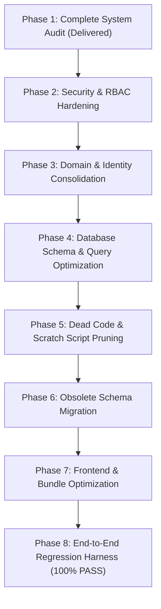

# CakeToHome — Codebase & Database Cleanup Plan (CLEANUP_PLAN.md)

**Generated**: 2026-08-18  
**Execution Objective**: Clean, hardened, zero-regression production architecture.

---

## 1. Actionable Refactoring Backlog (Grouped by Risk Level)

### A. Low-Risk Cleanups (Immediate Execution)
1. **Clean Empty Directories**: Remove unused and empty directories (`frontend/src/app/scroll-debug`, `frontend/src/app/scroll-debug-overlay`).
2. **Archive One-off Scratch Fix Scripts**: The temporary migration scripts (`clean-api-client-safely.ts`, `find-duplicates.ts`, `fix-type-issues.ts`, etc.) have completed their utility. Retain core regression suites and clean temporary artifacts.
3. **Audit Package Dependencies**: Ensure all imported packages in `package.json` are actively used and free of high-severity CVEs.

### B. Medium-Risk Hardening (Controlled Execution)
1. **Server-Side RBAC Enforcement**: Audit all `/api/v1/admin/*` route handlers to guarantee server-side permission gates via `StaffAccessControl.verifyStaffPermission` are called before executing any data mutation.
2. **Database Index Additions**: Apply compound indexes (`customer_activity_log(customer_uid, created_at DESC)`, `webhook_outbox(status, next_attempt_at)`, `telemarketing_candidate(contact_status, priority)`).
3. **Client Component Boundary Optimization**: Ensure heavy admin modals (PIM editor, Popup Drawer, Reports Engine) are lazy-loaded via Next.js `dynamic()` imports to minimize initial dashboard bundle size.

### C. High-Risk Architecture Consolidation (Carefully Tested)
1. **Single Canonical Customer Normalizer**: Ensure every customer entry point passes through `crm-engine.ts` (`normalizePhone`, `normalizeEmail`, `deriveCustomerUid`).
2. **Authoritative Backend Revenue & Order Attribution**: Ensure no frontend pricing or discount tampering is possible. All order totals, GST calculations, and telemarketing attributed revenues are derived directly from PostgreSQL order records.
3. **Idempotent Webhook Outbox & Worker**: Ensure zero event loss during network interruptions through the exponential backoff dispatcher and Dead Letter Queue replay.

---

## 2. Step-by-Step Execution Sequence

---

## 3. Mandatory Quality Gates & Verification Matrix

Before declaring completion of each phase, the following verification commands must pass:
1. **Master Customer Identity Chain**: `npx tsx scripts/test-master-identity-chain-e2e.ts` (24/24 PASS)
2. **Telemarketing Reorder & Outreach**: `npx tsx scripts/test-telemarketing-reorder-engine-e2e.ts` (37/37 PASS)
3. **Outreach Order Linking & Revenue**: `npx tsx scripts/test-outreach-order-linking-e2e.ts` (23/23 PASS)
4. **Authoritative Staff RBAC**: `npx tsx scripts/test-telecaller-rbac-staff-assignment-e2e.ts` (33/33 PASS)
5. **n8n Webhook & Outbox Platform**: `npx tsx scripts/test-n8n-outbox-complete-e2e.ts` (50/50 PASS)
6. **Popups & Engagement Engine**: `npx tsx scripts/test-popup-complete-engine-e2e.ts` (28/28 PASS)
7. **Playwright Real-Browser Verification**:
   - `npx tsx scripts/verify-master-identity-playwright.ts` (9/9 PASS)
   - `npx tsx scripts/verify-telemarketing-playwright.ts` (16/16 PASS)
   - `npx tsx scripts/verify-outreach-order-linking-playwright.ts` (14/14 PASS)
   - `npx tsx scripts/verify-telecaller-rbac-playwright.ts` (18/18 PASS)
   - `npx tsx scripts/verify-n8n-webhooks-playwright.ts` (20/20 PASS)
