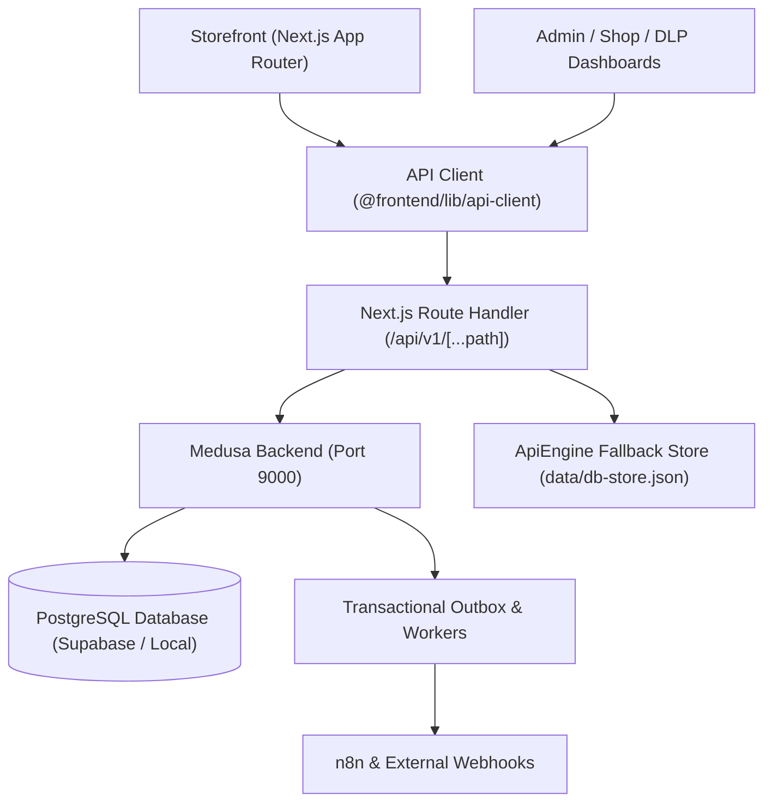
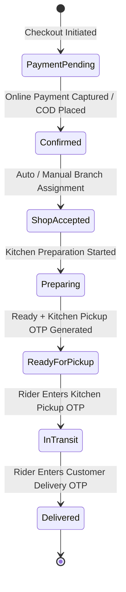

# CakeToHome Codebase Architecture Map

## Overview
This document provides a comprehensive, subsystem-level architectural mapping of the CakeToHome bakery commerce and operations platform across Frontend, Backend, Database, Auth/RBAC, and Business Lifecycles.

---

## 1. Subsystem Architecture Index

---

## 2. Detailed Subsystem Analysis

### 1. Frontend Architecture
- **Source of Truth**: React Server Components (`app/(store)`, `app/(checkout)`, `app/account`, `app/dashboard`) + Next.js App Router.
- **Entry Point**: `frontend/src/app/layout.tsx`, `frontend/src/app/(store)/layout.tsx`, `frontend/src/app/(store)/page.tsx`.
- **Dependencies**: Next.js 14, React 18, `@medusajs/ui`, `@medusajs/icons`, `lucide-react`, Tailwind CSS, `canvas-confetti`.
- **Database Access**: Direct DB access is prohibited on frontend; interactions routed via server data accessors (`src/lib/data/*`) or `/api/v1/*` route handlers.
- **API Access**: `api-client.ts` (`fetch` with Bearer auth, auto-retry, and timeout management).
- **Client/Server Boundary**:
  - Server Components: `(store)/page.tsx`, `(store)/products/[id]/page.tsx`, `layout.tsx`, `catalog.ts`.
  - Client Components: `ai-chat-assistant.tsx`, `exit-intent-popup.tsx`, `nav-cart.tsx`, `delivery-location-header.tsx`, `scroll-frame-hero.tsx`, dashboard panels.
- **Performance Risks**:
  - Global layout inclusion of `AiChatAssistant` (556 LOC) and `ExitIntentPopup` without dynamic hydration.
  - Large shared bundle graph if heavy server-side engines (`api-engine.ts`, `tax-master.ts`) leak into client chunks.
  - Repeated catalog and occasion requests if server-side fetch deduplication is absent.

---

### 2. Backend Architecture (Medusa Engine)
- **Source of Truth**: Medusa Framework v2 (`backend/`) with custom module services.
- **Entry Point**: `backend/src/api/*`, `backend/medusa-config.ts`.
- **Dependencies**: `@medusajs/medusa`, `@medusajs/framework`, MikroORM / Knex, PostgreSQL driver.
- **Database Access**: PostgreSQL connection pool (min 2, max 30) with SSL configuration.
- **API Access**: REST API endpoints under `/store/*` and `/admin/*`.
- **Performance Risks**:
  - Synchronous module initialization across 20 registered custom modules.
  - Sequential queries in multi-entity joins (Orders $\times$ Items $\times$ Customers $\times$ Delivery).
  - Potential unindexed foreign key lookups under heavy concurrency.

---

### 3. API & Routing Architecture
- **Source of Truth**: Dual Routing Architecture:
  1. Primary: Medusa Node.js backend (`:9000/admin/*`, `:9000/store/*`).
  2. Gateway & Resiliency Fallback: Next.js API route handler (`/api/v1/[...path]/route.ts`) forwarding to Medusa and falling back to `ApiEngine`.
- **Entry Point**: `frontend/src/app/api/v1/[...path]/route.ts`.
- **Dependencies**: `staff-access-control.ts`, `api-engine.ts`, `webhook-engine.ts`, `telemarketing-engine.ts`.
- **Performance Risks**:
  - Heavy catch-all route handler (`route.ts` 2,824 lines) evaluating path regexes sequentially.
  - Redundant JSON serialization/deserialization across proxy boundaries.

---

### 4. Database & Storage Architecture
- **Source of Truth**: PostgreSQL database (Supabase cloud / local Postgres) + disk persistence (`frontend/data/db-store.json` for fallback).
- **Entry Point**: Medusa entities / migrations (`backend/src/migrations/*`).
- **Dependencies**: PostgreSQL 15+, Supabase RLS, connection pool manager.
- **Query Patterns**:
  - Single-row lookups (`order_number`, `phone`, `id`).
  - Filtered range scans (`created_at`, `branch_id`, `delivery_date`, `status`).
  - Aggregations (`daily_revenue`, `orders_by_slot`, `kpis`).
- **Performance Risks**:
  - Sequential scans on unindexed filters (`delivery_partner_id`, `customer_uid`, `payment_status`).
  - N+1 query patterns during order line item and customization hydration.

---

### 5. Authentication & Customer Identity Architecture
- **Source of Truth**: Master Customer Identity Engine (`frontend/src/lib/auth/auth-service.ts`, `crm-engine.ts`).
- **Entry Point**: `frontend/src/components/store/auth/customer-auth-modal.tsx`, `api/v1/auth/*`.
- **Identities**:
  - Canonical Customer: `cth_cus_<10-digit-phone>` (deterministic, idempotent).
  - Guest to Registered Merge: Automatic cart, wishlist, and address migration on OTP verification.
- **Performance Risks**:
  - Duplicate phone normalization calls across middleware, client, and route handlers.

---

### 6. Staff & Role-Based Access Control (RBAC)
- **Source of Truth**: `frontend/src/lib/staff-access-control.ts`.
- **Roles**: `SUPER_ADMIN`, `BRANCH_MANAGER`, `KITCHEN_STAFF`, `DELIVERY_PARTNER`, `TELEMARKETING_AGENT`, `SUPPORT_AGENT`.
- **Access Profiles**: Granular permissions (`prof_branch_ops`, `prof_telemarketing`, `prof_delivery_ops`, etc.).
- **Security Invariant**: Strictly enforced server-side; cross-role transitions (e.g. driver $\leftrightarrow$ manager) validated with explicit conflict checks.

---

### 7. Order Lifecycle State Machine

- **Source of Truth**: `ApiEngine` / `OrderLifecycleModuleService`.
- **Payment Confirmation Gate**: Unpaid online orders (`payment_status === "pending" | "failed"`) are strictly isolated from the kitchen queue and KPI counters.

---

### 8. Delivery Partner & Hub Isolation
- **Source of Truth**: `ApiEngine.canPartnerAccessOrder`, `getDeliveryPartnerAuthorizedBranches`.
- **Isolation Rule**: Rider assigned to Hub A cannot see, query, or claim jobs for Hub B.
- **Concurrency & Idempotency**:
  - Repeat claim by same driver returns `200 OK` (`already_claimed: true`).
  - Competing claim by another driver returns `409 Conflict`.

---

### 9. CRM, Abandoned Cart & Telemarketing Lifecycle
- **Source of Truth**: `frontend/src/lib/crm/crm-engine.ts`, `telemarketing-engine.ts`.
- **Lifecycle**:
  - Abandoned Cart Detection (after 15–30 min idle).
  - Multi-Channel Recovery Dispatch (WhatsApp / SMS / Email with secure single-use recovery token).
  - Automated Telemarketing Queue Assignment for high-value dropoffs ($>₹1,000$).
- **Performance Risks**:
  - Heavy memory footprint if raw abandoned cart lists and audit logs are retained indefinitely.

---

### 10. Webhooks & Transactional Outbox Lifecycle
- **Source of Truth**: `frontend/src/lib/webhook-engine.ts`, `backend/src/modules/webhook`.
- **Pattern**: Transactional Outbox pattern with exponential backoff retries, HMAC SHA-256 signature verification, and n8n webhook dispatchers.
