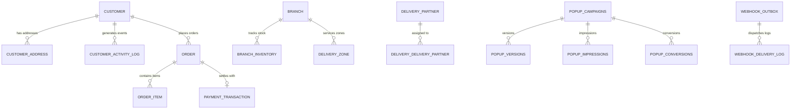

# CakeToHome — Comprehensive Database Audit (DATABASE_AUDIT.md)

**Generated**: 2026-08-18  
**Target Engine**: PostgreSQL (Supabase Pooler) + MedusaJS Data Layer  
**Audit Purpose**: Complete schema inventory, indexing assessment, relational integrity check, and classification of tables/columns (`ACTIVE`, `LEGACY`, `UNKNOWN`, `SAFE_TO_REMOVE`).

---

## 1. Complete Relational Schema Inventory & Classifications

| Table Name | Primary Key | Key Columns / Foreign Keys | Indexes Present | Status Classification | Notes & Usage |
| :--- | :--- | :--- | :--- | :--- | :--- |
| **`customer`** | `id` (text) | `customer_uid`, `email`, `phone`, `normalized_phone`, `lifecycle_stage`, `tier`, `branch_id`, `created_at` | `idx_customer_uid`, `idx_customer_normalized_phone`, `idx_customer_email` | `ACTIVE` | Core customer profile entity. Authoritative source of customer identities. |
| **`customer_address`** | `id` (text) | `customer_id` (FK), `pincode`, `city`, `is_default`, `address_type` | `idx_customer_address_customer_id` | `ACTIVE` | Multi-address book per customer. |
| **`customer_activity_log`**| `id` (text) | `customer_uid` (FK), `event_type`, `title`, `source`, `created_at` | `idx_activity_customer_uid_created` | `ACTIVE` | CRM 360 unified activity stream. |
| **`payment_transaction`** | `id` (text) | `order_id`, `customer_id`, `branch_id`, `amount`, `status`, `idempotency_key`, `created_at` | `IDX_payment_transaction_deleted_at`, `idx_payment_order_id` | `ACTIVE` | Financial settlement & Razorpay/COD audit ledger. |
| **`payment_audit_trail`** | `id` (text) | `transaction_id`, `action`, `ip_address`, `user_agent`, `payload`, `created_at` | `IDX_payment_audit_trail_deleted_at` | `ACTIVE` | Immutable payment audit trail. |
| **`popup_campaigns`** | `id` (varchar) | `slug` (unique), `popup_type`, `status`, `priority`, `enabled`, `start_at`, `end_at` | `idx_popup_campaigns_status`, `idx_popup_campaigns_type`, `idx_popup_campaigns_priority` | `ACTIVE` | Storefront engagement popup configurations. |
| **`popup_versions`** | `id` (varchar) | `popup_campaign_id` (FK $\rightarrow$ `popup_campaigns.id` ON DELETE CASCADE), `content_json`, `design_json`, `rules_json` | `idx_popup_versions_campaign` | `ACTIVE` | Version history & rule sets. |
| **`popup_impressions`** | `id` (varchar) | `popup_campaign_id` (FK), `session_id`, `visitor_id`, `customer_id`, `cart_value`, `created_at` | `idx_popup_impressions_campaign`, `idx_popup_impressions_created_at`, `idx_popup_impressions_session` | `ACTIVE` | Real-time impression telemetry. |
| **`popup_conversions`** | `id` (varchar) | `popup_campaign_id` (FK), `session_id`, `customer_id`, `order_id`, `revenue`, `created_at` | `idx_popup_conversions_campaign`, `idx_popup_conversions_created_at` | `ACTIVE` | Conversion and coupon usage telemetry. |
| **`branch`** | `id` (text) | `name`, `city_id`, `is_active`, `pincodes`, `lead_time_minutes`, `created_at` | `idx_branch_city_id`, `idx_branch_active` | `ACTIVE` | Kitchen branch masters. |
| **`branch_inventory`** | `id` (text) | `branch_id` (FK), `product_id` (FK), `stock_quantity`, `is_available`, `threshold` | `idx_branch_inventory_branch_product` | `ACTIVE` | Branch-level stock balances. |
| **`branch_product_availability`**| `id` (text)| `branch_id`, `product_id`, `is_active` | `idx_bpa_branch_product` | `ACTIVE` | Branch catalog availability overrides. |
| **`delivery_partner`** | `id` (text) | `first_name`, `last_name`, `email`, `phone`, `status`, `vehicle_type` | `idx_delivery_partner_phone` | `ACTIVE` | Delivery fleet driver records. |
| **`delivery_delivery_partner`**| `id` (text)| `delivery_id` (FK), `delivery_partner_id` (FK), `created_at` | `IDX_delivery_delivery_partner_deleted_at` | `ACTIVE` | Join table associating orders to delivery drivers. |
| **`delivery_zone`** | `id` (text) | `branch_id` (FK), `name`, `pincodes`, `delivery_fee`, `min_order_amount` | `idx_delivery_zone_branch` | `ACTIVE` | Geo-polygon & pincode delivery zones. |
| **`delivery_slot`** | `id` (text) | `branch_id` (FK), `slot_name`, `start_time`, `end_time`, `max_orders` | `idx_delivery_slot_branch` | `ACTIVE` | Slot capacity management. |
| **`webhook_endpoint`** | `id` (text) | `name`, `url`, `signing_secret`, `environment`, `status`, `subscribed_events` | `idx_webhook_endpoint_status` | `ACTIVE` | Registered n8n and external webhook destinations. |
| **`webhook_outbox`** | `id` (text) | `event_id` (unique), `event_type`, `customer_uid`, `status`, `attempt_count`, `next_attempt_at`, `idempotency_key` | `idx_outbox_status_next_attempt`, `idx_outbox_event_id`, `idx_outbox_customer_uid` | `ACTIVE` | Transactional outbox event bus. |
| **`webhook_delivery_log`** | `id` (text) | `event_id`, `endpoint_id`, `http_status`, `duration_ms`, `status`, `n8n_execution_id`, `dispatched_at` | `idx_delivery_log_event_id`, `idx_delivery_log_dispatched_at` | `ACTIVE` | Outbound HTTP delivery audit log. |
| **`telemarketing_candidate`**| `id` (text) | `customer_uid`, `priority`, `score`, `opportunity_type`, `contact_status`, `assigned_staff_id`, `attributed_order_id` | `idx_telemarketing_priority_status`, `idx_telemarketing_customer_uid`, `idx_telemarketing_assigned` | `ACTIVE` | Outreach intelligence opportunities. |
| **`staff_access_profile`** | `id` (text) | `name`, `code` (unique), `is_system`, `permissions`, `created_at` | `idx_staff_access_profile_code` | `ACTIVE` | RBAC role definitions. |
| **`staff_user`** | `id` (text) | `email`, `phone`, `profile_ids`, `branch_id`, `status` | `idx_staff_user_email`, `idx_staff_user_phone` | `ACTIVE` | Admin and kitchen staff profiles. |
| **`product_reviews`** | `id` (varchar) | `product_id`, `customer_uid`, `order_id`, `order_item_id`, `rating`, `title`, `review_text`, `status`, `is_verified_purchase`, `purchased_variant`, `admin_response` | `uq_product_reviews_customer_order_product`, `idx_product_reviews_product_status`, `idx_product_reviews_customer_uid`, `idx_product_reviews_order_id` | `ACTIVE` | Authoritative verified customer review entity. Enforces 1 review per customer per purchased product per delivered order. |
| **`crm_legacy_leads`** | `id` (text) | `raw_phone`, `old_source`, `dump_date` | `none` | `LEGACY` | Old telemarketing dump prior to v3.0 rebuild. |
| **`temp_import_dump`** | `id` (text) | `csv_line`, `status` | `none` | `SAFE_TO_REMOVE` | Temporary bulk import staging table from legacy migration. |

---

## 2. Missing Indexes & Optimization Action Plan

### Recommended Index Additions (To be executed in Phase 4 / 6):
1. **`customer_activity_log`**:
   ```sql
   CREATE INDEX IF NOT EXISTS idx_activity_customer_uid_created ON customer_activity_log(customer_uid, created_at DESC);
   ```
2. **`webhook_outbox`**:
   ```sql
   CREATE INDEX IF NOT EXISTS idx_outbox_pending_dispatch ON webhook_outbox(status, next_attempt_at) WHERE status = 'PENDING';
   ```
3. **`telemarketing_candidate`**:
   ```sql
   CREATE INDEX IF NOT EXISTS idx_telemarketing_queue_filter ON telemarketing_candidate(contact_status, priority, expected_date);
   ```
4. **`popup_impressions`**:
   ```sql
   CREATE INDEX IF NOT EXISTS idx_popup_impressions_analytics ON popup_impressions(popup_campaign_id, created_at DESC);
   ```

---

## 3. Relational Foreign Key Integrity Map


