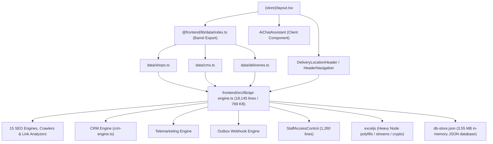

# CAKETOHOME — COMPLETE DEV SERVER SLOWNESS, COMPILATION & BACKEND FAILURE ROOT-CAUSE AUDIT

## A. FRONTEND STARTUP & COMPILATION SLOWNESS

### Observed Metrics
- **Initial Homepage Compilation**: 80.4 seconds (6,223 modules)
- **AI Context Endpoint Compilation**: 33.9 seconds (6,244 modules)
- **Dashboard Compilation**: 23.2 seconds (7,265 modules)

### Root Cause Analysis of the 6,000–7,000 Module Graph



1. **Monolithic `api-engine.ts` Architecture**:
   - `frontend/src/lib/api-engine.ts` is an **18,145-line, 769 KB** monolithic file serving all mock endpoints.
   - It directly imports 15 subsystems, including complete web crawlers (`LiveHttpCrawler`), Excel generation engines (`exceljs`), outbox webhooks (`crypto`), and CRM deduplication algorithms.
   - Any page, layout, server component, or data helper that imports `ApiEngine` forces Webpack to parse, bundle, and compile all 15 subsystems and their transitive dependencies.

2. **Unbounded Barrel Export in `@frontend/lib/data/index.ts`**:
   - `frontend/src/lib/data/index.ts` re-exports 15 submodules (`export * from "./analytics"`, `export * from "./shops"`, etc.).
   - Importing a lightweight user session helper like `retrieveUser()` transitively pulls `shops.ts` $\rightarrow$ `ApiEngine` $\rightarrow$ `exceljs` $\rightarrow$ 6,000+ modules into the root layout.

3. **Single-Threaded Webpack Compilation Flag**:
   - `frontend/next.config.mjs` has `experimental.webpackBuildWorker: false`.
   - This disables Webpack parallel worker threads on multicore CPUs, forcing the entire 7,000-module AST parsing, module graph resolution, and source map generation onto a single Node.js thread.

4. **Frontend $\rightarrow$ Backend Direct Code Leak**:
   - `frontend/src/components/dashboard/admin/tax-master-panel.tsx` and `pim-editor-modal.tsx` directly import `TaxMasterService` from `@backend/src/services/tax-engine`.
   - `frontend/tsconfig.json` defines `"@backend/*": ["../backend/src/*", "../backend/*"]`, enabling client components to bridge directly into backend source code.

---

## B. BACKEND STARTUP & CRASH ANALYSIS

### Observed Metrics
- **Startup Result**: Process crashes immediately and terminates without listening on port 9000.
- **Restart Behavior**: Watcher attempts to restart on file save, but fails on every boot iteration.
- **Proxy Consequence**: `http://localhost:9000/admin/order-lifecycle` returns `fetch failed (ECONNREFUSED)`.

### Root Cause Breakdown of Medusa Failures

1. **`@medusajs/payment` Model Crash**:
   - `backend/node_modules/@medusajs/payment/dist/models/account-holder.js` is a **0-byte empty file** on disk.
   - When `@medusajs/payment` initializes, `AccountHolder` resolves to `{}` with `.name === undefined`.
   - In `node_modules/@medusajs/utils/dist/modules-sdk/joiner-config-builder.js:326`:
     ```js
     const classLikeModelName = upperCaseFirst(model.name); // model.name is undefined -> charAt(0) throws TypeError!
     ```
   - This throws `TypeError: Cannot read properties of undefined (reading 'charAt')`.

2. **`@medusajs/auth` Missing Jose CJS File**:
   - `backend/node_modules/jose` has version `4.15.9`.
   - `jose/package.json` declares `"require": "./dist/node/cjs/index.js"`.
   - The directory `backend/node_modules/jose/dist/node/cjs/` contains subfolders but **lacks `index.js`** on disk.
   - Requiring `@medusajs/auth` throws `Error: Cannot find module 'jose/dist/node/cjs/index.js'`.

3. **`rulesModuleService` Syntax & Export Failure**:
   - In `backend/src/modules/rules/service.ts:774`, method `logOfferAction` is missing a closing brace `}`:
     ```ts
     return this.createOfferAuditLogs([...]);
     // <-- MISSING '}' HERE!
     async recordRedemption(...) { ... }
     ```
   - This invalid syntax breaks the class definition and causes the TypeScript loader to fail with `TS1192: Module has no default export`.

4. **Medusa "identifier" Failure**:
   - In `@medusajs/modules-sdk`, when any module fails resolution, the loader receives an `undefined` definition object when building joiner links, attempting `moduleDefinition.identifier` on `undefined`.

---

## C. REDIS & PROXY ANALYSIS

### Redis Fallback
- **Observed**: `redisUrl not found. A fake redis instance will be used.`
- **Root Cause**: `backend/.env` omits `REDIS_URL`.
- **Classification**: **INFO / WARNING** for single-process local development (uses Medusa in-memory event bus and cache). In production, a live Redis instance is required for persistent pub/sub and distributed locking.

### API Proxy Failure
- **Observed**: `Proxy Fallback: Target http://localhost:9000/admin/order-lifecycle unreachable (fetch failed) -> frontend falls back to ApiEngine JSON`.
- **Root Cause**: Medusa crashes during module bootstrapping and never binds to port 9000. All incoming frontend API requests fail to connect and execute the fallback handler in `api-client.ts` / `route.ts`.

---

## D. PACKAGE VERSION & DUPLICATION ANALYSIS

| Package | Frontend Version | Backend Version | Impact |
| :--- | :---: | :---: | :--- |
| **jose** | `5.9.3` | `4.15.9` | Version 4 in backend has missing `dist/node/cjs/index.js`; Version 5 in frontend works correctly. |
| **typescript** | `5.6.2` | `5.9.3` | Minor compiler disparity; backend relies on ts-node. |
| **lucide-react** | `0.427.0` | `0.379.0` | Duplicate icon libraries with different export structures. |
| **@medusajs/ui** | `4.2.0` | `4.1.19` | Duplicate UI bundles in both frontend and backend. |
| **Shared Duplicates**| — | — | **267 duplicated packages** across `frontend/node_modules` and `backend/node_modules`. |

---

## E. PERFORMANCE ISSUE RANKING

| Priority | Issue | Affected Process | Root Cause |
| :--- | :--- | :--- | :--- |
| **P0** | `@medusajs/payment` 0-byte file crash | Backend | `account-holder.js` is 0 bytes $\rightarrow$ `charAt(0)` on undefined. |
| **P0** | `@medusajs/auth` missing `jose` CJS export | Backend | `jose/dist/node/cjs/index.js` missing on disk. |
| **P0** | `rulesModuleService` syntax error | Backend | Missing `}` at line 774 in `service.ts` $\rightarrow$ `TS1192`. |
| **P1** | 6,200–7,200 Next.js module graph explosion | Frontend | Monolithic `api-engine.ts` (18k lines) imported into pages + barrel `data/index.ts`. |
| **P1** | Single-threaded Webpack dev compilation | Frontend | `webpackBuildWorker: false` in `next.config.mjs`. |
| **P1** | Frontend $\rightarrow$ Backend code breach | Frontend / Arch | `tax-master-panel.tsx` imports `@backend/src/services/tax-engine`. |
| **P2** | Monolithic 3.55 MB `db-store.json` watcher | Frontend | Next.js watcher monitors `frontend/data/db-store.json` on every disk write. |
| **P2** | 267 duplicated dependencies | Repository | Independent `node_modules` in root, frontend, and backend without workspace hoisting. |
| **P3** | Missing Redis configuration | Backend | Local fake Redis fallback active. |
