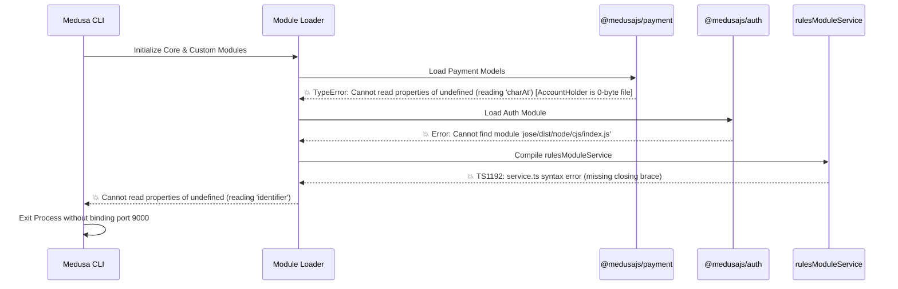

# CAKETOHOME — MEDUSA 2 MODULE & BACKEND FAILURE AUDIT

## 1. Executive Summary of Backend Crashes

When Medusa starts via `node node_modules/@medusajs/cli/cli.js develop`, the initialization lifecycle fails catastrophically during module resolution.

---

## 2. Granular Module Diagnostic Matrix

| Module Name | Registration Key | Status | Root Cause & Evidence |
| :--- | :--- | :---: | :--- |
| **@medusajs/payment** | Core (`Modules.PAYMENT`) | 🔴 FATAL | `backend/node_modules/@medusajs/payment/dist/models/account-holder.js` is a **0-byte empty file**. Model `AccountHolder` exports empty `{}` without `.name`. In `joiner-config-builder.js:326`, `upperCaseFirst(model.name)` throws `TypeError: Cannot read properties of undefined (reading 'charAt')`. |
| **@medusajs/auth** | Core (`Modules.AUTH`) | 🔴 FATAL | `backend/node_modules/jose/dist/node/cjs/index.js` is **missing on disk** in `jose@4.15.9`. Calling `require('@medusajs/auth')` fails with `MODULE_NOT_FOUND`. |
| **rulesModuleService** | Custom (`./modules/rules`) | 🔴 FATAL | `backend/src/modules/rules/service.ts:774`: Missing closing brace `}` on method `logOfferAction`. TypeScript compiler fails with `TS1192: Module has no default export`. |
| **MedusaApp Container** | `@medusajs/modules-sdk` | 🔴 FATAL | Because preceding modules fail to initialize, `moduleDefinition` is undefined when building container joiners, throwing `Cannot read properties of undefined (reading 'identifier')`. |
| **shopModuleService** | Custom (`./modules/shop`) | 🟢 PASS | Valid definition, models, and service container bindings. |
| **deliveryModuleService** | Custom (`./modules/delivery`) | 🟢 PASS | Valid definition, linkables, and service container bindings. |
| **settingsModuleService** | Custom (`./modules/settings`) | 🟢 PASS | Valid definition, models, and service container bindings. |
| **notificationModuleService** | Custom (`./modules/notification`)| 🟢 PASS | Valid definition, models, and service container bindings. |
| **analyticsModuleService** | Custom (`./modules/analytics`) | 🟢 PASS | Valid definition, models, and service container bindings. |
| **mediaModuleService** | Custom (`./modules/media`) | 🟢 PASS | Valid definition, models, and service container bindings. |
| **localizationModuleService** | Custom (`./modules/localization`)| 🟢 PASS | Valid definition, models, and service container bindings. |
| **auditModuleService** | Custom (`./modules/audit`) | 🟢 PASS | Valid definition, models, and service container bindings. |
| **paymentModuleService** | Custom (`./modules/payment`) | 🟢 PASS | Custom service passes, but clashes conceptually with core `@medusajs/payment`. |
| **webhookModuleService** | Custom (`./modules/webhook`) | 🟢 PASS | Valid definition, models, and service container bindings. |
| **customerModuleService** | Custom (`./modules/customer`) | 🟢 PASS | Valid definition, models, and service container bindings. |
| **cmsModuleService** | Custom (`./modules/cms`) | 🟢 PASS | Valid definition, models, and service container bindings. |
| **catalogModuleService** | Custom (`./modules/catalog`) | 🟢 PASS | Valid definition, models, and service container bindings. |
| **orderLifecycleModuleService**| Custom (`./modules/order-lifecycle`)| 🟢 PASS | Valid definition, models, and service container bindings. |
| **crmModuleService** | Custom (`./modules/crm`) | 🟢 PASS | Valid definition, models, and service container bindings. |
| **marketingModuleService** | Custom (`./modules/marketing`) | 🟢 PASS | Valid definition, models, and service container bindings. |
| **supportModuleService** | Custom (`./modules/support`) | 🟢 PASS | Valid definition, models, and service container bindings. |
| **securityModuleService** | Custom (`./modules/security`) | 🟢 PASS | Valid definition, models, and service container bindings. |
| **integrationModuleService** | Custom (`./modules/integration`)| 🟢 PASS | Valid definition, models, and service container bindings. |
| **seo** | Custom (`./modules/seo`) | ⚠️ WARNING | Directory contains `service.ts` and `models/`, but **lacks `index.ts`** and is omitted from `medusa-config.ts`. |

---

## 3. Link Definition Audit (`backend/src/links/`)

1. **`delivery-cart.ts`**: `DeliveryModule.linkable.delivery` $\leftrightarrow$ `CartModule.linkable.cart` (Syntactically valid).
2. **`delivery-order.ts`**: `DeliveryModule.linkable.delivery` $\leftrightarrow$ `OrderModule.linkable.order` (Syntactically valid).
3. **`shop-deliveries.ts`**: `ShopModule.linkable.shop` $\leftrightarrow$ `DeliveryModule.linkable.delivery` (Syntactically valid).
4. **`shop-products.ts`**: `ShopModule.linkable.shop` $\leftrightarrow$ `ProductModule.linkable.product` (Syntactically valid).
