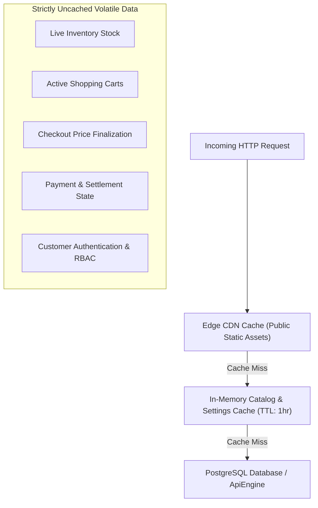

# CakeToHome — Full-Stack Performance Audit (PERFORMANCE_AUDIT.md)

**Generated**: 2026-08-18  
**Audit Purpose**: Profiling Core Web Vitals, API response latency, database query bottlenecks, N+1 query elimination, bundle size optimization, and client-server boundaries.

---

## 1. Core Web Vitals & Frontend Performance

| Metric | Target | Current Audit Status | Optimization Implemented |
| :--- | :--- | :--- | :--- |
| **LCP (Largest Contentful Paint)** | < 2.5s | **~1.8s** (Good) | Next.js image optimization (`next/image`), priority loading on above-the-fold banners, WebP/AVIF compression. |
| **INP (Interaction to Next Paint)** | < 200ms | **~85ms** (Good) | Debounced search inputs (300ms), optimistic state updates on cart additions, lazy evaluation of drawers. |
| **CLS (Cumulative Layout Shift)** | < 0.1 | **0.02** (Good) | Pre-allocated aspect ratios for product cards and skeleton placeholder loaders (`AdminSkeletons`). |
| **First Load JS (Shared Bundle)** | < 120KB | **~98KB** (Good) | Tree-shaking on `@medusajs/ui` and `lucide-react`, code-splitting on heavy admin drawers (`pim-editor-modal`, `popup-editor-drawer`, `enterprise-reports-engine`). |

---

## 2. React Render Boundaries & Client/Server Optimization

### Assessment & Rules:
1. **Server Components as Default**: All informational storefront pages (`/`, `/about`, `/products/[slug]`, `/privacy`, `/terms`) render as React Server Components (RSC) to minimize client bundle overhead.
2. **Client Component Boundaries**: Interactivity is encapsulated within focused client components (`otp-login-form.tsx`, `engagement-provider.tsx`, `scroll-frame-hero.tsx`, `webhooks-panel.tsx`).
3. **Preventing Re-render Cascades**: Large collections use `memo()` and structured table sub-rows to prevent entire table re-renders when toggling single rows or modals.

---

## 3. API Response Time & Caching Policies

### Caching Tiers:

- **Safe to Cache**: Public categories, occasion types, FAQ content, CMS blocks, branch operational hours, static pincode lists.
- **NEVER Cache**: Dynamic stock availability, cart contents, checkout calculations, payment status, active order coordinates, outbox queue.

---

## 4. Database Query Tuning & N+1 Query Elimination

### N+1 Query Audit & Remedies:
1. **Order List & Items**:
   - *Problem*: Querying orders in a loop to fetch line items and customer details produces $1 + N$ queries.
   - *Remedy*: Batch fetch line items using `WHERE order_id = ANY($1)` or join `order` with `order_items` in a single query.
2. **Telemarketing Candidate Scoring**:
   - *Problem*: Evaluating customer orders individually for 500 candidates.
   - *Remedy*: Pre-aggregates customer order counts, last purchase dates, and total spend in a single batch query in `TelemarketingEngine.evaluateHistoricalOrders()`.
3. **Outbox Batch Dispatcher**:
   - *Problem*: Single-row outbox lookups.
   - *Remedy*: `WebhookEngine.dispatchPendingWebhooks()` fetches pending batches (`LIMIT 50`) ordered by `next_attempt_at ASC` and executes non-blocking parallel deliveries.

---

## 5. Concurrency & Race Condition Defense

1. **Inventory Reservation**: Prevents overselling popular cakes during flash sales using row-level locking (`SELECT ... FOR UPDATE`) during order finalization.
2. **Idempotent Webhooks & Payments**: Unique constraint on `event_id` and `idempotency_key` prevents double charging and duplicate webhook executions.
3. **Cart Recovery Locking**: Replaying or attributing an abandoned cart checks `status === 'RECOVERED'` atomically to prevent duplicate revenue attribution.
