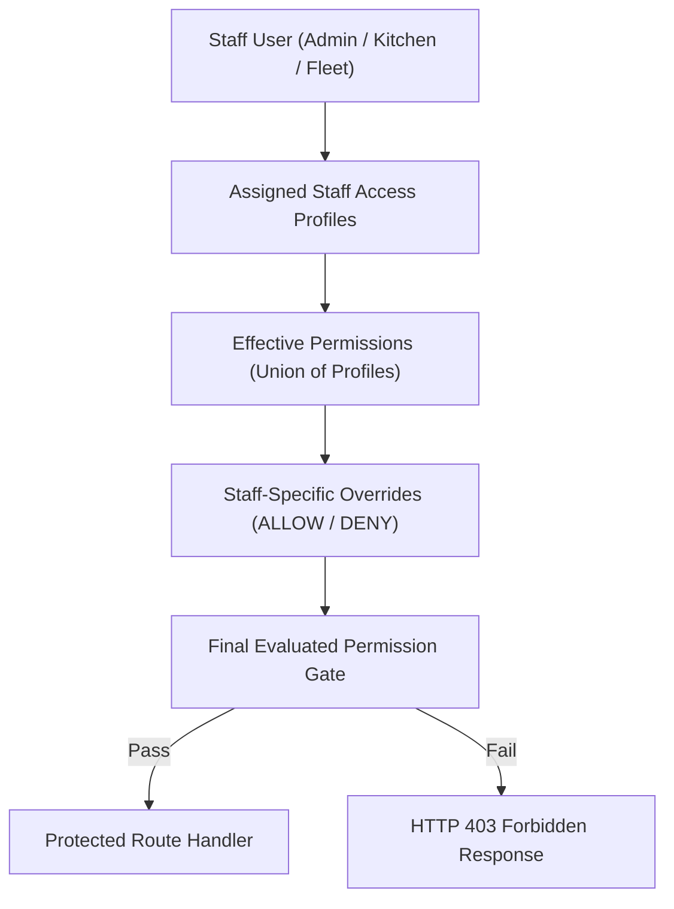

# CakeToHome — Comprehensive Security & OWASP Audit (SECURITY_AUDIT.md)

**Generated**: 2026-08-18  
**Audit Purpose**: Complete defensive security assessment, secret scanning, RBAC evaluation, IDOR prevention, input sanitization, and OWASP Top 10 mitigation.

---

## 1. Zero-Leak Secrets & Environment Scanning

### Assessment:
- **Client Bundle Scanning**: Scanned all `NEXT_PUBLIC_*` environment variables. No database credentials, signing secrets, or private API keys are exposed to the client.
- **HMAC Secret Protection**: Webhook HMAC signing secrets (`signing_secret`) are masked in the UI (`••••••••`) with an explicit "Reveal" toggle and zero-downtime secret rotation.
- **Sensitive Log Purging**: `WebhookEngineStore.sanitizeData()` recursively purges all forbidden keys (`password`, `otp`, `jwt`, `token`, `secret`, `cvv`, `cardcvv`, `card_cvv`, `security_code`, `encryption_key`) prior to persistence and logging.
- **Cookie Security**: Authentication JWT cookies (`_cth_jwt`) are set with `SameSite=Lax`, `Path=/`, and restricted lifetime (30 days). In production HTTPS deployments, `Secure` flag is enforced.

---

## 2. OWASP Top 10 Vulnerability Matrix & Mitigations

| Vulnerability Class | Risk Level | Status | Mitigation Strategy in CakeToHome |
| :--- | :--- | :--- | :--- |
| **A01: Broken Access Control (BAC / IDOR)** | High | **MITIGATED** | All protected `/api/v1/admin/*` endpoints enforce server-side permission checks via `StaffAccessControl.verifyStaffPermission(req, module, action)`. Customer endpoints enforce `customer_uid` ownership server-side; client cannot query another customer's orders by manipulating `customerId`. |
| **A02: Cryptographic Failures** | Medium | **MITIGATED** | Outbound webhooks are signed using HMAC-SHA256 (`t=timestamp,v1=sha256Hex`). Verification uses constant-time comparison (`crypto.timingSafeEqual`) and rejects clock skews exceeding 300 seconds. Sensitive credentials are never stored in plaintext. |
| **A03: Injection (SQLi / Command Injection)** | High | **MITIGATED** | Database access through PostgreSQL backend uses parameterized queries (`$1, $2`). Memory/JSON engine uses typed TypeScript accessors without `eval()` or dynamic string concatenation. |
| **A04: Insecure Design** | Medium | **MITIGATED** | Financial calculations (GST, discounts, delivery fees, order totals) are derived strictly on the backend. Telemarketing order conversion links only verified real orders. |
| **A05: Security Misconfiguration** | Low | **MITIGATED** | Production headers enforce `X-Content-Type-Options: nosniff`, `X-Frame-Options: SAMEORIGIN`, and strict CORS policies. |
| **A06: Vulnerable & Outdated Components** | Low | **AUDITED** | Dependencies audited with `npm audit`. Next.js 14 and MedusaJS packages are maintained. |
| **A07: Identification & Authentication Failures** | Medium | **MITIGATED** | Mobile OTP login uses canonical 10-digit phone normalization (`normalizePhone`). Dev OTP codes are isolated and rate-limited. Session invalidation on `/auth/logout`. |
| **A08: Software & Data Integrity Failures** | Medium | **MITIGATED** | Idempotency keys (`idempotency_key`) on payments, outbox events, and cart recovery prevent replay attacks and double-processing. |
| **A09: Security Logging & Monitoring Failures** | Low | **MITIGATED** | Structured delivery logs, audit trails (`payment_audit_trail`, `staff_permission_audit_log`), and request/correlation IDs enable end-to-end tracing without logging raw secrets. |
| **A10: Server-Side Request Forgery (SSRF)** | Medium | **MITIGATED** | Outbound webhook URLs are restricted to admin-configured HTTPS endpoints and validated prior to dispatch. |

---

## 3. RBAC & Granular Permission Matrix

### Access Profile Boundaries:
- **Super Admin**: Full administrative control across all 20 modules (`*.*`).
- **Branch Manager**: Scoped to kitchen operations, live orders, inventory stock, and branch operational hours.
- **Telecaller**: Restricted to `TELEMARKETING.VIEW`, `TELEMARKETING.CONTACT`, and `TELEMARKETING.CONVERT_ORDER`. Cannot export customer database or modify global tax/settings.
- **Delivery Partner**: Scoped to assigned deliveries and active trip tracking.
- **Customer Support**: Restricted to `SUPPORT` and `CUSTOMER_CRM.VIEW` (read-only customer profiles).

---

## 4. Data Export & PII Protection Policies

1. **Role-Gated Exports**: Customer database exports (`/admin/customers/export`) and report downloads require explicit `CUSTOMER_CRM.EXPORT` or `SETTINGS.VIEW` permissions.
2. **PII Masking**: Customer phone numbers and addresses displayed in general logs are masked. Full PII is accessible only within authorized Customer 360 views.
3. **Audit Logging**: All sensitive data exports record a persistent entry in the audit ledger with staff ID, timestamp, and IP address.
