# CakeToHome — System Architecture & Domain Blueprint (SYSTEM_MAP.md)

**Platform Version**: CakeToHome Enterprise v3.0  
**Generated**: 2026-08-18  
**Architecture Classification**: Dual-Engine Clean Hybrid (PostgreSQL/MedusaJS Backend + High-Throughput Next.js 14 App Router + Transactional Outbox + n8n Event Bus)

---

## 1. Executive Platform Architecture

```mermaid
flowchart TD
    subgraph ClientTier ["1. Client & Storefront Presentation Tier"]
        C1["Next.js 14 Storefront (RSC + Client Islands)"]
        C2["Admin Dashboard & Control Center (/dashboard)"]
        C3["Mobile Web OTP Auth & Customer Portal (/account)"]
        C4["Interactive Cart & Dynamic Checkout (/cart, /checkout)"]
    end

    subgraph EdgeGateway ["2. Edge, Auth & Dispatch Gateway"]
        MW["Next.js Middleware (Auth, Session, RBAC)"]
        RT["API Router (/api/v1/[...path])"]
        SEC["HMAC Signing & Input Sanitization Engine"]
    end

    subgraph DomainCore ["3. Core Domain Engines & Business Logic"]
        AUTH_DOM["Auth & Staff RBAC (StaffAccessControl)"]
        CUST_DOM["Customer Identity & CRM 360 (CRM360Engine)"]
        CAT_DOM["Catalog, Pricing & Inventory (ApiEngine)"]
        ORD_DOM["Order Lifecycle & KOT Dispatch (ApiEngine)"]
        DEL_DOM["Delivery Routing & Partner Fleet (ApiEngine)"]
        MKT_DOM["Engagement, Popups & Recovery (PopupTriggerEngine)"]
        TEL_DOM["Telemarketing Reorder Engine (TelemarketingEngine)"]
        WH_DOM["Transactional Outbox & DLQ (WebhookEngine)"]
    end

    subgraph DataTier ["4. Authoritative Persistence & Automation Layer"]
        PG["PostgreSQL Database (Supabase Pooler / Port 5432)"]
        MED_SRV["MedusaJS Core Backend (Port 9000)"]
        N8N["Enterprise n8n Workflow Automation Platform"]
        DISK["Local ACID JSON-Store (Dev/Fallback Mirror)"]
    end

    ClientTier --> EdgeGateway
    EdgeGateway --> DomainCore
    DomainCore --> DataTier
```

---

## 2. Business Domain Breakdown & Domain Boundaries

### 1. Authentication & Staff Access Control (`AUTH_RBAC`)
- **Domain Responsibilities**: Customer OTP mobile verification, admin password authentication, JWT token generation, role detection (`SUPER_ADMIN`, `BRANCH_MANAGER`, `DELIVERY_PARTNER`, `CUSTOMER`), access profile union evaluation, and granular permission enforcement.
- **Canonical Files**:
  - `src/lib/staff-access-control.ts`
  - `src/lib/auth-service.ts`
  - `src/lib/data/sessions.ts`
  - `src/lib/data/users.ts`
  - `src/components/store/auth/otp-login-form.tsx`
  - `src/components/dashboard/admin/staff-profiles-panel.tsx`
- **Authoritative Data Structures**:
  - `StaffAccessProfile`, `StaffUserRecord`, `StaffPermissionCatalog`, `StaffPermissionAuditLog`

### 2. Master Customer Identity & CRM 360 (`CUSTOMER_CRM`)
- **Domain Responsibilities**: Canonical customer UID derivation (`cth_cus_<10-digit-clean-phone>`), phone/email normalization, unified order history linkage, customer lifetime spend, RFM segmentation, tags, notes, and activity timeline.
- **Canonical Files**:
  - `src/lib/crm/crm-engine.ts`
  - `src/lib/crm/types.ts`
  - `src/components/dashboard/admin/crm-panel.tsx`
  - `src/components/dashboard/admin/crm/customer-360-drawer.tsx`
  - `src/app/account/page.tsx`
- **Authoritative Data Structures**:
  - `CustomerRecord`, `CustomerActivityLog`, `CustomerNoteRecord`, `CustomerAddressRecord`

### 3. Catalog, PIM & Multi-Branch Inventory (`CATALOG_INVENTORY`)
- **Domain Responsibilities**: Cake and dessert catalog, slug routing, weight pricing tiers (0.5kg, 1kg, 2kg, etc.), flavor customization, add-ons/accessories, artisan/dietary filters, branch-level stock overrides, and lead-time constraints.
- **Canonical Files**:
  - `src/lib/api-engine.ts`
  - `src/lib/data/products.ts`
  - `src/components/dashboard/admin/pim-editor-modal.tsx`
  - `src/components/dashboard/admin/catalog-panel.tsx`
  - `src/components/dashboard/admin/categories-panel.tsx`
  - `src/components/dashboard/admin/variants-management-panel.tsx`

### 4. Branch, City & Geo-Delivery Master (`GEO_BRANCH`)
- **Domain Responsibilities**: Multi-city definitions (Bengaluru, Mumbai, Delhi-NCR, Hyderabad, etc.), physical kitchen branches, operational hours, delivery radius polygons, pincode mapping, slot capacities, and dynamic delivery fee estimation.
- **Canonical Files**:
  - `src/lib/api-engine.ts`
  - `src/components/dashboard/admin/branches-panel.tsx`
  - `src/components/dashboard/admin/cities-panel.tsx`
  - `src/components/dashboard/admin/branch-zone-manager.tsx`
  - `src/components/dashboard/admin/branch-pincode-panel.tsx`

### 5. Shopping Cart & Guest-To-Customer Ownership (`CART`)
- **Domain Responsibilities**: Active browsing cart, guest session cookies (`_cth_cart_id`), line item quantities, custom cake messages, photo upload attachments, auto-merge on login into `customer_uid`, and cart abandonment scanning.
- **Canonical Files**:
  - `src/lib/api-engine.ts`
  - `src/lib/data/cart.ts`
  - `src/components/store/cart/*`

### 6. Checkout, Tax & Order Finalization (`CHECKOUT_ORDER`)
- **Domain Responsibilities**: Pre-order validation (prep time, branch capacity, delivery slot availability), statutory GST calculation (5% food / 18% services & delivery), Razorpay/Cash on Delivery processing, immutable order snapshot creation, and KOT/Invoice generation.
- **Canonical Files**:
  - `src/lib/api-engine.ts`
  - `src/lib/data/orders.ts`
  - `src/components/dashboard/admin/orders-panel.tsx`
  - `src/components/dashboard/admin/order-details-drawer.tsx`
  - `src/components/dashboard/admin/order-invoice-print-modal.tsx`
  - `src/components/dashboard/admin/order-kot-print-modal.tsx`

### 7. Abandoned Cart Recovery & Re-engagement (`RECOVERY`)
- **Domain Responsibilities**: Background cart abandonment evaluation (30-min threshold), cryptographic recovery tokens (`/cart/recover/<token>`), WhatsApp recovery message dispatch via n8n, and conversion attribution.
- **Canonical Files**:
  - `src/lib/api-engine.ts`
  - `src/components/dashboard/admin/abandoned-cart-panel.tsx`

### 8. Telemarketing Reorder & Reactivation Intelligence (`TELEMARKETING`)
- **Domain Responsibilities**: Historical order intelligence, 10 explicit celebration opportunity types, 5-signal deterministic scoring (0-100), factual pitch generation, authoritative telecaller staff assignment, call logging, and non-duplicable order conversion linking.
- **Canonical Files**:
  - `src/lib/telemarketing-engine.ts`
  - `src/lib/telemarketing-export-service.ts`
  - `src/components/dashboard/admin/telemarketing-panel.tsx`

### 9. Enterprise n8n Webhook & Transactional Outbox (`WEBHOOK_OUTBOX`)
- **Domain Responsibilities**: Atomic event queuing, 40+ canonical event catalogue, HMAC-SHA256 request signing, sensitive field sanitization, exponential retry worker, Dead Letter Queue (DLQ) escalation, manual replay with idempotency, and two-stage delivery/execution logging.
- **Canonical Files**:
  - `src/lib/webhook-engine.ts`
  - `src/components/dashboard/admin/webhooks-panel.tsx`

### 10. Storefront Engagement & Popup Campaign System (`POPUP_ENGAGEMENT`)
- **Domain Responsibilities**: Client-side trigger evaluator (exit intent, scroll depth, idle time, cart threshold, first-time visitor), priority arbitration, frequency capping (per session, daily, lifetime), coupon integration, and analytics tracking.
- **Canonical Files**:
  - `src/lib/engagement/popup-trigger-engine.ts`
  - `src/lib/engagement/popup-priority-engine.ts`
  - `src/lib/engagement/popup-frequency-manager.ts`
  - `src/components/store/engagement/engagement-provider.tsx`
  - `src/components/dashboard/admin/popups-panel.tsx`
  - `src/components/dashboard/admin/popup-editor-drawer.tsx`

---

## 3. Entry Points & Request Lifecycles

1. **Storefront Customer Journey**:
   $$\text{Browser} \longrightarrow \text{Next.js App Router} \longrightarrow \text{Inline OTP Login} \longrightarrow \text{API Proxy} \longrightarrow \text{ApiEngine} \longrightarrow \text{Transactional Outbox} \longrightarrow \text{n8n}$$
2. **Admin Command Journey**:
   $$\text{Browser (/dashboard)} \longrightarrow \text{Middleware RBAC Check} \longrightarrow \text{React Component} \longrightarrow \text{apiClient.ts} \longrightarrow \text{/api/v1/admin/*} \longrightarrow \text{StaffAccessControl.verifyStaffPermission} \longrightarrow \text{Domain Engine}$$
3. **External Webhook & n8n Callback**:
   $$\text{n8n Workflow} \longrightarrow \text{POST /api/v1/admin/webhooks/callback} \longrightarrow \text{HMAC Header Verification} \longrightarrow \text{WebhookEngine.recordWorkflowCallback} \longrightarrow \text{Delivery Log Update}$$

---

## 4. External Integrations Matrix

| Provider | Purpose | Protocol / SDK | Transport Layer | Auth Scheme |
| :--- | :--- | :--- | :--- | :--- |
| **n8n Workflow Engine** | Outbound business event automation & external dispatch | HTTPS Webhook Trigger | Outbox Worker Pool | HMAC-SHA256 Signature Header |
| **Razorpay** | Online payment gateway & UPI checkout | REST API & Webhooks | Server API Action | Key / Secret Basic Auth |
| **Gupshup / Twilio** | SMS OTP and transactional WhatsApp messages | n8n / REST API | Webhook Dispatch | API Bearer Token |
| **PostgreSQL (Supabase)** | Authoritative relational database | TCP (Port 5432 / 6543) | PgBouncer Pooler | PostgreSQL SSL Connection String |
| **Cloudflare / CDN** | Edge asset delivery & DNS caching | HTTPS Edge | Reverse Proxy | Managed Cloudflare SSL |
