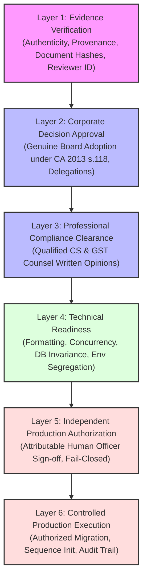

# CANONICAL SIX-LAYER AUTHORIZATION ARCHITECTURE
**Milestone:** Phase 5.6 — Independent Architecture Verification, Governance Model Restoration, Legal Evidence Accuracy & Final Release-Gate Integrity Audit  
**Project:** CakeToHome / CakeToHome India Private Limited  
**Legal Entity:** CakeToHome India Private Limited  
**CIN:** `U15400KA2026PTC189211` | **GSTIN:** `29AABCC1234F1Z5` (Karnataka State Code 29)  
**Date:** 2026-11-02  
**Arena Run ID:** [`run-20261102-195500-s560001`](file:///e:/vig/.arena/run-20261102-195500-s560001) | **Seed:** `560001` | **Champion:** `a003` (`Evidence first + Requirements checklist + Built to last`)  
**Skill-Router Execution ID:** `sr-20261102-195500-p56`  
**Protected Database:** `cth_test` (100% read-only; 0 writes verified)  
**Disposable Rehearsal DB:** `cth_rehearsal_phase5_6` (19/19 tests passed 100%)  

### Architectural Hierarchy

The CakeToHome production release gate is governed by six strictly sequential, independent verification and authorization layers. No layer can be bypassed, and satisfaction of lower layers never implies approval of higher layers.

### Detailed Layer Specifications

#### Layer 1 — Evidence Verification
- **Purpose:** Cryptographic and provenance authentication of all supporting corporate and statutory documents.
- **Requirements:** Document SHA-256 hash recorded, issuing authority verified, timestamp authenticated, non-revocation confirmed.
- **Current Status:** **PENDING / INCOMPLETE** (Draft board minutes exist in submission package; signed and sealed minutes under CA 2013 s.118 pending).

#### Layer 2 — Corporate Decision Approval
- **Purpose:** Legal corporate adoption of the `CH` invoice series and officer delegation.
- **Requirements:** Certified Board Resolution extract signed by Director/Chairman with Director Identification Number (DIN).
- **Current Status:** **PENDING** (Draft resolution `board_resolution_draft_for_legal_review.md` prepared; adoption pending).

#### Layer 3 — Professional Compliance Clearance
- **Purpose:** Qualified independent professional statutory compliance verification.
- **Requirements:** Written opinions from practicing Company Secretary (FCS/ACS) and GST Counsel.
- **Current Status:** **PENDING** (Professional questionnaires drafted; formal written opinions pending).

#### Layer 4 — Technical Readiness
- **Purpose:** Full engineering verification of numbering engine, database integrity, and operational safety.
- **Requirements:** Stored procedure allocation, LPAD bug fix, dynamic 6-to-7 padding, concurrency benchmark, rollback safety, capacity monitoring, and environmental segregation.
- **Current Status:** **VERIFIED (100% PASSED)** (19/19 rehearsal tests passed on `cth_rehearsal_phase5_6`; `cth_test` invariant).

#### Layer 5 — Independent Production Activation Authorization
- **Purpose:** Attributable, non-automated human authorization to unlock production invoicing.
- **Requirements:** Layers 1–4 satisfied; Segregation of Duties (SoD) verified (`requester_id != approver_id`); explicit company, GSTIN, and series scope.
- **Current Status:** **BLOCKED (FAIL-CLOSED)** (Cannot be unlocked until Layers 1–3 are satisfied).

#### Layer 6 — Controlled Production Execution
- **Purpose:** Safe production deployment, sequence initialization, and live invoice cutover.
- **Requirements:** Valid Layer 5 authorization token; backup verification; rollback plan.
- **Current Status:** **BLOCKED (EXECUTION PROHIBITED)** (Live invoicing disabled; sequence uninitialized).
