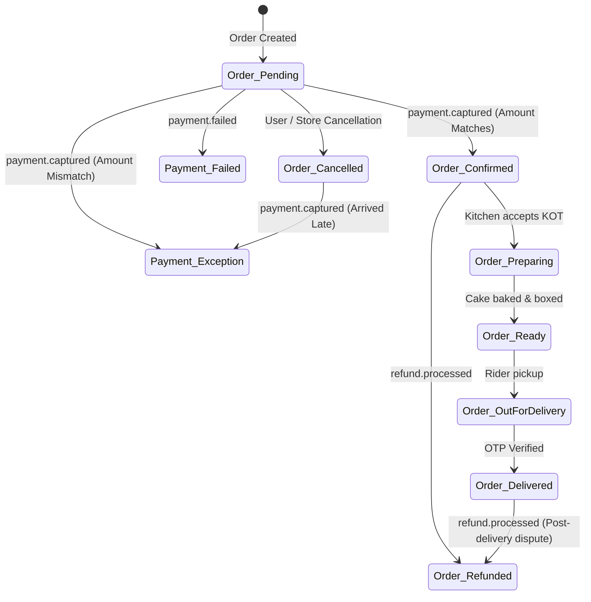

# CakeToHome — Payment Status Synchronization & State Machine

**Project:** CakeToHome  
**Component:** Order & Payment Lifecycle State Machines  
**Target Tables:** `public.order`, `public.payment_transaction`, `public.order_status_history`  

---

## 1. Domain Status Mappings

CakeToHome enforces clear separation of concerns between **Order Status** (fulfillment and kitchen lifecycle) and **Payment Status** (financial and gateway lifecycle).

### 1.1 Payment Transaction Statuses (`payment_transaction.status`)
- `initiated`: Payment session created, user has opened checkout modal.
- `pending`: Payment authorized by card network or UPI switch, pending final capture.
- `captured`: Payment successfully settled and credited to CakeToHome gateway account.
- `failed`: Payment declined by bank, insufficient funds, or authentication failure.
- `cancelled`: Payment cancelled by user before authorization.
- `expired`: Payment link or checkout session timed out.
- `refunded`: Full refund credited back to customer's original payment method.
- `partially_refunded`: Partial refund processed for out-of-stock items or adjustments.
- `disputed`: Customer initiated a chargeback or payment dispute with issuing bank.

### 1.2 Order Payment Statuses (`order.payment_status`)
- `pending`: Payment not yet confirmed.
- `paid`: Payment authenticated, verified cryptographically, and captured in full.
- `failed`: Payment attempt was declined.
- `refunded`: Order funds have been refunded.
- `payment_exception`: Anomaly detected (amount mismatch, payment on cancelled order, or currency mismatch). Requires administrative / accounting action.

### 1.3 Order Fulfillment Statuses (`order.status`)
- `pending`: Order placed, waiting for payment or store acceptance.
- `confirmed`: Payment verified; order locked in kitchen production queue.
- `preparing`: Baker/chef has accepted KOT and cake is being baked/decorated.
- `ready_for_pickup`: Cake completed, packaged, and staged in store chiller.
- `out_for_delivery`: Handed over to rider with delivery OTP verification.
- `delivered`: Final delivery OTP verified by rider; delivery completed.
- `cancelled`: Order cancelled by customer or store before preparation.

---

## 2. Order & Payment State Machine Transitions

---

## 3. Real-Time Customer Storefront Synchronization

A key requirement is that **the customer must not need to manually refresh the page, contact support, or wait for an administrator to confirm a successfully paid order**.

### Implementation Pattern: Client Polling Watcher
In `frontend/src/components/store/order/order-live-status-watcher.tsx`:

1. **Mounting Check**: If the order is currently `pending` or payment status is not `paid`, the client watcher activates.
2. **Frequency & Duration**:
   - Interval: Every **2000ms (2 seconds)**.
   - Max Duration: **60 seconds** (30 poll cycles).
3. **Endpoint**: `GET /api/v1/orders/:id/status` (or `GET /api/v1/store/orders/:id/status`).
4. **Transition Hook**:
   - When the response indicates `is_paid === true` and `is_confirmed === true`:
     - Updates local component state to confirmed.
     - Displays real-time confirmation banner: *"✓ Payment Authenticated & Captured — Order Confirmed in Real-Time"*.
     - Calls `router.refresh()` to update the React Server Component tree without full browser navigation or losing client context.
     - Clears the polling interval.

---

## 4. Multi-Layer Audit Logging

Every payment state change writes to three immutable audit layers:

1. **`public.order_status_history`**:
   Stores `from_status`, `to_status`, `actor_type = 'payment_gateway'`, `reason`, and JSON snapshot with `payment_id` and amounts.
2. **`public.payment_webhook_event`**:
   Stores incoming raw webhook event, event ID, signature validation status, payload, and execution result.
3. **`public.customer_notification_queue`**:
   Stores the queued customer alerts dispatched across SMS, WhatsApp, and Email with exact message payloads and timestamps.
