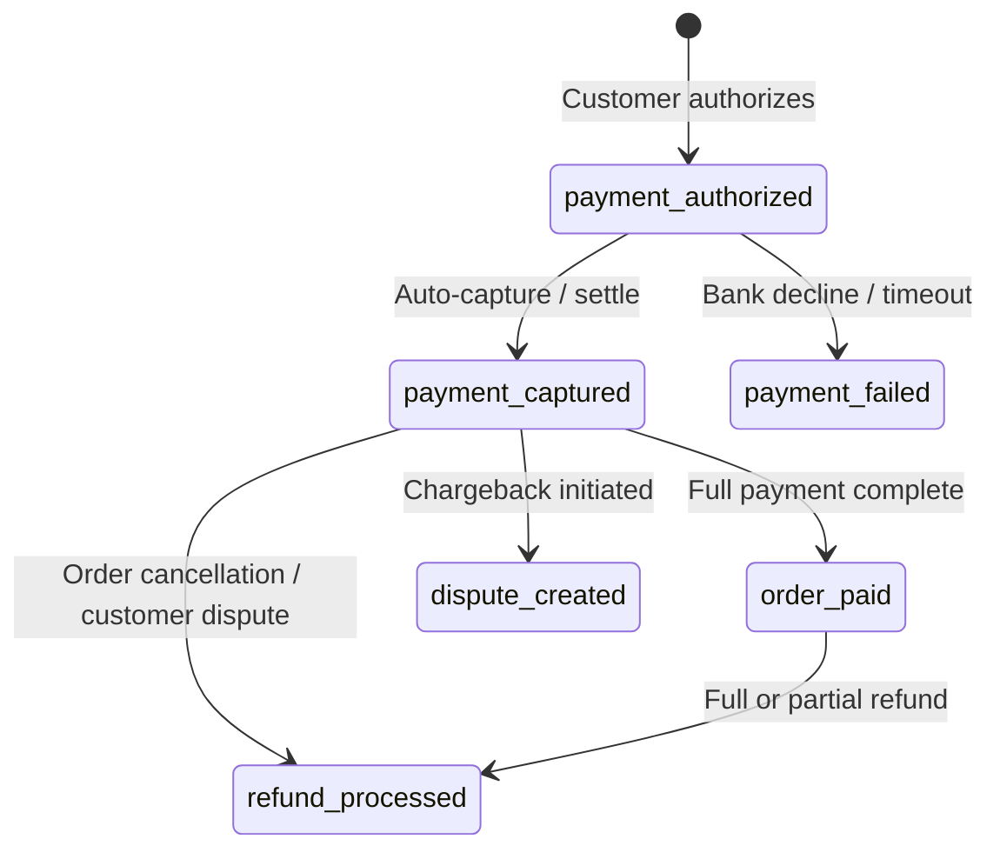

# CakeToHome — Payment Webhook & Security Configuration Manual

**Project:** CakeToHome  
**Component:** Webhook Ingestion, Secret Management & Replay Prevention  
**Environment:** Staging / Production  
**Target Gateway:** Razorpay  

---

## 1. Webhook Endpoint Specifications

CakeToHome exposes both a dedicated App Router webhook endpoint and wildcard API route fallbacks:

### Primary Webhook URL
```
POST https://cakes2home.com/api/v1/payments/webhook
```

### Auxiliary Fallback URLs
```
POST https://cakes2home.com/api/v1/payments/razorpay/webhook
POST https://cakes2home.com/api/v1/store/payments/webhook
```

### Required Request Headers
- `Content-Type: application/json`
- `X-Razorpay-Signature: <hex-encoded-hmac-sha256>`
- `X-Razorpay-Event-Id: <unique-event-identifier>` (Optional but recommended for strict replay detection)

---

## 2. Environment Variables & Secret Management

All cryptographic operations require secure server-side secrets. Secrets must never be exposed to the browser or client-side bundles.

| Variable Name | Purpose | Recommended Configuration |
| :--- | :--- | :--- |
| `RAZORPAY_KEY_ID` | Public gateway key used in storefront checkout modal | `rzp_live_...` (Prod) / `rzp_test_...` (Staging) |
| `RAZORPAY_KEY_SECRET` | Gateway secret used for client signature verification | High entropy string provided by Razorpay dashboard |
| `RAZORPAY_WEBHOOK_SECRET` | Secret configured in Razorpay Webhooks dashboard | High entropy string (min 32 alphanumeric chars) |
| `WEBHOOK_SIGNING_SECRET` | Backup alias for webhook signing secret | Identical to `RAZORPAY_WEBHOOK_SECRET` |

> [!IMPORTANT]
> **Secret Rotation Procedure**: When rotating the webhook secret in the Razorpay Dashboard, update `RAZORPAY_WEBHOOK_SECRET` in the application environment variables before saving the change in Razorpay to prevent dropped webhook events during deployment.

---

## 3. Supported Webhook Events

The CakeToHome payment service processes and synchronizes the following Razorpay events:



| Razorpay Event | CakeToHome Transaction Status | CakeToHome Order Payment Status | Automated Action |
| :--- | :--- | :--- | :--- |
| `payment.authorized` | `pending` | `pending` | Acknowledged, awaiting capture |
| `payment.captured` | `captured` | `paid` | Full order confirmation, stock deduction, KOT generation, notifications |
| `order.paid` | `captured` | `paid` | Full order confirmation, stock deduction, KOT generation, notifications |
| `payment.failed` | `failed` | `failed` | Failure reason recorded, failure SMS alert sent to customer |
| `refund.processed` | `refunded` | `refunded` | Payment transaction refunded, order marked refunded, audit logged |
| `payment.dispute.created` | `disputed` | `payment_exception` | Alert raised to accounting/compliance team for review |

---

## 4. Replay Protection & Deduplication Architecture

Webhooks in production may be retried multiple times by the payment gateway due to network timeouts or upstream retry policies. CakeToHome guarantees strict idempotency through a multi-tier defense:

1. **Unique Event Constraint**:
   The table `public.payment_webhook_event` maintains a unique constraint on `event_id`:
   ```sql
   CREATE UNIQUE INDEX idx_pwe_event_id ON public.payment_webhook_event (event_id);
   ```
2. **Pre-Processing Check**:
   Before executing state transitions, the engine queries `payment_webhook_event`:
   ```sql
   SELECT id, status, processed_at FROM public.payment_webhook_event 
   WHERE event_id = $1 AND status IN ('processed', 'already_confirmed')
   ```
   If already processed, it immediately short-circuits and returns HTTP 200 with `{ idempotent: true, status: 'already_confirmed' }`.
3. **Double Execution Invariant**:
   - `inventory_movement`: Before inserting stock deductions, the engine verifies whether an existing `movement_type = 'SALE'` movement exists for this order.
   - `customer_notification_queue`: Before queueing SMS/WhatsApp, checks if `order_confirmed_sms` already exists for this order.
   - Prevents duplicate kitchen tickets, duplicate stock deductions, and duplicate SMS blasts.

---

## 5. Security & Edge Case Mitigation

### 5.1 Payment for Cancelled Order
- If a customer was slow to pay and the order was cancelled by the store or system cutoff, the incoming `payment.captured` event:
  - Does **NOT** un-cancel or confirm the order.
  - Updates `order.payment_status` to `payment_exception`.
  - Sets transaction `settlement_status` to `flagged_refund`.
  - Logs a priority alert for store operations to process a refund or customer contact.

### 5.2 Amount Mismatch
- If a compromised payload or rounding bug attempts to confirm a ₹1,180 cake order with a ₹500 payment:
  - Fails amount tolerance check ($|\Delta| > 0.05$).
  - Sets `payment_status = 'payment_exception'`.
  - Order status remains `pending` (unconfirmed).
  - Logs exact expected vs received amount in `order.metadata.amount_mismatch_details`.
