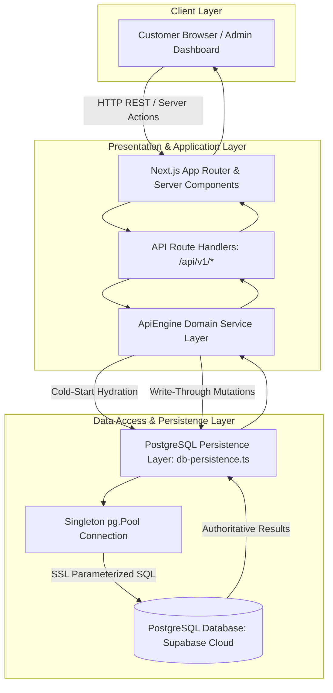

# CakeToHome — Database-First Architecture Specification

## 1. System Architecture Overview

CakeToHome operates as a conventional, production-grade web application where **PostgreSQL is the single authoritative source of truth**. All administrative configurations, product master data, pricing structures, option mappings, delivery rules, orders, and CMS contents are persisted directly into relational tables and read back via server-side APIs.



---

## 2. Database as the Single Source of Truth

The application guarantees that transient layers are never treated as persistent stores:
- **PostgreSQL**: 100% Authoritative Source of Truth.
- **Server In-Memory Cache (`memoryStore`)**: Read-through cache initialized on server cold-start via `hydrateStoreFromDatabase()`.
- **Browser `localStorage` / `sessionStorage`**: Strictly limited to client-side auth tokens (`cth_access_token`), search history, and transient modal dismissal flags. Zero business data is stored in browser storage.
- **React State**: Limited to local UI presentation state (e.g., active tab, form inputs, modal visibility).
- **JSON Files**: Preserved only as static migration/seed/diagnostic utilities. Zero runtime dependency on JSON for application persistence.

---

## 3. Core Domain Data Flows

### 3.1 Product & PIM Data Flow
```
[Admin edits in PIM Modal]
       ↓
[POST/PUT /api/v1/admin/catalog/products/:id]
       ↓
[ApiEngine.updateAdminProduct / saveProductWeightPrices / saveProductFlavorMappings]
       ↓
[persistProductToDb(product)]
       ↓
[PostgreSQL "product" & "product_variant" UPSERT]
       ↓
[Next.js Revalidation Tag: revalidateTag("products")]
       ↓
[Customer /products/[slug] fetches updated DB state]
```

### 3.2 Product Option Whitelist Governance
- **Strict Option Whitelisting**: The customer-facing product detail page (`/products/[id]`) queries options via `apiClient.getStorefrontProductOptions(product.id)`.
- If 0 flavours or shapes are mapped to the product in PIM, exactly `[]` is returned.
- No global master flavours or hardcoded constants (`DEFAULT_PRODUCTS`, `DEFAULT_VARIANT_OPTIONS`) are injected as fallbacks.
- Server-side validation in `validateCheckout` strictly validates submitted option IDs against the product's whitelisted mappings.

### 3.3 CMS Content Flow
```
[Admin edits CMS Page in Dashboard]
       ↓
[PUT /api/v1/admin/cms/pages/:id]
       ↓
[persistCmsPageToDb(page)]
       ↓
[PostgreSQL "cms_page" Table UPDATE]
       ↓
[Storefront Homepage queries GET /api/v1/cms/pages/homepage]
       ↓
[Renders DB-backed hero, promotional cards, and banners]
```

### 3.4 Checkout & Server-Side Price Anti-Spoofing
```
[Customer clicks Checkout]
       ↓
[POST /api/v1/checkout/validate]
       ↓
[Server retrieves Product from DB]
       ↓
[Recalculates Unit Price = Base Price + Weight Matrix Price + Shape Surcharge + Flavour Surcharge]
       ↓
[Validates Delivery Distance & Corporate Cutoff Time (Asia/Kolkata)]
       ↓
[Calculates Tax & Surcharges]
       ↓
[Returns Authoritative Order Summary]
```

### 3.5 Delivery & Map-First Geocoding
- **Map Pin Authority**: Delivery destination is selected via map search or coordinate pin placement (`latitude`, `longitude`).
- **Independent Recipient Location**: Delivery destination is never locked to the customer's browser GPS coordinates.
- **Geographic Distance**: Calculated as true geodesic distance between servicing hub GPS coordinates and delivery destination GPS coordinates.
- **Product Delivery Distance Restriction**: Products with configured `max_delivery_distance_km` in PIM are validated server-side.

### 3.6 Order Lifecycle & Persistence
```
[Customer confirms Payment]
       ↓
[POST /api/v1/orders]
       ↓
[ApiEngine.createOrder -> validateCheckout]
       ↓
[persistOrderToDb(order)]
       ↓
[PostgreSQL "order" Table INSERT]
       ↓
[Order survives server restarts and browser cache purges]
```

---

## 4. Cache & Revalidation Strategy

1. **Cold-Start Boot**: On server startup, `hydrateStoreFromDatabase()` queries PostgreSQL tables and populates runtime domain state.
2. **Write-Through Persistence**: Every mutating API route (`POST`, `PUT`, `PATCH`, `DELETE`) synchronously updates runtime memory and immediately awaits the asynchronous database transaction (`persist*ToDb` / `delete*FromDb`).
3. **Cache Invalidation**: Next.js App Router cache tags (`products`, `product:${id}`, `product:${slug}`) are purged on product/CMS updates via `revalidateTag()`.
4. **Cache Decoupling**: If browser cache or Redis is cleared, all future reads seamlessly query PostgreSQL without data loss.

---

## 5. Security, Authorization & Error Handling

- **Server-Side Authorization**: Administrative mutations require valid authentication (`cth_admin_token` or Super Admin role).
- **Zero Client-Side Secrets**: Database connection string (`DATABASE_URL`) is strictly accessible in server-side Node execution.
- **Zero Silent Fallbacks**: Database connection or query failures throw structured HTTP 500/503 errors and display explicit failure notifications in the UI rather than silently falling back to mock fixtures.
