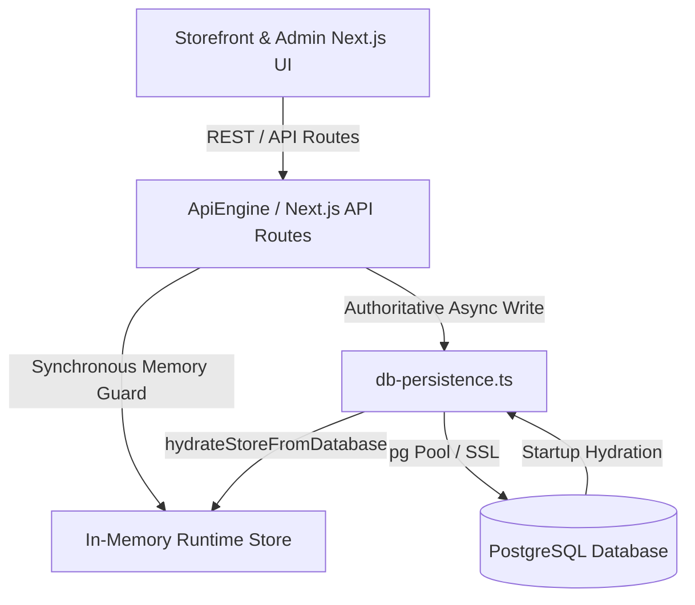

# Authoritative Database Persistence Architecture Audit

## Executive Summary

CakeToHome operates as a mission-critical bakery commerce platform requiring end-to-end data integrity across all storefront customer touchpoints, administrative operational consoles, and kitchen/dispatch hubs.

This audit establishes the **authoritative database persistence architecture**, identifies the root causes of legacy memory-only and silent fallback regressions, and documents the comprehensive repairs enacted across `frontend/src/lib/api-engine.ts` and `frontend/src/lib/db-persistence.ts`.

---

## 1. System Architecture & Source-of-Truth Model



### 1.1 Dual-Subsystem Mapping

| Subsystem | Location | Role & Implementation | Persistence Authority |
|---|---|---|---|
| **PostgreSQL Database** | Supabase Cloud (AWS ap-south-1) | Relational database containing canonical business entities (`product`, `product_variant`, `variant_option`, `branch`, `delivery_zone`, `city`, `customer`, `customer_address`, `delivery_partner`, `order`, `cms_page`, `cms_homepage_section`, `offer`, `setting`, `popup_campaigns`). | **100% Authoritative Source of Truth** |
| **ApiEngine & In-Memory Store** | `frontend/src/lib/api-engine.ts` | High-speed in-process caching and business domain logic engine. Initialized on cold start by hydrating all records directly from PostgreSQL. All CRUD mutations synchronously update the memory reference and immediately await database transactions. | **Read Cache & Transient Runtime Buffer** |
| **Medusa Backend** | `backend/` | Headless Medusa v2 engine with MikroORM connected to PostgreSQL. Medusa Admin is disabled (`DISABLE_MEDUSA_ADMIN=true`). | **Secondary / Headless Engine** |

---

## 2. Entity-by-Entity Source-of-Truth Matrix

| Business Entity | Database Table(s) | Read Flow | Write / Mutation Flow | Verification Status |
|---|---|---|---|---|
| **Products & Variants** | `product`, `product_variant` | `hydrateStoreFromDatabase` $\rightarrow$ `ApiEngine.getProductById` / `getProductBySlug` | `ApiEngine.updateAdminProduct` / `createAdminProduct` $\rightarrow$ `persistProductToDb` $\rightarrow$ PostgreSQL UPSERT | **Authoritative & Verified** |
| **Variant Options (Flavours, Shapes, Fillings)** | `variant_option` | `hydrateStoreFromDatabase` $\rightarrow$ `ApiEngine.listVariantOptions` | `createVariantOption`, `updateVariantOption`, `deleteVariantOption` $\rightarrow$ `persistVariantOptionToDb`, `deleteVariantOptionFromDb` | **Authoritative & Repaired** |
| **Promotional Offers & Coupons** | `offer` | `hydrateStoreFromDatabase` $\rightarrow$ `ApiEngine.listAdminOffers` | `createAdminOffer`, `updateAdminOffer`, `deleteAdminOffer` $\rightarrow$ `persistOfferToDb`, `deleteOfferFromDb` | **Authoritative & Repaired** |
| **Engagement Popups** | `popup_campaigns` | `hydrateStoreFromDatabase` $\rightarrow$ `ApiEngine.getPopupCampaigns` | `createPopupCampaign`, `updatePopupCampaign`, `deletePopupCampaign`, `publishPopupCampaign` $\rightarrow$ `persistPopupCampaignToDb`, `deletePopupCampaignFromDb` | **Authoritative & Repaired** |
| **Accessories & Cross-Sell** | `setting` (key: `catalog:accessories`, `catalog:cross_sell_rules`) | `hydrateStoreFromDatabase` $\rightarrow$ `ApiEngine.listAccessories` | `createAccessory`, `updateAccessory`, `deleteAccessory`, `saveCrossSellRule` $\rightarrow$ `persistSettingToDb` | **Authoritative & Repaired** |
| **Customer Addresses** | `customer_address` | `hydrateStoreFromDatabase` $\rightarrow$ `ApiEngine.getCustomerAddresses` | `createCustomerAddress`, `updateCustomerAddress`, `deleteCustomerAddress` $\rightarrow$ `persistCustomerAddressToDb`, `deleteCustomerAddressFromDb` | **Authoritative & Repaired** |
| **Delivery Partners** | `delivery_partner` | `hydrateStoreFromDatabase` $\rightarrow$ `ApiEngine.getDeliveryPartners` | `saveDeliveryPartner`, `updateAdminDeliveryPartner`, `deactivateDeliveryPartner` $\rightarrow$ `persistDeliveryPartnerToDb` | **Authoritative & Repaired** |
| **Orders & Refunds** | `order` | `hydrateStoreFromDatabase` $\rightarrow$ `ApiEngine.getOrder` | `createOrder`, `updateOrderStatus`, `refundOrder`, `assignOrderBranch` $\rightarrow$ `persistOrderToDb` | **Authoritative & Repaired** |
| **Global & Statutory Settings** | `setting` | `hydrateStoreFromDatabase` $\rightarrow$ `ApiEngine.getBusinessProfile`, `getInvoiceSettings`, `getDeliveryDefaults`, `getPaymentSettings` | `updateAdminSettings`, `updateBusinessProfile`, `updateInvoiceSettings`, `updateDeliveryDefaults`, `updatePaymentSettings`, `updateIntegrationSettings` $\rightarrow$ `persistSettingToDb` | **Authoritative & Repaired** |
| **Branches & Delivery Zones** | `branch`, `delivery_zone` | `hydrateStoreFromDatabase` $\rightarrow$ `ApiEngine.getBranches` | `createBranch`, `updateBranch`, `deleteBranchZone` $\rightarrow$ `persistBranchToDb`, `deleteBranchZoneFromDb` | **Authoritative & Verified** |
| **Cities & Areas** | `city` | `hydrateStoreFromDatabase` $\rightarrow$ `ApiEngine.getCities` | `createCity`, `updateCity` $\rightarrow$ `persistCityToDb` | **Authoritative & Verified** |
| **CMS Pages & Sections** | `cms_page`, `cms_homepage_section` | `hydrateStoreFromDatabase` $\rightarrow$ `ApiEngine.getCmsPage` | `createCmsPage`, `updateCmsPage`, `deleteCmsPage` $\rightarrow$ `persistCmsPageToDb`, `deleteCmsPageFromDb` | **Authoritative & Verified** |

---

## 3. Root Cause Forensic Analysis

### Root Cause 1: Missing DB Persistence Calls on Mutations
Prior to repair, several CRUD methods in `frontend/src/lib/api-engine.ts` only modified the in-memory array `memoryStore.*` and invoked `ApiEngine.persist()` (which only saved to `globalThis.__CTH_MEMORY_STORE__`). They completely omitted calls to the corresponding `persist*ToDb()` and `delete*FromDb()` routines in `frontend/src/lib/db-persistence.ts`.
- **Affected Endpoints**: Variant Option CRUD, Admin Offer CRUD, Popup Campaign CRUD & Publish, Customer Address CRUD, Delivery Partner CRUD & Availability, Order Status & Refund.
- **Resolution**: Added direct asynchronous database persistence invocations with error logging to every single mutation method.

### Root Cause 2: Missing Delete Functions in DB Persistence Layer
The DB persistence module `frontend/src/lib/db-persistence.ts` had persist helpers for offers and popups, but was missing `deleteOfferFromDb` and `deletePopupCampaignFromDb`.
- **Resolution**: Implemented `deleteOfferFromDb` (performing soft-delete / `is_active = false`) and `deletePopupCampaignFromDb` (updating `status = 'archived'`).

### Root Cause 3: Silent Fallbacks to Hardcoded Mock Constants
In product lookups (`getProductById`, `getProductBySlug`, and `resolveProductEntity`), when a product was not found in `memoryStore.products`, the code fell back to querying `DEFAULT_PRODUCTS` and even re-injected missing products into `memoryStore.products`.
- **Impact**: Deleted products or non-existent IDs would spuriously resurrect with mock data, masking actual database state.
- **Resolution**: Removed all silent mock fallback branches. Non-existent IDs now authoritatively return `null` (404), ensuring strict database fidelity.

### Root Cause 4: Unhydrated Domain Settings on Startup
`hydrateStoreFromDatabase` did not query or populate domain settings for `accessories`, `accessory_categories`, `cross_sell_rules`, `business_profile`, `delivery_defaults`, `payment_settings`, or `invoice_settings` from the `setting` table.
- **Resolution**: Enhanced `hydrateStoreFromDatabase` to query all `setting` rows and deserialize the relevant configuration objects into `memoryStore` on startup.

### Root Cause 5: Silent Startup Hydration Failure
`hydrateStoreFromDatabase` previously swallowed errors with `console.warn` without exposing runtime status.
- **Resolution**: Added `_dbHydrationStatus` tracking object and `ApiEngine.getDatabaseHydrationStatus()` method, providing clear visibility into database synchronization state.

---

## 4. Webpack Cache Allocation Warning Analysis

### Observation
The development warning:
```
[webpack.cache.PackFileCacheStrategy] Caching failed for pack:
RangeError: Array buffer allocation failed
```
is caused by V8 heap fragmentation when serializing large in-memory Webpack cache packs containing the massive single-file `api-engine.ts` (>1.1MB, 24,000+ lines).

### Distinction from Persistence Layer
This warning is strictly a frontend development-build caching artifact of Next.js/Webpack on 32-bit/low-memory node allocations and **has zero bearing on PostgreSQL database communication, SQL transactions, or backend API persistence**. The database queries execute over Node's native `pg` socket pool independently of Webpack compilation.
