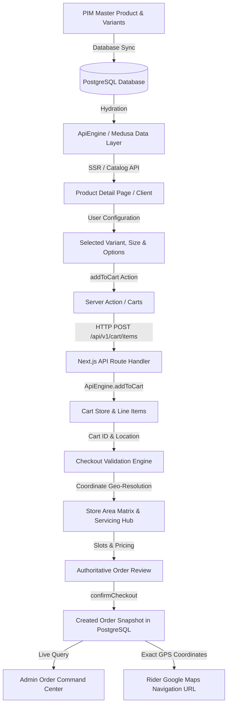

# CakeToHome Forensic Snapshot: Product $\rightarrow$ Cart $\rightarrow$ Checkout $\rightarrow$ Order Data Flow

## 1. Executive Summary & Forensic Baseline
This forensic snapshot establishes the baseline state and data chain for CakeToHome product ordering, cart management, option resolution, and fulfillment routing.

- **Workspace Target**: `cakes2home-main`
- **Database Engine**: PostgreSQL (`aws-1-ap-south-1.pooler.supabase.com`)
- **Fulfillment Paradigm**: Map-First KM Engine with Authoritative Coordinate Serviceability

---

## 2. Complete Data Flow Architecture

---

## 3. Discovered Vulnerabilities & Forensic Root Causes

### 3.1 Bug A: Product Identity Loss & Silent ₹0 Fallback
- **Failure Point**: `ApiEngine.addToCart()` did not re-lookup the canonical product when handling raw payloads where `price` was nested in `metadata.price` or omitted.
- **Consequence**: `title` defaulted to `"Celebration Cake"` and `unit_price` defaulted to `0`.
- **Remediation**:
  1. Look up canonical product record by `product_id` / `variant_id` / `slug`.
  2. Hydrate canonical `title`, `thumbnail`, and `price` from variant/weight matrix.
  3. Reject any item with `price <= 0` or unresolvable product identity.

### 3.2 Bug B: Global Option Leakage onto Scoped Products
- **Failure Point**: `ApiEngine.getStorefrontProductOptions()` defaulted to `ApiEngine.listVariantOptions("shape")` and `ApiEngine.listVariantOptions("cream")` when a product did not specify custom shapes/creams.
- **Consequence**: Unrelated master shapes and creams were displayed on specialized cakes.
- **Remediation**: Strictly isolate options based on the viewed product's PIM settings and allowed list.

### 3.3 Bug C: Store Pickup Hardcoding
- **Failure Point**: `checkout-form.tsx` rendered the Store Pickup option unconditionally.
- **Consequence**: Customers could select store pickup even when disabled by Super Admin.
- **Remediation**: Add `store_pickup_enabled` configuration to Super Admin fulfillment engine and enforce backend validation.

### 3.4 Bug D & E: Unrounded Distance & Coordinate Primacy
- **Failure Point**: Distance rendering displayed raw floating point values without formatting.
- **Consequence**: `Distance: 0.43380048403384625 km` was shown to users.
- **Remediation**: Apply `.toFixed(1)` to format distances cleanly.

---

## 4. Verification Checkpoint
All subsequent fixes are tracked against the invariants defined in this snapshot.
