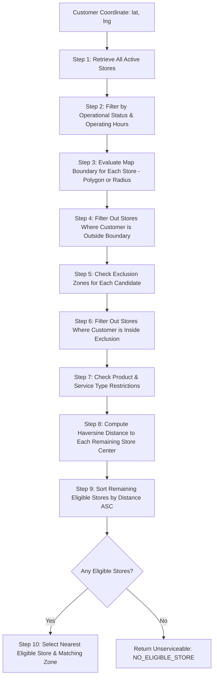

# Map-First Store Selection & Delivery Architecture

## Executive Summary & Vision

CakeToHome operates as the **Operating System for Modern Bakeries**, where fulfillment decisions are driven strictly by geographic accuracy, freshness constraints, and operational reliability.

Prior iterations relied partially on postal pincodes as an implicit proxy for delivery eligibility. In bakery commerce, postal pincodes are coarse political boundaries that span up to 20–30 kilometers across water bodies, highways, and mountain divides. A customer sharing a pincode with a store may be separated by an unbridgeable river or heavy transit corridor, making delicate cake transport unviable.

Under the **Map-First Store Selection Architecture**, delivery serviceability, store routing, delivery fees, and order fulfillment are **authoritatively determined by physical GPS coordinates, geometric polygon fences, and radial distances**.

---

## 1. Non-Negotiable Core Architectural Invariants

1. **Map-First Authority**:
   - Customer delivery serviceability is determined solely by physical coordinates `(latitude, longitude)`.
   - Postal pincodes **never** determine whether a customer can receive delivery when valid customer coordinates exist.
   - Pincodes are stored purely as secondary metadata for postal address formatting, billing, and search indexing.

2. **No False Pincode Fallback**:
   - If a customer provides no GPS coordinate or map selection, the platform **never** silently declares serviceability based on a pincode.
   - Instead, the customer is prompted: *"Please select your delivery location using GPS or map search."*

3. **Nearest ELIGIBLE Store Selection**:
   - The platform never selects the closest physical store and then checks if it delivers.
   - The platform strictly filters candidate stores for **eligibility first**, eliminates stores whose delivery areas do not cover the customer or whose exclusion zones intersect the customer, and then sorts remaining eligible stores by geographic distance.
   - **Canonical Rule**:
     - Store A: 2.0 km away, customer outside Store A's delivery fence $\rightarrow$ **INELIGIBLE**.
     - Store B: 5.0 km away, customer inside Store B's delivery fence $\rightarrow$ **ELIGIBLE**.
     - **Result**: Store B is selected. Store A is rejected.

4. **Exclusion Precedence**:
   - If a customer coordinate falls within a store's delivery boundary (Radius or Polygon) but falls inside an active **Exclusion Zone** (e.g. water body, restricted cantonment, industrial corridor), serviceability is immediately denied (`matched: false`).

5. **Store Admin Map Search Viewport Safety**:
   - In administrative map editors, searching a landmark, street, or city **moves only the map viewport**.
   - Searching never mutates store physical coordinates, radius centers, or saved polygon geometry until the administrator explicitly clicks `[ Use this location ]` and saves.

---

## 2. 10-Step Canonical Store Selection Algorithm

When a customer specifies a delivery location `(lat, lng)`, `ApiEngine.resolveSmartBranch` executes the following deterministic 10-step sequence:



### Mathematical Formulation of Haversine Distance

The great-circle distance $d$ between customer $(\phi_c, \lambda_c)$ and store center $(\phi_s, \lambda_s)$ on Earth with mean radius $R = 6371\text{ km}$:

$$\Delta\phi = (\phi_s - \phi_c) \cdot \frac{\pi}{180}$$
$$\Delta\lambda = (\lambda_s - \lambda_c) \cdot \frac{\pi}{180}$$
$$a = \sin^2\left(\frac{\Delta\phi}{2}\right) + \cos\left(\phi_c \cdot \frac{\pi}{180}\right) \cdot \cos\left(\phi_s \cdot \frac{\pi}{180}\right) \cdot \sin^2\left(\frac{\Delta\lambda}{2}\right)$$
$$c = 2 \cdot \text{atan2}\left(\sqrt{a}, \sqrt{1 - a}\right)$$
$$d = R \cdot c$$

---

## 3. Boundary Geometry Types & Priority

Each store in the **Store Area Matrix** defines one or more **Delivery Areas** (`DeliveryZone`).

| Geometry Type | Description | Priority | Mathematical Check |
| :--- | :--- | :--- | :--- |
| **Polygon (`polygon`)** | Custom geo-boundary drawn by bakery manager. | Higher (evaluated first) | Ray-casting Point-In-Polygon (Even-Odd rule) |
| **Radius (`radius`)** | Circular perimeter centered on store physical coordinates. | Secondary fallback | Haversine distance $d \le r_{\text{effective}}$ |
| **Exclusion (`exclusion_polygons`)** | Negative geofences inside active delivery boundaries. | Absolute override | Ray-casting PIP $\rightarrow$ if inside $\rightarrow$ reject |

### Radius Limit Hierarchy
To prevent over-extension of bakery logistics, radial boundaries are strictly clamped via a 3-tier hierarchy:
1. **Global System Ceiling**: 25 km
2. **Store Operational Limit** (`store.max_delivery_radius_km`): e.g. 15 km
3. **Delivery Area Configured Radius** (`zone.radius_km`): e.g. 8 km

$$r_{\text{effective}} = \min(r_{\text{zone}}, r_{\text{store}}, r_{\text{global}})$$

---

## 4. Subordination of Pincode Matrix

The legacy **Pincode Matrix** has been reframed as **Address / Pincode Reference**:
- Historical records are preserved for backward compatibility and analytical lookup.
- When an order is placed, postal pincode is stored alongside street address as postal metadata.
- Pincodes are **never queried** by `resolveDeliveryContext`, `calculateDeliveryFee`, `resolveSmartBranch`, or `getCheckoutAvailability` when coordinates are supplied.
- Pincodes without coordinates produce a non-blocking prompt: *"Please choose your location on the map to verify bakery delivery eligibility."*

---

## 5. Order Snapshot & Fulfillment Immutability

When an order is confirmed, the exact delivery coordinates and calculated distance are snapshotted permanently into the order entity:

```json
{
  "order_number": "CTH-20260827-209",
  "store_id": "br_kollam_central",
  "store_name": "Kollam Central Cake Studio",
  "delivery_latitude": 8.8853,
  "delivery_longitude": 76.5803,
  "distance_km": 3.82,
  "location_source": "MAP_PIN",
  "delivery_zone_name": "Kollam City Core (0–5 km)",
  "delivery_fee": 59,
  "rider_navigation_link": "https://www.google.com/maps/dir/?api=1&destination=8.8853,76.5803"
}
```

Delivery riders receive direct one-click navigation links to the exact pin drop, eliminating failed deliveries caused by inaccurate or ambiguous postal codes.
