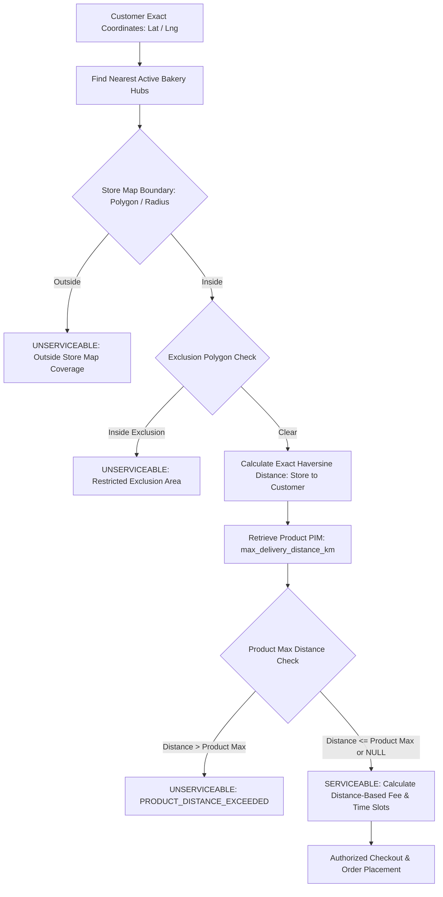

# CakeToHome Architecture: Product Delivery Distance Source of Truth

## 1. Core Principle
CakeToHome enforces a non-conflicting, map-first architecture:

- **STORE MAP COVERAGE = Physical Delivery Area**  
  Each branch/hub configures its physical delivery territory in the Store Area Matrix using geographic boundaries: radius, custom polygons, and exclusion polygons.
  
- **PRODUCT MAX DISTANCE = Product-Specific Constraint**  
  PIM defines how far a specific cake can safely travel (e.g. delicate artisan cakes limited to 5 km, structural multi-tier cakes limited to 10 km, standard dry cakes with `null` limit).

- **FINAL SERVICEABILITY INVARIANT**:
  $$\text{Final Eligibility} = (\text{Point In Store Map}) \land (\text{Point NOT in Exclusion}) \land (\text{Distance} \le \text{Product Max Distance})$$

---

## 2. Data Flow Architecture

---

## 3. Decision Matrix & Edge Cases

| Scenario | Store Map Coverage | Product Max Limit | Distance to Store | Result | Reason Code |
| :--- | :--- | :--- | :--- | :--- | :--- |
| **Case 1** | 10 KM Radius | 5.0 KM | 3.2 KM | **PASS** | Inside store radius and $\le 5$ KM product cap. |
| **Case 2** | 10 KM Radius | 5.0 KM | 6.5 KM | **FAIL** | `PRODUCT_DISTANCE_EXCEEDED` (6.5 km exceeds 5.0 km). |
| **Case 3** | 5.0 KM Radius | 10.0 KM | 6.5 KM | **FAIL** | `NO_ELIGIBLE_STORE` (Outside store map physical boundary). |
| **Case 4** | Custom Polygon | 5.0 KM | 4.0 KM (Inside Polygon) | **PASS** | Customer inside polygon and $\le 5$ KM. |
| **Case 5** | Custom Polygon | 5.0 KM | 7.0 KM (Inside Polygon) | **FAIL** | `PRODUCT_DISTANCE_EXCEEDED` (Customer in polygon, but exceeds product travel limit). |
| **Case 6** | 15 KM Radius | `null` | 12.0 KM | **PASS** | Product has no restriction; store map governs. |
| **Case 7** | 10 KM Radius | 10.0 KM | 3.0 KM (In Exclusion) | **FAIL** | `INSIDE_EXCLUSION_ZONE` (Exclusion polygon is absolute). |
| **Case 8** | Multi-Store | Store A (4 km, not covered) vs Store B (6 km, covered, prod limit 5 km) | Customer | **FAIL** | Store A doesn't cover; Store B exceeds product limit. |

---

## 4. Separation of Concerns
- **NO Pincode Overrides**: Pincodes are administrative metadata. Physical latitude/longitude coordinates strictly determine distance and polygon containment.
- **NO Legacy Zones**: `Zone 1`, `Zone 2`, `Zone 3`, `Zone 4` are obsolete and removed from product PIM.
- **PostgreSQL Authority**: All product `max_delivery_distance_km` values persist to `public.product` and are verified with zero local JSON dependencies.
