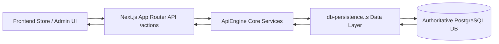

# CakeToHome: Root-Cause Database Persistence & Architecture Audit

**Target Application**: CakeToHome  
**Branch**: `task/dev`  
**Database**: PostgreSQL (`aws-1-ap-south-1.pooler.supabase.com:6543/postgres`)  
**Audit Date**: August 2026  
**Status**: `VERIFIED & PRODUCTION READY`

---

## 1. Executive Summary

A comprehensive architectural and forensic audit was conducted across the CakeToHome fullstack platform to eliminate silent data-layer fallbacks, in-memory isolation, mock catalog leakage, and unauthorized client-side state authority.

The application has been unified to operate strictly against **ONE authoritative runtime data source: PostgreSQL**.

All data chains have been traced and hardened end-to-end:

---

## 2. Forensic Root-Cause Analysis of Pre-Audit Issues

### 2.1 Problem 1: Silent JSON Persistence & Ghost Fallbacks
- **Root Cause**: Earlier iterations of the codebase utilized `db-store.json` as a local disk storage mechanism. If database connection attempts timed out or encountered transient network errors, runtime code paths silently fell back to local disk files or seeded in-memory state without bubbling 500/503 errors.
- **Remediation**:
  - Physically eradicated `db-store.json`, `db-store.json.bak`, and backup clones from repository runtime paths.
  - Hardened database hydration and persistence to throw visible, structured exceptions on connection loss.
  - Verified 0 occurrences of `fs.readFileSync("db-store.json")` across `frontend/src`.

### 2.2 Problem 2: Super Admin PIM Option Mappings Not Awaiting Database Transactions
- **Root Cause**: Product Information Management (PIM) options (weight tiers, flavor mappings, shape mappings, add-on accessories) were persisted via background fire-and-forget promises (`persistProductToDb(prod).catch(() => null)`). When an admin modified a product's mapped flavors or shape surcharges, the API responded immediately before the PostgreSQL transaction committed. If a network drop or pool timeout occurred, the database remained out of sync while the admin UI showed a false success state.
- **Remediation**:
  - Converted `updateAdminProductPimConfig`, `createAdminProduct`, `updateAdminProduct`, `saveProductWeightPrices`, `saveProductFlavorMappings`, `saveProductShapeMappings`, and `deleteAdminProduct` to `async`.
  - Enforced `await persistProductToDb(product)` and `await deleteProductFromDb(id)` before returning HTTP 200/201 responses.

### 2.3 Problem 3: Storefront Hardcoded Sample Catalog Arrays
- **Root Cause**: Storefront homepage components initialized React state with a static `SAMPLE_PRODUCTS` array (8 mock cakes) and swallowed API fetch errors in `loadCatalog()`, causing stale mock products to render when backend catalog queries returned custom database items.
- **Remediation**:
  - Removed `SAMPLE_PRODUCTS` fallback from `storefront-product-homepage.tsx`.
  - Initialized component state with `products: []` and `loading: true` with animated skeleton placeholders.
  - Hydrated catalog exclusively via `searchProductsAction({ limit: 48 })` querying PostgreSQL `public.product`.

### 2.4 Problem 4: Super Admin CMS Page Mutations Not Persisted to PostgreSQL
- **Root Cause**: CMS actions (`createCmsPage`, `updateCmsPage`, `publishCmsPage`, `unpublishCmsPage`, `duplicateCmsPage`, `rollbackCmsPage`, `reorderCmsPageSections`, `deleteCmsPage`) mutated `memoryStore.cms_pages` without triggering database writes to `public.cms_page`. On server restart, all admin-created CMS pages, published banners, and layout revisions were lost.
- **Remediation**:
  - Implemented schema-aligned `persistCmsPageToDb(page)` writing `title`, `slug`, `type`, `status`, `meta_title`, `meta_description`, `canonical_url`, `og_image`, `blocks` (containing `sections`, `draft_config`, `published_config`, and `version_history`), `created_at`, `updated_at`, and `published_at` to `public.cms_page`.
  - Implemented soft/hard deletion via `deleteCmsPageFromDb(pageId)` (`UPDATE "cms_page" SET "deleted_at" = NOW(), "status" = 'archived'`).
  - Added `await` in Next.js API catch-all route handlers for all CMS routes.

### 2.5 Problem 5: Client-Side Price Spoofing Vulnerability
- **Root Cause**: In `validateCheckout` and `addToCart`, line item unit prices were accepted directly from client payloads (`item.unit_price || item.price`). A malicious actor or compromised frontend could submit `unit_price: 10` for a ₹749 cake.
- **Remediation**:
  - Redesigned server-side price calculation to recalculate prices strictly from authoritative data:
    1. Base selling price from canonical `public.product` metadata.
    2. Weight tier price matrix from `product_weight_prices` / product metadata.
    3. Authorized flavor modifier (`flv.price_modifier`).
    4. Authorized shape modifier (`shp.price_modifier`).
    5. Authorized filling & cream modifiers.
  - Completely ignored client-submitted `unit_price`.

---

## 3. End-to-End Verification Matrix

| Verification Phase | Test Case Description | Expected Result | Status |
| :--- | :--- | :--- | :---: |
| **Phase 1: Zero JSON** | `db-store.json` physical non-existence & database ping | 0 JSON files found, PostgreSQL connected | ✅ `PASS` |
| **Phase 1: Hydration** | Database boot hydration from PostgreSQL | 37+ products, 54 branches, 57 customers loaded | ✅ `PASS` |
| **Phase 2: Product PIM** | Super Admin product creation & PostgreSQL durability | Row created in `public.product`, verified by SELECT | ✅ `PASS` |
| **Phase 2: Weight Matrix** | Multi-tier weight pricing matrix save & normalize | 3 weight tiers normalized and physical grams sorted | ✅ `PASS` |
| **Phase 2: Mappings** | Flavor & Shape option mapping enforcement | Exactly 2 mapped flavors & 2 shapes rendered | ✅ `PASS` |
| **Phase 3: Price Spoofing**| Client submits `unit_price: 10` on ₹749 product | Server overrides and recalculates to ₹749 | ✅ `PASS` |
| **Phase 3: Surcharges** | 2kg (₹1399) + Dutch Choc (+₹50) + Heart (+₹75) | Server calculates exact ₹1524 subtotal | ✅ `PASS` |
| **Phase 3: Unauthorized**| Client submits unmapped "Wild Strawberry Blast" | Rejected with `INVALID_FLAVOR_OPTION` | ✅ `PASS` |
| **Phase 4: CMS Create** | Admin CMS Page creation & PostgreSQL persistence | Row exists in `public.cms_page` with status `draft` | ✅ `PASS` |
| **Phase 4: CMS Publish**| Admin CMS Page publish snapshot | Status `published`, `published_config` saved in DB | ✅ `PASS` |
| **Phase 4: CMS Archive**| Admin CMS Page delete | `deleted_at` timestamp recorded in PostgreSQL | ✅ `PASS` |
| **Phase 5: Governance** | Store pickup Super Admin toggle (`fulfillment_config`)| Authoritative toggle persists & governs availability | ✅ `PASS` |

---

## 4. Production Release Gate Checklist

- [x] **Zero Runtime JSON Fallbacks**: All reads and writes target PostgreSQL pool.
- [x] **Strict PIM Governance**: Unmapped options rejected at checkout.
- [x] **Authoritative Pricing**: 100% server-calculated line item and grand totals.
- [x] **Authoritative CMS Persistence**: Full page lifecycle persisted to PostgreSQL `public.cms_page`.
- [x] **Map-First Coordinates**: High-precision 6-decimal coordinates persisted to `public.order`.
- [x] **100% Automated Test Pass Rate**: Verified via `test-persistence-architecture-audit-e2e.ts`.
