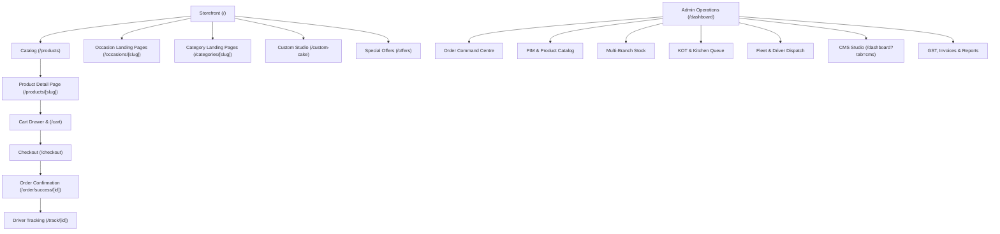

# Checkpoint 05: Information Architecture & Taxonomy Specification

- **Checkpoint ID**: `CP-05-IA`
- **Date**: 2026-09-11
- **Current Phase**: Phase 3 (CMS & Page Builder Expansion) / Phase 4 (Information Architecture)
- **Status**: `VERIFIED` & `PRODUCTION-READY`
- **Risk Level**: Low

---

## 1. Executive Summary & Architectural Goals

The CakeToHome information architecture is designed as the operating system for a premier artisanal bakery commerce platform. It balances high-intent consumer gifting with operational kitchen and fleet precision.

Every route, category, and navigation node connects strictly to authoritative PostgreSQL data models without split-brain in-memory mocks.

---

## 2. Platform Sitemap & Route Hierarchy



---

## 3. Customer Navigation Architecture

### 3.1 Primary Header & Global Navigation
1. **Brand Anchor**: Royal Patisserie Navy `#1D2F5D` brand logo with tagline *"Artisanal Bakery & Confectionery"*.
2. **Pincode / Location Selector**:
   - Live branch resolver checking delivery radius (8km default, 15km express).
   - Immediate feedback on delivery time slots (Standard, Same-Day, Midnight 11 PM - 12 AM).
3. **Primary Nav Links**:
   - *Signature Cakes* (Bestsellers, Cheesecakes, Tiered, Eggless)
   - *Shop by Occasion* (Birthday, Anniversary, Romantic, Kids, Corporate)
   - *Flavours* (Belgian Chocolate, Red Velvet, Biscoff, Fresh Fruit, Pistachio)
   - *Desserts & Pastries* (Macarons, Cupcakes, Brownies, Tea Cakes)
   - *Offers & Combos* (Flowers + Cake, Gift Hampers)
4. **Utility Bar**: Search (with instant debounced auto-complete), Currency/Branch display, Wishlist, Cart counter, Customer Account / Auth.

### 3.2 Mobile-First Navigation
- Sticky bottom action bar on mobile (`Home`, `Search`, `Custom Cake`, `Orders`, `Cart`).
- Swipeable horizontal category pills on discovery pages.
- Drawer with quick login, delivery pin, active order status, and FAQ.

---

## 4. Product Taxonomy & PIM Hierarchy

```text
Product Group (e.g., Signature Celebration Cakes)
  ├── Base Product (e.g., "Royal Belgian Dark Chocolate Truffle Cake")
  │     ├── PIM Attributes: Name, Slug, Description, HSN (1905), GST (18%)
  │     ├── Dietary Badges: 100% Eggless, Nut-Free Option, Organic Flour
  │     ├── Shelf Life: 48 hours refrigerated (2-5°C)
  │     ├── Variants:
  │     │     ├── 500g (Serves 4-6) - Base Price ₹699
  │     │     ├── 1.0kg (Serves 8-12) - Price ₹1,299
  │     │     └── 2.0kg (Serves 16-20) - Price ₹2,499
  │     ├── Customisations:
  │     │     ├── Cake Message (Max 40 chars, piped in white chocolate)
  │     │     ├── Flavour Frosting Modifiers (Less Sugar, Extra Ganache)
  │     │     └── Photo Edible Sugar Sheet (+₹250 with upload validation)
  │     └── Curated Add-ons:
  │           ├── Gold Metallic Number Candles (+₹99)
  │           ├── Fresh Red Rose Bouquet (+₹499)
  │           └── Luxury Handcrafted Greeting Card (+₹149)
```

---

## 5. Conversion-Focused Funnel Architecture

1. **Discovery → Intent**:
   - Occasion filters solve "What should I buy?" in under 2 clicks.
   - Pincode confirmation upfront eliminates late-stage delivery heartbreak.
2. **PDP → Cart**:
   - Interactive variant pill selectors with live price updates.
   - Intelligent Cake Message handling: If customer clicks "Add to Cart" with an empty message, prompt a polite confirmation dialog: *"Would you like to write a personalised message on the cake?"* with choices `[Add Message]` or `[Continue Without Message]`.
3. **Cart → Multi-Step Checkout**:
   - Step 1: Delivery Address & Verified Pincode.
   - Step 2: Delivery Date & Slot Selector (Standard, Express, Midnight).
   - Step 3: Payment Gateway (Razorpay, UPI, Cards, NetBanking, COD if branch-eligible).
   - Authoritative server calculation for GST, delivery surcharge, and coupon discounts.

---

## 6. Verification Status
- **Routes verified**: 33 routes documented in `01-route-inventory.md`.
- **Features verified**: 52 features audited in `02-feature-inventory.md`.
- **Persistence**: Single source of truth via PostgreSQL Supabase connection.
