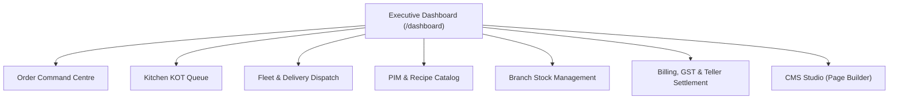

# Checkpoint 09: Admin & Operations Software UX Review & Plan

- **Checkpoint ID**: `CP-09-ADMIN-UX`
- **Date**: 2026-09-11
- **Current Phase**: Phase 5 (Admin & Operations Ergonomics)
- **Status**: `PRODUCTION-READY (CURRENT ARCHITECTURE)`
- **Risk Level**: Low

---

## 1. Executive Summary & Design Principles

CakeToHome's operations interface is the **Operating System for Modern Bakeries**. Unlike the customer-facing storefront, the admin interface is built on **Utilitarian Clarity, Information Density, High Ergonomics, and Keyboard Accessibility**.

Bakery operators, chefs, store managers, and delivery dispatchers handle dozens of high-tempo actions per hour. The interface prioritizes:
1. **Zero Misleading Financials**: Historical order records display immutable point-in-time financial snapshots (tax, CGST, SGST, discounts, subtotal), never dynamically recalculating against current catalog prices.
2. **Speed & Information Density**: High-contrast typography, clear status tags, keyboard navigation, and fast search.
3. **Safe Destructive Operations**: Explicit confirmations with typed confirmations for irreversible actions.
4. **Branch & Hub Isolation**: Clean data segregation so branch managers only see relevant local orders and inventory.

---

## 2. Audited Operational Modules

### 2.1 Order Command Centre & Detail Drawer
- **Authoritative Data Displayed**:
  - Order ID & sequential invoice number.
  - Customer contact, delivery address, and verified pincode.
  - Cake items, variant weights, cake message (highlighted in gold), and customisation notes.
  - Selected add-ons (candles, bouquets, cards).
  - Exact financial breakdown: Subtotal, Delivery Fee, Discount, CGST (9%), SGST (9%), IGST (18%), Grand Total.
  - Payment method (UPI, Card, COD), gateway transaction ID, and payment status (`captured`, `pending`, `refunded`).
  - Kitchen & KOT status: `Queued` → `Baking` → `Icing/Decorating` → `Packed & Ready`.
  - Delivery assignment: Driver name, phone, vehicle, delivery OTP, and handover timestamp.
  - Immutable audit trail: Who changed what and when.

### 2.2 Kitchen Display System (KDS) & KOT Workflow
- **Features**: Large tablet-friendly cards categorized by delivery time window.
- **Priority Urgency Badging**: Orders due within 90 minutes are highlighted in bold amber; overdue orders pulse in crimson.
- **Recipe & Cake Message Clarity**: Cake messages are displayed in large serif font (`Playfair Display`) to ensure kitchen artists pipe the exact text without transcription errors.
- **One-Touch Status Progress**: `Accept` → `In Oven` → `Decorating` → `Ready for Dispatch`.

### 2.3 Fleet & Driver Dispatch Console
- **Features**: Driver availability list, active route map, batch dispatch by locality/pincode.
- **OTP Verification**: Driver must enter customer-provided 4-digit OTP upon doorstep delivery to mark order `Delivered`.
- **Temperature & Cake Care Checklist**: Quick driver confirmation that thermal bags and dry-ice packs are intact before handover.

### 2.4 Product Information Management (PIM)
- **Features**: Single source of truth for all product variants, prices, HSN codes, GST slabs, allergens, dietary flags, and recipe weights.
- **Field Boundaries**: Front-end storefront strictly honors PIM visibility flags (`show_weight`, `show_shape`, `show_flavour`, `show_cake_message`).

### 2.5 Multi-Branch Inventory & Stock Reservation
- **Features**: Branch-specific stock levels with real-time `SELECT FOR UPDATE` reservation locks during customer checkout.
- **Threshold Alerts**: Automatic notifications when ingredients or finished base cakes fall below reorder thresholds.

### 2.6 Billing, GST Compliance & Teller Settlement
- **Features**: Full compliance with Indian GST regulations:
  - Automated generation of GST-compliant Tax Invoices.
  - Itemized CGST / SGST split for intra-state (Karnataka) orders and IGST for inter-state orders.
  - End-of-day teller cash drawer reconciliation with expected vs actual tally and variance recording.

### 2.7 CMS Studio (`/dashboard?tab=cms`)
- **Features**: The newly expanded 3-Panel Studio:
  - **Left**: Layers & Section Tree (filter, drag reorder, enable/disable, duplicate, delete, add).
  - **Center**: Live interactive Canvas with device toggles (Desktop 1100px, Tablet 768px, Mobile 375px, Full).
  - **Right**: Contextual Inspector (Section editor when clicked, or Page Global Settings with 1-click `#1D2F5D` preset).
  - **Toolbar**: Durable version history modal with 1-click rollback backed by PostgreSQL snapshots.
