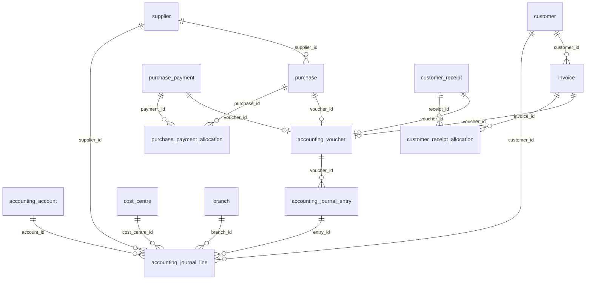
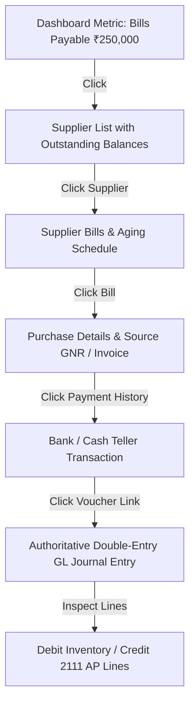
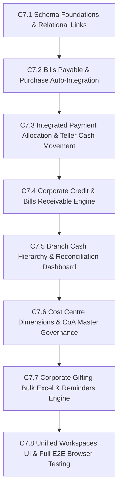

# CAKETOHOME ERP — PHASE C7 FORENSIC INSPECTION & ARCHITECTURE LOCK
**Milestone**: Phase C7 — Party Accounting, Bills Payable/Receivable, Integrated Settlement, Branch Cash & Cost Centres  
**Date**: 2026-10-06  
**Status**: 🔒 ARCHITECTURE & FORENSIC INSPECTION LOCKED — AWAITING IMPLEMENTATION AUTHORIZATION  
**Operating Protocol**: Strictly Forensic & Architecture Lock Only. Zero Code Changes, Zero Migrations, Zero Schema Modifications. Database is the Only Source of Truth.

---

## 1. Executive Summary & Forensic Grounding

This document establishes the authoritative forensic findings, database facts, gap analysis, and comprehensive architectural design for **Phase C7** of the CakeToHome ERP. 

Phase C7 represents the architectural unification of previously isolated operational panels (Purchases, Retail Invoices, Teller Sessions, Expenses, Manual Journals) into a single, cohesive, server-authoritative double-entry accounting workflow:

$$\begin{aligned}
\text{Source Transaction} &\longrightarrow \text{Accounting Posting} \longrightarrow \text{General Ledger} \longrightarrow \text{Party Subledger} \\
&\longrightarrow \text{Bills Payable / Receivable} \longrightarrow \text{Cash / Bank / Teller} \longrightarrow \text{Branch} \\
&\longrightarrow \text{Cost Centre} \longrightarrow \text{Dashboard} \longrightarrow \text{Audit Drill-Down}
\end{aligned}$$

### Predecessor Milestone Invariants (Frozen & Protected)
- **Phase C6.4 Manual Journal UI**: Complete, frozen, and verified (44/44 Browser, 58/58 UI API).
- **Predecessor Regression Baseline**: 491/491 tests passing (100% success rate across C4.1, C5, C6.1–C6.4).
- **PostgreSQL State**: Pristine baseline. Exactly 100 accounts in Chart of Accounts, 0 orphan journal entries/lines, 0 lingering test vouchers/entities, 0 blocked DB locks, Trial Balance strictly balanced at $\text{Dr } ₹3,380.00 = \text{Cr } ₹3,380.00$.

---

## 2. Existing Implementation Inventory

A rigorous forensic audit of the codebase (`frontend/src`) reveals the following components and operational responsibilities:

| Subsystem / Service | Source File | Current Operational Responsibility |
| :--- | :--- | :--- |
| **AccountsPayableService** | [`accounts-payable.service.ts`](file:///e:/vig/cakes2home-main/cakes2home-main/frontend/src/lib/services/accounts-payable.service.ts) | Computes AP subledger statements and dynamic AP aging by aggregating from `accounting_journal_line` (Account `2111`) and `purchase`. Generates aging buckets (Current, 1-30, 31-60, 61-90, 90+). |
| **PurchasePaymentService** | [`purchase-payment.service.ts`](file:///e:/vig/cakes2home-main/cakes2home-main/frontend/src/lib/services/purchase-payment.service.ts) | Executes atomic disbursements against purchases. Posts $\text{Dr } 2111 \text{ AP} / \text{Cr } 1111 \text{ Cash or } 1112 \text{ Bank}$. Enforces concurrency control via `pg_advisory_xact_lock(purchase_id)`. |
| **PurchasePostingService** | [`purchase-posting.service.ts`](file:///e:/vig/cakes2home-main/cakes2home-main/frontend/src/lib/services/purchase-posting.service.ts) | Stage-2 atomic posting of purchase receipts. Debits inventory accounts (`1131`, `1132`, `1133`), debits input GST (`1141`–`1144`), debits freight (`5240`), and credits Accounts Payable (`2111`). |
| **PurchaseService** | [`purchase.service.ts`](file:///e:/vig/cakes2home-main/cakes2home-main/frontend/src/lib/services/purchase.service.ts) | Purchase order lifecycle management (`DRAFT` $\rightarrow$ `SUBMITTED` $\rightarrow$ `APPROVED` $\rightarrow$ `POSTED` $\rightarrow$ `CANCELLED`). |
| **AccountsReceivableService** | [`accounts-receivable.service.ts`](file:///e:/vig/cakes2home-main/cakes2home-main/frontend/src/lib/services/accounts-receivable.service.ts) | Computes customer subledger statements over Account `1121`. Contains an explicit code guard: *AR Aging is EXPLICITLY FEATURE-BLOCKED pending authoritative due-date policy approval*. |
| **CustomerReceiptService** | [`customer-receipt.service.ts`](file:///e:/vig/cakes2home-main/cakes2home-main/frontend/src/lib/services/customer-receipt.service.ts) | Retail B2C customer receipt processing. Credits `1121` AR, debits `1113` Gateway Clearing or `1122` Undeposited COD. |
| **TellerSessionService** | [`teller-session.service.ts`](file:///e:/vig/cakes2home-main/cakes2home-main/frontend/src/lib/services/teller-session.service.ts) | Cash custody, opening float, teller movements (`teller_movement`), closing count, cash shortage/excess (`5296`), and C4.1 settlement voucher generation. |
| **BankAccountService** | [`bank-account.service.ts`](file:///e:/vig/cakes2home-main/cakes2home-main/frontend/src/lib/services/bank-account.service.ts) | Company bank master. Maps bank accounts 1:1 to dedicated leaf GL accounts under control account `1112`. |
| **ExpensePostingService** | [`expense-posting.service.ts`](file:///e:/vig/cakes2home-main/cakes2home-main/frontend/src/lib/services/expense-posting.service.ts) | Operational expense posting with direct cash drawer movements and configured bank accounts (Phase C5). |
| **PostingService** | [`posting.service.ts`](file:///e:/vig/cakes2home-main/cakes2home-main/frontend/src/lib/services/posting.service.ts) | Canonical double-entry GL posting engine. Validates fiscal periods, accounting start date, currency (INR), and balanced debits/credits. |
| **BankStatementImportService** | [`bank-statement-import.service.ts`](file:///e:/vig/cakes2home-main/cakes2home-main/frontend/src/lib/services/bank-statement-import.service.ts) | Multi-format statement ingestion (CSV, MT940, OFX) with SHA-256 deduplication and atomic database transactions. |

---

## 3. Database Inventory (Live PostgreSQL Facts)

A direct, read-only inspection of the live PostgreSQL database revealed the following structural facts:

```
Total Public Base Tables: 314
Public Base Tables Relevant to Accounting & Parties: 16
Live Chart of Accounts Count: Exactly 100 accounts (0 modified)
Active Blocked DB Locks: 0
Trial Balance: Dr ₹3,380.00 === Cr ₹3,380.00 (Diff: ₹0.0000)
```

### Table Structure & Cardinality Analysis

1. **`accounting_account` (100 rows)**:
   - Key control accounts verified:
     - `1111` Cash in Hand (Leaf, Asset)
     - `1112` Bank Operating A/c (Group, Asset)
     - `1113` Gateway Clearing A/c (Leaf, Asset)
     - `1114` Petty Cash - Branches (Leaf, Asset)
     - `1121` Accounts Receivable (Leaf, Asset)
     - `1122` Undeposited COD Collections (Leaf, Asset)
     - `1131` Merchandise Inventory - Accessories (Leaf, Asset)
     - `1132` Merchandise Inventory - Cakes (Leaf, Asset)
     - `1133` Packaging Supplies Stock (Leaf, Asset)
     - `1141`–`1144` Input Tax Accounts (Leaf, Asset)
     - `2111` Accounts Payable (Leaf, Liability)
     - `3300` Opening Balance Offset (Leaf, Equity)
     - `5110` COGS - Cakes (Leaf, Expense)
     - `5120` COGS - Accessories (Leaf, Expense)
     - `5240` Freight & Cartage Inward (Leaf, Expense)
     - `5280` Software & Tech Infrastructure (Leaf, Expense)
     - `5296` Cash Over/Short (Leaf, Expense)
   - **Crucial Invariants**: Account `5150` DOES NOT EXIST. Account `2119` DOES NOT EXIST. Account code field is `code`, subtype field is `subtype`.

2. **`accounting_journal_line` (10 rows)**:
   - Columns: `id`, `journal_entry_id`, `account_id`, `debit_amount`, `credit_amount`, `narration`, `branch_id`, `supplier_id`, `customer_id`, `metadata`.
   - **Foreign Keys**: `supplier_id -> supplier(id)` and `customer_id -> customer(id)` are **already present and enforced** in PostgreSQL!
   - Missing dimension: `cost_centre_id` is NOT present.

3. **`purchase` (0 rows)**:
   - Columns: `id`, `supplier_id`, `branch_id`, `invoice_no`, `invoice_date`, `subtotal`, `discount`, `taxable_value`, `cgst`, `sgst`, `igst`, `total`, `payment_method`, `credit_terms_days`, `due_date`, `status`, `created_by`, `approved_by`, `posted_at`, `metadata`.
   - **Gaps**: Lacks explicit foreign keys for `voucher_id`, `bank_account_id`, and `teller_session_id`.

4. **`purchase_payment` (0 rows)**:
   - Columns: `id`, `purchase_id`, `amount`, `method`, `payment_date`, `reference`, `created_by`, `created_at`, `updated_at`, `deleted_at`.
   - **Gaps**: Lacks foreign keys for `voucher_id`, `bank_account_id`, `teller_session_id`, and `branch_id`. Multi-bill payment allocations cannot be represented without separate allocation rows.

5. **`invoice` (5 rows)**:
   - Columns: `id`, `invoice_number`, `order_id`, `branch_id`, `customer_id`, `customer_name`, `customer_phone`, `subtotal`, `tax_total`, `delivery_fee`, `discount_total`, `grand_total`, `currency_code`, `payment_method`, `payment_status`, `status`, `metadata`.
   - **Gaps**: Lacks `due_date`, `paid_amount`, `outstanding_amount`, and `voucher_id`. It is strictly a B2C retail invoice today.

6. **`customer` (57 rows)**:
   - Columns: `id`, `company_name`, `first_name`, `last_name`, `email`, `phone`, `has_account`, `metadata`, `created_at`, `updated_at`, `deleted_at`, `created_by`.
   - **Gaps**: Lacks structured corporate credit fields (`credit_enabled`, `credit_limit`, `payment_terms_days`, `gstin`, `credit_balance`).

7. **`branch` (57 rows)**:
   - 57 operational branches exist. **NO "Head Office" branch exists**. Head Office is currently unrepresented as an accounting branch/entity.

8. **`teller_session` (0 rows) & `teller_movement` (0 rows)**:
   - Teller session tracks cash custody (`opening_float`, `expected_cash`, `closing_count`, `variance`).
   - `teller_session.settlement_voucher_id` links to `accounting_voucher(id)`.
   - `teller_movement` tracks physical cash movements with `source_type` and `source_id`.

9. **Cost Centres**:
   - **Zero** cost centre tables, columns, or foreign keys exist in PostgreSQL.

---

## 4. Gap Analysis: What Already Exists vs. What is Incomplete

```
+------------------------------------+--------------------------+---------------------------------+
| Architectural Area                 | What Already Exists      | What is Missing / Incomplete    |
+------------------------------------+--------------------------+---------------------------------+
| AP Subledger (Account 2111)        | Journal lines have       | No dedicated Bill Ledger;       |
|                                    | supplier_id FK; AP aging | purchase_payment lacks voucher  |
|                                    | dynamically calculated   | and bank/teller FKs             |
+------------------------------------+--------------------------+---------------------------------+
| AR Subledger (Account 1121)        | Journal lines have       | AR aging feature-blocked;       |
|                                    | customer_id FK;          | No corporate credit fields;     |
|                                    | B2C receipts to 1113/1122| No B2B Receive Payment workflow |
+------------------------------------+--------------------------+---------------------------------+
| Purchase -> Accounting             | Stage-2 PostingService   | Cash purchases do not trigger   |
| Integration                        | debits inv/GST, credits  | teller_movement in active drawer|
|                                    | 2111 AP                  |                                 |
+------------------------------------+--------------------------+---------------------------------+
| Branch Cash Hierarchy             | GL Account 1111 per      | No Head Office branch entity;   |
|                                    | branch; C4.1 Teller      | No unified company dashboard    |
|                                    | Session tracking         | reconciling GL 1111 with drawers|
+------------------------------------+--------------------------+---------------------------------+
| Cost Centres                       | None                     | Completely absent from schema;  |
|                                    |                          | Needs dimension model, not CoA  |
+------------------------------------+--------------------------+---------------------------------+
| Chart of Accounts Master           | 100 accounts locked in   | No administration API or UI;    |
| Administration                     | DB; Group/Leaf rules     | Cannot safely add leaf accounts |
+------------------------------------+--------------------------+---------------------------------+
| Payment Reminders                  | Ad-hoc CRM customer      | No due-date / overdue reminder  |
|                                    | follow-up reminders      | engine for AP or AR             |
+------------------------------------+--------------------------+---------------------------------+
| Corporate Gifting Bulk Engine      | Excel export (exceljs);  | No corporate channel; no bulk   |
|                                    | Bank statement import SHA| gifting template, upload or     |
|                                    | validation engine        | schedule validation             |
+------------------------------------+--------------------------+---------------------------------+
```

---

## 5. What Can Be Reused vs. What Requires Extension

### 5.1 Reusable Components (Unchanged)
1. **`PostingService`**: The canonical posting engine remains the sole authority for inserting into `accounting_voucher`, `accounting_journal_entry`, and `accounting_journal_line`.
2. **`accounting_journal_line.supplier_id` & `.customer_id`**: Subledger party foreign keys are already live in PostgreSQL. All subledger queries will directly read these columns.
3. **`pg_advisory_xact_lock` Concurrency Pattern**: Established in `PurchasePaymentService` to prevent double-spending on bills and payments.
4. **`TellerSessionService` Invariants**: The formula $\text{Expected Cash} = \text{Opening Float} + \sum \text{Movements (IN)} - \sum \text{Movements (OUT)}$ is preserved 100%. Opening floats never create GL entries. Shortages/excesses post to `5296 Cash Over/Short` upon session close.
5. **Bank Master Resolution**: `BankAccountService` mapping bank records 1:1 to leaf GL accounts under `1112`.

### 5.2 Components Requiring Extension
1. **`purchase` Entity**:
   - Add `voucher_id` linking to `accounting_voucher(id)` so posted purchases directly point to their GL voucher.
2. **`purchase_payment` Entity**:
   - Add `voucher_id` (FK to `accounting_voucher`), `bank_account_id` (FK to `bank_account`), `teller_session_id` (FK to `teller_session`), and `branch_id` (FK to `branch`).
3. **`customer` Entity**:
   - Add corporate credit fields (`is_corporate`, `credit_enabled`, `credit_limit`, `payment_terms_days`, `gstin`, `credit_balance`).
4. **`invoice` Entity**:
   - Add `due_date`, `paid_amount`, `outstanding_amount`, `voucher_id`, and `is_corporate`.
5. **`AccountsReceivableService`**:
   - Remove the feature block on AR aging. Calculate aging dynamically for corporate customers based on authoritative invoice and receipt allocations.
6. **`teller_movement`**:
   - Add `PURCHASE_PAYMENT` and `B2B_RECEIPT` to the enum of recognized movement types.

---

## 6. Schema Requirements (New & Extended)

To maintain database integrity without duplicate data stores, the schema design introduces **zero parallel payable/receivable databases**. Instead, it adds missing relational links, allocation tracking, and cost centre dimensions.



### 6.1 Proposed Tables & Modifications (Design Only — No DDL Executed)

#### A. Cost Centre Dimension (`cost_centre`)
```sql
CREATE TABLE public.cost_centre (
  id TEXT PRIMARY KEY,
  code VARCHAR(50) UNIQUE NOT NULL,
  name VARCHAR(255) NOT NULL,
  department VARCHAR(100) NOT NULL, -- 'HEAD_OFFICE', 'MARKETING', 'HR', 'SALARY', 'OPERATIONS', 'BRANCH'
  branch_id TEXT REFERENCES public.branch(id), -- Optional branch attribution
  is_active BOOLEAN NOT NULL DEFAULT true,
  metadata JSONB,
  created_at TIMESTAMPTZ NOT NULL DEFAULT NOW(),
  updated_at TIMESTAMPTZ NOT NULL DEFAULT NOW()
);

-- Add dimension to journal line (Nullable for backward compatibility)
ALTER TABLE public.accounting_journal_line 
ADD COLUMN cost_centre_id TEXT REFERENCES public.cost_centre(id);

ALTER TABLE public.accounting_voucher 
ADD COLUMN cost_centre_id TEXT REFERENCES public.cost_centre(id);
```

#### B. Payment Allocations (Many-to-Many Partial/Full Bill Settlement)
```sql
-- AP Payment Allocation: Allows 1 payment to settle N purchases, or N payments on 1 purchase
CREATE TABLE public.purchase_payment_allocation (
  id TEXT PRIMARY KEY,
  payment_id TEXT NOT NULL REFERENCES public.purchase_payment(id) ON DELETE RESTRICT,
  purchase_id TEXT NOT NULL REFERENCES public.purchase(id) ON DELETE RESTRICT,
  allocated_amount NUMERIC(15, 2) NOT NULL CHECK (allocated_amount > 0),
  created_at TIMESTAMPTZ NOT NULL DEFAULT NOW()
);

-- AR Receipt Allocation: Allows 1 customer receipt to settle N invoices
CREATE TABLE public.customer_receipt_allocation (
  id TEXT PRIMARY KEY,
  receipt_id TEXT NOT NULL, -- references customer_receipt or payment_transaction
  invoice_id TEXT NOT NULL REFERENCES public.invoice(id) ON DELETE RESTRICT,
  allocated_amount NUMERIC(15, 2) NOT NULL CHECK (allocated_amount > 0),
  created_at TIMESTAMPTZ NOT NULL DEFAULT NOW()
);
```

#### C. Corporate Credit Fields on `customer`
```sql
ALTER TABLE public.customer
ADD COLUMN is_corporate BOOLEAN NOT NULL DEFAULT false,
ADD COLUMN credit_enabled BOOLEAN NOT NULL DEFAULT false,
ADD COLUMN credit_limit NUMERIC(15, 2) NOT NULL DEFAULT 0.00 CHECK (credit_limit >= 0),
ADD COLUMN payment_terms_days INTEGER NOT NULL DEFAULT 0 CHECK (payment_terms_days >= 0),
ADD COLUMN gstin VARCHAR(15),
ADD COLUMN credit_balance NUMERIC(15, 2) NOT NULL DEFAULT 0.00;
```

#### D. Corporate Gifting Batch & Recipient Schedule
```sql
CREATE TABLE public.corporate_gifting_batch (
  id TEXT PRIMARY KEY,
  customer_id TEXT NOT NULL REFERENCES public.customer(id),
  batch_name VARCHAR(255) NOT NULL,
  total_recipients INTEGER NOT NULL,
  total_amount NUMERIC(15, 2) NOT NULL,
  status VARCHAR(50) NOT NULL DEFAULT 'DRAFT', -- 'DRAFT', 'VALIDATED', 'SCHEDULED', 'PROCESSING', 'COMPLETED'
  file_hash VARCHAR(64) NOT NULL,
  created_by TEXT NOT NULL REFERENCES public.user(id),
  created_at TIMESTAMPTZ NOT NULL DEFAULT NOW()
);

CREATE TABLE public.corporate_gifting_recipient (
  id TEXT PRIMARY KEY,
  batch_id TEXT NOT NULL REFERENCES public.corporate_gifting_batch(id),
  employee_id VARCHAR(100),
  recipient_name VARCHAR(255) NOT NULL,
  recipient_phone VARCHAR(50) NOT NULL,
  delivery_address TEXT NOT NULL,
  delivery_date DATE NOT NULL,
  product_id TEXT NOT NULL,
  quantity INTEGER NOT NULL DEFAULT 1,
  order_id TEXT REFERENCES public.order(id),
  status VARCHAR(50) NOT NULL DEFAULT 'PENDING'
);
```

---

## 7. Service Architecture

The business logic is organized into clean, single-responsibility services adhering to Hexagonal / Clean Architecture:

```
src/lib/services/
├── accounts-payable.service.ts       (Existing - Subledger 2111 queries)
├── accounts-receivable.service.ts    (Existing - Subledger 1121 queries)
├── bills-payable.service.ts          (NEW - Authoritative AP Bill lifecycle & Pay Bill)
├── bills-receivable.service.ts       (NEW - Corporate AR Bill lifecycle & Receive Payment)
├── branch-cash-control.service.ts    (NEW - Head Office & Branch Cash-in-Hand aggregation)
├── cost-centre.service.ts            (NEW - Cost Centre master and dimension queries)
├── chart-of-accounts-master.service.ts (NEW - Controlled CoA creation & governance)
├── corporate-gifting.service.ts      (NEW - Corporate gifting bulk import & scheduling)
├── payment-reminder.service.ts       (NEW - AP & AR due date reminder engine)
└── posting.service.ts                (Existing canonical posting engine)
```

### 7.1 Service Responsibilities & Workflows

#### 1. `BillsPayableService`
- **Queries**: Fetches open bills from `purchase` where `status = 'POSTED'` with balance calculated as $\text{Total} - \sum \text{Allocations} - \sum \text{Returns}$. Computes aging buckets ($<0$ Overdue, 0-30, 31-60, 61-90, 90+ days).
- **`payBill(params)`**:
  1. Validates payment amount $\le \text{Outstanding Balance}$ of target bill(s). (Overpayment rejected).
  2. Acquires row lock via `pg_advisory_xact_lock(purchase_id)`.
  3. If payment method is `CASH`:
     - Resolves active `teller_session` for user's branch. If no open session, rejects transaction.
     - Creates `teller_movement` ($\text{direction} = \text{'OUT'}$, $\text{type} = \text{'PURCHASE_PAYMENT'}$, $\text{amount}$).
     - Credits GL Account `1111 Cash in Hand`.
  4. If payment method is `BANK`:
     - Resolves active `bank_account` and its linked GL leaf account under `1112`.
     - Credits resolved Bank GL Account.
  5. Debits GL Account `2111 Accounts Payable` with dimension `supplier_id = purchase.supplier_id` and optional `cost_centre_id`.
  6. Dispatches atomic posting through `PostingService.postVoucher()`.
  7. Inserts `purchase_payment` and `purchase_payment_allocation`.
  8. If balance reaches $0.00$, marks bill status as `FULLY_PAID`; if $> 0.00$, marks `PARTIALLY_PAID`.

#### 2. `BillsReceivableService`
- **Queries**: Fetches open invoices for corporate customers. Filters out normal B2C retail customers (retail credit strictly disabled).
- **`receivePayment(params)`**:
  1. Validates customer is corporate and credit-approved.
  2. Validates receipt amount $\le \text{Outstanding Balance}$ of target invoice(s).
  3. Debits resolved `bank_account` GL account under `1112` (or `1111` if cash teller receipt).
  4. Credits GL Account `1121 Accounts Receivable` with dimension `customer_id = invoice.customer_id`.
  5. Inserts `customer_receipt_allocation`.
  6. Decreases `customer.credit_balance` atomically.

#### 3. `BranchCashControlService`
- Authoritative calculation of company-wide cash in hand:
  $$\text{Total Company Cash} = \sum_{\text{branch}} \text{GL Balance of Account 1111 for that branch}$$
- Computes two reconcilable figures for every branch:
  1. **GL Cash Balance**: Sum of debits minus credits in `accounting_journal_line` for Account `1111` where `branch_id = X`.
  2. **Active Drawer Float**: Current physical cash in branch teller drawer (`opening_float` + net `teller_movement` for active sessions).
  3. **In-Transit / Unsettled Cash**: Difference between closed sessions not yet banked and GL petty cash accounts (`1114`).
- Produces dashboard view: Company Total + Branch A + Branch B + ... + Head Office.

#### 4. `CostCentreService`
- Cost centres are **financial dimensions**, NOT GL accounts.
- Pre-seeded departments:
  - `HEAD_OFFICE` (Executive, Finance, Compliance)
  - `MARKETING` (Digital Campaigns, Offline Promotions, Creative)
  - `HR` (Recruitment, Staff Welfare)
  - `SALARY` (Corporate Payroll, Branch Payroll)
  - `OPERATIONS` (Logistics, Central Kitchen, Fleet Maintenance)
  - `BRANCH` (Branch Storefront Operations)
- Validates that when an expense or journal line requires a cost centre, the selected `cost_centre_id` is active.

#### 5. `ChartOfAccountsMasterService`
- Protects the 100 system accounts from deletion, renaming, or code modification.
- Allows authorized users (`FINANCE_MANAGER`, `CHIEF_ACCOUNTANT`) to create new **leaf** accounts under existing group accounts.
- Enforces strict rules:
  1. Group accounts (e.g. `1000`, `1100`, `1110`, `2000`) can NEVER be postable.
  2. New accounts must specify an existing group parent.
  3. Account code must match parent numbering scheme (e.g., new bank account must be `1112xx`).
  4. Complete audit trail in `accounting_account_audit`.

---

## 8. API Architecture & Route Map

All endpoints follow RESTful conventions, require session authentication, and enforce branch isolation and RBAC:

```
POST   /api/v1/admin/accounting/payables/bills/search       -> Search open supplier bills & aging
POST   /api/v1/admin/accounting/payables/pay                -> Atomic Pay Bill allocation & GL posting
GET    /api/v1/admin/accounting/payables/history/:supplierId-> Supplier payment history & drill-down

POST   /api/v1/admin/accounting/receivables/bills/search    -> Search open corporate bills & aging
POST   /api/v1/admin/accounting/receivables/receive         -> Atomic Receive Payment allocation & GL posting
GET    /api/v1/admin/accounting/receivables/history/:custId -> Customer receipt history & drill-down

GET    /api/v1/admin/accounting/cash-in-hand                -> Company & Branch Cash Reconciliation
GET    /api/v1/admin/accounting/cost-centres                -> List cost centres
POST   /api/v1/admin/accounting/cost-centres                -> Create cost centre (Finance Manager only)

GET    /api/v1/admin/accounting/accounts/master             -> Hierarchical CoA tree with metadata
POST   /api/v1/admin/accounting/accounts/master             -> Create new leaf account

GET    /api/v1/admin/corporate/gifting/template             -> Download official Excel upload template
POST   /api/v1/admin/corporate/gifting/validate             -> Validate uploaded Excel batch (dry run)
POST   /api/v1/admin/corporate/gifting/import               -> Commit validated batch & schedule gifts

GET    /api/v1/admin/accounting/reminders                   -> Active due date & overdue payment reminders
```

---

## 9. Cash & Teller Integration (Branch Cash Controller)

### 9.1 Existing C4.1/C4.2 Teller Functionality: Kept 100% Intact
The existing C4.1/C4.2 Teller Cash Custody engine is NOT replaced. It remains the physical gatekeeper of cash drawers:
- Tellers open sessions with an `opening_float`. (No GL entry).
- Cash sales add `teller_movement` (`direction = 'IN'`).
- Cash expenses add `teller_movement` (`direction = 'OUT'`) and create Dr Expense / Cr 1111 GL vouchers.
- End-of-day closing count computes variance. Shortage/excess posts to `5296 Cash Over/Short` upon manager verification.

### 9.2 Purchase Cash Disbursement Extension
When a manager pays a supplier bill in cash:
1. System checks if there is an active `teller_session` for that branch.
2. If YES:
   - Records `teller_movement`:
     - `teller_session_id`: active session ID
     - `direction`: `OUT`
     - `movement_type`: `PURCHASE_PAYMENT`
     - `amount`: payment amount
     - `source_type`: `PURCHASE`
     - `source_id`: `purchase.id`
   - Decreases the expected cash of the teller drawer.
   - Posts GL: Dr 2111 Accounts Payable / Cr 1111 Cash in Hand.
3. If NO active teller session exists for that branch:
   - Direct cash disbursement from drawer is **BLOCKED**. The user is prompted: *"No active cash drawer open for branch. Open a teller session or disburse via Bank Transfer."*

### 9.3 Company Cash in Hand Dashboard
The dashboard displays:
- **Total Company Cash in Hand**: Authoritative GL sum of Account 1111 across all branches.
- **Branch Breakdown Cards**:
  - `Head Office`: Central vault / treasury cash.
  - `Branch 01`: Drawer Cash (Active) + Safe Float (Petty Cash `1114`).
  - `Branch 02`: Drawer Cash (Active) + Safe Float (Petty Cash `1114`).
- **Discrepancy Alarm**: If $\sum \text{Drawer Cash} \neq \text{GL 1111}$, an alert highlights unposted movements or unverified closing variances.

---

## 10. Cost Centre & Head Office Architecture

### 10.1 Avoiding Chart of Accounts Explosion
A fatal ERP anti-pattern is creating separate GL accounts for every department (e.g., `5211 Marketing Salary`, `5212 Branch A Salary`, `5213 Central Kitchen Salary`). This causes combinatorial explosion and breaks financial reporting.

**Architectural Lock**:
- The Chart of Accounts remains compact (100 core accounts).
- The Cost Centre is a **Dimension** on `accounting_journal_line` (`cost_centre_id`).
- When posting expenses, payroll, or overheads:
  - Account: `5210 Salaries & Wages` (Natural Account)
  - Cost Centre: `CC_MKT_01 Marketing` or `CC_OPS_BR01 Branch 01 Operations` (Dimension)
  - Branch: `BR_01` (Geographic Entity)

### 10.2 Head Office as the Control Centre
- PostgreSQL currently has 57 operational branches, but no `Head Office`.
- Architecture introduces `Head Office` as `branch.code = 'HO_CENTRAL'` with `is_head_office = true`.
- Central administrative expenses (executive salaries, server hosting `5280`, corporate marketing) are attributed to `branch_id = HO_CENTRAL` and their respective cost centres.

---

## 11. B2B Corporate Credit & Bulk Gifting Architecture

### 11.1 Strict Separation: Retail vs. Corporate
- **Retail Ecommerce Customers**: 100% advance payment (Gateway `1113`) or Cash on Delivery (`1122`). Credit terms are strictly disabled.
- **Corporate Customers**: Allowed credit terms (e.g., Net 30, Net 60) up to an approved `credit_limit`.
- Every corporate invoice checks:
  $$\text{Current Credit Balance} + \text{New Invoice Amount} \le \text{Credit Limit}$$
  If exceeded, order creation is blocked unless approved by `FINANCE_MANAGER`.

### 11.2 Bulk Corporate Gifting via Excel
1. **Template Generation**: Official Excel template provided via `/api/v1/admin/corporate/gifting/template` using `exceljs`.
   - Columns: `Employee_ID`, `Recipient_Name`, `Recipient_Phone`, `Delivery_Address`, `Delivery_Date`, `Product_SKU`, `Quantity`, `Gift_Message`, `Cost_Centre_Code`.
2. **Pre-Import Validation (Dry Run)**:
   - Validates all phone numbers (10-digit Indian mobile).
   - Validates delivery dates (must be within approved corporate gifting window).
   - Validates product SKUs against live catalog.
   - Calculates total invoice value and verifies customer credit limit.
   - Returns row-by-row error report if any line fails. **Zero partial creation on validation failure**.
3. **Execution & Scheduling**:
   - Creates `corporate_gifting_batch` with cryptographic SHA-256 file hash.
   - Spawns scheduled delivery orders in `order` table under channel `CORPORATE_GIFTING`.
   - Posts single corporate tax invoice with GST breakdown and debits Trade AR `1121`.

---

## 12. Payment Reminders Engine

Both Bills Payable and Bills Receivable require due-date alerts to protect working capital:

### 12.1 Due Date Schedule
- **Early Reminder**: 7 days before due date.
- **Impending Reminder**: 3 days before due date.
- **Due Date Alert**: On the exact due date.
- **Overdue Escalation**: Daily after due date with aging bucket tagging.

### 12.2 Integration Point
- Leverages the existing background scheduler / task engine.
- Generates notifications in `admin_notification` and dispatches alerts to the Finance Dashboard.

---

## 13. Audit Drill-Down Topology (No Dead-End Cards)

Every balance displayed in the ERP must be fully drillable down to immutable ledger lines:



Receivables follow an identical drill-down:
$$\text{Dashboard AR} \longrightarrow \text{Corporate Customer} \longrightarrow \text{Open Invoices} \longrightarrow \text{Bank Receipts} \longrightarrow \text{GL Voucher Lines}$$

---

## 14. Security, RBAC & Segregation of Duties (SoD)

Phase C7 extends the strict Maker-Checker-Poster four-eyes principle established in C5 and C6:

```
+---------------------------+------------------------+------------------------+------------------------+
| Action                    | Maker / Preparer       | Checker / Approver     | Poster / Disbursement  |
+---------------------------+------------------------+------------------------+------------------------+
| Enter Purchase Bill       | Store Manager / Buyer  | Accounts Executive     | Chief Accountant       |
| Pay Supplier Bill         | Accounts Clerk         | Finance Manager        | Bank / Cashier Signer  |
| Approve Corporate Credit  | Sales Executive        | Credit Manager         | CFO / Finance Director |
| Receive Corporate Payment | Accounts Clerk         | Cash Controller        | Cashier / GL Poster    |
| Create New GL Account     | Senior Accountant      | Finance Manager        | System Controller      |
| Reverse Payment / Bill    | Original Creator BLOCKED| Independent Approver   | Independent Poster     |
+---------------------------+------------------------+------------------------+------------------------+
```

### Absolute Security Guards
1. **Maker Self-Approval Prohibited**: The user who enters a purchase bill or payment cannot approve or post it.
2. **Super Admin SoD Enforcement**: Super Admins cannot bypass Maker-Checker constraints.
3. **Branch Isolation**: Branch managers can only view and disburse bills belonging to their assigned branch. Only `HEAD_OFFICE` accountants have multi-branch visibility.
4. **Idempotency & Replay Defense**: All payment disbursements require an idempotency key and row-level advisory locks.

---

## 15. Accounting Invariants (Non-Negotiable)

1. **Balance Sheet Zero-Sum**: Every financial transaction must satisfy $\sum \text{Debits} = \sum \text{Credits}$ to the exact rupee and paisa.
2. **Single-Sided Journal Lines**: A line in `accounting_journal_line` has $(\text{debit} > 0 \text{ XOR } \text{credit} > 0)$. Never both, never neither.
3. **No Direct Overwriting of Balances**: Outstanding balances on purchases, invoices, or customer ledgers must be derived from transactions, never updated by arbitrary client input.
4. **Subledger Reconciliation**:
   $$\sum \text{Supplier Ledger Balances} \equiv \text{Balance of GL Account 2111}$$
   $$\sum \text{Customer Ledger Balances} \equiv \text{Balance of GL Account 1121}$$
5. **No Group Account Postings**: Group accounts (`1000`, `1100`, `1110`, `2000`, etc.) can NEVER receive postings. Only active leaf accounts are postable.
6. **Compensating Reversals Only**: Posted transactions are immutable. Errors are corrected exclusively through compensating reversal vouchers linked via `reversal_of_voucher_id`.

---

## 16. Phased Implementation Roadmap (Recommended Order)

Implementation must proceed in strict sequential substeps to ensure regression safety:



### Detailed Substep Breakdown
- **Substep C7.1 — Schema Foundations & Relational Links**:
  - Add missing foreign keys (`purchase.voucher_id`, `purchase_payment.voucher_id`, `purchase_payment.bank_account_id`).
  - Create `purchase_payment_allocation` and `customer_receipt_allocation`.
  - Create `cost_centre` table and add `cost_centre_id` to `accounting_journal_line`.
  - Add corporate credit columns to `customer`.
- **Substep C7.2 — Bills Payable & Purchase Auto-Integration**:
  - Create `BillsPayableService`.
  - Auto-link purchase postings to GL vouchers.
  - Implement full/partial payment calculation and aging schedule.
- **Substep C7.3 — Integrated Payment Disbursement & Teller Cash Movement**:
  - Extend `PurchasePaymentService` to create `teller_movement` for cash payments.
  - Atomic double-entry posting: Dr 2111 AP / Cr Bank or Cash.
- **Substep C7.4 — Corporate Credit & Bills Receivable**:
  - Create `BillsReceivableService`.
  - Enable corporate invoice credit limit validation and payment receipt allocations.
- **Substep C7.5 — Branch Cash Hierarchy & Cash-in-Hand**:
  - Create `BranchCashControlService`.
  - Aggregate company cash across branches from GL Account 1111 and reconcile with active teller sessions.
- **Substep C7.6 — Cost Centre Dimensions & Chart of Accounts Master**:
  - Create `CostCentreService` and `ChartOfAccountsMasterService`.
  - Implement controlled leaf account creation with strict group account guards.
- **Substep C7.7 — Corporate Gifting Bulk Engine & Reminders**:
  - Create `CorporateGiftingService` with Excel upload, dry-run validation, and recipient scheduling.
  - Implement payment due-date reminders.
- **Substep C7.8 — Unified Workspaces UI & End-to-End Verification**:
  - Build Bills Payable, Bills Receivable, Branch Cash Control, and CoA Master UI panels.
  - Execute automated Playwright browser tests and regression suite across all 491+ tests.

---

## 17. Explicit Out-of-Scope Items for Phase C7

To prevent scope creep, the following items are strictly **OUT OF SCOPE** for Phase C7:
1. Modifying or refactoring frozen Phase C6.4 Manual Journal code or UI.
2. Modifying core C4.1/C4.2 Teller session verification algorithms.
3. Enabling credit terms for retail B2C ecommerce customers.
4. Auto-debiting bank accounts via payment gateways (e.g. NACH/e-Mandate).
5. Third-party external payroll software integrations.
6. Multi-currency foreign exchange revaluation (system remains strictly INR-only).

---

## 18. Forensic Baseline Audit Confirmation

An independent read-only database audit executed immediately prior to locking this document confirms the following pristine state:

```
==================================================
  INDEPENDENT POSTGRESQL DATABASE AUDIT
==================================================
1. Chart of Accounts count: 100 ✅ (Target: 100)
2. Orphan journal entries: 0 ✅ (Target: 0)
3. Orphan journal lines: 0 ✅ (Target: 0)
4. Lingering C6 test vouchers: 0 ✅ (Target: 0)
5. Lingering C6 test entities:
   - Users: 0 ✅
   - Suppliers: 0 ✅
   - Customers: 0 ✅
6. Accounting vouchers by status:
   - POSTED: 5
   - SUBMITTED: 1
7. Total journal entries: 4
   Total journal lines: 10
8. Active blocked DB locks: 0 ✅ (Target: 0)
9. Trial Balance zero-sum check:
   Total Debits:  ₹3380.00
   Total Credits: ₹3380.00
   Difference:    ₹0.0000 ✅ (Balanced)
==================================================
AUDIT RESULT: ALL POSTGRESQL INVARIANTS SATISFIED ✅
==================================================
```

---

## 19. Architecture Lock & Stop Protocol

Phase C7 Forensic Inspection & Architecture Lock is hereby **LOCKED AND FROZEN**.

- **Zero application files modified.**
- **Zero database migrations created or applied.**
- **Zero Git commits or pushes made.**
- **Database remains the sole source of truth.**

**STRICT STOP APPLIED.** Awaiting explicit user review and authorization before proceeding to Phase C7.1 implementation.
