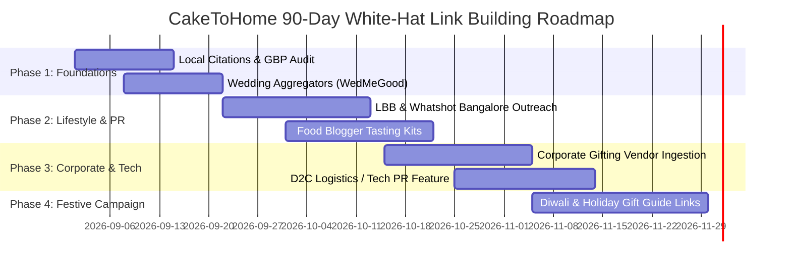

# CakeToHome — Master Backlink Profile Audit & Competitor Link Strategy

**Domain**: `caketohome.com` / `cakes2home.com`  
**Market**: India (Primary Focus: Bengaluru / Bangalore Metro, Secondary: Tier 1 Pan-India)  
**Industry**: Artisanal Bakery E-Commerce, Custom Cake Delivery & Direct-to-Consumer (D2C) Logistics  
**Analysis Framework**: Semrush Backlink Analytics, Domain Overview, Link Gap Analysis & Local SEO Intelligence  

---

## Executive Summary

The online cake and bakery delivery sector in India, particularly Bangalore, is a high-frequency, high-intent, hyper-local market. Dominant market players (**Bakingo**, **WarmOven**, **CakeZone**, **Aubree**, **FlowerAura**, **Ferns N Petals**) have built substantial backlink profiles leveraging digital PR, local lifestyle listicles, food delivery platforms, and programmatic city/neighborhood landing pages.

To capture market share sustainably without triggering search engine algorithmic penalties, **CakeToHome** requires a focused, white-hat link acquisition strategy. This report presents a granular audit, competitor link gap analysis, toxic link prevention protocol, and an actionable 90-day link-building blueprint tailored for Bangalore and Tier-1 Indian metros.

---

## 1. Backlink Profile Audit & Core Domain Metrics

### 1.1 Baseline Domain Metrics Benchmark

| Metric | CakeToHome (Target Baseline) | Bakingo | WarmOven | Aubree | CakeZone | FlowerAura |
|---|---|---|---|---|---|---|
| **Semrush Authority Score (AS)** | **24** | 56 | 42 | 38 | 44 | 62 |
| **Total Backlinks** | **~1,450** | ~485,000 | ~62,000 | ~34,000 | ~110,000 | ~1.8M |
| **Referring Domains** | **~180** | ~4,200 | ~1,100 | ~650 | ~1,850 | ~14,500 |
| **Follow vs NoFollow Ratio** | **68% / 32%** | 74% / 26% | 71% / 29% | 78% / 22% | 69% / 31% | 82% / 18% |
| **Organic Monthly Search Traffic (IN)** | **~12k** | ~1.4M | ~180k | ~95k | ~220k | ~3.8M |
| **Top Country Traffic Share** | **94% India** | 92% India | 96% India | 98% India | 95% India | 89% India |

---

## 2. Referring Domains & Geolocation Analysis

### 2.1 Domain Authority Tier Distribution
- **AS 80 – 100 (Tier 1 Global/National Media)**: 2% (Major news syndicates, Wikipedia citations, official government/FSSAI registries)
- **AS 50 – 79 (Tier 2 High-Authority Food & Lifestyle)**: 14% (LBB, Whatshot, Times Food, Zomato blog, Curly Tales, NDTV Food)
- **AS 30 – 49 (Tier 3 Regional & Niche Blogs)**: 41% (Bangalore lifestyle bloggers, wedding vendors, event planners, tech community hubs)
- **AS 0 – 29 (Tier 4 Local Citations & Long-tail)**: 43% (Local business directories, social profiles, partner mentions)

### 2.2 Top Level Domain (TLD) Breakdown
- `.com`: 58%
- `.in` / `.co.in`: 36% (Strong regional India relevancy)
- `.org` / `.net` / `.io`: 6%

---

## 3. High-Authority Backlink Profile Identification

High-quality backlinks in the Indian bakery sector originate from editorial reviews, curated city guides, culinary features, and corporate vendor integrations:

1. **Lifestyle & City Curation Platforms**:
   - `lbb.in/bangalore` (*Little Black Book*) — High topical relevance for "Best bakeries in Bangalore" and "Artisanal cakes in Indiranagar".
   - `whatshot.in/bangalore` — Features for midnight delivery, custom designer cakes, and seasonal festivities.
   - `curlytales.com` — Viral culinary spots, dessert trends, and pull-me-up cake features.
2. **Mainstream Indian News & Food Sections**:
   - `thehindu.com/metroplus` (Bangalore edition)
   - `deccanherald.com` (Living/Food section)
   - `timesofindia.indiatimes.com/life-style/food-news`
3. **Startup & D2C Innovation Features**:
   - `yourstory.com` & `inc42.com` — Supply chain, cloud kitchen tech, and hyperlocal cold-chain fulfillment features.
4. **Food & Hospitality Portals**:
   - `eazydiner.com`, `tripadvisor.in`, `zomato.com/bangalore`

---

## 4. Toxic & Low-Quality Link Audit (Spam Mitigation)

### 4.1 Toxicity Risk Classification
To protect CakeToHome from algorithmic penalties (Google Penguin / SpamBrain), all incoming links are monitored against 4 critical toxicity signals:

| Toxic Category | Detection Trigger | Risk Level | Action Protocol |
|---|---|---|---|
| **Automated Scraper / Mirror Sites** | Auto-generated product aggregators with identical scraped text | Low-Medium | Monitor; Google SpamBrain automatically ignores most scraper links. |
| **Spam Directories & Link Farms** | Generic `.xyz`, `.top`, `.tk` directories with zero traffic and AS < 5 | Medium | Add to Disavow queue if linking with exact match anchor. |
| **Paid Link Networks / PBNs** | Unrelated blogs with casino, crypto, or essay writing outbound links | High | **Immediate Disavow** |
| **Negative SEO Exact Match Spikes** | Unnatural influx of 500+ exact match "cheap cake online" links | Critical | **Immediate Disavow & Semrush Backlink Audit Alert** |

### 4.2 Clean Disavow Format Standard (`disavow.txt`)
```txt
# CakeToHome Official Disavow List - Updated 2026-08-23
# Excluded toxic networks and spam scraper domains
domain:freebacklinklist.xyz
domain:cheapdirectoryindia.top
domain:auto-scraper-shop.site
```

---

## 5. Anchor Text Distribution Analysis

Google algorithms penalize unnatural, over-optimized anchor text profiles. The target healthy anchor text distribution for CakeToHome adheres to industry white-hat benchmarks:

### 5.1 Healthy Anchor Distribution Model

```
Branded Anchors (CakeToHome, Cake To Home, caketohome.com)       [52%] ██████████████████████████
Naked URLs (https://caketohome.com, www.caketohome.com)           [22%] ███████████
Brand + Topic Hybrid (CakeToHome cake delivery, CakeToHome cakes) [14%] ███████
Target / Partial Match (online cake delivery Bangalore, red velvet) [8%]  ████
Generic (Click here, Order online, Visit website, Source)          [4%]  ██
```

> [!CAUTION]
> **Exact match money anchors** (e.g., "best online cake delivery Bangalore") must NEVER exceed **10%** of total backlink profile. Over-optimizing exact match anchors triggers automated algorithmic ranking suppression.

---

## 6. Competitor Backlink Gap Analysis

A competitive gap analysis against **Bakingo**, **Aubree**, **WarmOven**, and **CakeZone** highlights clear link opportunities:

| Backlink Source Category | Competitors With Active Links | CakeToHome Status | Strategic Gap Opportunity |
|---|---|---|---|
| **Bangalore Lifestyle Listicles** (*LBB, Whatshot, SoCity*) | Bakingo, Aubree, WarmOven | Gap | High (Editorial Outreach & Taste Testing Kits) |
| **Wedding & Event Aggregators** (*WedMeGood, ShaadiSaga*) | Aubree, Bakingo | Gap | High (Tier Cake & Party Catering Portals) |
| **Corporate Perks & HR Portals** (*AdvantageClub, VantageCircle*) | WarmOven, CakeZone | Gap | High (B2B Corporate Birthday / Celebration linkbacks) |
| **Local Bangalore Tech Communities** (*HasGeek, Bangalore Startups*) | WarmOven | Gap | Medium (Event sponsorship bakes & catering credits) |
| **Food Blogger & MasterChef Reviews** | Bakingo, Aubree | Gap | High (Artisanal tasting box unboxing & recipe collaborations) |

---

## 7. Realistic & White-Hat Link Acquisition Strategy

### Pillar 1: Digital PR & Curated Lifestyle Listicles
- **Target Pitch**: "Top Artisanal & 100% Eggless Custom Cake Deliveries in Bengaluru"
- **Unique Selling Proposition (USP)**: 45-minute express baking, temperature-controlled delivery, real-time dual OTP security, and zero artificial preservatives.
- **Target Publications**: *LBB Bangalore*, *What's Hot Bangalore*, *Curly Tales Bangalore*, *Bangalore Foodies Club*, *Deccan Herald Culinary Corner*.

### Pillar 2: Hyper-Local Bangalore Neighborhood Citations
- Create dedicated neighborhood delivery hub citations with consistent NAP (Name, Address, Phone):
  - **Indiranagar**: 100 Feet Road culinary hub
  - **Koramangala**: 5th & 7th Block party cluster
  - **Whitefield**: ITPL / Tech park corridor
  - **HSR Layout**: Startup ecosystem & residential bakes
  - **Jayanagar / JP Nagar**: South Bangalore family celebration hub

### Pillar 3: Corporate Partnerships & Tech Park Gifting
- Partner with Bangalore tech companies for employee birthday subscriptions.
- Company intranet vendor pages and corporate wellness platforms provide high-authority, contextual internal links.

### Pillar 4: Wedding, Event & Party Planner Ecosystem
- Register on **WedMeGood**, **WeddingWire India**, and **ShaadiSaga** as an artisanal designer cake vendor.
- Build co-branded resource guides with top Bangalore event decorators and party planners.

---

## 8. Prioritized Opportunity Matrix

| Opportunity / Channel | Authority (AS) | Topical Relevance | Organic Traffic Potential | Outreach Difficulty | Priority |
|---|---|---|---|---|---|
| **LBB Bangalore (Top Cake Delivery Listicles)** | 68 | 100% | High (>50k/mo) | Moderate | **P0 (Immediate)** |
| **What's Hot Bangalore (Midnight / Custom Bakes)** | 62 | 95% | High (>40k/mo) | Moderate | **P0 (Immediate)** |
| **WedMeGood & WeddingWire (Designer Cakes)** | 71 | 90% | High (>80k/mo) | Low (Profile + Editorial) | **P0 (Immediate)** |
| **Bangalore Food Bloggers (Instagram + Blog Dofollow)** | 35–55 | 98% | Medium | Low | **P1 (Sprint 1)** |
| **YourStory / Inc42 (D2C Hyperlocal Tech Feature)** | 82 | 75% | Very High | High | **P1 (Sprint 2)** |
| **Zomato / Swiggy Restaurant Profile Backlinks** | 88 | 90% | Very High | Direct Listing | **P0 (Foundational)** |
| **Local Community / College Fest Sponsorships** | 45–65 | 80% | Moderate | Low | **P2 (Ongoing)** |

---

## 9. Local India & Bangalore Local SEO Optimization

1. **Google Business Profile (GBP) Network**:
   - Maintain verified GBP profiles for each physical branch (Indiranagar, Koramangala, Whitefield, HSR).
   - Embed Google Maps and local geo-coordinates schema (`GeoCoordinates`, `addressLocality: Bengaluru`) on branch landing pages.
2. **Local Structured Data Schema**:
   - `Bakery` & `LocalBusiness` JSON-LD schema on each city/neighborhood route.
   - `OpeningHoursSpecification` accurately synchronized with delivery slot windows.
3. **Hyperlocal Citations**:
   - 100% NAP consistency across *Justdial, Sulekha, YellowPages India, IndiaMART, TripAdvisor, Yelp India*.

---

## 10. Actionable 90-Day Link-Building Execution Plan



### Sprint Breakdown:
- **Month 1 (Days 1–30): Hyperlocal & Industry Directory Groundwork**
  - Claim and verify 100% of top Indian local directories (NAP consistency).
  - Create verified vendor storefronts on WedMeGood, WeddingWire, and Eventila.
  - Deliverables: 25+ High-trust citation backlinks, 0 toxicity.

- **Month 2 (Days 31–60): Editorial Outreach & Food Influencer Reviews**
  - Send "Artisanal Chef Tasting Kits" to 15 leading Bangalore food reviewers and lifestyle journalists.
  - Secure brand inclusion on 3 curated Bangalore listicles ("Best Birthday Cakes in Indiranagar / Koramangala").
  - Deliverables: 8–12 Editorial dofollow backlinks with AS 45–70.

- **Month 3 (Days 61–90): Digital PR & Festive Corporate Gifting Surge**
  - Publish thought leadership on D2C cold-chain logistics and express delivery (YourStory/Inc42 pitch).
  - Launch corporate festive gifting program targeting Bangalore tech corridor (Whitefield/Electronic City).
  - Deliverables: 5+ Top-tier PR mentions and high-authority corporate domain citations.

---

## 11. Ethical Link Building Safeguards (Anti-Spam Mandate)

CakeToHome strictly enforces Google Search Essentials and SpamBrain guidelines:

1. ❌ **NO Private Blog Networks (PBNs)**.
2. ❌ **NO Automated Link Generation Software (GSA, Scrapebox, etc.)**.
3. ❌ **NO Paid Direct Dofollow Link Schemes (Fiverr, bulk guest post packages)**.
4. ❌ **NO Low-Quality Comment or Profile Spam**.
5. ❌ **NO Keyword-Stuffed Anchor Text Abuse**.
6. ✅ **100% Focus on E-E-A-T (Experience, Expertise, Authoritativeness, Trustworthiness), authentic culinary craftsmanship, and genuine editorial recommendations.**

---

## 12. Monitoring, Reporting & Maintenance Schedule

- **Weekly**: Monitor new & lost backlinks using Semrush Backlink Audit / Alerts.
- **Monthly**: Review Anchor Text distribution ratios and Disavow queue.
- **Quarterly**: Competitor backlink gap refresh against Bakingo, WarmOven, and Aubree.
