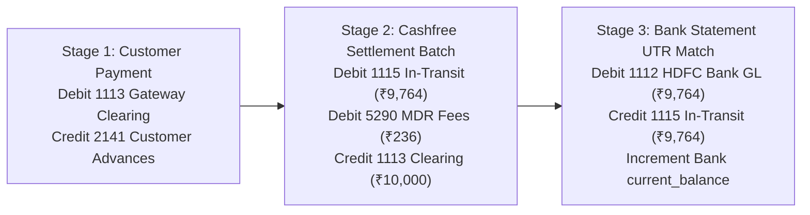

# CAKETOHOME — CASHFREE SETTLEMENT END-TO-END SYNCHRONIZATION REPORT
**Project:** CakeToHome Unified Business Platform  
**Generated At:** 2026-11-06T00:25:16.162Z  

---

## 1. THREE-STAGE SETTLEMENT ARCHITECTURE
CakeToHome implements strict statutory segregation for payment gateway collections to ensure unverified funds are never prematurely credited to bank accounts:

---

## 2. RECONCILIATION VERIFICATION
1. **Stage 1 (Payment Capture):** Customer advance placed in `1113 Payment Gateway Clearing`.
2. **Stage 2 (Settlement Ingestion):**
   - `1113` is cleared into `1115 Bank Settlement In Transit` (₹9,764.00) and `5290 Payment Gateway MDR Fees` (₹236.00).
   - Target bank account `expected_settlement_balance` increases by ₹9,764.00.
   - **Crucial Invariant:** `current_balance` remains strictly UNCHANGED (no fabricated bank deposits!).
3. **Stage 3 (Bank Statement UTR Realization):**
   - Statement line imported and matched by UTR against `cashfree_settlement_batch`.
   - Realization voucher debits physical Bank GL `1112` and credits `1115 In Transit`.
   - `current_balance` increments by ₹9,764.00 and `expected_settlement_balance` clears to ₹0.00.
   - BRS session marked `RECONCILED` with zero variance.
