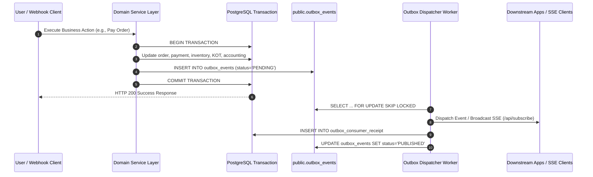

# CAKETOHOME — CROSS-APPLICATION EVENT ARCHITECTURE REPORT
**Project:** CakeToHome Unified Business Platform  
**Generated At:** 2026-11-06T00:25:16.162Z  

---

## 1. TRANSACTIONAL OUTBOX ENGINE
The CakeToHome Event Architecture utilizes the **Transactional Outbox Pattern** to ensure absolute consistency between database state changes and downstream notifications.

---

## 2. EVENT SCHEMAS & CANONICAL TAXONOMY
Every event published to `public.outbox_events` adheres to the following canonical contract:

| Field | Type | Description |
| :--- | :--- | :--- |
| `event_id` | TEXT UNIQUE | Unique event identifier (`evt_<timestamp>_<rand>`) |
| `correlation_id` | TEXT | Business transaction correlation ID across services |
| `aggregate_type` | TEXT | `ORDER`, `PAYMENT`, `INVENTORY`, `BANK_ACCOUNT`, `INVOICE`, etc. |
| `aggregate_id` | TEXT | Primary key of the modified aggregate root |
| `event_type` | TEXT | Dot-separated action name (e.g., `order.confirmed`, `payment.captured`) |
| `branch_id` | TEXT NULL | Branch tenant ID for operational partitioning |
| `role_visibility`| TEXT[] | RBAC visibility whitelist (e.g. `['SUPER_ADMIN', 'ADMIN']`) |
| `payload` | JSONB | Complete domain delta payload |
| `status` | TEXT | `PENDING`, `PROCESSING`, `PUBLISHED`, `DEAD_LETTER` |
| `retry_count` | INT | Current delivery attempt count (max 5) |

---

## 3. REAL-TIME SERVER-SENT EVENTS (SSE) STREAMING
The Next.js API Gateway provides authenticated, role-scoped SSE streaming:
- **Endpoint:** `/api/subscribe` (and `/api/v1/events/stream`)
- **Protocol:** `text/event-stream`, `Cache-Control: no-cache`, `Connection: keep-alive`
- **Tenant & Role Filtering:**
  - Customers receive exclusively events where `payload.customer_id === user.customerId`. Internal banking, ledger, and kitchen events are strictly filtered out (0 leakage).
  - Branch Managers receive only events scoped to their assigned `branch_id`.
  - Super Admins receive full enterprise visibility.
